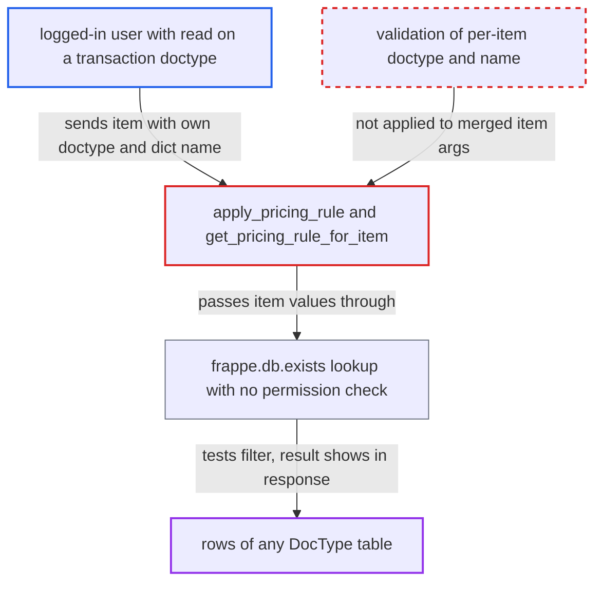

# apply_pricing_rule lets item-level doctype and filter dict drive frappe.db.exists, a blind data oracle

| Field | Value |
|---|---|
| ID | `find_014TvGyrVdGSSY8vFWr9Ew7b` |
| Severity | **High** |
| Status | open |
| CWE | CWE-943 — Query logic injection |
| Created | 2026-10-27T21:28:37.270124Z |
| Claude Security | https://claude.ai/security/findings/find_014TvGyrVdGSSY8vFWr9Ew7b |

## Description

A logged-in user with read access to one allowed transaction doctype, such as a Sales User on Quotation, can learn whether any row matching a filter exists in any DocType table. This ignores role permissions, User Permissions and Company Restriction. Repeated probes extract values character by character. The cause is `apply_pricing_rule`, which validates only the top-level args. Per-item `doctype` and `name` then reach `frappe.db.exists` unchecked.

1. **attacker** posts to the `apply_pricing_rule` endpoint with a harmless top-level `doctype`. The top-level `doctype` is an allow-listed transaction doctype such as `Quotation`, so `validate_pricing_context` passes. ([`erpnext/accounts/doctype/pricing_rule/pricing_rule.py:766-781`](https://github.com/cx-benchmark/erpnext/blob/90e7aefca73da3c440d2e8da7472fcb67838e678/erpnext/accounts/doctype/pricing_rule/pricing_rule.py#L766-L781))
2. **attacker** adds an item with its own `doctype`, a dict `name` holding a filter, and `pricing_rules` set to `"[]"`. The item has no `item_code`, or has `ignore_pricing_rule` set, so it will reach the existence lookup. ([`erpnext/accounts/doctype/pricing_rule/pricing_rule.py:386-418`](https://github.com/cx-benchmark/erpnext/blob/90e7aefca73da3c440d2e8da7472fcb67838e678/erpnext/accounts/doctype/pricing_rule/pricing_rule.py#L386-L418))
3. **`apply_pricing_rule`** merges each item over a copy of the args with `args_copy.update(item)`. The item's `doctype` and `name` replace the validated values, and the merged args are never validated again. ([`erpnext/accounts/doctype/pricing_rule/pricing_rule.py:386-418`](https://github.com/cx-benchmark/erpnext/blob/90e7aefca73da3c440d2e8da7472fcb67838e678/erpnext/accounts/doctype/pricing_rule/pricing_rule.py#L386-L418))
4. **`get_pricing_rule_for_item`** calls `frappe.db.exists(args.doctype, args.name)` with the item's values. The pinned Frappe treats a dict `name` as a filter set with operators such as `like`, `>` and `between`, and the lookup runs with no permission check. ([`erpnext/accounts/doctype/pricing_rule/pricing_rule.py:462-468`](https://github.com/cx-benchmark/erpnext/blob/90e7aefca73da3c440d2e8da7472fcb67838e678/erpnext/accounts/doctype/pricing_rule/pricing_rule.py#L462-L468))
5. **`remove_pricing_rule_for_item`** sets `pricing_rules` to an empty string and `pricing_rule_removed` to `True` in the returned row, but only if the lookup matched. When nothing matches, those keys are absent, so the response answers yes or no for the attacker's filter. ([`erpnext/accounts/doctype/pricing_rule/pricing_rule.py:741-746`](https://github.com/cx-benchmark/erpnext/blob/90e7aefca73da3c440d2e8da7472fcb67838e678/erpnext/accounts/doctype/pricing_rule/pricing_rule.py#L741-L746))
6. **attacker** repeats the request with refined filters. Each request is one yes or no answer, so values can be read one character at a time.

## Assessment

Any logged-in user with read on one allow-listed transaction doctype can attack, for example a Sales User on Quotation. No victim is involved. The attacker sends a POST to `/api/method/erpnext.accounts.doctype.pricing_rule.pricing_rule.apply_pricing_rule` with an item such as `{"doctype":"Bank Account","name":{"company":"OtherCo","bank_account_no":["like","12%"]},"pricing_rules":"[]"}`. A second way in is `get_item_details`, which reaches the same `frappe.db.exists` call at `get_item_details.py:196`. There `ctx.doctype` is allow-listed, but `ctx.name` may be a dict. A narrower form exists in the whitelisted `remove_pricing_rule_for_item`, which has no permission check. It sends each JSON entry of `pricing_rules` to `frappe.db.exists("Pricing Rule", d)` and `frappe.get_cached_doc`. A dict entry therefore picks a Pricing Rule by filter, and the returned keys reveal its discount type, free item and applied items.

Impact: The attacker gets a blind read of any column in any DocType table, with no role permission, User Permission or company restriction applied. This includes other companies' customers, suppliers, invoice totals, bank account numbers, contact details, communications and pricing-rule structures. Password fields in `__Auth` are out of reach. There is no write effect and no availability effect.

## Recommendation

(1) `get_pricing_rule_for_item` runs `frappe.db.exists` with a `doctype` and `name` taken from the caller's per-item data. These values are not validated after `validate_pricing_context`, and the result changes the response.

Fix criteria: `frappe.db.exists` only runs against the allow-listed transaction doctype validated for the request, with a string docname. A non-string `name` or a non-allow-listed item `doctype` is rejected. Items cannot override `doctype` or `name`, or the context validation is re-run on the merged per-item args. Sending the request from the assessment gives a response that does not differ based on whether an arbitrary table or filter matches.

(2) `remove_pricing_rule_for_item` and `remove_pricing_rules` accept arbitrary JSON values in `pricing_rules` and pass them as the name to `frappe.db.exists` and `frappe.get_cached_doc` on Pricing Rule, with no permission check. Dict entries act as filters and leak rule configuration.

Fix criteria: Only string Pricing Rule names reach the lookups, and non-string entries are dropped or rejected. The endpoint requires read permission on Pricing Rule or on the transaction being edited. A dict entry in `pricing_rules` is refused. The returned `item_details` keys no longer depend on whether a filter over `tabPricing Rule` matches.

## Evidence

**https://github.com/cx-benchmark/erpnext**

- [`erpnext/accounts/doctype/pricing_rule/pricing_rule.py:462-468`](https://github.com/cx-benchmark/erpnext/blob/90e7aefca73da3c440d2e8da7472fcb67838e678/erpnext/accounts/doctype/pricing_rule/pricing_rule.py#L462-L468)
- [`erpnext/accounts/doctype/pricing_rule/pricing_rule.py:386-418`](https://github.com/cx-benchmark/erpnext/blob/90e7aefca73da3c440d2e8da7472fcb67838e678/erpnext/accounts/doctype/pricing_rule/pricing_rule.py#L386-L418)
- [`erpnext/accounts/doctype/pricing_rule/pricing_rule.py:766-781`](https://github.com/cx-benchmark/erpnext/blob/90e7aefca73da3c440d2e8da7472fcb67838e678/erpnext/accounts/doctype/pricing_rule/pricing_rule.py#L766-L781)
- [`erpnext/accounts/doctype/pricing_rule/pricing_rule.py:741-746`](https://github.com/cx-benchmark/erpnext/blob/90e7aefca73da3c440d2e8da7472fcb67838e678/erpnext/accounts/doctype/pricing_rule/pricing_rule.py#L741-L746)
- [`erpnext/accounts/doctype/pricing_rule/pricing_rule.py:698-745`](https://github.com/cx-benchmark/erpnext/blob/90e7aefca73da3c440d2e8da7472fcb67838e678/erpnext/accounts/doctype/pricing_rule/pricing_rule.py#L698-L745)
- [`erpnext/setup/doctype/company/company.py:353`](https://github.com/cx-benchmark/erpnext/blob/90e7aefca73da3c440d2e8da7472fcb67838e678/erpnext/setup/doctype/company/company.py#L353)

