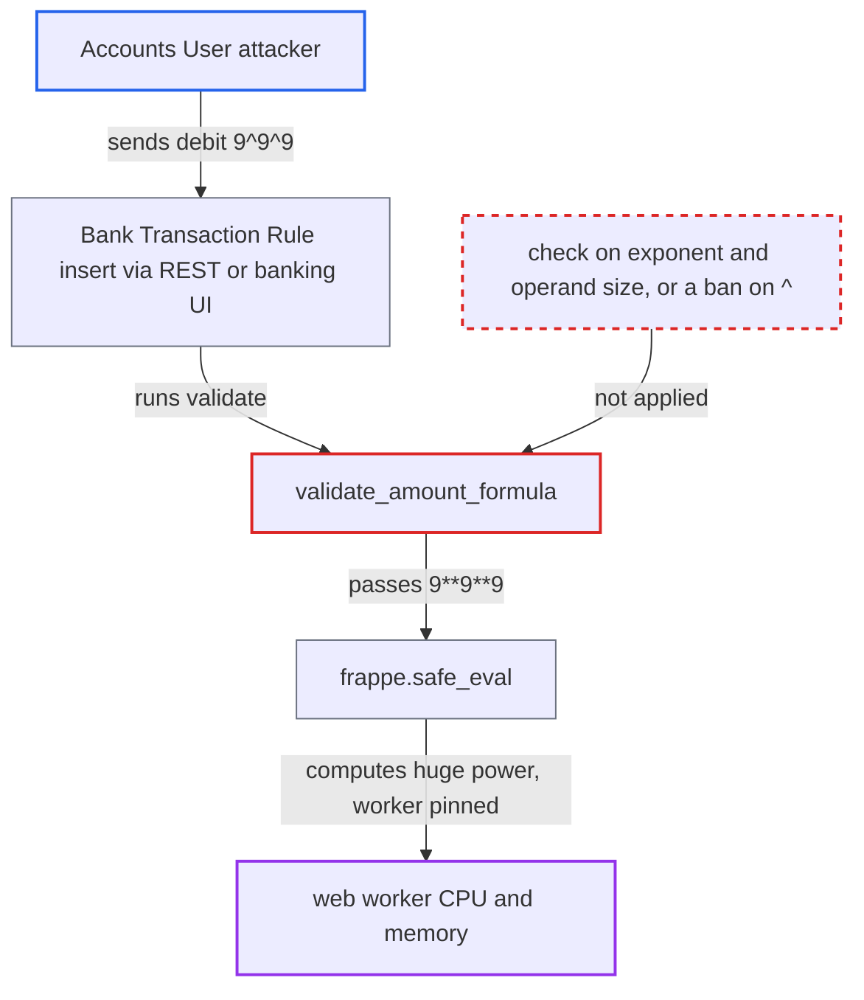

# Bank Transaction Rule formula validation evaluates unbounded exponentiation, hanging web workers

| Field | Value |
|---|---|
| ID | `find_01CDbKQp7TrrYRqqdHVsyVXk` |
| Severity | **High** |
| Status | open |
| CWE | CWE-400 — Uncontrolled Resource Consumption |
| Created | 2026-10-27T21:19:05.176764Z |
| Claude Security | https://claude.ai/security/findings/find_01CDbKQp7TrrYRqqdHVsyVXk |

## Description

A logged-in user with the `Accounts User` role can hang the site's web workers by saving a Bank Transaction Rule with a formula such as `9^9^9`. Each request ties up one worker's CPU and memory until the worker timeout kills it, and enough repeated requests make the site unresponsive for everyone. The cause is `validate_amount_formula`, which checks for `**` before rewriting `^` to `**` and then evaluates the result with no size or time limit.

1. **attacker with the `Accounts User` role** sends a create request for a Bank Transaction Rule. The request uses `classify_as=Bank Entry`, `bank_entry_type=Multiple Accounts` and two `accounts` rows naming existing accounts. The first row has `debit` set to `9^9^9`, a free-text field. ([`erpnext/accounts/doctype/bank_transaction_rule_accounts/bank_transaction_rule_accounts.json:37-46`](https://github.com/cx-benchmark/erpnext/blob/90e7aefca73da3c440d2e8da7472fcb67838e678/erpnext/accounts/doctype/bank_transaction_rule_accounts/bank_transaction_rule_accounts.json#L37-L46))
2. **the `validate` method of `BankTransactionRule`** calls `validate_amount_formula` on the `debit` and `credit` of each non-last `accounts` row. This runs on every insert or save, before the mandatory and company-match checks, so the request does not need to be valid otherwise. ([`erpnext/accounts/doctype/bank_transaction_rule/bank_transaction_rule.py:116-135`](https://github.com/cx-benchmark/erpnext/blob/90e7aefca73da3c440d2e8da7472fcb67838e678/erpnext/accounts/doctype/bank_transaction_rule/bank_transaction_rule.py#L116-L135))
3. **the token check** lets `^` and unbounded integer literals through. `ALLOWED_FORMULA_TOKEN` includes `^`, and `_is_expr_eval_formula` checks only the character set and balanced parentheses. ([`erpnext/accounts/doctype/bank_transaction_rule/bank_transaction_rule.py:12-26`](https://github.com/cx-benchmark/erpnext/blob/90e7aefca73da3c440d2e8da7472fcb67838e678/erpnext/accounts/doctype/bank_transaction_rule/bank_transaction_rule.py#L12-L26))
4. **`validate_amount_formula`** rewrites `^` to `**` after the `**` and `//` substring check has already run. The check sees `9^9^9` and finds nothing to reject. The rewrite then produces `9**9**9`, which is `9**387420489`. ([`erpnext/accounts/doctype/bank_transaction_rule/bank_transaction_rule.py:33-52`](https://github.com/cx-benchmark/erpnext/blob/90e7aefca73da3c440d2e8da7472fcb67838e678/erpnext/accounts/doctype/bank_transaction_rule/bank_transaction_rule.py#L33-L52))
5. **`frappe.safe_eval`** evaluates the formula with no time or size limit. CPython does not fold such a large power at compile time, so it is computed at evaluation time. This produces an integer of about 370 million digits and keeps the worker busy for minutes until the gunicorn timeout kills it. ([`erpnext/accounts/doctype/financial_report_template/financial_report_validation.py:36-37`](https://github.com/cx-benchmark/erpnext/blob/90e7aefca73da3c440d2e8da7472fcb67838e678/erpnext/accounts/doctype/financial_report_template/financial_report_validation.py#L36-L37))

## Assessment

The attacker must be an authenticated user with the `Accounts User` role, which has create and write rights on `Bank Transaction Rule`. They can send the standard REST insert to `/api/resource/Bank Transaction Rule`, the same request the banking UI makes with `createDoc`. No victim action is needed. Repeating one request per worker keeps the site unresponsive. The report assumes `frappe.safe_eval` in the pinned Frappe (`frappe >=17.0.0-dev,<18.0.0`) only compiles with RestrictedPython and checks for `NamedExpr`, with no time or size limit.

Impact: One request pins one web worker until the gunicorn timeout, and the request fails only after that. A handful of concurrent, repeated requests occupy every worker, so the site stops serving all users while the attack continues. No data is read or changed.

## Recommendation

Formulas are evaluated server-side with Python big-integer semantics after `^` is turned into `**`. Nothing limits exponentiation, operand size or evaluation time, so one validation request can use unbounded CPU and memory.

Fix criteria: Formula validation finishes in bounded time for any input the tokenizer accepts. Either exponentiation is rejected outright, by dropping `^` from the allowed tokens and removing the `^` to `**` rewrite, or validation uses a non-evaluating parser or a restricted evaluator with float semantics and small operand limits. Saving a rule with `debit="9^9^9^9"` returns a validation error promptly, with no measurable CPU or memory growth.

## Evidence

**https://github.com/cx-benchmark/erpnext**

- [`erpnext/accounts/doctype/bank_transaction_rule/bank_transaction_rule.py:33-52`](https://github.com/cx-benchmark/erpnext/blob/90e7aefca73da3c440d2e8da7472fcb67838e678/erpnext/accounts/doctype/bank_transaction_rule/bank_transaction_rule.py#L33-L52)
- [`erpnext/accounts/doctype/bank_transaction_rule/bank_transaction_rule.py:12-26`](https://github.com/cx-benchmark/erpnext/blob/90e7aefca73da3c440d2e8da7472fcb67838e678/erpnext/accounts/doctype/bank_transaction_rule/bank_transaction_rule.py#L12-L26)
- [`erpnext/accounts/doctype/bank_transaction_rule/bank_transaction_rule.py:116-135`](https://github.com/cx-benchmark/erpnext/blob/90e7aefca73da3c440d2e8da7472fcb67838e678/erpnext/accounts/doctype/bank_transaction_rule/bank_transaction_rule.py#L116-L135)
- [`erpnext/accounts/doctype/bank_transaction_rule/bank_transaction_rule.json:152-189`](https://github.com/cx-benchmark/erpnext/blob/90e7aefca73da3c440d2e8da7472fcb67838e678/erpnext/accounts/doctype/bank_transaction_rule/bank_transaction_rule.json#L152-L189)
- [`erpnext/accounts/doctype/bank_transaction_rule_accounts/bank_transaction_rule_accounts.json:37-46`](https://github.com/cx-benchmark/erpnext/blob/90e7aefca73da3c440d2e8da7472fcb67838e678/erpnext/accounts/doctype/bank_transaction_rule_accounts/bank_transaction_rule_accounts.json#L37-L46)
- [`banking/src/components/features/BankReconciliation/Rules/CreateNewRule.tsx:39`](https://github.com/cx-benchmark/erpnext/blob/90e7aefca73da3c440d2e8da7472fcb67838e678/banking/src/components/features/BankReconciliation/Rules/CreateNewRule.tsx#L39)
- [`erpnext/accounts/doctype/financial_report_template/financial_report_validation.py:36-37`](https://github.com/cx-benchmark/erpnext/blob/90e7aefca73da3c440d2e8da7472fcb67838e678/erpnext/accounts/doctype/financial_report_template/financial_report_validation.py#L36-L37)

