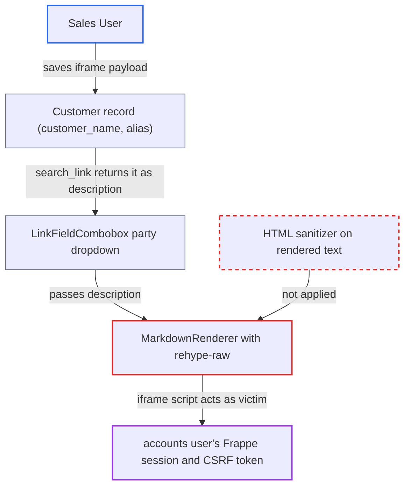

# Banking SPA renders link-search descriptions as live HTML via unsanitized rehype-raw

| Field | Value |
|---|---|
| ID | `find_01Xadcx2tV1Zq5AiNPS6vvNt` |
| Severity | **High** |
| Status | open |
| CWE | CWE-79 — Cross-site scripting |
| Created | 2026-10-27T21:31:15.720554Z |
| Claude Security | https://claude.ai/security/findings/find_01Xadcx2tV1Zq5AiNPS6vvNt |

## Description

A Sales User can run script in an accounts user's browser, with that user's full Frappe session, by saving a crafted Customer. It fires when the victim opens the party dropdown in Record Payment on `/banking`. The shared `MarkdownRenderer` uses `rehype-raw` with no sanitizer, so raw HTML in server-supplied text becomes live elements.

1. **Sales User** saves a Customer whose text fields hold an iframe payload. `customer_name` is `"<iframe srcdoc=''>"`, or the tag is split between `customer_name` and `alias`. Sales User has create and write on Customer, and both fields are free-text Data fields. ([`erpnext/selling/doctype/customer/customer.json:822-831`](https://github.com/cx-benchmark/erpnext/blob/90e7aefca73da3c440d2e8da7472fcb67838e678/erpnext/selling/doctype/customer/customer.json#L822-L831))
2. **accounts user** opens Record Payment on a deposit and opens the party dropdown. For a deposit the party type defaults to `Customer`, and the party picker searches that doctype. ([`banking/src/components/features/BankReconciliation/RecordPaymentModalContent.tsx:272`](https://github.com/cx-benchmark/erpnext/blob/90e7aefca73da3c440d2e8da7472fcb67838e678/banking/src/components/features/BankReconciliation/RecordPaymentModalContent.tsx#L272))
3. **the combobox in `LinkFieldCombobox.tsx`** calls `frappe.desk.search.search_link` for the party doctype. An empty search sorts by `creation` descending, so the new customer is listed as soon as the picker opens. ([`banking/src/components/common/LinkFieldCombobox.tsx:165-173`](https://github.com/cx-benchmark/erpnext/blob/90e7aefca73da3c440d2e8da7472fcb67838e678/banking/src/components/common/LinkFieldCombobox.tsx#L165-L173))
4. **Frappe search service** returns a `description` built from the customer's fields. The description joins `customer_name`, `customer_group`, `territory`, `mobile_no`, `primary_address` and `alias` with `, `. In the split case this join forms a complete tag whose quoted `srcdoc` spans the commas. ([`erpnext/selling/doctype/customer/customer.json:945-950`](https://github.com/cx-benchmark/erpnext/blob/90e7aefca73da3c440d2e8da7472fcb67838e678/erpnext/selling/doctype/customer/customer.json#L945-L950))
5. **`LinkFieldCombobox`** passes `result.description` to `MarkdownRenderer`. The description is rendered as markdown with no output encoding of its own. ([`banking/src/components/common/LinkFieldCombobox.tsx:275-282`](https://github.com/cx-benchmark/erpnext/blob/90e7aefca73da3c440d2e8da7472fcb67838e678/banking/src/components/common/LinkFieldCombobox.tsx#L275-L282))
6. **`MarkdownRenderer`** turns the raw HTML into a real iframe element. `rehype-raw` creates the elements. `urlTransform` only rewrites URL attributes, and `srcdoc` is not one, so it is left untouched. ([`banking/src/components/ui/markdown.tsx:12-26`](https://github.com/cx-benchmark/erpnext/blob/90e7aefca73da3c440d2e8da7472fcb67838e678/banking/src/components/ui/markdown.tsx#L12-L26))
7. **the srcdoc script** runs in the site's origin and calls the API as the victim. The parent page exposes `window.csrf_token`, so the script reads it and sends state-changing requests. ([`banking/index.html:28`](https://github.com/cx-benchmark/erpnext/blob/90e7aefca73da3c440d2e8da7472fcb67838e678/banking/index.html#L28))

## Assessment

The attacker needs an account that can create or write Customer records; Sales User has this. The victim is an accounts user who uses `/banking`, opens Record Payment on a deposit and opens the party dropdown. No further action is needed. The report assumes Frappe's save-time filter (`sanitize_html`, not in this checkout) lets the payload through in two cases. One is when the value parses as JSON. The other is when no complete element is found in a single field. Other strings reach the same renderer. `Bank Account.account_name` is a Data field that Accounts User can write, and it is interpolated into markup in `BankTransactionList.tsx`. Bodies of `_server_messages` are rendered in `error-banner.tsx`. `BankClearanceSummary.tsx` and `BankReconciliationStatement.tsx` interpolate `bankAccount.account`, a document name where Frappe rejects `<` and `>`, so those two allow only markdown injection. Even without a filter bypass, a markdown link or image such as `[text](https://...)` contains no `<` and renders live in the dropdown.

Impact: The script runs in the site's origin with the victim's whole Frappe session, not only the banking app. It can read whatever the victim can read, such as bank transactions, balances and party data. It can call any whitelisted method with their CSRF token, for example `create_payment_entry_and_reconcile` or document writes in other modules. It can forge or mis-reconcile payments, and a victim with the Accounts Manager or System Manager role allows more. The report claims no availability impact.

## Recommendation

(1) `MarkdownRenderer` enables `rehype-raw` without a sanitizer. Field values written by other users (link descriptions, account names, server messages) are therefore turned into live HTML in the banking SPA.

Fix criteria: Untrusted strings produce no elements or attributes beyond a safe allow-list. No `iframe`, `srcdoc`, `style`, `link`, `meta`, `form`, `svg` or `object` survives, and URL attributes are limited to http(s). A Customer whose `customer_name` is `"<iframe srcdoc=''>"` shows as inert text in the Record Payment party dropdown. So does a Customer whose tag is split across `customer_name` and `alias`.

(2) Plain-text values are concatenated into markup strings in `BankTransactionList.tsx:246`, `BankClearanceSummary.tsx:206` and `BankReconciliationStatement.tsx:192`. These strings are then parsed as markdown or HTML instead of being rendered as React text nodes.

Fix criteria: Account names and dates are rendered as text nodes, not parsed as markup. A Bank Account whose `account_name` contains an HTML or markdown payload appears verbatim in the transaction-list banner.

## Evidence

**https://github.com/cx-benchmark/erpnext**

- [`banking/src/components/ui/markdown.tsx:12-26`](https://github.com/cx-benchmark/erpnext/blob/90e7aefca73da3c440d2e8da7472fcb67838e678/banking/src/components/ui/markdown.tsx#L12-L26)
- [`banking/src/components/common/LinkFieldCombobox.tsx:275-282`](https://github.com/cx-benchmark/erpnext/blob/90e7aefca73da3c440d2e8da7472fcb67838e678/banking/src/components/common/LinkFieldCombobox.tsx#L275-L282)
- [`banking/src/components/common/LinkFieldCombobox.tsx:165-173`](https://github.com/cx-benchmark/erpnext/blob/90e7aefca73da3c440d2e8da7472fcb67838e678/banking/src/components/common/LinkFieldCombobox.tsx#L165-L173)
- [`banking/src/components/features/BankReconciliation/RecordPaymentModalContent.tsx:560-569`](https://github.com/cx-benchmark/erpnext/blob/90e7aefca73da3c440d2e8da7472fcb67838e678/banking/src/components/features/BankReconciliation/RecordPaymentModalContent.tsx#L560-L569)
- [`banking/src/components/features/BankReconciliation/RecordPaymentModalContent.tsx:272`](https://github.com/cx-benchmark/erpnext/blob/90e7aefca73da3c440d2e8da7472fcb67838e678/banking/src/components/features/BankReconciliation/RecordPaymentModalContent.tsx#L272)
- [`erpnext/selling/doctype/customer/customer.json:945-950`](https://github.com/cx-benchmark/erpnext/blob/90e7aefca73da3c440d2e8da7472fcb67838e678/erpnext/selling/doctype/customer/customer.json#L945-L950)
- [`erpnext/selling/doctype/customer/customer.json:822-831`](https://github.com/cx-benchmark/erpnext/blob/90e7aefca73da3c440d2e8da7472fcb67838e678/erpnext/selling/doctype/customer/customer.json#L822-L831)
- [`banking/index.html:28`](https://github.com/cx-benchmark/erpnext/blob/90e7aefca73da3c440d2e8da7472fcb67838e678/banking/index.html#L28)
- [`banking/src/components/features/BankReconciliation/BankTransactionList.tsx:246-252`](https://github.com/cx-benchmark/erpnext/blob/90e7aefca73da3c440d2e8da7472fcb67838e678/banking/src/components/features/BankReconciliation/BankTransactionList.tsx#L246-L252)
- [`banking/src/components/ui/error-banner.tsx:43-45`](https://github.com/cx-benchmark/erpnext/blob/90e7aefca73da3c440d2e8da7472fcb67838e678/banking/src/components/ui/error-banner.tsx#L43-L45)
- [`banking/yarn.lock:3241-3244`](https://github.com/cx-benchmark/erpnext/blob/90e7aefca73da3c440d2e8da7472fcb67838e678/banking/yarn.lock#L3241-L3244)

