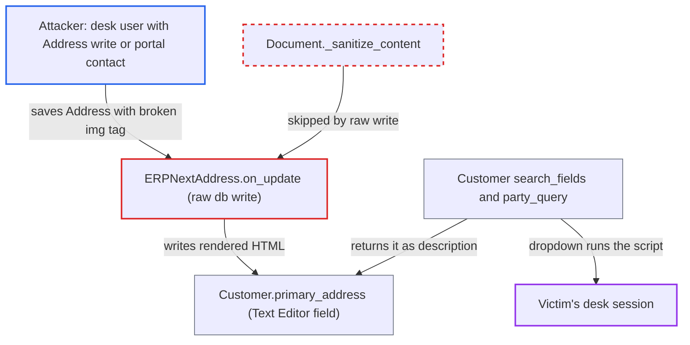

# Customer/Supplier primary_address written with db_set/set_value, bypassing save-time HTML sanitizer

| Field | Value |
|---|---|
| ID | `find_01MrgjchY7BQVjoKXAPgr5GC` |
| Severity | **High** |
| Status | open |
| CWE | CWE-79 — Cross-site scripting |
| Created | 2026-10-27T22:00:39.649900Z |
| Claude Security | https://claude.ai/security/findings/find_01MrgjchY7BQVjoKXAPgr5GC |

## Description

A low-privilege desk user or a portal customer contact can run script in the browser of a higher-privileged ERPNext user, such as an Accounts User or Manager, and act with that user's session. The attacker needs write access to an Address that is a Customer's primary address. The code at fault is `ERPNextAddress.on_update`, plus three similar paths, which store address HTML with `db_set` or `frappe.db.set_value` and skip save-time sanitizing. `primary_address` is then shown as HTML in Customer search dropdowns.

1. **Attacker** saves an Address with a broken tag in `address_line1`. The value is ``. The report assumes (for the pinned `frappe >=17.0.0-dev,<18`) that `frappe.utils.sanitize_html` leaves a value with no complete tag untouched, so it is stored as is.
2. **the hook `ERPNextAddress.on_update`** renders the Address Template and writes the result into `Customer.primary_address`. It does this for every Customer whose `customer_primary_address` is this Address, using `get_address_display` and `frappe.db.set_value`. The template adds ` `, which turns the broken tag into a live one. ([`erpnext/accounts/custom/address.py:41-56`](https://github.com/cx-benchmark/erpnext/blob/90e7aefca73da3c440d2e8da7472fcb67838e678/erpnext/accounts/custom/address.py#L41-L56))
3. **`frappe.db.set_value`** stores the HTML without sanitizing it. The write goes straight to SQL and never passes `Document._sanitize_content`, which is the only place Frappe cleans HTML in a Text Editor field. `update_modified=False` is used, so nothing shows in the Customer's timeline or Version history. ([`erpnext/accounts/custom/address.py:41-56`](https://github.com/cx-benchmark/erpnext/blob/90e7aefca73da3c440d2e8da7472fcb67838e678/erpnext/accounts/custom/address.py#L41-L56))
4. **Victim (for example an Accounts User or Manager)** types the customer's name into a Customer link field. `primary_address` is in the Customer `search_fields`, so the search returns it as the `description` of each suggestion. `party_query` does the same for the fields that use `erpnext.queries.customer`. ([`erpnext/selling/doctype/customer/customer.json:945`](https://github.com/cx-benchmark/erpnext/blob/90e7aefca73da3c440d2e8da7472fcb67838e678/erpnext/selling/doctype/customer/customer.json#L945))
5. **Victim's browser** renders the stored HTML in the dropdown and runs the attacker's script. The report assumes Frappe's `link.js` inserts `description` into the dropdown as HTML, and says the verifier should check this on the pinned Frappe. The script runs in the desk origin with the victim's session. ([`erpnext/selling/doctype/customer/customer.json:399-406`](https://github.com/cx-benchmark/erpnext/blob/90e7aefca73da3c440d2e8da7472fcb67838e678/erpnext/selling/doctype/customer/customer.json#L399-L406))

## Assessment

The attacker is a desk user with Address write permission (Sales User, Purchase User, Accounts User or Stock User, per Frappe's Address permissions) or a portal Customer contact using the `/address` web form. They must be able to edit an Address that is some Customer's `customer_primary_address`. Three other code paths make the same unsanitized write: `Customer.create_primary_address`, `Supplier.create_primary_address` and `PartyImportProvider._create_addresses`. The `on_update` hook is the easiest to reach. A victim then has to do a routine action: type the customer's name into any Customer link field, or open the Customer Report View column. The stored HTML is also rendered by any form where an administrator has unhidden the field, and by custom print formats or API consumers that treat Text Editor content as HTML. The Customer's own form is safe only because the field is hidden by default.

Impact: The attacker's script runs in the desk origin with the victim's session cookie and CSRF token. It can read any data and perform any action the victim's roles allow, including customers, pricing, GL, and submitting or cancelling financial documents. The report states nothing in the code limits what the script can do.

## Recommendation

(1) `ERPNextAddress.on_update`, `Customer.create_primary_address`, `Supplier.create_primary_address` and `PartyImportProvider._create_addresses` store `get_address_display()` output with `db_set` or `frappe.db.set_value`. This skips Frappe's save-time HTML sanitizing of Text Editor fields.

Fix criteria: Address HTML is sanitized (for example with `frappe.utils.sanitize_html`) or escaped before the raw write, at all four sites. Test: save an Address that is a Customer's primary address with `address_line1 = '<img src=x onerror=alert(1)//'`. The stored `Customer.primary_address` must then have no `onerror` attribute and no unclosed `<img`.

(2) `Customer.search_fields` includes `primary_address`, an HTML field, so it is returned as a plain-text search description. Any live markup stored there reaches every Customer link dropdown.

Fix criteria: Search descriptions are plain text: either `primary_address` is removed from `search_fields`, or the search and `party_query` output for it is stripped of HTML. Test: a Customer whose `primary_address` contains a tag shows it as text, or not at all, in the link dropdown.

## Evidence

**https://github.com/cx-benchmark/erpnext**

- [`erpnext/accounts/custom/address.py:41-56`](https://github.com/cx-benchmark/erpnext/blob/90e7aefca73da3c440d2e8da7472fcb67838e678/erpnext/accounts/custom/address.py#L41-L56)
- [`erpnext/selling/doctype/customer/customer.py:349-357`](https://github.com/cx-benchmark/erpnext/blob/90e7aefca73da3c440d2e8da7472fcb67838e678/erpnext/selling/doctype/customer/customer.py#L349-L357)
- [`erpnext/buying/doctype/supplier/supplier.py:259-269`](https://github.com/cx-benchmark/erpnext/blob/90e7aefca73da3c440d2e8da7472fcb67838e678/erpnext/buying/doctype/supplier/supplier.py#L259-L269)
- [`erpnext/utilities/party_import_provider.py:160-194`](https://github.com/cx-benchmark/erpnext/blob/90e7aefca73da3c440d2e8da7472fcb67838e678/erpnext/utilities/party_import_provider.py#L160-L194)
- [`erpnext/selling/doctype/customer/customer.json:945`](https://github.com/cx-benchmark/erpnext/blob/90e7aefca73da3c440d2e8da7472fcb67838e678/erpnext/selling/doctype/customer/customer.json#L945)
- [`erpnext/controllers/queries.py:1232-1241`](https://github.com/cx-benchmark/erpnext/blob/90e7aefca73da3c440d2e8da7472fcb67838e678/erpnext/controllers/queries.py#L1232-L1241)
- [`erpnext/selling/doctype/customer/customer.json:399-406`](https://github.com/cx-benchmark/erpnext/blob/90e7aefca73da3c440d2e8da7472fcb67838e678/erpnext/selling/doctype/customer/customer.json#L399-L406)

