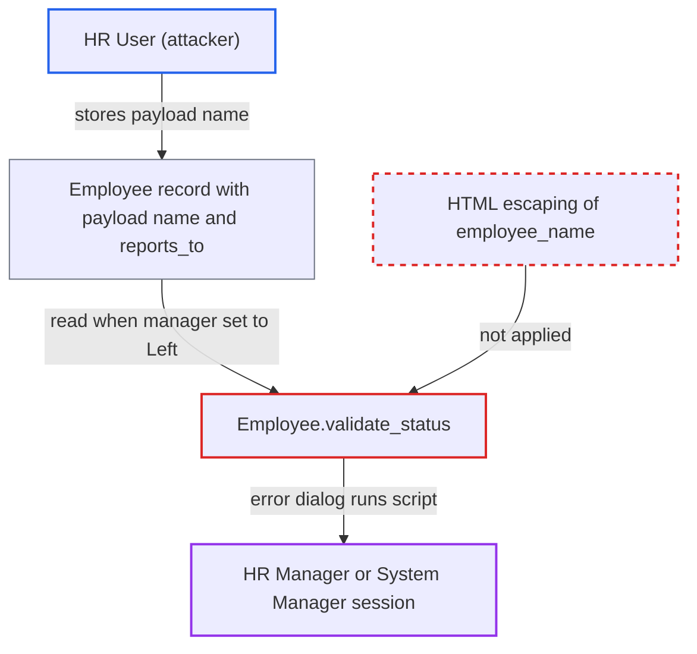

# Employee names rendered unescaped in relieve-employee error shown to HR managers

| Field | Value |
|---|---|
| ID | `find_01SkwrFZcgQR9sKA8PoA6RYJ` |
| Severity | **High** |
| Status | open |
| CWE | CWE-79 — Cross-site scripting |
| Created | 2026-10-27T22:32:14.528485Z |
| Claude Security | https://claude.ai/security/findings/find_01SkwrFZcgQR9sKA8PoA6RYJ |

## Description

An HR User can run script in the browser of an HR Manager or System Manager. The attacker stores a crafted employee name, and the script runs when the victim sets the manager's status to `Left`. The cause is `Employee.validate_status`, which puts unescaped `employee_name` values into an HTML error message.

1. **HR User** saves an Employee whose `first_name` is a JSON-quoted script payload. The payload looks like `""`. Frappe's save-time `sanitize_html` runs after `validate()` and leaves JSON-quoted and unterminated-tag values unchanged, and Employee is series-named, so `validate_name` does not block `<` and `>`. ([`erpnext/setup/doctype/employee/employee.py:150-153`](https://github.com/cx-benchmark/erpnext/blob/90e7aefca73da3c440d2e8da7472fcb67838e678/erpnext/setup/doctype/employee/employee.py#L150-L153))
2. **HR User** sets `reports_to` to a manager, or gives the payload name to the manager. HR User has create and write on every Employee record, so this works on any employee. ([`erpnext/setup/doctype/employee/employee.json:1-10`](https://github.com/cx-benchmark/erpnext/blob/90e7aefca73da3c440d2e8da7472fcb67838e678/erpnext/setup/doctype/employee/employee.json#L1-L10))
3. **HR Manager or System Manager** sets the manager's status to `Left` and saves. This is a deliberate off-boarding step on that record.
4. **`Employee.validate_status`** builds an HTML message from the employee names and throws it. The message uses `frappe.bold(self.employee_name)` and a `get_link_to_form` link labelled with each subordinate's `employee_name`. None of these are escaped. ([`erpnext/setup/doctype/employee/employee.py:285-303`](https://github.com/cx-benchmark/erpnext/blob/90e7aefca73da3c440d2e8da7472fcb67838e678/erpnext/setup/doctype/employee/employee.py#L285-L303))
5. **the desk dialog** renders the message as HTML and runs the script. The script runs in the victim's session with the victim's roles.

## Assessment

The attacker needs a desk account with the HR User role. That role can write any Employee record. The attacker gives an employee a payload name and points `reports_to` at a manager, or gives the manager the payload name. The attack then waits for an HR Manager or System Manager to set that manager's status to `Left` and save. This needs that victim to act on that particular record. The report rates it lower than similar findings for that reason. The report assumes Frappe `>=17.0.0-dev,<18`, which is not in the checkout.

Impact: The script runs with the victim's roles and can call the REST API as them. It can read all HR and company data and change records. If the victim is a System Manager, it can also grant roles. The attacker goes from HR User to a manager or admin session.

## Recommendation

`validate_status` in `employee.py` (lines 293-298) puts user-written `employee_name` values into an HTML throw message without escaping. This covers the `frappe.bold` call and the `get_link_to_form` label.

Fix criteria: The relieved employee's name and each subordinate's link label are HTML-escaped with `escape_html(employee_name)`, or replaced by the employee ID. To verify, relieve a manager whose subordinate is named `""`. The dialog must show the literal text and run no script.

## Evidence

**https://github.com/cx-benchmark/erpnext**

- [`erpnext/setup/doctype/employee/employee.py:285-303`](https://github.com/cx-benchmark/erpnext/blob/90e7aefca73da3c440d2e8da7472fcb67838e678/erpnext/setup/doctype/employee/employee.py#L285-L303)
- [`erpnext/setup/doctype/employee/employee.py:150-153`](https://github.com/cx-benchmark/erpnext/blob/90e7aefca73da3c440d2e8da7472fcb67838e678/erpnext/setup/doctype/employee/employee.py#L150-L153)
- [`erpnext/setup/doctype/employee/employee.json:1-10`](https://github.com/cx-benchmark/erpnext/blob/90e7aefca73da3c440d2e8da7472fcb67838e678/erpnext/setup/doctype/employee/employee.json#L1-L10)
- [`erpnext/support/doctype/warranty_claim/warranty_claim.py:114-122`](https://github.com/cx-benchmark/erpnext/blob/90e7aefca73da3c440d2e8da7472fcb67838e678/erpnext/support/doctype/warranty_claim/warranty_claim.py#L114-L122)

