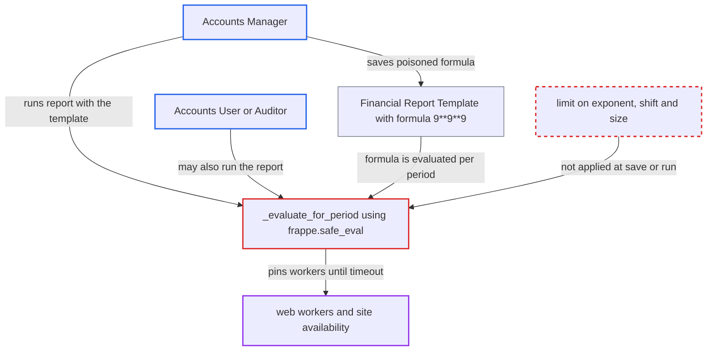

# Financial Report Template formulas allow unbounded exponentiation when financial reports run

| Field | Value |
|---|---|
| ID | `find_01Vy8Z8sUx4dK6jF2agbvZng` |
| Severity | **High** |
| Status | open |
| CWE | CWE-400 — Uncontrolled resource consumption |
| Created | 2026-10-27T21:51:42.879218Z |
| Claude Security | https://claude.ai/security/findings/find_01Vy8Z8sUx4dK6jF2agbvZng |

## Description

A user with the `Accounts Manager` role can freeze the whole site by saving a report template formula such as `9**9**9`. Running a report with that template ties up a web worker until the gunicorn timeout kills it, and a few requests use up all workers. The cause is that `CalculationFormulaValidator` and `FormulaCalculator._evaluate_for_period` put no limit on exponent, shift or size.

1. **Accounts Manager** saves a Financial Report Template with a Calculated Amount row. The row's `calculation_formula` is `9**9**9`, and the role has create and write rights on the template. ([`erpnext/accounts/doctype/financial_report_template/financial_report_template.json:78-99`](https://github.com/cx-benchmark/erpnext/blob/90e7aefca73da3c440d2e8da7472fcb67838e678/erpnext/accounts/doctype/financial_report_template/financial_report_template.json#L78-L99))
2. **`CalculationFormulaValidator`** accepts the formula on save. It checks only syntax, blocks `NamedExpr` and `Lambda`, and checks that `compile_restricted` accepts the formula and the names resolve, with no limit on `**`, `<<`, literal size or nesting, so the save succeeds instantly. ([`erpnext/accounts/doctype/financial_report_template/financial_report_validation.py:314-387`](https://github.com/cx-benchmark/erpnext/blob/90e7aefca73da3c440d2e8da7472fcb67838e678/erpnext/accounts/doctype/financial_report_template/financial_report_validation.py#L314-L387))
3. **attacker or any Accounts User or Auditor** runs a template-driven report with `report_template` set to the poisoned template. The report is Custom Financial Statement, or Profit and Loss, Balance Sheet or Cash Flow, and it runs inside the web request because `prepared_report` is 0. ([`erpnext/accounts/report/custom_financial_statement/custom_financial_statement.py:10-12`](https://github.com/cx-benchmark/erpnext/blob/90e7aefca73da3c440d2e8da7472fcb67838e678/erpnext/accounts/report/custom_financial_statement/custom_financial_statement.py#L10-L12))
4. **`FinancialReportEngine.execute`** loads the template and processes its formula rows. It reaches `RowProcessor._process_formula_row`, and `evaluate_formula` re-runs only the same validator, which accepts the formula again, then evaluates it once per period. ([`erpnext/accounts/doctype/financial_report_template/financial_report_engine.py:213-228`](https://github.com/cx-benchmark/erpnext/blob/90e7aefca73da3c440d2e8da7472fcb67838e678/erpnext/accounts/doctype/financial_report_template/financial_report_engine.py#L213-L228))
5. **`_evaluate_for_period`** evaluates the formula with `frappe.safe_eval`. `9**387420489` is computed as an integer of about 370 million digits, with no time or size bound, and the `except` handlers only run after evaluation returns or raises. ([`erpnext/accounts/doctype/financial_report_template/financial_report_engine.py:1354-1360`](https://github.com/cx-benchmark/erpnext/blob/90e7aefca73da3c440d2e8da7472fcb67838e678/erpnext/accounts/doctype/financial_report_template/financial_report_engine.py#L1354-L1360))
6. **web worker** stays busy at full CPU with growing memory until the gunicorn timeout. Repeated requests pin further workers, so the worker pool is exhausted.

## Assessment

The attacker needs a desk login with the `Accounts Manager` role, which can create and write Financial Report Templates. They save the template, then call `frappe.desk.query_report.run` for Custom Financial Statement, or for Profit and Loss, Balance Sheet or Cash Flow with `report_template` set. Any Accounts User or Auditor who selects the poisoned template triggers the same evaluation, so no victim action is needed. Other unbounded int and sequence operations, such as `<<` and sequence repetition, are also unchecked. The finding assumes `frappe.safe_eval` in the pinned `frappe >=17.0.0-dev,<18.0.0` adds no time or size limit.

Impact: The attacker can make the site stop serving every user for as long as the attack continues, because each report run holds a worker at full CPU with memory growing to hundreds of MB. Nothing is read or modified, since the evaluation context holds only numbers and math helpers.

## Recommendation

User-written template formulas run under `frappe.safe_eval` with Python integer semantics. The validator and the engine allow `**`, `<<` and unbounded literals with no limit on operand size, result size or evaluation time.

Fix criteria: Evaluating any formula the validator accepts finishes in bounded time and memory. Exponentiation, shifts and sequence repetition are rejected or bounded, or evaluation uses float-only semantics with a hard time or size cap, enforced at save and again at evaluation. Saving a row with `9**9**9` or `1<<10**10` is refused. Running the report with such a formula already in the database fails fast with a formula error.

## Evidence

**https://github.com/cx-benchmark/erpnext**

- [`erpnext/accounts/doctype/financial_report_template/financial_report_engine.py:1354-1360`](https://github.com/cx-benchmark/erpnext/blob/90e7aefca73da3c440d2e8da7472fcb67838e678/erpnext/accounts/doctype/financial_report_template/financial_report_engine.py#L1354-L1360)
- [`erpnext/accounts/doctype/financial_report_template/financial_report_validation.py:314-387`](https://github.com/cx-benchmark/erpnext/blob/90e7aefca73da3c440d2e8da7472fcb67838e678/erpnext/accounts/doctype/financial_report_template/financial_report_validation.py#L314-L387)
- [`erpnext/accounts/doctype/financial_report_template/financial_report_engine.py:1329-1345`](https://github.com/cx-benchmark/erpnext/blob/90e7aefca73da3c440d2e8da7472fcb67838e678/erpnext/accounts/doctype/financial_report_template/financial_report_engine.py#L1329-L1345)
- [`erpnext/accounts/doctype/financial_report_template/financial_report_engine.py:213-228`](https://github.com/cx-benchmark/erpnext/blob/90e7aefca73da3c440d2e8da7472fcb67838e678/erpnext/accounts/doctype/financial_report_template/financial_report_engine.py#L213-L228)
- [`erpnext/accounts/doctype/financial_report_template/financial_report_template.json:78-99`](https://github.com/cx-benchmark/erpnext/blob/90e7aefca73da3c440d2e8da7472fcb67838e678/erpnext/accounts/doctype/financial_report_template/financial_report_template.json#L78-L99)
- [`erpnext/accounts/report/custom_financial_statement/custom_financial_statement.py:10-12`](https://github.com/cx-benchmark/erpnext/blob/90e7aefca73da3c440d2e8da7472fcb67838e678/erpnext/accounts/report/custom_financial_statement/custom_financial_statement.py#L10-L12)
- [`erpnext/accounts/doctype/financial_report_template/financial_report_validation.py:36-37`](https://github.com/cx-benchmark/erpnext/blob/90e7aefca73da3c440d2e8da7472fcb67838e678/erpnext/accounts/doctype/financial_report_template/financial_report_validation.py#L36-L37)

