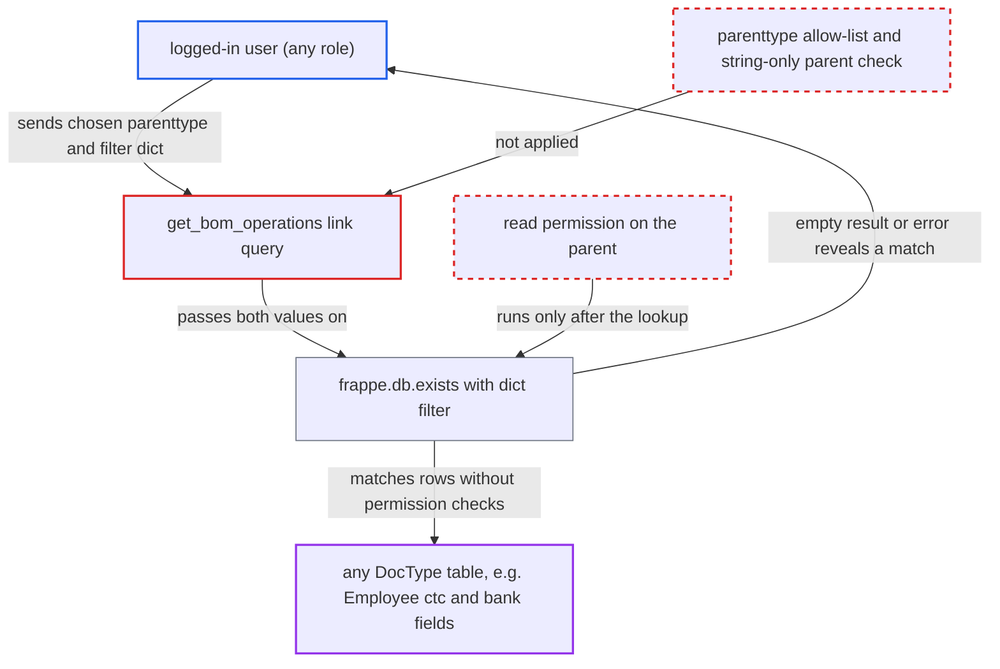

# get_bom_operations passes caller doctype and filter dict to db.exists, a blind data oracle

| Field | Value |
|---|---|
| ID | `find_012fmHYk19poA21ThzxJeoXH` |
| Severity | **High** |
| Status | open |
| CWE | CWE-943 — Query logic injection |
| Created | 2026-10-27T21:56:39.597365Z |
| Claude Security | https://claude.ai/security/findings/find_012fmHYk19poA21ThzxJeoXH |

## Description

Any logged-in user, with no particular role, can read almost any column of any DocType table one bit at a time. That includes employee pay and bank fields and other companies' invoices, and it bypasses role permissions, User Permissions and Company Restriction. The whitelisted link query `get_bom_operations` passes the caller's `parenttype` and an untyped `parent` to `frappe.db.exists` before it checks authorisation. Whether the call returns `[]` or raises reveals whether a row matched.

1. **authenticated user** posts a crafted request to `get_bom_operations`. The body sets `doctype` to `BOM Operation` and `searchfield` to `name`. It puts `parenttype` (for example `Employee`) and a dict `parent` with operator filters (for example on `ctc`) into `filters`. The same call also works through `frappe.desk.search.search_link` with `query=` set to this method. ([`erpnext/manufacturing/doctype/work_order/work_order.py:1309-1323`](https://github.com/cx-benchmark/erpnext/blob/90e7aefca73da3c440d2e8da7472fcb67838e678/erpnext/manufacturing/doctype/work_order/work_order.py#L1309-L1323))
2. **the function `get_bom_operations`** calls `frappe.db.exists(parenttype, parent)` with the caller's values. In the pinned Frappe a dict name is applied as a filter set with operators and no permission check. The call runs at `:1314`, before the only authorisation at `:1317`. ([`erpnext/manufacturing/doctype/work_order/work_order.py:1309-1323`](https://github.com/cx-benchmark/erpnext/blob/90e7aefca73da3c440d2e8da7472fcb67838e678/erpnext/manufacturing/doctype/work_order/work_order.py#L1309-L1323))
3. **the function `get_bom_operations`** returns `[]` with HTTP 200 when no row matches. This is the miss branch, and it reveals nothing beyond the fact that no row matched. ([`erpnext/manufacturing/doctype/work_order/work_order.py:1309-1323`](https://github.com/cx-benchmark/erpnext/blob/90e7aefca73da3c440d2e8da7472fcb67838e678/erpnext/manufacturing/doctype/work_order/work_order.py#L1309-L1323))
4. **the function `get_bom_operations`** calls `frappe.has_permission` with the dict as `doc` when a row matches, which raises an error. `get_doc_permissions` reads `doc.doctype` off a plain dict, so the call fails. The error versus `[]` is the one bit the attacker reads. ([`erpnext/manufacturing/doctype/work_order/work_order.py:1309-1323`](https://github.com/cx-benchmark/erpnext/blob/90e7aefca73da3c440d2e8da7472fcb67838e678/erpnext/manufacturing/doctype/work_order/work_order.py#L1309-L1323))
5. **authenticated user** repeats the request with narrower prefix or range filters. Each answer gives one bit, so repeated probes recover the value of any non-Password column. The process can be fully automated.

## Assessment

The attacker is any authenticated user, and no role is needed. They POST to `/api/method/erpnext.manufacturing.doctype.work_order.work_order.get_bom_operations` or go through `frappe.desk.search.search_link` with `query=` set to this method. No victim is involved. For example, a Manufacturing User holds only `select` on `Employee`, yet can recover `ctc`, `bank_ac_no`, `iban` and `passport_number` of any employee, or read other companies' invoices and bank accounts. With a plain-string `parent` the flaw is still a name-existence oracle (200 versus 403) on any doctype. The report rests on Frappe `>=17.0.0-dev,<18`, which is not in the checkout. It assumes `db.exists` keeps its documented dict-filter semantics and that `has_permission` with a dict `doc` raises for non-Administrators.

Impact: The attacker gets a blind, one-bit-per-request read of any non-Password column in any DocType table. This bypasses role permissions, User Permissions and Company Restriction. The report names no write or availability effect.

## Recommendation

A caller-chosen `parenttype` and an untyped `parent` reach `frappe.db.exists`, which does no permission check, before any authorisation. The branch taken afterwards (`[]` or an exception) reveals whether the filter matched.

Fix criteria: `parenttype` is limited to the doctypes that own `BOM Operation` rows. `parent` must be a plain string. Both are checked before any database lookup. Read permission on that specific parent is checked before any lookup or query runs. To verify, call it with a dict `parent`, or with `parenttype` set to `Employee` or `User`. The call must fail with the same response whether or not a matching row exists.

## Evidence

**https://github.com/cx-benchmark/erpnext**

- [`erpnext/manufacturing/doctype/work_order/work_order.py:1309-1323`](https://github.com/cx-benchmark/erpnext/blob/90e7aefca73da3c440d2e8da7472fcb67838e678/erpnext/manufacturing/doctype/work_order/work_order.py#L1309-L1323)
- [`erpnext/controllers/queries.py:1287-1292`](https://github.com/cx-benchmark/erpnext/blob/90e7aefca73da3c440d2e8da7472fcb67838e678/erpnext/controllers/queries.py#L1287-L1292)
- [`erpnext/setup/doctype/company/company.py:353`](https://github.com/cx-benchmark/erpnext/blob/90e7aefca73da3c440d2e8da7472fcb67838e678/erpnext/setup/doctype/company/company.py#L353)
- [`erpnext/manufacturing/doctype/work_order/work_order.js:65-73`](https://github.com/cx-benchmark/erpnext/blob/90e7aefca73da3c440d2e8da7472fcb67838e678/erpnext/manufacturing/doctype/work_order/work_order.js#L65-L73)
- [`erpnext/setup/doctype/employee/employee.json:434`](https://github.com/cx-benchmark/erpnext/blob/90e7aefca73da3c440d2e8da7472fcb67838e678/erpnext/setup/doctype/employee/employee.json#L434)

