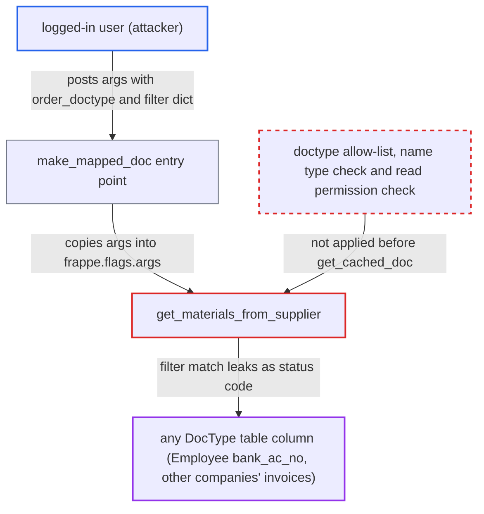

# get_materials_from_supplier loads caller-chosen doctype by filter dict before authorization, a blind data oracle

| Field | Value |
|---|---|
| ID | `find_01Rhq46eemUJyfpE6ZHUmueB` |
| Severity | **High** |
| Status | open |
| CWE | CWE-943 — Query logic injection |
| Created | 2026-10-27T21:56:39.514909Z |
| Claude Security | https://claude.ai/security/findings/find_01Rhq46eemUJyfpE6ZHUmueB |

## Description

Any logged-in user, with no special role, can learn the values of almost any non-password column in any DocType table, one yes/no answer per request. This includes other companies' data and employee bank details, and role permissions, User Permissions and Company Restriction do not apply. The endpoint `get_materials_from_supplier` takes a caller-chosen doctype and a name, which may be a filter dict, and loads it with `frappe.get_cached_doc` before any permission or type check.

1. **attacker (any logged-in user)** posts a request to `make_mapped_doc` naming `get_materials_from_supplier`. The `args` JSON carries `order_doctype` (for example `Employee`) and a `subcontract_order` that is a filter object such as a `like` match on `bank_ac_no`, and `make_mapped_doc` copies it into `frappe.flags.args`. ([`erpnext/subcontracting/doctype/subcontracting_order/subcontracting_order.js:591-598`](https://github.com/cx-benchmark/erpnext/blob/90e7aefca73da3c440d2e8da7472fcb67838e678/erpnext/subcontracting/doctype/subcontracting_order/subcontracting_order.js#L591-L598))
2. **the handler `get_materials_from_supplier`** prefers the values in `args` over the type-checked `source_name`. Whenever `args.subcontract_order` is set, `source_name` is ignored, and neither `order_doctype` nor the name is allow-listed or type-checked. ([`erpnext/controllers/subcontracting_controller.py:1639-1651`](https://github.com/cx-benchmark/erpnext/blob/90e7aefca73da3c440d2e8da7472fcb67838e678/erpnext/controllers/subcontracting_controller.py#L1639-L1651))
3. **the handler `get_materials_from_supplier`** calls `frappe.get_cached_doc(order_doctype, subcontract_order)` before any permission check. In the pinned Frappe, a dict name is used as query filters, operators included, and the first matching row is loaded without permissions. If nothing matches, `DoesNotExistError` gives a 404. ([`erpnext/controllers/subcontracting_controller.py:1639-1651`](https://github.com/cx-benchmark/erpnext/blob/90e7aefca73da3c440d2e8da7472fcb67838e678/erpnext/controllers/subcontracting_controller.py#L1639-L1651))
4. **the handler `get_materials_from_supplier`** fails differently when a row matched. For a DocType that is not a subcontracting controller, `doc.initialized_fields()` raises `AttributeError` (500). For subcontracting and buying doctypes, the request ends in a 417 throw or a 403 from `get_mapped_doc`. ([`erpnext/controllers/subcontracting_controller.py:306-310`](https://github.com/cx-benchmark/erpnext/blob/90e7aefca73da3c440d2e8da7472fcb67838e678/erpnext/controllers/subcontracting_controller.py#L306-L310))
5. **attacker** reads the status code as a yes/no answer and narrows the filter. Any response other than 404 means some row matches. Changing `like` prefixes or `>`/`<` bounds across many requests recovers a column value one character at a time. ([`erpnext/controllers/subcontracting_controller.py:1653-1660`](https://github.com/cx-benchmark/erpnext/blob/90e7aefca73da3c440d2e8da7472fcb67838e678/erpnext/controllers/subcontracting_controller.py#L1653-L1660))

## Assessment

The attacker is any logged-in user, and no role is needed. They POST to `/api/method/frappe.model.mapper.make_mapped_doc` with `method=erpnext.controllers.subcontracting_controller.get_materials_from_supplier`, `source_name=x`, and an `args` JSON whose `order_doctype` is `Employee` and whose `subcontract_order` is a filter such as `company` equal to `OtherCo` plus `bank_ac_no` `like` `12%`. No victim is involved. The attack relies on assumptions about Frappe `>=17.0.0-dev,<18.0.0` that the report could not check in the checkout: `make_mapped_doc` stores the parsed `args` in `frappe.flags.args`, a dict name is resolved as filters, and `DoesNotExistError` maps to 404 while an unhandled `AttributeError` maps to 500.

Impact: The attacker gets a blind yes/no read of any column stored in any DocType table, such as `Employee.ctc`, `bank_ac_no` and `iban`, and other companies' invoices, orders and bank accounts. Each request gives one bit, but it can be fully automated. Password fields are kept in `__Auth` and are out of reach. Nothing is written, because `get_mapped_doc` returns an unsaved Stock Entry, and only to users who can read the source order.

## Recommendation

The endpoint resolves a caller-chosen doctype and a caller-chosen name, possibly a filter dict from `frappe.flags.args`, with `frappe.get_cached_doc` before any type check, allow-list or authorization. The different errors for a match and a miss reveal whether the filter is true.

Fix criteria: Before any database lookup, `order_doctype` is limited to the doctypes this flow supports (`Subcontracting Order`, `Purchase Order`). The order name must be a plain string. The caller must hold read permission on that specific document, so that User Permissions apply. Replaying the request from the assessment with a dict name and with a foreign doctype gets refused with the same error whether or not any row matches.

## Evidence

**https://github.com/cx-benchmark/erpnext**

- [`erpnext/controllers/subcontracting_controller.py:1639-1651`](https://github.com/cx-benchmark/erpnext/blob/90e7aefca73da3c440d2e8da7472fcb67838e678/erpnext/controllers/subcontracting_controller.py#L1639-L1651)
- [`erpnext/controllers/subcontracting_controller.py:306-310`](https://github.com/cx-benchmark/erpnext/blob/90e7aefca73da3c440d2e8da7472fcb67838e678/erpnext/controllers/subcontracting_controller.py#L306-L310)
- [`erpnext/controllers/subcontracting_controller.py:1653-1660`](https://github.com/cx-benchmark/erpnext/blob/90e7aefca73da3c440d2e8da7472fcb67838e678/erpnext/controllers/subcontracting_controller.py#L1653-L1660)
- [`erpnext/subcontracting/doctype/subcontracting_order/subcontracting_order.js:591-598`](https://github.com/cx-benchmark/erpnext/blob/90e7aefca73da3c440d2e8da7472fcb67838e678/erpnext/subcontracting/doctype/subcontracting_order/subcontracting_order.js#L591-L598)
- [`erpnext/selling/doctype/sales_order/mapper.py:319`](https://github.com/cx-benchmark/erpnext/blob/90e7aefca73da3c440d2e8da7472fcb67838e678/erpnext/selling/doctype/sales_order/mapper.py#L319)
- [`erpnext/setup/doctype/transaction_deletion_record/transaction_deletion_record.py:1081`](https://github.com/cx-benchmark/erpnext/blob/90e7aefca73da3c440d2e8da7472fcb67838e678/erpnext/setup/doctype/transaction_deletion_record/transaction_deletion_record.py#L1081)
- [`erpnext/tests/permission_test_utils.py:53-55`](https://github.com/cx-benchmark/erpnext/blob/90e7aefca73da3c440d2e8da7472fcb67838e678/erpnext/tests/permission_test_utils.py#L53-L55)

