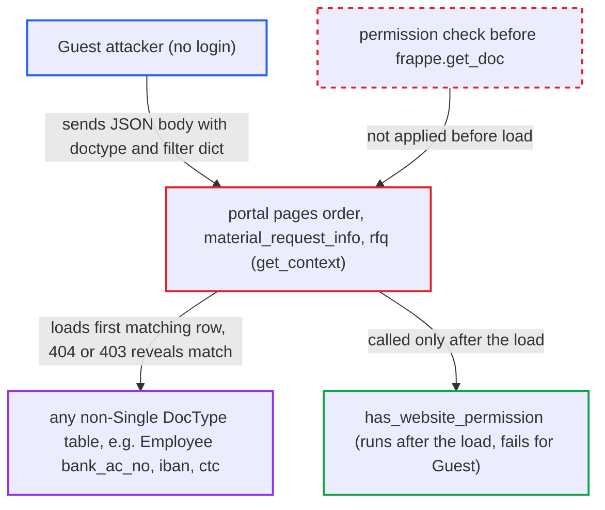

# Guest portal pages load caller-chosen doctype and filters before authorization, creating a data oracle

| Field | Value |
|---|---|
| ID | `find_01Thsv1MRxPjGpGyrxmf1bDq` |
| Severity | **High** |
| Status | open |
| CWE | CWE-204 — Observable Response Discrepancy |
| Created | 2026-10-27T21:34:10.414809Z |
| Claude Security | https://claude.ai/security/findings/find_01Thsv1MRxPjGpGyrxmf1bDq |

## Description

An unauthenticated visitor can read almost any non-Password column of any non-Single table, such as employees' `bank_ac_no`, `iban` or `ctc`, one yes/no answer at a time. No login or special setting is needed. The pages `order.py`, `material_request_info.py` and `rfq.py` pass a caller-chosen `doctype` and `name` to `frappe.get_doc` before any permission check. The 404 versus 403 response then shows whether a row matched.

1. **Guest attacker** sends a request to a portal page with a JSON body. The body names any `doctype` and gives `name` as a filter dict, for example `{"doctype": "Employee", "name": {"bank_ac_no": ["like", "12%"]}}`, because a request to the page path itself has no fixed `doctype` default. ([`erpnext/hooks.py:168-174`](https://github.com/cx-benchmark/erpnext/blob/90e7aefca73da3c440d2e8da7472fcb67838e678/erpnext/hooks.py#L168-L174))
2. **the page handler (`order.py`, `material_request_info.py` or `rfq.py`)** calls `frappe.get_doc` with the caller's values. No permission is checked on this call, and a dict `name` is treated as query filters that load the first matching row. ([`erpnext/templates/pages/material_request_info.py:10-21`](https://github.com/cx-benchmark/erpnext/blob/90e7aefca73da3c440d2e8da7472fcb67838e678/erpnext/templates/pages/material_request_info.py#L10-L21))
3. **`frappe.get_doc`** loads the first row that matches, or finds none. ERPNext already uses the filter-dict form of `get_doc` and operator filters such as `like`, `>` and `<` are accepted by the database layer, so the attacker can test prefixes and bounds. ([`erpnext/setup/doctype/transaction_deletion_record/transaction_deletion_record.py:1081-1083`](https://github.com/cx-benchmark/erpnext/blob/90e7aefca73da3c440d2e8da7472fcb67838e678/erpnext/setup/doctype/transaction_deletion_record/transaction_deletion_record.py#L1081-L1083))
4. **the page handler** checks permission only after the load. For a Guest this check always fails, because `has_website_permission` returns `False` without a Customer or Supplier role. ([`erpnext/controllers/website_list_for_contact.py:296-300`](https://github.com/cx-benchmark/erpnext/blob/90e7aefca73da3c440d2e8da7472fcb67838e678/erpnext/controllers/website_list_for_contact.py#L296-L300))
5. **Frappe error handling** returns a 404 page if nothing matched and a 403 page if a row matched. `DoesNotExistError` and `PermissionError` render different pages, so the status tells the attacker whether any row fits the filter. ([`erpnext/templates/pages/order.py:13-37`](https://github.com/cx-benchmark/erpnext/blob/90e7aefca73da3c440d2e8da7472fcb67838e678/erpnext/templates/pages/order.py#L13-L37))
6. **Guest attacker** repeats the request with narrower `like` prefixes or `>`/`<` bounds. Each answer gives one bit, so a column value can be rebuilt step by step.

## Assessment

The attacker is any unauthenticated visitor who can reach the site over the network. No login, victim action or special configuration is needed. The attacker requests `/material_request_info`, `/order` or `/rfq` directly with a JSON body, so `doctype` and `name` come from the caller. `task_info.py` gives a second way in with the same pattern for `Task`, where the caller controls `task`. With a plain string `name`, only the existence of a record is shown, which the REST read at `/api/resource/<doctype>/<name>` already tells a Guest. The real gain is the dict `name`. The report assumes Frappe `>=17.0.0-dev,<18.0.0`, which is not in the checkout: pages are routable by file name, a JSON body fills `form_dict`, 404 and 403 render differently, and `frappe.get_doc(doctype, dict)` loads by filters.

Impact: The attacker can test any filter against any non-Single DocType table and recover any non-Password column, such as employees' `bank_ac_no`, `iban`, `ctc`, `passport_number` and `date_of_birth`, or parties' tax IDs and invoice totals. Password fields kept in `__Auth` are out of reach. Nothing is modified, and each probe costs one page render.

## Recommendation

(1) The portal pages pass a caller-chosen `doctype` and a caller-controlled `name`, which may be a filter dict, to `frappe.get_doc` before any permission check. The difference between a missing and a forbidden record shows whether any row matches.

Fix criteria: Each page accepts only the doctypes its route rules serve and only a plain string `name`. It checks permission before revealing anything about the record, so a missing and a forbidden record give identical responses. A Guest request to `/material_request_info` or `/order` with `doctype=Employee`, or with a dict `name`, is refused before any lookup. An existing and a missing Sales Order give a Guest the same response.

(2) `task_info.py` loads `Task` with a caller-controlled `task` value before calling `check_permission()`, which repeats the same load-then-check order.

Fix criteria: `task` must be a plain string, and a Guest gets the same response whether or not the Task or filter exists. This is checked with an existing and a missing Task name and with a dict body.

## Evidence

**https://github.com/cx-benchmark/erpnext**

- [`erpnext/templates/pages/order.py:13-37`](https://github.com/cx-benchmark/erpnext/blob/90e7aefca73da3c440d2e8da7472fcb67838e678/erpnext/templates/pages/order.py#L13-L37)
- [`erpnext/templates/pages/material_request_info.py:10-21`](https://github.com/cx-benchmark/erpnext/blob/90e7aefca73da3c440d2e8da7472fcb67838e678/erpnext/templates/pages/material_request_info.py#L10-L21)
- [`erpnext/templates/pages/rfq.py:12-23`](https://github.com/cx-benchmark/erpnext/blob/90e7aefca73da3c440d2e8da7472fcb67838e678/erpnext/templates/pages/rfq.py#L12-L23)
- [`erpnext/controllers/website_list_for_contact.py:296-300`](https://github.com/cx-benchmark/erpnext/blob/90e7aefca73da3c440d2e8da7472fcb67838e678/erpnext/controllers/website_list_for_contact.py#L296-L300)
- [`erpnext/hooks.py:168-174`](https://github.com/cx-benchmark/erpnext/blob/90e7aefca73da3c440d2e8da7472fcb67838e678/erpnext/hooks.py#L168-L174)
- [`erpnext/setup/doctype/transaction_deletion_record/transaction_deletion_record.py:1081-1083`](https://github.com/cx-benchmark/erpnext/blob/90e7aefca73da3c440d2e8da7472fcb67838e678/erpnext/setup/doctype/transaction_deletion_record/transaction_deletion_record.py#L1081-L1083)
- [`erpnext/setup/doctype/company/company.py:353`](https://github.com/cx-benchmark/erpnext/blob/90e7aefca73da3c440d2e8da7472fcb67838e678/erpnext/setup/doctype/company/company.py#L353)
- [`erpnext/templates/pages/task_info.py:4-8`](https://github.com/cx-benchmark/erpnext/blob/90e7aefca73da3c440d2e8da7472fcb67838e678/erpnext/templates/pages/task_info.py#L4-L8)
- [`erpnext/setup/doctype/employee/employee.json`](https://github.com/cx-benchmark/erpnext/blob/90e7aefca73da3c440d2e8da7472fcb67838e678/erpnext/setup/doctype/employee/employee.json)

