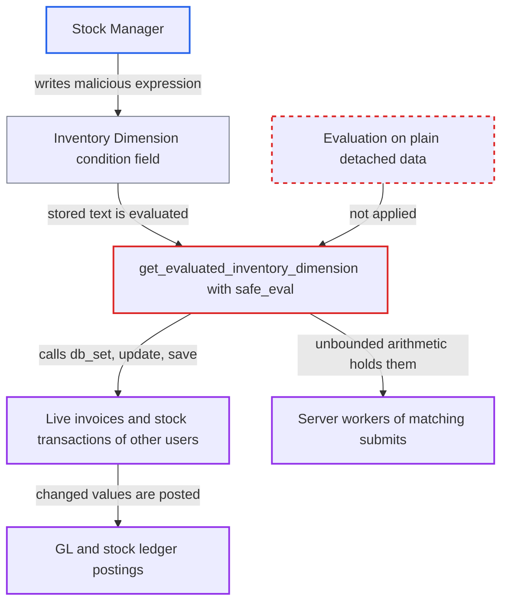

# Inventory Dimension condition can mutate live transactions other users submit

| Field | Value |
|---|---|
| ID | `find_01XPqt4i3kwwq6u5BysLN9ov` |
| Severity | **High** |
| Status | open |
| CWE | CWE-94 — Code injection |
| Created | 2026-10-27T21:53:26.349049Z |
| Claude Security | https://claude.ai/security/findings/find_01XPqt4i3kwwq6u5BysLN9ov |

## Description

A user with only the `Stock Manager` role can change other users' Sales Invoices, Purchase Invoices, Delivery Notes and Stock Entries as they are submitted or cancelled, in any company. They can also tie up the server workers that process those submits. The attack needs a per-doctype Inventory Dimension (`apply_to_all_doctypes` off) with a malicious `condition`. `get_evaluated_inventory_dimension` runs that text with `frappe.safe_eval` on live `Document` objects. This depends on an assumption about `safe_eval` in the pinned `frappe` version, which is not in the checkout.

1. **Stock Manager** creates or edits an Inventory Dimension with a malicious `condition`. The dimension uses `apply_to_all_doctypes=0` and a `document_type` such as `Sales Invoice Item`. `Stock Manager` has create and write rights on this doctype, and `condition` stays editable even after stock entries exist. ([`erpnext/stock/doctype/inventory_dimension/inventory_dimension.json:194-223`](https://github.com/cx-benchmark/erpnext/blob/90e7aefca73da3c440d2e8da7472fcb67838e678/erpnext/stock/doctype/inventory_dimension/inventory_dimension.json#L194-L223))
2. **`validate()` in the Inventory Dimension** accepts the dimension without looking at the `condition` text. It checks only the reference document, so the expression is stored as written. ([`erpnext/stock/doctype/inventory_dimension/inventory_dimension.py:61-92`](https://github.com/cx-benchmark/erpnext/blob/90e7aefca73da3c440d2e8da7472fcb67838e678/erpnext/stock/doctype/inventory_dimension/inventory_dimension.py#L61-L92))
3. **Accounts User** submits a Sales Invoice with `update_stock`. For this doctype the dimension runs inside the request of whoever submits or cancels, in any company. For Sales Invoice and Delivery Note, `doc` is the real child row `Document`. ([`erpnext/controllers/selling_controller.py:455-479`](https://github.com/cx-benchmark/erpnext/blob/90e7aefca73da3c440d2e8da7472fcb67838e678/erpnext/controllers/selling_controller.py#L455-L479))
4. **the stock ledger service** passes the live item row as `doc` and the submitted transaction as `parent`. This happens while each Stock Ledger Entry dict is built, through `update_inventory_dimensions`. ([`erpnext/stock/services/stock_ledger_service.py:116-122`](https://github.com/cx-benchmark/erpnext/blob/90e7aefca73da3c440d2e8da7472fcb67838e678/erpnext/stock/services/stock_ledger_service.py#L116-L122))
5. **`get_evaluated_inventory_dimension`** evaluates the stored `condition` with `frappe.safe_eval` on those live objects. It loads every dimension whose `document_type` equals the row's doctype. Under the report's assumption about `safe_eval`, the expression can call public `Document` methods such as `db_set`, `update` and `save`. `db_set` writes straight to the database with no permission or docstatus check. ([`erpnext/stock/doctype/inventory_dimension/inventory_dimension.py:387-394`](https://github.com/cx-benchmark/erpnext/blob/90e7aefca73da3c440d2e8da7472fcb67838e678/erpnext/stock/doctype/inventory_dimension/inventory_dimension.py#L387-L394))
6. **`update_stock_ledger()`** runs before `make_gl_entries()` in the same request. Values the expression changed on the live invoice, such as `debit_to`, `customer`, an item `income_account` or `cost_center`, are therefore posted to the ledger. Purchase Invoice with `update_stock` has the same order. ([`erpnext/accounts/doctype/sales_invoice/sales_invoice.py:471-478`](https://github.com/cx-benchmark/erpnext/blob/90e7aefca73da3c440d2e8da7472fcb67838e678/erpnext/accounts/doctype/sales_invoice/sales_invoice.py#L471-L478))

## Assessment

The attacker holds only `Stock Manager`, which the threat model does not trust as an administrator. The attacker creates or edits an Inventory Dimension with `apply_to_all_doctypes=0` and a `document_type` of `Sales Invoice Item`, `Purchase Invoice Item`, `Delivery Note Item` or `Stock Entry Detail`. A dimension with `apply_to_all_doctypes` set does not work, because `reset_value` clears its `condition`. An example condition is `parent.update({'debit_to': '<other account>'}) or parent.db_set('customer', '<other>') or True`. It fires when another user, such as an Accounts User, routinely submits or cancels a matching transaction. For the availability attack, a `9**9**9` condition on `Stock Entry Detail` lets the attacker pin workers with their own Stock Entries. The attack relies on the report's assumption that `safe_eval` in the pinned `frappe >=17.0.0-dev,<18.0.0` rejects only `_`-prefixed names, a fixed list of frame and format attributes, and module or code objects, and does not guard ordinary calls. That code is not in the checkout.

Impact: The attacker can change documents that other users submit or cancel, in any company, including Sales and Purchase Invoices that `Stock Manager` cannot read or write. Changed values that feed the GL and stock ledger are posted in the same request. An unbounded expression holds the worker of each matching submit until timeout, and repeated submits use up every worker. The report finds no way to read other records, so data disclosure is not part of it.

## Recommendation

(1) `get_evaluated_inventory_dimension` hands the live `Document` objects `doc` and `parent` to a `safe_eval` expression written by a `Stock Manager`. Their public methods (`db_set`, `update`, `save`, `cancel`) can be called, so a filter can change transactions that other users submit.

Fix criteria: The condition is evaluated against plain, detached data, such as copies of the row and parent or a field allow-list. No `Document` method or database write can be reached from it. Test: with a condition of `parent.db_set('remarks','x') or parent.update({'debit_to':'Y'}) or True`, submitting a Sales Invoice with `update_stock` leaves the stored invoice and its GL entries unchanged.

(2) The `condition` text is never validated when saved. It is evaluated without any bound on cost, so unbounded arithmetic in it pins the worker of every matching stock transaction.

Fix criteria: Saving a dimension refuses conditions whose cost is unbounded, such as large powers or shifts and oversized expressions. Alternatively, evaluation is bounded in time and size. Test: a `9**9**9` condition cannot be saved, or the submit fails within milliseconds.

## Evidence

**https://github.com/cx-benchmark/erpnext**

- [`erpnext/stock/doctype/inventory_dimension/inventory_dimension.py:387-394`](https://github.com/cx-benchmark/erpnext/blob/90e7aefca73da3c440d2e8da7472fcb67838e678/erpnext/stock/doctype/inventory_dimension/inventory_dimension.py#L387-L394)
- [`erpnext/stock/services/stock_ledger_service.py:116-122`](https://github.com/cx-benchmark/erpnext/blob/90e7aefca73da3c440d2e8da7472fcb67838e678/erpnext/stock/services/stock_ledger_service.py#L116-L122)
- [`erpnext/controllers/selling_controller.py:455-479`](https://github.com/cx-benchmark/erpnext/blob/90e7aefca73da3c440d2e8da7472fcb67838e678/erpnext/controllers/selling_controller.py#L455-L479)
- [`erpnext/stock/doctype/inventory_dimension/inventory_dimension.py:400-411`](https://github.com/cx-benchmark/erpnext/blob/90e7aefca73da3c440d2e8da7472fcb67838e678/erpnext/stock/doctype/inventory_dimension/inventory_dimension.py#L400-L411)
- [`erpnext/stock/doctype/inventory_dimension/inventory_dimension.py:135-142`](https://github.com/cx-benchmark/erpnext/blob/90e7aefca73da3c440d2e8da7472fcb67838e678/erpnext/stock/doctype/inventory_dimension/inventory_dimension.py#L135-L142)
- [`erpnext/stock/doctype/inventory_dimension/inventory_dimension.py:61-92`](https://github.com/cx-benchmark/erpnext/blob/90e7aefca73da3c440d2e8da7472fcb67838e678/erpnext/stock/doctype/inventory_dimension/inventory_dimension.py#L61-L92)
- [`erpnext/stock/doctype/inventory_dimension/inventory_dimension.json:194-223`](https://github.com/cx-benchmark/erpnext/blob/90e7aefca73da3c440d2e8da7472fcb67838e678/erpnext/stock/doctype/inventory_dimension/inventory_dimension.json#L194-L223)
- [`erpnext/accounts/doctype/sales_invoice/sales_invoice.py:471-478`](https://github.com/cx-benchmark/erpnext/blob/90e7aefca73da3c440d2e8da7472fcb67838e678/erpnext/accounts/doctype/sales_invoice/sales_invoice.py#L471-L478)
- [`erpnext/accounts/doctype/purchase_invoice/purchase_invoice.py:750-753`](https://github.com/cx-benchmark/erpnext/blob/90e7aefca73da3c440d2e8da7472fcb67838e678/erpnext/accounts/doctype/purchase_invoice/purchase_invoice.py#L750-L753)
- [`erpnext/accounts/doctype/sales_invoice/sales_invoice.json:2418-2456`](https://github.com/cx-benchmark/erpnext/blob/90e7aefca73da3c440d2e8da7472fcb67838e678/erpnext/accounts/doctype/sales_invoice/sales_invoice.json#L2418-L2456)
- [`erpnext/accounts/doctype/pricing_rule/utils.py:89`](https://github.com/cx-benchmark/erpnext/blob/90e7aefca73da3c440d2e8da7472fcb67838e678/erpnext/accounts/doctype/pricing_rule/utils.py#L89)
- [`pyproject.toml:45`](https://github.com/cx-benchmark/erpnext/blob/90e7aefca73da3c440d2e8da7472fcb67838e678/pyproject.toml#L45)

