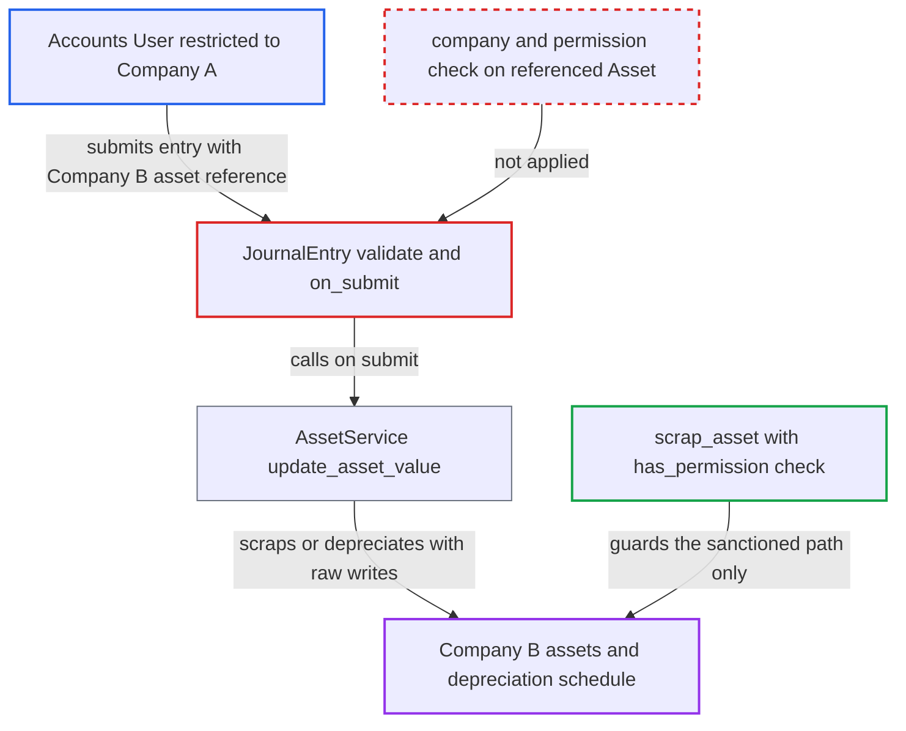

# Journal Entry Asset references unchecked; restricted user can scrap or depreciate other companies' assets

| Field | Value |
|---|---|
| ID | `find_01EzuCFkHYEMhsTsY5Cn5kc7` |
| Severity | **High** |
| Status | open |
| CWE | CWE-639 — Insecure direct object reference |
| Created | 2026-10-27T21:26:29.245589Z |
| Claude Security | https://claude.ai/security/findings/find_01EzuCFkHYEMhsTsY5Cn5kc7 |

## Description

A user restricted to one company can scrap or change the depreciation of another company's assets. That misstates the other company's fixed-asset records and stops its scheduled depreciation. The attacker needs an `Accounts User` login that can submit a Journal Entry in their own company. The cause is that `JournalEntry.validate()` never checks the Asset named in `reference_name`, and `AssetService` then writes to that asset on submit.

1. **Attacker (Accounts User restricted to Company A)** creates a balanced Company A Journal Entry that names a Company B asset. One row has `reference_type = "Asset"` and `reference_name` set to the Company B asset name, which is sequential and guessable. The `voucher_type` is "Asset Disposal", or "Depreciation Entry" with a debit to a Company A Expense account. ([`erpnext/accounts/doctype/journal_entry_account/journal_entry_account.json:189-204`](https://github.com/cx-benchmark/erpnext/blob/90e7aefca73da3c440d2e8da7472fcb67838e678/erpnext/accounts/doctype/journal_entry_account/journal_entry_account.json#L189-L204))
2. **Frappe User Permissions** do not evaluate the Dynamic Link `reference_name`. The report assumes this for the pinned Frappe >=17,\<18, and the repository's own comments say the same. The restriction to Company A therefore does not stop the row naming a Company B asset. ([`erpnext/accounts/doctype/journal_entry_account/journal_entry_account.json:189-204`](https://github.com/cx-benchmark/erpnext/blob/90e7aefca73da3c440d2e8da7472fcb67838e678/erpnext/accounts/doctype/journal_entry_account/journal_entry_account.json#L189-L204))
3. **the handler `validate()`** accepts the entry without checking the referenced asset. `validate_account_company` checks only each row's `account`. The reference validator covers only Sales/Purchase Invoice/Order, and `validate_transaction_company` covers only Item/Customer/Supplier. ([`erpnext/accounts/doctype/journal_entry/journal_entry.py:141-195`](https://github.com/cx-benchmark/erpnext/blob/90e7aefca73da3c440d2e8da7472fcb67838e678/erpnext/accounts/doctype/journal_entry/journal_entry.py#L141-L195))
4. **the handler `on_submit`** calls `AssetService(self).update_asset_value()` after GL posting. Any user who can submit a Journal Entry in their own company triggers this call. ([`erpnext/accounts/doctype/journal_entry/journal_entry.py:241-251`](https://github.com/cx-benchmark/erpnext/blob/90e7aefca73da3c440d2e8da7472fcb67838e678/erpnext/accounts/doctype/journal_entry/journal_entry.py#L241-L251))
5. **`AssetService`** writes to the named Company B asset with raw database writes. `update_asset_on_disposal` sets `disposal_date` and `journal_entry_for_scrap`, and the status becomes `Scrapped`. `update_asset_on_depreciation` lowers `value_after_depreciation` and stamps the entry on a matching Depreciation Schedule row. Neither function checks company or permission. ([`erpnext/accounts/doctype/journal_entry/services/asset_service.py:58-128`](https://github.com/cx-benchmark/erpnext/blob/90e7aefca73da3c440d2e8da7472fcb67838e678/erpnext/accounts/doctype/journal_entry/services/asset_service.py#L58-L128))
6. **depreciation scheduler** skips the affected asset from then on. It books only assets in status `Submitted` or `Partially Depreciated`, and only schedule rows with no `journal_entry`. ([`erpnext/assets/doctype/asset/depreciation.py:96-97`](https://github.com/cx-benchmark/erpnext/blob/90e7aefca73da3c440d2e8da7472fcb67838e678/erpnext/assets/doctype/asset/depreciation.py#L96-L97))

## Assessment

The attacker is an authenticated `Accounts User` whose User Permissions confine them to Company A. They submit the Journal Entry through `/api/resource` or the desk. The entry is balanced and posts GL rows only in Company A. No victim action is needed. The attack relies on Frappe User Permissions not checking Dynamic Links, which the report assumes for the pinned Frappe >=17,\<18.

Impact: The attacker can mark any Company B asset `Scrapped` with a chosen disposal date. They can also cut its `value_after_depreciation` by any amount and mark depreciation-schedule rows as booked. Company B's scheduled depreciation then stops, which misstates its financial statements. No GL entries are written in Company B and no data is disclosed. Cancelling an `Asset Disposal` entry does not clear the scrap fields, so undoing the damage needs someone with rights in both companies.

## Recommendation

Journal Entry rows that reference an `Asset` are not checked against the entry's company or against the user's permission on that asset. `AssetService` still writes the referenced asset on submit, bypassing permissions.

Fix criteria: Validation rejects a Journal Entry when any row with `reference_type == "Asset"` names an asset whose `company` differs from the entry's `company`. For user-initiated saves, it also rejects the entry when the user lacks write permission on that asset. A Company A restricted user who submits an Asset Disposal or Depreciation Entry referencing a Company B asset gets an error. The Company B asset's `status`, `value_after_depreciation`, `disposal_date`, `journal_entry_for_scrap` and Depreciation Schedule rows stay unchanged.

## Evidence

**https://github.com/cx-benchmark/erpnext**

- [`erpnext/accounts/doctype/journal_entry/services/asset_service.py:58-128`](https://github.com/cx-benchmark/erpnext/blob/90e7aefca73da3c440d2e8da7472fcb67838e678/erpnext/accounts/doctype/journal_entry/services/asset_service.py#L58-L128)
- [`erpnext/accounts/doctype/journal_entry/journal_entry.py:241-251`](https://github.com/cx-benchmark/erpnext/blob/90e7aefca73da3c440d2e8da7472fcb67838e678/erpnext/accounts/doctype/journal_entry/journal_entry.py#L241-L251)
- [`erpnext/accounts/doctype/journal_entry/journal_entry.py:141-195`](https://github.com/cx-benchmark/erpnext/blob/90e7aefca73da3c440d2e8da7472fcb67838e678/erpnext/accounts/doctype/journal_entry/journal_entry.py#L141-L195)
- [`erpnext/accounts/doctype/journal_entry/services/reference_validator.py:14-60`](https://github.com/cx-benchmark/erpnext/blob/90e7aefca73da3c440d2e8da7472fcb67838e678/erpnext/accounts/doctype/journal_entry/services/reference_validator.py#L14-L60)
- [`erpnext/accounts/doctype/journal_entry_account/journal_entry_account.json:189-204`](https://github.com/cx-benchmark/erpnext/blob/90e7aefca73da3c440d2e8da7472fcb67838e678/erpnext/accounts/doctype/journal_entry_account/journal_entry_account.json#L189-L204)
- [`erpnext/stock/doctype/company_restriction/company_restriction.py:14`](https://github.com/cx-benchmark/erpnext/blob/90e7aefca73da3c440d2e8da7472fcb67838e678/erpnext/stock/doctype/company_restriction/company_restriction.py#L14)
- [`erpnext/assets/doctype/asset/depreciation.py:373-375`](https://github.com/cx-benchmark/erpnext/blob/90e7aefca73da3c440d2e8da7472fcb67838e678/erpnext/assets/doctype/asset/depreciation.py#L373-L375)
- [`erpnext/assets/doctype/asset/depreciation.py:96-97`](https://github.com/cx-benchmark/erpnext/blob/90e7aefca73da3c440d2e8da7472fcb67838e678/erpnext/assets/doctype/asset/depreciation.py#L96-L97)

