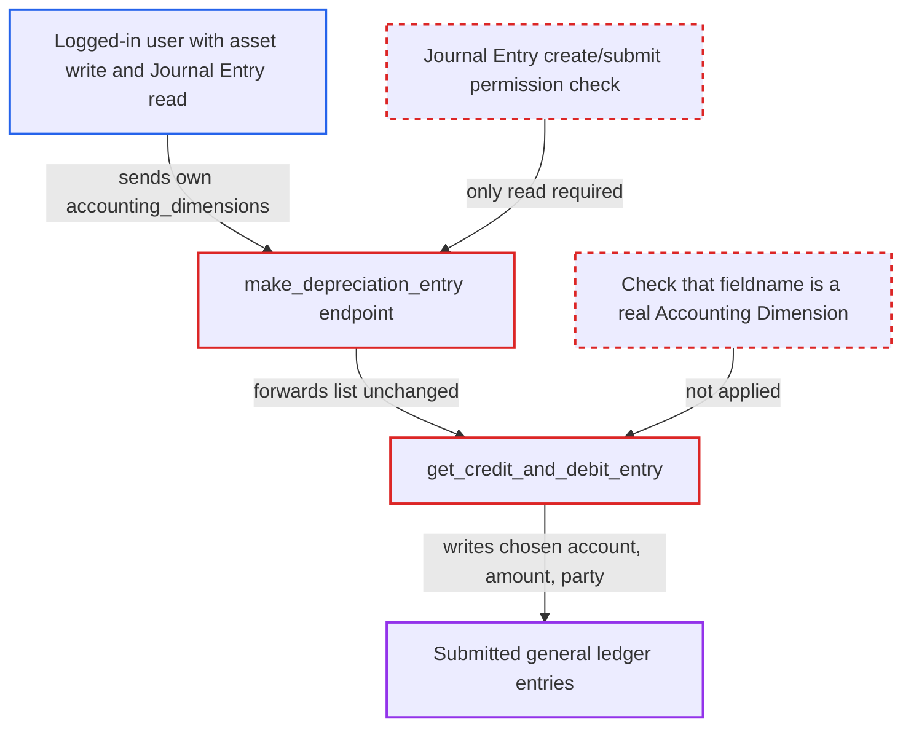

# make_depreciation_entry lets callers set arbitrary Journal Entry row fields via accounting_dimensions

| Field | Value |
|---|---|
| ID | `find_017VzbMnPvBRHLQxcpFeAMJt` |
| Severity | **High** |
| Status | open |
| CWE | CWE-915 — Mass assignment |
| Created | 2026-10-27T21:08:05.410601Z |
| Claude Security | https://claude.ai/security/findings/find_017VzbMnPvBRHLQxcpFeAMJt |

## Description

A logged-in user with write on Asset and Asset Depreciation Schedule (default role `Quality Manager`) and only read on Journal Entry (for example `Auditor`) can post submitted, balanced general ledger entries of their choosing in the asset's company. They do not need Journal Entry create or submit rights. The whitelisted `make_depreciation_entry` passes a caller-supplied `accounting_dimensions` list to `get_credit_and_debit_entry`. That function writes caller-named fields into the Journal Entry rows without checking them.

1. **attacker** sends a request to the whitelisted `make_depreciation_entry`. The request names a schedule with an unbooked row, a far-future `date` and an `accounting_dimensions` list. The endpoint checks only write on the schedule and the asset, plus the default read on Journal Entry. ([`erpnext/assets/doctype/asset/depreciation.py:168-179`](https://github.com/cx-benchmark/erpnext/blob/90e7aefca73da3c440d2e8da7472fcb67838e678/erpnext/assets/doctype/asset/depreciation.py#L168-L179))
2. **`_make_depreciation_entry`** uses the caller's list instead of the server's list. `accounting_dimensions or get_checks_for_pl_and_bs_accounts()` picks the caller's list whenever it is non-empty, so the server-side list is never consulted. ([`erpnext/assets/doctype/asset/depreciation.py:196`](https://github.com/cx-benchmark/erpnext/blob/90e7aefca73da3c440d2e8da7472fcb67838e678/erpnext/assets/doctype/asset/depreciation.py#L196))
3. **`get_credit_and_debit_entry`** copies caller-chosen fields into the credit and debit rows. Each dict's `fieldname` is used as a row key, with its `default_dimension` as the value, whenever the dict's `company` equals the asset's company and `mandatory_for_bs` or `mandatory_for_pl` is truthy. `fieldname` is never checked against the Accounting Dimension doctype. The caller can therefore set `account`, `credit_in_account_currency`, `debit_in_account_currency`, `party_type`, `party` and `reference_*`, and can target the credit and debit rows separately. ([`erpnext/assets/doctype/asset/depreciation.py:274-303`](https://github.com/cx-benchmark/erpnext/blob/90e7aefca73da3c440d2e8da7472fcb67838e678/erpnext/assets/doctype/asset/depreciation.py#L274-L303))
4. **`_make_depreciation_entry`** saves and submits a `Depreciation Entry` Journal Entry with `ignore_permissions`. The entry is submitted unless the Journal Entry has a workflow, in which case it stays a draft. The caller's missing create/submit right is never applied. ([`erpnext/assets/doctype/asset/depreciation.py:240-258`](https://github.com/cx-benchmark/erpnext/blob/90e7aefca73da3c440d2e8da7472fcb67838e678/erpnext/assets/doctype/asset/depreciation.py#L240-L258))
5. **Journal Entry validation** accepts the tampered rows. It checks only that accounts belong to the company, that receivable/payable rows have a party, and that debits equal credits. The Depreciation-Entry check covers only rows of account type `Depreciation`. ([`erpnext/accounts/doctype/journal_entry/services/asset_service.py:26-37`](https://github.com/cx-benchmark/erpnext/blob/90e7aefca73da3c440d2e8da7472fcb67838e678/erpnext/accounts/doctype/journal_entry/services/asset_service.py#L26-L37))

## Assessment

The attacker is a logged-in desk user with write on Asset and Asset Depreciation Schedule (default role `Quality Manager`) and read on Journal Entry (for example the `Auditor` role), but no Journal Entry create or submit right. They pick a schedule with an unbooked row and POST to `make_depreciation_entry` with a far-future `date`. The `accounting_dimensions` dicts name `account`, `credit_in_account_currency` or `debit_in_account_currency`, and `party_type` and `party`. Each dict carries the asset's `company` and a `mandatory_for_bs` or `mandatory_for_pl` flag. The report notes that whitelisted methods are callable by any logged-in user. An `Accounts User` can already submit Journal Entries and gains nothing. The shipped client call sends only `depr_schedule_name` and `date`.

Impact: The attacker posts submitted general ledger entries with any non-group accounts, any amount and any party. Examples are crediting a customer's receivable or debiting a supplier's payable. Reach is limited to companies where User Permissions let them write assets. If the Journal Entry has a workflow, the entry stays a draft. Nothing is disclosed and availability is not affected.

## Recommendation

(1) The whitelisted `make_depreciation_entry` exposes `accounting_dimensions`, an internal scheduler parameter, to API callers. `get_credit_and_debit_entry` then assigns caller-named keys into Journal Entry Account rows without checking them against the configured Accounting Dimensions.

Fix criteria: A request to `make_depreciation_entry` cannot influence the dimension list. The list is either derived server-side or limited to fieldnames of enabled Accounting Dimensions. A call whose `accounting_dimensions` names `account`, `party` or `credit_in_account_currency` produces a Journal Entry that still uses the asset category's depreciation accounts and the schedule amount.

(2) The endpoint checks only read on Journal Entry, yet it ends in a Journal Entry saved and submitted with `ignore_permissions`.

Fix criteria: The endpoint requires the right the action implies, Journal Entry create/submit, consistent with `scrap_asset`. A user with only Journal Entry read receives a PermissionError.

## Evidence

**https://github.com/cx-benchmark/erpnext**

- [`erpnext/assets/doctype/asset/depreciation.py:274-303`](https://github.com/cx-benchmark/erpnext/blob/90e7aefca73da3c440d2e8da7472fcb67838e678/erpnext/assets/doctype/asset/depreciation.py#L274-L303)
- [`erpnext/assets/doctype/asset/depreciation.py:168-179`](https://github.com/cx-benchmark/erpnext/blob/90e7aefca73da3c440d2e8da7472fcb67838e678/erpnext/assets/doctype/asset/depreciation.py#L168-L179)
- [`erpnext/assets/doctype/asset/depreciation.py:196`](https://github.com/cx-benchmark/erpnext/blob/90e7aefca73da3c440d2e8da7472fcb67838e678/erpnext/assets/doctype/asset/depreciation.py#L196)
- [`erpnext/assets/doctype/asset/depreciation.py:240-258`](https://github.com/cx-benchmark/erpnext/blob/90e7aefca73da3c440d2e8da7472fcb67838e678/erpnext/assets/doctype/asset/depreciation.py#L240-L258)
- [`erpnext/accounts/doctype/journal_entry/services/asset_service.py:26-37`](https://github.com/cx-benchmark/erpnext/blob/90e7aefca73da3c440d2e8da7472fcb67838e678/erpnext/accounts/doctype/journal_entry/services/asset_service.py#L26-L37)
- [`erpnext/assets/doctype/asset_depreciation_schedule/asset_depreciation_schedule.js:28-44`](https://github.com/cx-benchmark/erpnext/blob/90e7aefca73da3c440d2e8da7472fcb67838e678/erpnext/assets/doctype/asset_depreciation_schedule/asset_depreciation_schedule.js#L28-L44)

