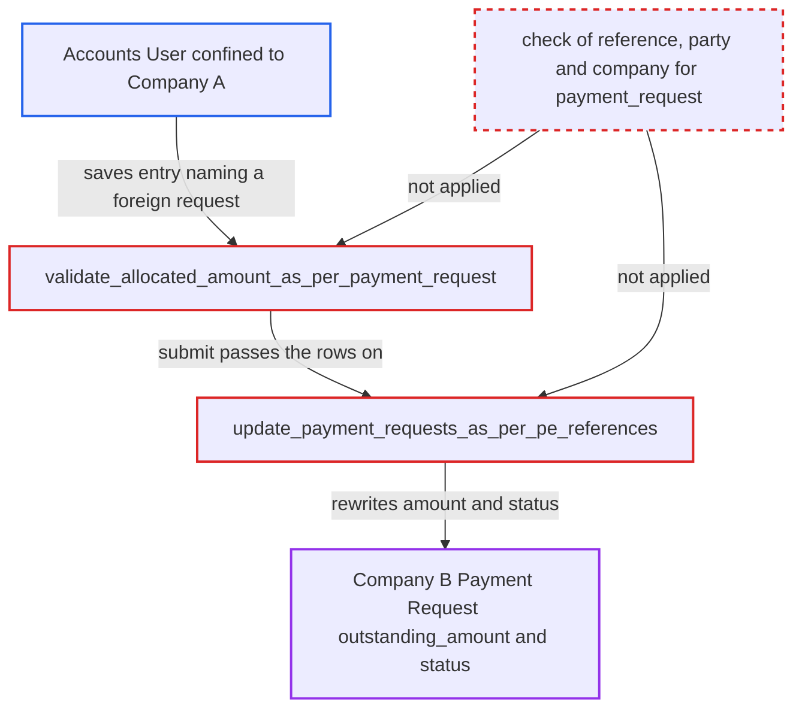

# Payment Entry rows rewrite any company's Payment Request outstanding and status

| Field | Value |
|---|---|
| ID | `find_01BP6HxfhaR5w2XjmETBEQJK` |
| Severity | **High** |
| Status | open |
| CWE | CWE-639 — Authorization bypass via key |
| Created | 2026-10-27T21:56:39.749196Z |
| Claude Security | https://claude.ai/security/findings/find_01BP6HxfhaR5w2XjmETBEQJK |

## Description

An Accounts User limited to one company can change the `outstanding_amount` and `status` of any other company's Payment Request, for example marking it `Paid` with no payment. They can also read any request's outstanding amount. The attacker needs only a Payment Entry they are allowed to create. The server never checks that the row's `payment_request` belongs to the row's reference, party or company. `validate_allocated_amount_as_per_payment_request` and `update_payment_requests_as_per_pe_references` are the weak points.

1. **Accounts User confined to Company A** saves a Payment Entry with a foreign request name in a reference row. The row's `payment_request` is a plain writable link, so a guessed Company-B name such as the sequential `ACC-PRQ-.YYYY.-` names is accepted. Raw `/api/resource` or `savedocs` calls skip the desk link picker, which is the only place the pairing is enforced. ([`erpnext/accounts/doctype/payment_entry_reference/payment_entry_reference.json:133-137`](https://github.com/cx-benchmark/erpnext/blob/90e7aefca73da3c440d2e8da7472fcb67838e678/erpnext/accounts/doctype/payment_entry_reference/payment_entry_reference.json#L133-L137))
2. **the method `validate_allocated_amount_as_per_payment_request`** checks only that the allocation fits the named request's outstanding amount. A positive allocation at or below the outstanding amount passes. A negative allocation, as on a return-invoice row, also passes the `<=` check and will raise the outstanding amount. ([`erpnext/accounts/doctype/payment_entry/payment_entry.py:459-478`](https://github.com/cx-benchmark/erpnext/blob/90e7aefca73da3c440d2e8da7472fcb67838e678/erpnext/accounts/doctype/payment_entry/payment_entry.py#L459-L478))
3. **the lookup `get_payment_request_outstanding_set_in_references`** reads the request by name alone. It applies no docstatus, company or reference filter, so any existing Payment Request satisfies the check. `validate_reference_documents` never compares the row's `payment_request` with the reference either. ([`erpnext/accounts/doctype/payment_entry/payment_entry.py:2077-2098`](https://github.com/cx-benchmark/erpnext/blob/90e7aefca73da3c440d2e8da7472fcb67838e678/erpnext/accounts/doctype/payment_entry/payment_entry.py#L2077-L2098))
4. **Accounts User** submits the Payment Entry. `on_submit` calls `update_payment_requests()`, which passes the reference rows to the update function. Cancelling the entry reverses the change. ([`erpnext/accounts/doctype/payment_entry/payment_entry.py:258-262`](https://github.com/cx-benchmark/erpnext/blob/90e7aefca73da3c440d2e8da7472fcb67838e678/erpnext/accounts/doctype/payment_entry/payment_entry.py#L258-L262))
5. **the function `update_payment_requests_as_per_pe_references`** rewrites the Company-B request's `outstanding_amount` and `status`. It loads the named requests, recomputes the amount from the row's `allocated_amount`, derives `Paid`, `Partially Paid`, `Requested` or `Initiated`, and writes both with `frappe.db.bulk_update`. It performs no permission or ownership check. ([`erpnext/accounts/doctype/payment_request/payment_request.py:1242-1313`](https://github.com/cx-benchmark/erpnext/blob/90e7aefca73da3c440d2e8da7472fcb67838e678/erpnext/accounts/doctype/payment_request/payment_request.py#L1242-L1313))
6. **victim company's payment flow** acts on the forged request state. A forged `Paid` status makes the `Integration Request` validate hook refuse gateway payment. The forged amount also feeds the order's `advance_payment_status`. ([`erpnext/accounts/doctype/payment_request/payment_request.py:1399-1408`](https://github.com/cx-benchmark/erpnext/blob/90e7aefca73da3c440d2e8da7472fcb67838e678/erpnext/accounts/doctype/payment_request/payment_request.py#L1399-L1408))

## Assessment

The attacker is an authenticated Accounts User whose User Permissions confine them to Company A. They create a Company-A Payment Entry against their own customer's invoice, through desk or `/api/resource`. One reference row names a guessed Company-B Payment Request in `payment_request`. Its `allocated_amount` is at or below that request's outstanding amount, or negative to raise it. No victim action is needed. The same mismatch also works inside one company against another customer's request. There the user can already record payments, so the cross-company case is the main gain. The report assumes that Frappe User Permissions on Company check only Link fields that target Company. It marks this as an assumption for Frappe `>=17.0.0-dev,<18`, not verified in the checkout.

Impact: The attacker can set the `outstanding_amount` and `status` of any company's Payment Request. They can mark it `Paid` with no payment, or reset a paid one to `Requested`. This changes the victim order's `advance_payment_status` and blocks the victim customer's online payment of that request. A later gateway receipt is booked at the forged outstanding amount by `create_payment_entry`. Any request's outstanding amount is also disclosed through `payment_request_outstanding` and the allocation error. No GL entries are written in the victim company.

## Recommendation

`Payment Entry Reference.payment_request` is accepted as client-supplied. `validate_allocated_amount_as_per_payment_request` checks only the request's outstanding amount. `update_payment_requests_as_per_pe_references` writes the named request without checking that it belongs to the row's reference, the entry's party and company, or that the caller may act on it.

Fix criteria: During validate, and again before the submit and cancel update, every row with a `payment_request` is rejected unless that request is submitted. Its `reference_doctype`/`reference_name`, `party_type`/`party` and `company` must equal the row's reference and the entry's party and company. A Company-A user submitting a Payment Entry that names a Company-B or unrelated request gets a validation error. That request's outstanding amount and status stay unchanged. The row's `payment_request_outstanding` returns no value for requests that fail the same check.

## Evidence

**https://github.com/cx-benchmark/erpnext**

- [`erpnext/accounts/doctype/payment_entry/payment_entry.py:459-478`](https://github.com/cx-benchmark/erpnext/blob/90e7aefca73da3c440d2e8da7472fcb67838e678/erpnext/accounts/doctype/payment_entry/payment_entry.py#L459-L478)
- [`erpnext/accounts/doctype/payment_request/payment_request.py:1242-1313`](https://github.com/cx-benchmark/erpnext/blob/90e7aefca73da3c440d2e8da7472fcb67838e678/erpnext/accounts/doctype/payment_request/payment_request.py#L1242-L1313)
- [`erpnext/accounts/doctype/payment_entry/payment_entry.py:258-262`](https://github.com/cx-benchmark/erpnext/blob/90e7aefca73da3c440d2e8da7472fcb67838e678/erpnext/accounts/doctype/payment_entry/payment_entry.py#L258-L262)
- [`erpnext/accounts/doctype/payment_entry/payment_entry.py:2077-2098`](https://github.com/cx-benchmark/erpnext/blob/90e7aefca73da3c440d2e8da7472fcb67838e678/erpnext/accounts/doctype/payment_entry/payment_entry.py#L2077-L2098)
- [`erpnext/accounts/doctype/payment_entry/payment_entry.py:769-850`](https://github.com/cx-benchmark/erpnext/blob/90e7aefca73da3c440d2e8da7472fcb67838e678/erpnext/accounts/doctype/payment_entry/payment_entry.py#L769-L850)
- [`erpnext/accounts/doctype/payment_entry_reference/payment_entry_reference.json:133-137`](https://github.com/cx-benchmark/erpnext/blob/90e7aefca73da3c440d2e8da7472fcb67838e678/erpnext/accounts/doctype/payment_entry_reference/payment_entry_reference.json#L133-L137)
- [`erpnext/accounts/doctype/payment_entry/payment_entry.js:202-215`](https://github.com/cx-benchmark/erpnext/blob/90e7aefca73da3c440d2e8da7472fcb67838e678/erpnext/accounts/doctype/payment_entry/payment_entry.js#L202-L215)
- [`erpnext/stock/doctype/company_restriction/company_restriction.py:256-268`](https://github.com/cx-benchmark/erpnext/blob/90e7aefca73da3c440d2e8da7472fcb67838e678/erpnext/stock/doctype/company_restriction/company_restriction.py#L256-L268)
- [`erpnext/accounts/doctype/payment_entry_reference/payment_entry_reference.py:40-45`](https://github.com/cx-benchmark/erpnext/blob/90e7aefca73da3c440d2e8da7472fcb67838e678/erpnext/accounts/doctype/payment_entry_reference/payment_entry_reference.py#L40-L45)
- [`erpnext/accounts/doctype/payment_request/payment_request.py:1399-1408`](https://github.com/cx-benchmark/erpnext/blob/90e7aefca73da3c440d2e8da7472fcb67838e678/erpnext/accounts/doctype/payment_request/payment_request.py#L1399-L1408)
- [`erpnext/accounts/services/advances.py:178-220`](https://github.com/cx-benchmark/erpnext/blob/90e7aefca73da3c440d2e8da7472fcb67838e678/erpnext/accounts/services/advances.py#L178-L220)

