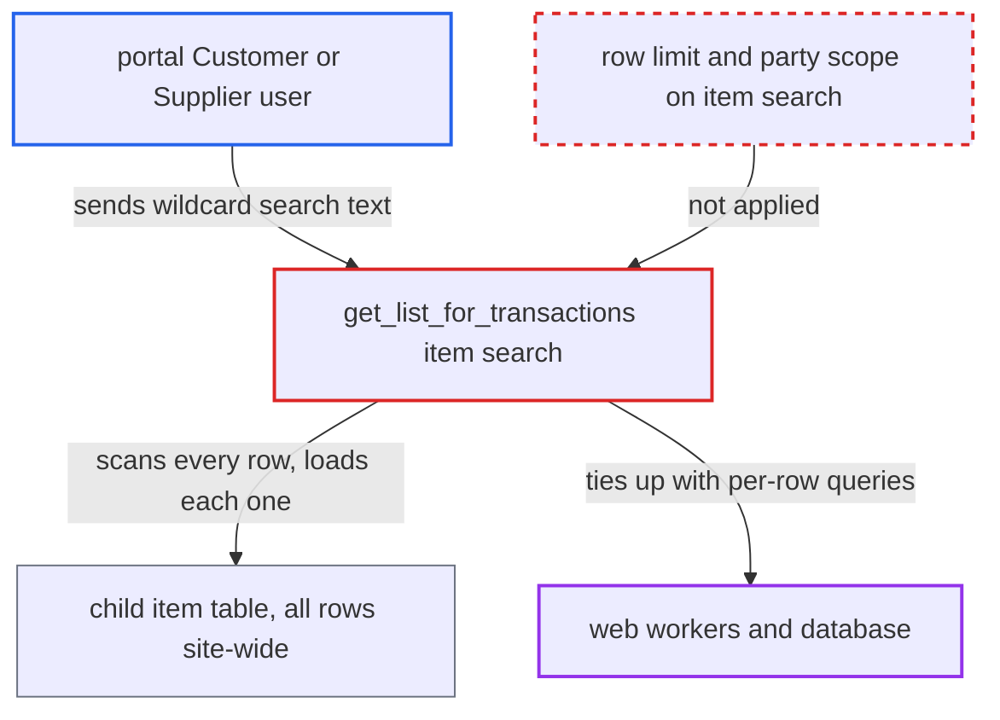

# Portal transaction item search scans and loads every child row site-wide

| Field | Value |
|---|---|
| ID | `find_01A9cg9ENXkUeosfLwH75asd` |
| Severity | **High** |
| Status | open |
| CWE | CWE-770 — Resource allocation without limits |
| Created | 2026-10-27T21:33:45.951381Z |
| Claude Security | https://claude.ai/security/findings/find_01A9cg9ENXkUeosfLwH75asd |

## Description

A portal Customer or Supplier user can make the site's web workers and database very busy, and this can deny service to every user while the attack lasts. No data is disclosed or changed. The attacker needs only a portal login linked to any party. The cause is `get_list_for_transactions()`, which runs an unbounded, unscoped item search whenever `txt` is set.

1. **portal user** requests a portal transaction list with a wildcard search. The user sends `txt=%` (for example `/orders?txt=%25`) or calls the list API method, and `%` or `_` passes through as a LIKE wildcard that matches every row. ([`erpnext/controllers/tests/test_website_list_for_contact.py:61-82`](https://github.com/cx-benchmark/erpnext/blob/90e7aefca73da3c440d2e8da7472fcb67838e678/erpnext/controllers/tests/test_website_list_for_contact.py#L61-L82))
2. **`get_transaction_list`** adds the party filter and passes `txt` on unchanged. It sets `ignore_permissions=True` and hands the caller's `txt` straight to `get_list_for_transactions`, and the party filter is used only in the final query. ([`erpnext/controllers/website_list_for_contact.py:107-143`](https://github.com/cx-benchmark/erpnext/blob/90e7aefca73da3c440d2e8da7472fcb67838e678/erpnext/controllers/website_list_for_contact.py#L107-L143))
3. **`get_list_for_transactions()`** scans the whole child item table with `frappe.get_all`. The `item_name` LIKE query has no limit and no party restriction, so it returns every matching row on the site, for example in `tabSales Order Item`. ([`erpnext/controllers/website_list_for_contact.py:180-186`](https://github.com/cx-benchmark/erpnext/blob/90e7aefca73da3c440d2e8da7472fcb67838e678/erpnext/controllers/website_list_for_contact.py#L180-L186))
4. **`get_list_for_transactions()`** calls `frappe.get_doc` for each matching row and adds one `or_filters` term per row. Each call costs one SELECT plus building a Document, only to read `child.parent`. ([`erpnext/controllers/website_list_for_contact.py:180-186`](https://github.com/cx-benchmark/erpnext/blob/90e7aefca73da3c440d2e8da7472fcb67838e678/erpnext/controllers/website_list_for_contact.py#L180-L186))
5. **`get_list_for_transactions()`** sends one `frappe.get_list` query with all the OR terms. The query has one `OR name = ...` term per matching row, and only this query carries the caller's party filters. ([`erpnext/controllers/website_list_for_contact.py:188-200`](https://github.com/cx-benchmark/erpnext/blob/90e7aefca73da3c440d2e8da7472fcb67838e678/erpnext/controllers/website_list_for_contact.py#L188-L200))

## Assessment

The attacker is a portal Customer or Supplier user linked to any party. They repeatedly request a portal transaction list with `txt=%`. The lists affected are Sales Order, Sales Invoice, Quotation, Delivery Note, Purchase Order, Purchase Invoice, Supplier Quotation and Material Request. The entry point is either the portal page (for example `/orders?txt=%25`) or the list API method. No rate limit or bound in the code stops the requests. A few concurrent requests are enough to keep every web worker busy.

Impact: The attacker can exhaust the web workers and load the database, which denies service to all users while the requests continue. Each request costs work proportional to the number of item rows on the whole site. The party filter on the final query still holds, so no data is disclosed or changed.

## Recommendation

The portal item-name search reads the whole child table with no limit and no scope to the caller's parties. It loads a Document for every match and builds an OR list that grows with the match count, so one request costs work proportional to the site's entire transaction history.

Fix criteria: The item search is one bounded query, limited to the requested page size and restricted to parent documents that pass the caller's party filters (for example a join or subquery on `parent`). It does not instantiate a Document or add a filter term per matched row. A request with `txt=%` against a large item table runs a constant number of queries, and its time is comparable to an unfiltered portal list request.

## Evidence

**https://github.com/cx-benchmark/erpnext**

- [`erpnext/controllers/website_list_for_contact.py:180-186`](https://github.com/cx-benchmark/erpnext/blob/90e7aefca73da3c440d2e8da7472fcb67838e678/erpnext/controllers/website_list_for_contact.py#L180-L186)
- [`erpnext/controllers/website_list_for_contact.py:188-200`](https://github.com/cx-benchmark/erpnext/blob/90e7aefca73da3c440d2e8da7472fcb67838e678/erpnext/controllers/website_list_for_contact.py#L188-L200)
- [`erpnext/controllers/website_list_for_contact.py:107-143`](https://github.com/cx-benchmark/erpnext/blob/90e7aefca73da3c440d2e8da7472fcb67838e678/erpnext/controllers/website_list_for_contact.py#L107-L143)
- [`erpnext/controllers/website_list_for_contact.py:35-52`](https://github.com/cx-benchmark/erpnext/blob/90e7aefca73da3c440d2e8da7472fcb67838e678/erpnext/controllers/website_list_for_contact.py#L35-L52)
- [`erpnext/selling/doctype/sales_order/sales_order.py:790-805`](https://github.com/cx-benchmark/erpnext/blob/90e7aefca73da3c440d2e8da7472fcb67838e678/erpnext/selling/doctype/sales_order/sales_order.py#L790-L805)
- [`erpnext/controllers/tests/test_website_list_for_contact.py:61-82`](https://github.com/cx-benchmark/erpnext/blob/90e7aefca73da3c440d2e8da7472fcb67838e678/erpnext/controllers/tests/test_website_list_for_contact.py#L61-L82)
- [`erpnext/stock/tests/test_serial_batch_identity.py:1283-1299`](https://github.com/cx-benchmark/erpnext/blob/90e7aefca73da3c440d2e8da7472fcb67838e678/erpnext/stock/tests/test_serial_batch_identity.py#L1283-L1299)

