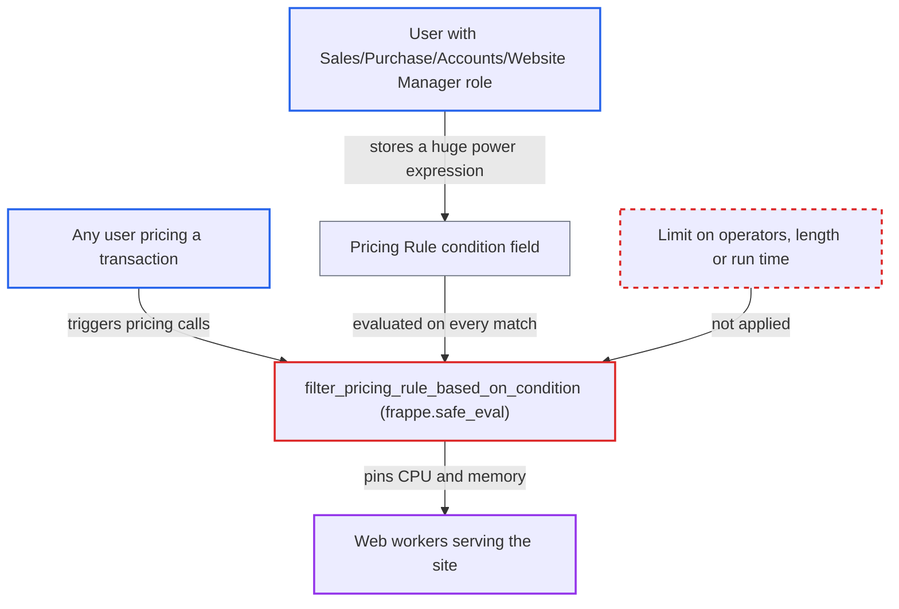

# Pricing Rule condition allows unbounded exponentiation, pinning workers on every priced transaction

| Field | Value |
|---|---|
| ID | `find_01DG5poLf6anft3N7emGvr1B` |
| Severity | **High** |
| Status | open |
| CWE | CWE-400 — Uncontrolled resource consumption |
| Created | 2026-10-27T21:50:37.373423Z |
| Claude Security | https://claude.ai/security/findings/find_01DG5poLf6anft3N7emGvr1B |

## Description

A user with the Sales Manager, Purchase Manager, Accounts Manager or Website Manager role can make the site stop serving requests. They save one Pricing Rule whose `condition` is a huge power such as `9**9**9 > 0`. The code evaluates that text with `frappe.safe_eval` and has no limit on operators, length or run time, and `validate_condition` only rejects a `name = value` pattern.

1. **Attacker with a Pricing Rule write role** saves a Pricing Rule with a costly `condition`. The rule applies to the root Item Group for Selling, and the condition is `9**9**9 > 0`; `validate_condition` only rejects a `name = value` pattern, so the text is accepted. ([`erpnext/accounts/doctype/pricing_rule/pricing_rule.py:349-355`](https://github.com/cx-benchmark/erpnext/blob/90e7aefca73da3c440d2e8da7472fcb67838e678/erpnext/accounts/doctype/pricing_rule/pricing_rule.py#L349-L355))
2. **the Pricing Rule permissions** allow roles below System Manager to store the rule. Create and write on Pricing Rule are granted to `Accounts Manager`, `Sales Manager`, `Purchase Manager` and `Website Manager`, and `condition` is a free-form `Code` field. ([`erpnext/accounts/doctype/pricing_rule/pricing_rule.json:668-723`](https://github.com/cx-benchmark/erpnext/blob/90e7aefca73da3c440d2e8da7472fcb67838e678/erpnext/accounts/doctype/pricing_rule/pricing_rule.json#L668-L723))
3. **the transaction form** calls `apply_pricing_rule` with `doc` when pricing-relevant fields change. Any user entering a Quotation, Sales Order or Invoice for a matching item triggers this; `get_item_details` and `set_missing_item_details` on save reach the same evaluation. ([`erpnext/public/js/controllers/transaction.js:2300-2302`](https://github.com/cx-benchmark/erpnext/blob/90e7aefca73da3c440d2e8da7472fcb67838e678/erpnext/public/js/controllers/transaction.js#L2300-L2302))
4. **`get_pricing_rule_for_item`** passes the document on to `get_pricing_rules`. This is the path into condition evaluation, reached from the whitelisted `apply_pricing_rule`. ([`erpnext/accounts/doctype/pricing_rule/pricing_rule.py:434-477`](https://github.com/cx-benchmark/erpnext/blob/90e7aefca73da3c440d2e8da7472fcb67838e678/erpnext/accounts/doctype/pricing_rule/pricing_rule.py#L434-L477))
5. **`filter_pricing_rule_based_on_condition`** evaluates the stored `condition` with `frappe.safe_eval`. CPython does not fold large powers ahead of time, so `9**9**9` computes `9**387420489` (about 370 million digits) in C and holds the GIL far longer than the request timeout; the `except Exception` only logs after evaluation returns. ([`erpnext/accounts/doctype/pricing_rule/utils.py:84-100`](https://github.com/cx-benchmark/erpnext/blob/90e7aefca73da3c440d2e8da7472fcb67838e678/erpnext/accounts/doctype/pricing_rule/utils.py#L84-L100))

## Assessment

The attacker is a logged-in desk user holding one of `Sales Manager`, `Purchase Manager`, `Accounts Manager` or `Website Manager`. System Manager is not needed. After the rule is saved, no further action by the attacker or a victim is needed. The attacker's own repeated `apply_pricing_rule` calls with a `doc` trigger it, and so does any other user's normal work. That work includes adding items to sales documents, the `get_item_details` call, and `set_missing_item_details` on save. The rule must match by item or group, brand, party, company, date and selling or buying. A rule on the root Item Group matches broadly. The report assumes the pinned Frappe (`>=17.0.0-dev,<18.0.0`, not in the checkout) allows `**` in `frappe.safe_eval`.

Impact: Each matching pricing request takes a web worker's CPU, its GIL and hundreds of MB of memory until the worker is killed. With a root-group rule, every sales transaction entry triggers it. Workers run out and the site stops serving until the rule is found and removed. No data is disclosed or changed.

## Recommendation

The stored `condition` is evaluated with `frappe.safe_eval` with no bound on operators or cost. `validate_condition` does not restrict exponentiation or expression size.

Fix criteria: A Pricing Rule condition cannot use unbounded CPU. Either `**`, `pow`, `<<` and over-long expressions are rejected at save time, or evaluation runs under a strict time limit. A condition like `9**9**9 > 0` then cannot be stored, or is aborted within milliseconds. Saving such a rule fails. `apply_pricing_rule` with an existing rule of that shape returns promptly.

## Evidence

**https://github.com/cx-benchmark/erpnext**

- [`erpnext/accounts/doctype/pricing_rule/utils.py:84-100`](https://github.com/cx-benchmark/erpnext/blob/90e7aefca73da3c440d2e8da7472fcb67838e678/erpnext/accounts/doctype/pricing_rule/utils.py#L84-L100)
- [`erpnext/accounts/doctype/pricing_rule/pricing_rule.py:349-355`](https://github.com/cx-benchmark/erpnext/blob/90e7aefca73da3c440d2e8da7472fcb67838e678/erpnext/accounts/doctype/pricing_rule/pricing_rule.py#L349-L355)
- [`erpnext/accounts/doctype/pricing_rule/pricing_rule.json:668-723`](https://github.com/cx-benchmark/erpnext/blob/90e7aefca73da3c440d2e8da7472fcb67838e678/erpnext/accounts/doctype/pricing_rule/pricing_rule.json#L668-L723)
- [`erpnext/accounts/doctype/pricing_rule/pricing_rule.py:434-477`](https://github.com/cx-benchmark/erpnext/blob/90e7aefca73da3c440d2e8da7472fcb67838e678/erpnext/accounts/doctype/pricing_rule/pricing_rule.py#L434-L477)
- [`erpnext/public/js/controllers/transaction.js:2300-2302`](https://github.com/cx-benchmark/erpnext/blob/90e7aefca73da3c440d2e8da7472fcb67838e678/erpnext/public/js/controllers/transaction.js#L2300-L2302)
- [`erpnext/stock/get_item_details.py:84-196`](https://github.com/cx-benchmark/erpnext/blob/90e7aefca73da3c440d2e8da7472fcb67838e678/erpnext/stock/get_item_details.py#L84-L196)
- [`erpnext/accounts/doctype/financial_report_template/financial_report_validation.py:365-376`](https://github.com/cx-benchmark/erpnext/blob/90e7aefca73da3c440d2e8da7472fcb67838e678/erpnext/accounts/doctype/financial_report_template/financial_report_validation.py#L365-L376)

