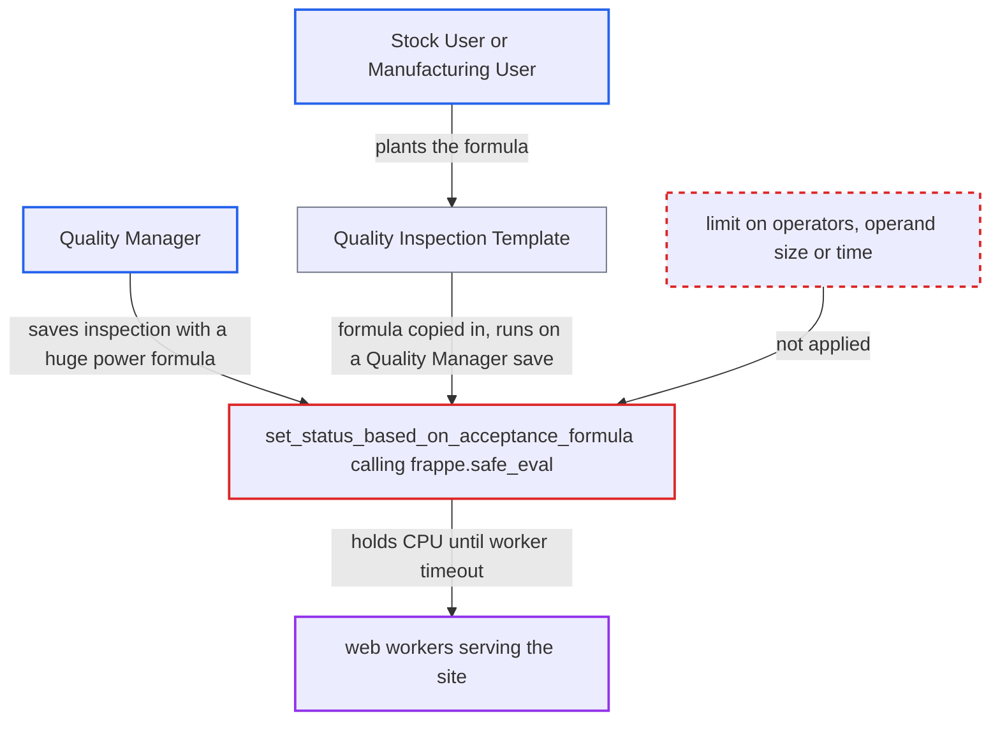

# Quality Inspection acceptance formula evaluated unbounded, letting exponentiation pin web workers

| Field | Value |
|---|---|
| ID | `find_013uGdK54MM6P28zmKPBVyqK` |
| Severity | **High** |
| Status | open |
| CWE | CWE-400 — Uncontrolled resource consumption |
| Created | 2026-10-27T21:50:44.812072Z |
| Claude Security | https://claude.ai/security/findings/find_013uGdK54MM6P28zmKPBVyqK |

## Description

A Quality Manager can freeze the whole site for all users by saving a Quality Inspection whose formula is an enormous power such as `9**9**9 > 0`. A Stock User or Manufacturing User can plant the same formula in a template instead, and it fires when a Quality Manager saves an inspection that uses it. The cause is that `set_status_based_on_acceptance_formula` passes the user-written `acceptance_formula` to `frappe.safe_eval` with no limit on operators, operand size or time.

1. **Quality Manager** sets a formula on a reading of a Quality Inspection. The reading's `formula_based_criteria` is switched on and `acceptance_formula` is an ordinary editable `Code` field, filled with `9**9**9 > 0`. ([`erpnext/stock/doctype/quality_inspection_reading/quality_inspection_reading.json:153-172`](https://github.com/cx-benchmark/erpnext/blob/90e7aefca73da3c440d2e8da7472fcb67838e678/erpnext/stock/doctype/quality_inspection_reading/quality_inspection_reading.json#L153-L172))
2. **Quality Manager** saves the inspection, which runs `validate`. `validate` calls `inspect_and_set_status` on every insert and save. ([`erpnext/stock/doctype/quality_inspection/quality_inspection.py:76-99`](https://github.com/cx-benchmark/erpnext/blob/90e7aefca73da3c440d2e8da7472fcb67838e678/erpnext/stock/doctype/quality_inspection/quality_inspection.py#L76-L99))
3. **the method `inspect_and_set_status`** sends the reading to the formula evaluator. Every non-manual reading that has `formula_based_criteria` set is passed on. ([`erpnext/stock/doctype/quality_inspection/quality_inspection.py:340-347`](https://github.com/cx-benchmark/erpnext/blob/90e7aefca73da3c440d2e8da7472fcb67838e678/erpnext/stock/doctype/quality_inspection/quality_inspection.py#L340-L347))
4. **the method `set_status_based_on_acceptance_formula`** calls `frappe.safe_eval(condition, None, data)` on the stored formula. Nothing limits operators, operand size or running time, and the `except Exception` handler only runs after evaluation returns. ([`erpnext/stock/doctype/quality_inspection/quality_inspection.py:427-452`](https://github.com/cx-benchmark/erpnext/blob/90e7aefca73da3c440d2e8da7472fcb67838e678/erpnext/stock/doctype/quality_inspection/quality_inspection.py#L427-L452))
5. **the Python interpreter** computes `9**387420489` while the request waits. CPython does not fold large powers ahead of time, so the work happens at evaluation. The report assumes `frappe.safe_eval` blocks only `NamedExpr` and `Lambda` and allows `**`. ([`erpnext/accounts/doctype/financial_report_template/financial_report_validation.py:36-37`](https://github.com/cx-benchmark/erpnext/blob/90e7aefca73da3c440d2e8da7472fcb67838e678/erpnext/accounts/doctype/financial_report_template/financial_report_validation.py#L36-L37))
6. **Quality Manager** repeats the save so that each request ties up one web worker. Each request holds a worker's CPU and hundreds of MB until the server's worker timeout kills it, so a few repeated saves occupy every worker.

## Assessment

The main attacker is an employee with the non-admin Quality Manager role. That role is the only non-admin one that can create or write a Quality Inspection. They need no other condition: they save an inspection whose reading has `formula_based_criteria` set to 1 and `acceptance_formula` set to `9**9**9 > 0`, whenever they like. A second way in is through a template. A Stock User or Manufacturing User can write a Quality Inspection Template, and the template only checks that a formula is non-empty. `get_item_specification_details` copies the template formula into new inspections. For Job Card In-Process inspections, `set_acceptance_criteria_from_template` copies it again on every validate. Those users cannot save inspections themselves, so the planted formula fires when a Quality Manager saves an inspection using that template. This includes saves through `submit_quality_inspection` in the shop floor page.

Impact: The attacker can make the site stop serving all users for as long as the attack lasts. A few concurrent, repeated saves occupy every web worker. No data is read or changed, because the evaluation context holds only numeric readings.

## Recommendation

User-written `acceptance_formula` strings are evaluated with `frappe.safe_eval`. That allows big-integer exponentiation and shifts and has no limit on operand size or time. This applies to formulas in Quality Inspection readings and in template rows that Stock Users and Manufacturing Users can write.

Fix criteria: Evaluating an acceptance formula finishes in bounded time for any stored input. Exponentiation and shifts are rejected or bounded, or the allowed grammar is limited to comparisons, boolean operators, numeric literals and the reading names. This is enforced both when a template is saved and when an inspection is saved. Saving a template or an inspection with `9**9**9 > 0` is refused or fails promptly, with no measurable CPU or memory growth.

## Evidence

**https://github.com/cx-benchmark/erpnext**

- [`erpnext/stock/doctype/quality_inspection/quality_inspection.py:427-452`](https://github.com/cx-benchmark/erpnext/blob/90e7aefca73da3c440d2e8da7472fcb67838e678/erpnext/stock/doctype/quality_inspection/quality_inspection.py#L427-L452)
- [`erpnext/stock/doctype/quality_inspection/quality_inspection.py:76-99`](https://github.com/cx-benchmark/erpnext/blob/90e7aefca73da3c440d2e8da7472fcb67838e678/erpnext/stock/doctype/quality_inspection/quality_inspection.py#L76-L99)
- [`erpnext/stock/doctype/quality_inspection/quality_inspection.py:340-347`](https://github.com/cx-benchmark/erpnext/blob/90e7aefca73da3c440d2e8da7472fcb67838e678/erpnext/stock/doctype/quality_inspection/quality_inspection.py#L340-L347)
- [`erpnext/stock/doctype/quality_inspection/quality_inspection.json:290-345`](https://github.com/cx-benchmark/erpnext/blob/90e7aefca73da3c440d2e8da7472fcb67838e678/erpnext/stock/doctype/quality_inspection/quality_inspection.json#L290-L345)
- [`erpnext/stock/doctype/quality_inspection_reading/quality_inspection_reading.json:153-172`](https://github.com/cx-benchmark/erpnext/blob/90e7aefca73da3c440d2e8da7472fcb67838e678/erpnext/stock/doctype/quality_inspection_reading/quality_inspection_reading.json#L153-L172)
- [`erpnext/stock/doctype/quality_inspection_template/quality_inspection_template.py:64-70`](https://github.com/cx-benchmark/erpnext/blob/90e7aefca73da3c440d2e8da7472fcb67838e678/erpnext/stock/doctype/quality_inspection_template/quality_inspection_template.py#L64-L70)
- [`erpnext/stock/doctype/quality_inspection_template/quality_inspection_template.json:45-96`](https://github.com/cx-benchmark/erpnext/blob/90e7aefca73da3c440d2e8da7472fcb67838e678/erpnext/stock/doctype/quality_inspection_template/quality_inspection_template.json#L45-L96)
- [`erpnext/stock/doctype/quality_inspection/quality_inspection.py:196-214`](https://github.com/cx-benchmark/erpnext/blob/90e7aefca73da3c440d2e8da7472fcb67838e678/erpnext/stock/doctype/quality_inspection/quality_inspection.py#L196-L214)
- [`erpnext/manufacturing/page/shop_floor/shop_floor.py:222-287`](https://github.com/cx-benchmark/erpnext/blob/90e7aefca73da3c440d2e8da7472fcb67838e678/erpnext/manufacturing/page/shop_floor/shop_floor.py#L222-L287)
- [`erpnext/accounts/doctype/financial_report_template/financial_report_validation.py:36-37`](https://github.com/cx-benchmark/erpnext/blob/90e7aefca73da3c440d2e8da7472fcb67838e678/erpnext/accounts/doctype/financial_report_template/financial_report_validation.py#L36-L37)

