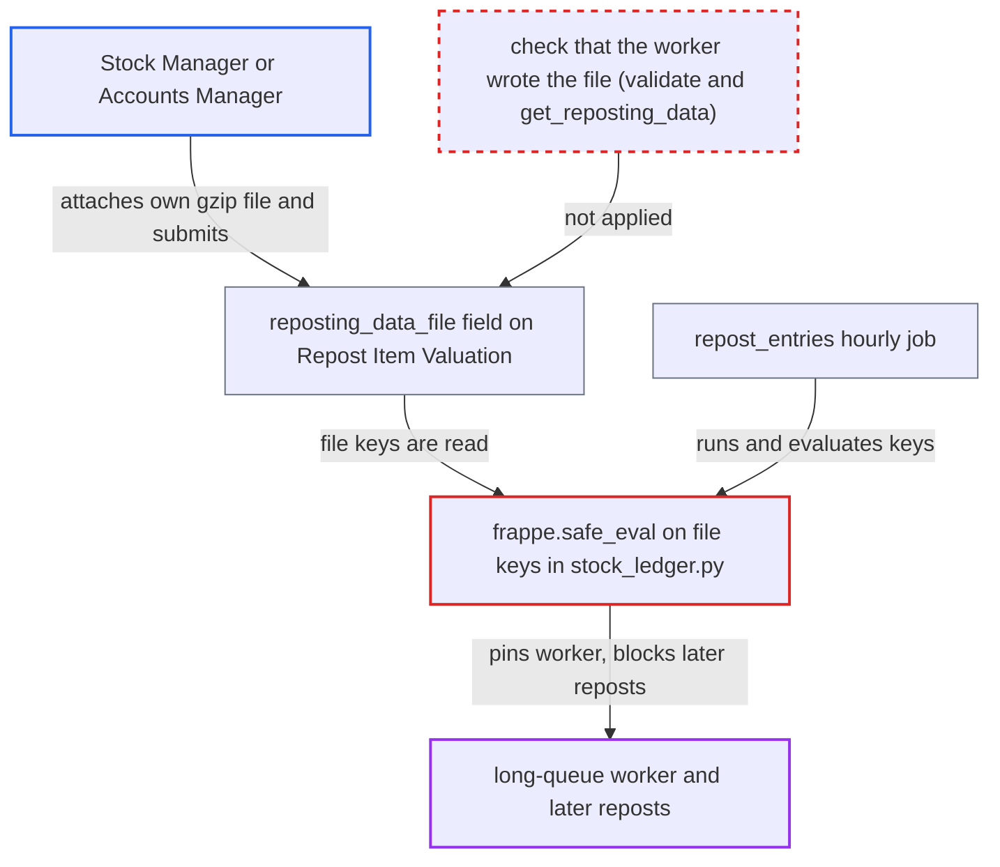

# Repost worker safe_eval()s keys of a user-attachable Repost Item Valuation data file

| Field | Value |
|---|---|
| ID | `find_01XXoGe5BykpQ3GKLKShbYqB` |
| Severity | **High** |
| Status | open |
| CWE | CWE-95 — Eval injection |
| Created | 2026-10-27T22:14:40.457593Z |
| Claude Security | https://claude.ai/security/findings/find_01XXoGe5BykpQ3GKLKShbYqB |

## Description

A user with Stock Manager or Accounts Manager rights can freeze stock reposting for the whole site. They attach a crafted file to a Repost Item Valuation and submit it. The hourly repost job then evaluates the file's keys as code, and a key such as `9**9**9` ties up a worker for tens of minutes or more. The flaw is that `frappe.safe_eval` is called on file keys in `stock_ledger.py`, and the file's origin is never checked.

1. **Stock Manager or Accounts Manager** attaches a gzip JSON file of their own to a draft Repost Item Valuation. The `reposting_data_file` field is only `read_only` in the form, and the report assumes `frappe.client.attach_file` with `docfield="reposting_data_file"` sets it server-side. The file holds a key such as `9**9**9` under `item_wh_first_reposted`. ([`erpnext/stock/doctype/repost_item_valuation/repost_item_valuation.json:257-263`](https://github.com/cx-benchmark/erpnext/blob/90e7aefca73da3c440d2e8da7472fcb67838e678/erpnext/stock/doctype/repost_item_valuation/repost_item_valuation.json#L257-L263))
2. **Stock Manager or Accounts Manager** submits the draft. These roles hold `create`, `write` and `submit` on the doctype, so System Manager rights are not needed. ([`erpnext/stock/doctype/repost_item_valuation/repost_item_valuation.json:284-326`](https://github.com/cx-benchmark/erpnext/blob/90e7aefca73da3c440d2e8da7472fcb67838e678/erpnext/stock/doctype/repost_item_valuation/repost_item_valuation.json#L284-L326))
3. **`validate()` in repost_item_valuation.py** leaves the user-set file in place. It never checks or resets `reposting_data_file`, so the value survives the submit. ([`erpnext/stock/doctype/repost_item_valuation/repost_item_valuation.py:102-116`](https://github.com/cx-benchmark/erpnext/blob/90e7aefca73da3c440d2e8da7472fcb67838e678/erpnext/stock/doctype/repost_item_valuation/repost_item_valuation.py#L102-L116))
4. **hourly job `repost_entries`** picks up the entry, and `repost()` commits status `In Progress`. In the default sequential mode, where `enable_parallel_reposting` is 0, one job handles all pending entries in posting-datetime order. ([`erpnext/stock/doctype/repost_item_valuation/repost_item_valuation.py:667-694`](https://github.com/cx-benchmark/erpnext/blob/90e7aefca73da3c440d2e8da7472fcb67838e678/erpnext/stock/doctype/repost_item_valuation/repost_item_valuation.py#L667-L694))
5. **`get_reposting_data`** loads the attached file and parses it. It finds the File only by `file_url` and `attached_to_field`, and nothing shows that the worker wrote it. ([`erpnext/stock/stock_ledger.py:748-782`](https://github.com/cx-benchmark/erpnext/blob/90e7aefca73da3c440d2e8da7472fcb67838e678/erpnext/stock/stock_ledger.py#L748-L782))
6. **`repost_future_sle`** passes the file's keys to `frappe.safe_eval`. This happens before any item is processed. `9**9**9` runs as one big-integer power at runtime and takes tens of minutes. ([`erpnext/stock/stock_ledger.py:738-745`](https://github.com/cx-benchmark/erpnext/blob/90e7aefca73da3c440d2e8da7472fcb67838e678/erpnext/stock/stock_ledger.py#L738-L745))
7. **repost worker** stays stuck, and the entry is selected again on every run. The entry stays `In Progress` whether RQ kills the job or a timeout exception is treated as recoverable. Every repost sorted after it never runs. ([`erpnext/stock/doctype/repost_item_valuation/repost_item_valuation.py:719-734`](https://github.com/cx-benchmark/erpnext/blob/90e7aefca73da3c440d2e8da7472fcb67838e678/erpnext/stock/doctype/repost_item_valuation/repost_item_valuation.py#L719-L734))
8. **application workflow** refuses to cancel or restart the entry. `before_cancel` rejects `Queued` and `In Progress` entries, and `restart_reposting` requires `Failed`. Only a System Manager working outside the normal workflow can clear it. ([`erpnext/stock/doctype/repost_item_valuation/repost_item_valuation.py:392-419`](https://github.com/cx-benchmark/erpnext/blob/90e7aefca73da3c440d2e8da7472fcb67838e678/erpnext/stock/doctype/repost_item_valuation/repost_item_valuation.py#L392-L419))

## Assessment

The attacker is a desk user with Stock Manager or Accounts Manager rights, below System Manager. They create a draft Repost Item Valuation, attach a gzip JSON file such as `{"item_wh_first_reposted": {"9**9**9": "2024-01-01"}}`, and submit it. No victim action is needed. The next hourly `repost_entries` run triggers it. The same flaw exists in a second sink: `update_entries_after.get_item_wh_wise_last_posted_sle` evaluates keys of `item_wh_wise_last_posted_sle` from the same file. In parallel mode, Transaction entries run inline and block the deduplicated `run_parallel_reposting` job in the same way. The report also notes, without filing it separately, that the worker trusts the hidden `read_only` `items_to_be_repost` field and the file's `repost_affected_transaction` list. One report assumption: the `frappe.client.attach_file` behaviour comes from Frappe, which is not in the checkout.

Impact: The attacker can block stock reposting site-wide. Each run pins a long-queue worker, and in the default sequential mode every repost sorted after the poisoned entry never runs. Backdated stock-valuation and GL corrections therefore stop propagating. The outage lasts until a System Manager intervenes outside the application. The report says nothing is disclosed or directly modified.

## Recommendation

(1) `get_item_wh_first_reposted_from_reposting_data` (`stock_ledger.py:745`) and `update_entries_after.get_item_wh_wise_last_posted_sle` (`:961`) rebuild tuple keys by running `frappe.safe_eval` on strings from the reposting data file. That executes attacker-influenced data as code.

Fix criteria: No content of the reposting data file is evaluated as code. Item and warehouse keys are stored and parsed as structured data, for example a list of `[item_code, warehouse]` pairs or a delimited string split without evaluation, and malformed entries are rejected. A file whose keys are arbitrary expressions (`9**9**9`, function calls) causes a validation error rather than evaluation. The worker finishes promptly on such a file.

(2) `get_reposting_data` (`stock_ledger.py:748-782`) and the `reposting_data_file` field (`repost_item_valuation.json:257-263`) let a Repost Item Valuation point at any File with `attached_to_field = "reposting_data_file"`, including one uploaded by a Stock Manager or Accounts Manager. `validate()` never clears a user-set value.

Fix criteria: The worker reads only a resume file it wrote itself. The File is attached to this very document (`attached_to_doctype` and `attached_to_name`) and was created by the worker. Alternatively, users cannot set the field, for example through a higher permlevel or by clearing it in `validate()` or `before_submit` unless the repost job is updating the document. A submitted document carrying a user-attached file is either rejected at save or submit, or reposted with that file ignored.

## Evidence

**https://github.com/cx-benchmark/erpnext**

- [`erpnext/stock/stock_ledger.py:738-745`](https://github.com/cx-benchmark/erpnext/blob/90e7aefca73da3c440d2e8da7472fcb67838e678/erpnext/stock/stock_ledger.py#L738-L745)
- [`erpnext/stock/stock_ledger.py:957-963`](https://github.com/cx-benchmark/erpnext/blob/90e7aefca73da3c440d2e8da7472fcb67838e678/erpnext/stock/stock_ledger.py#L957-L963)
- [`erpnext/stock/stock_ledger.py:748-782`](https://github.com/cx-benchmark/erpnext/blob/90e7aefca73da3c440d2e8da7472fcb67838e678/erpnext/stock/stock_ledger.py#L748-L782)
- [`erpnext/stock/stock_ledger.py:464-473`](https://github.com/cx-benchmark/erpnext/blob/90e7aefca73da3c440d2e8da7472fcb67838e678/erpnext/stock/stock_ledger.py#L464-L473)
- [`erpnext/stock/doctype/repost_item_valuation/repost_item_valuation.json:257-263`](https://github.com/cx-benchmark/erpnext/blob/90e7aefca73da3c440d2e8da7472fcb67838e678/erpnext/stock/doctype/repost_item_valuation/repost_item_valuation.json#L257-L263)
- [`erpnext/stock/doctype/repost_item_valuation/repost_item_valuation.json:284-326`](https://github.com/cx-benchmark/erpnext/blob/90e7aefca73da3c440d2e8da7472fcb67838e678/erpnext/stock/doctype/repost_item_valuation/repost_item_valuation.json#L284-L326)
- [`erpnext/stock/doctype/repost_item_valuation/repost_item_valuation.py:102-116`](https://github.com/cx-benchmark/erpnext/blob/90e7aefca73da3c440d2e8da7472fcb67838e678/erpnext/stock/doctype/repost_item_valuation/repost_item_valuation.py#L102-L116)
- [`erpnext/stock/doctype/repost_item_valuation/repost_item_valuation.py:667-694`](https://github.com/cx-benchmark/erpnext/blob/90e7aefca73da3c440d2e8da7472fcb67838e678/erpnext/stock/doctype/repost_item_valuation/repost_item_valuation.py#L667-L694)
- [`erpnext/stock/doctype/repost_item_valuation/repost_item_valuation.py:719-734`](https://github.com/cx-benchmark/erpnext/blob/90e7aefca73da3c440d2e8da7472fcb67838e678/erpnext/stock/doctype/repost_item_valuation/repost_item_valuation.py#L719-L734)
- [`erpnext/hooks.py:533-535`](https://github.com/cx-benchmark/erpnext/blob/90e7aefca73da3c440d2e8da7472fcb67838e678/erpnext/hooks.py#L533-L535)
- [`erpnext/stock/doctype/repost_item_valuation/repost_item_valuation.py:1018-1030`](https://github.com/cx-benchmark/erpnext/blob/90e7aefca73da3c440d2e8da7472fcb67838e678/erpnext/stock/doctype/repost_item_valuation/repost_item_valuation.py#L1018-L1030)
- [`erpnext/stock/doctype/repost_item_valuation/repost_item_valuation.py:392-419`](https://github.com/cx-benchmark/erpnext/blob/90e7aefca73da3c440d2e8da7472fcb67838e678/erpnext/stock/doctype/repost_item_valuation/repost_item_valuation.py#L392-L419)

