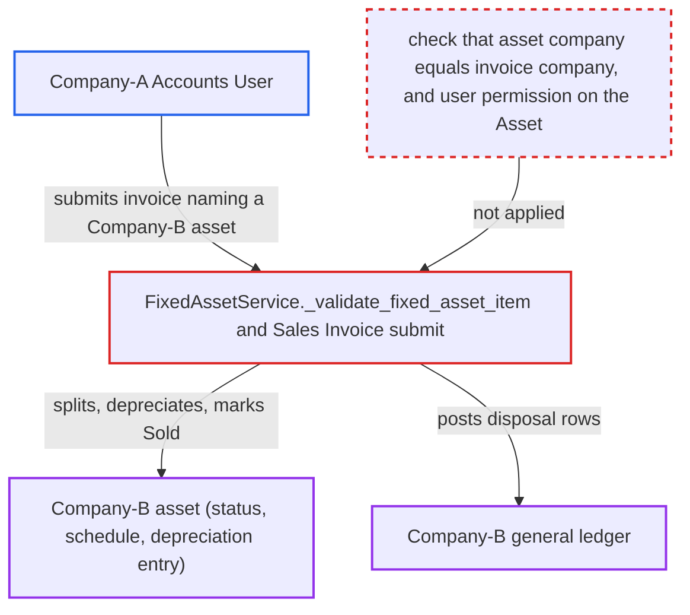

# Sales Invoice disposes another company's Asset: fixed-asset row never checked against invoice company

| Field | Value |
|---|---|
| ID | `find_01RQM6LdJLdALVPZcjHW92r9` |
| Severity | **High** |
| Status | open |
| CWE | CWE-862 — Missing Authorization |
| Created | 2026-10-27T22:06:29.801590Z |
| Claude Security | https://claude.ai/security/findings/find_01RQM6LdJLdALVPZcjHW92r9 |

## Description

A Company-A Accounts User can make a Sales Invoice dispose of another company's fixed asset. The Company-B asset is marked Sold, and disposal entries are posted into Company B's ledger. The user needs only permission to create and submit Sales Invoices in Company A. The cause is `FixedAssetService._validate_fixed_asset_item`, which never compares the asset's company with the invoice's `company` and never checks permission on the Asset.

1. **Company-A Accounts User** creates a Company-A Sales Invoice with a fixed-asset item row whose `asset` names a submitted Company-B asset. The company filter on the asset link exists only in the form's link query, so a direct save or API call can name any asset. ([`erpnext/accounts/doctype/sales_invoice/sales_invoice.js:824-833`](https://github.com/cx-benchmark/erpnext/blob/90e7aefca73da3c440d2e8da7472fcb67838e678/erpnext/accounts/doctype/sales_invoice/sales_invoice.js#L824-L833))
2. **the validator `_validate_fixed_asset_item`** accepts the row on save. It checks only that the asset is submitted, not already Sold, Scrapped or Capitalized, and that the sale date is after the last depreciation. It never compares `asset.company` with the invoice `company` and never checks permission on the Asset. ([`erpnext/accounts/doctype/sales_invoice/services/fixed_assets.py:25-61`](https://github.com/cx-benchmark/erpnext/blob/90e7aefca73da3c440d2e8da7472fcb67838e678/erpnext/accounts/doctype/sales_invoice/services/fixed_assets.py#L25-L61))
3. **Company-A Accounts User** submits the invoice. The `on_submit` flow then splits the asset, depreciates it, stores the disposal values and only afterwards builds the GL entries, with no company check at any point. ([`erpnext/accounts/doctype/sales_invoice/sales_invoice.py:473-479`](https://github.com/cx-benchmark/erpnext/blob/90e7aefca73da3c440d2e8da7472fcb67838e678/erpnext/accounts/doctype/sales_invoice/sales_invoice.py#L473-L479))
4. **the depreciation code `depreciate_asset`** reschedules the Company-B asset's depreciation and posts a depreciation Journal Entry in Company B. The entry is posted with `ignore_permissions`, so the user's lack of rights on Company B does not matter. ([`erpnext/assets/doctype/asset/depreciation.py:182-259`](https://github.com/cx-benchmark/erpnext/blob/90e7aefca73da3c440d2e8da7472fcb67838e678/erpnext/assets/doctype/asset/depreciation.py#L182-L259))
5. **the method `_update_asset`** sets `disposal_date` and status `Sold` on the Company-B asset. The update is written directly with `db_set` on the foreign asset. ([`erpnext/accounts/doctype/sales_invoice/services/fixed_assets.py:77-159`](https://github.com/cx-benchmark/erpnext/blob/90e7aefca73da3c440d2e8da7472fcb67838e678/erpnext/accounts/doctype/sales_invoice/services/fixed_assets.py#L77-L159))
6. **the GL composer `get_gl_entries_for_fixed_asset`** appends the asset-disposal GL rows built by `get_gl_entries_on_asset_disposal` to the invoice's GL entries. The rows are built with `asset.get_gl_dict`, so they carry the asset's company and that company's fixed-asset, accumulated-depreciation and disposal accounts. ([`erpnext/assets/doctype/asset/depreciation.py:661-740`](https://github.com/cx-benchmark/erpnext/blob/90e7aefca73da3c440d2e8da7472fcb67838e678/erpnext/assets/doctype/asset/depreciation.py#L661-L740))
7. **the method `get_gl_dict` in `base_gl_composer`** lets the asset's company override the invoice's company on those rows. `gl_dict.update(args)` keeps the asset company, so the rows pass `GLEntry.validate_account_details`, and `general_ledger.make_gl_entries` balances the whole map rather than each company. ([`erpnext/accounts/services/base_gl_composer.py:40-78`](https://github.com/cx-benchmark/erpnext/blob/90e7aefca73da3c440d2e8da7472fcb67838e678/erpnext/accounts/services/base_gl_composer.py#L40-L78))

## Assessment

The attacker is an Accounts User restricted by User Permission to Company A, who can create and submit Sales Invoices. They create a Company-A invoice for any customer. One item row is a fixed-asset row whose `asset` names a submitted Company-B asset. The report notes that such asset names are sequential (`ACC-ASS-`). They save, which passes validation, and then submit. No victim action is needed. The report assumes that Company User Permissions in frappe restrict only Link fields that target `Company`, so `items[].asset` accepts any company's asset. This frappe code is not in the checkout.

Impact: The Company-B asset is marked Sold, its depreciation schedule is finalised and a depreciation Journal Entry is posted in Company B. Company B's general ledger receives fixed-asset, accumulated-depreciation and gain/loss entries under a Sales Invoice voucher that Company B cannot see. Both companies' trial balances are out of balance by the sale amount, Company B's asset register and profit and loss are misstated, and Company A books a receivable from the customer.

## Recommendation

`FixedAssetService._validate_fixed_asset_item` never checks that the referenced Asset belongs to the invoice's company or that the user may dispose of it. The GL composition that follows trusts the asset's company for its rows.

Fix criteria: Sales Invoice validation rejects any fixed-asset row whose Asset `company` differs from the invoice `company`. It also rejects a row whose `item_code` differs from the row's item, and a row on which the user lacks write permission on the Asset. A Company-A user submitting an invoice that names a Company-B asset gets a validation error. The Company-B asset, its depreciation schedule and Company B's general ledger stay unchanged. Optionally, `make_gl_entries` also refuses a GL map whose rows span more than one company.

## Evidence

**https://github.com/cx-benchmark/erpnext**

- [`erpnext/accounts/doctype/sales_invoice/services/fixed_assets.py:25-61`](https://github.com/cx-benchmark/erpnext/blob/90e7aefca73da3c440d2e8da7472fcb67838e678/erpnext/accounts/doctype/sales_invoice/services/fixed_assets.py#L25-L61)
- [`erpnext/accounts/doctype/sales_invoice/services/fixed_assets.py:77-159`](https://github.com/cx-benchmark/erpnext/blob/90e7aefca73da3c440d2e8da7472fcb67838e678/erpnext/accounts/doctype/sales_invoice/services/fixed_assets.py#L77-L159)
- [`erpnext/accounts/doctype/sales_invoice/services/gl_composer.py:408-436`](https://github.com/cx-benchmark/erpnext/blob/90e7aefca73da3c440d2e8da7472fcb67838e678/erpnext/accounts/doctype/sales_invoice/services/gl_composer.py#L408-L436)
- [`erpnext/assets/doctype/asset/depreciation.py:661-740`](https://github.com/cx-benchmark/erpnext/blob/90e7aefca73da3c440d2e8da7472fcb67838e678/erpnext/assets/doctype/asset/depreciation.py#L661-L740)
- [`erpnext/accounts/services/base_gl_composer.py:40-78`](https://github.com/cx-benchmark/erpnext/blob/90e7aefca73da3c440d2e8da7472fcb67838e678/erpnext/accounts/services/base_gl_composer.py#L40-L78)
- [`erpnext/assets/doctype/asset/depreciation.py:182-259`](https://github.com/cx-benchmark/erpnext/blob/90e7aefca73da3c440d2e8da7472fcb67838e678/erpnext/assets/doctype/asset/depreciation.py#L182-L259)
- [`erpnext/accounts/doctype/sales_invoice/sales_invoice.py:473-479`](https://github.com/cx-benchmark/erpnext/blob/90e7aefca73da3c440d2e8da7472fcb67838e678/erpnext/accounts/doctype/sales_invoice/sales_invoice.py#L473-L479)
- [`erpnext/accounts/doctype/sales_invoice/sales_invoice.js:824-833`](https://github.com/cx-benchmark/erpnext/blob/90e7aefca73da3c440d2e8da7472fcb67838e678/erpnext/accounts/doctype/sales_invoice/sales_invoice.js#L824-L833)

