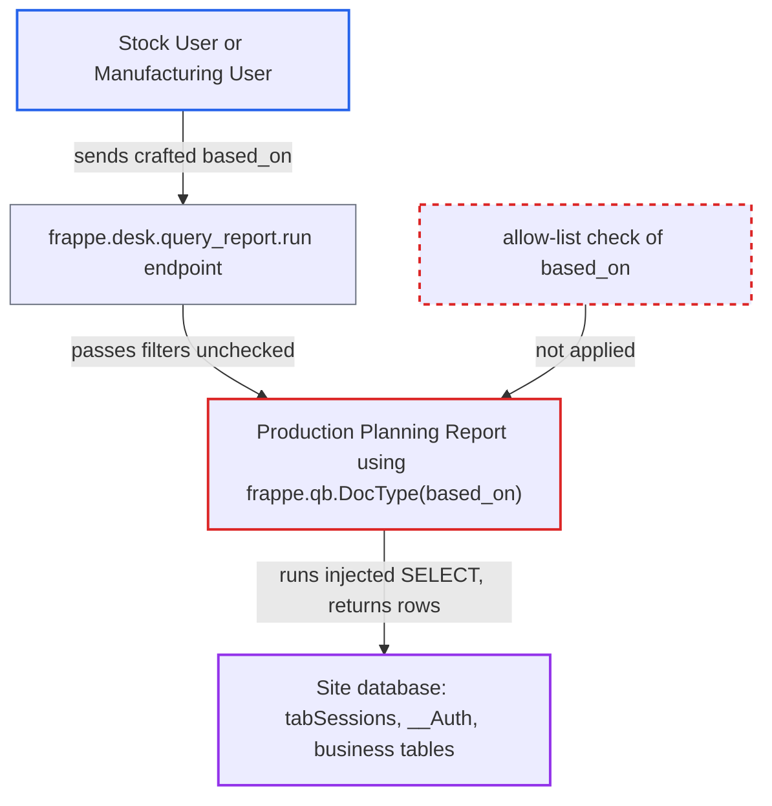

# SQL injection via based_on filter in Production Planning Report (qb.DocType identifier)

| Field | Value |
|---|---|
| ID | `find_01KauTTbp1kV7noroUBV5F56` |
| Severity | **High** |
| Status | open |
| CWE | CWE-89 — SQL injection |
| Created | 2026-10-27T22:12:10.540990Z |
| Claude Security | https://claude.ai/security/findings/find_01KauTTbp1kV7noroUBV5F56 |

## Description

A logged-in user with the Stock User or Manufacturing User role can run their own SELECT against the whole site database through the Production Planning Report. This exposes session ids, `__Auth` password hashes and business data, and a stolen Administrator session gives admin control. The cause is that the `based_on` filter is used as a table name in `frappe.qb.DocType` and is never checked against the three allowed document types.

1. **Attacker** sends a crafted `based_on` value to `frappe.desk.query_report.run`. The value contains a backtick and `-- `. The request is a POST to `/api/method/frappe.desk.query_report.run` with `report_name=Production Planning Report`, and the client-side Select options are not enforced on the server. ([`erpnext/manufacturing/report/production_planning_report/production_planning_report.js:14-20`](https://github.com/cx-benchmark/erpnext/blob/90e7aefca73da3c440d2e8da7472fcb67838e678/erpnext/manufacturing/report/production_planning_report/production_planning_report.js#L14-L20))
2. **Report code** takes `filters.based_on` and builds table objects from it with `frappe.qb.DocType`. The value is only compared with 'Work Order', 'Sales Order' and 'Material Request' to choose a branch. It is never checked against an allow-list, `frappe.get_meta` or `frappe.db.exists`. ([`erpnext/manufacturing/report/production_planning_report/production_planning_report.py:36-38`](https://github.com/cx-benchmark/erpnext/blob/90e7aefca73da3c440d2e8da7472fcb67838e678/erpnext/manufacturing/report/production_planning_report/production_planning_report.py#L36-L38))
3. **Query builder** writes the attacker's text into the SELECT list as a table identifier. For any `based_on` other than 'Work Order' the query uses two `from_()` tables, so every column is prefixed with its table name. The first token after `SELECT` is therefore the attacker-controlled `tab<based_on> Item` identifier. A backtick closes it, and `-- ` comments out the rest of the line. ([`erpnext/manufacturing/report/production_planning_report/production_planning_report.py:64-79`](https://github.com/cx-benchmark/erpnext/blob/90e7aefca73da3c440d2e8da7472fcb67838e678/erpnext/manufacturing/report/production_planning_report/production_planning_report.py#L64-L79))
4. **Report code** runs the rewritten statement with `query.run(as_dict=True)`. The `docstatus` and company WHERE clauses that follow the injection point are commented out. The attacker's SELECT can read any table, for example `tabSessions`, `__Auth` or `tabUser`. ([`erpnext/manufacturing/report/production_planning_report/production_planning_report.py:115-121`](https://github.com/cx-benchmark/erpnext/blob/90e7aefca73da3c440d2e8da7472fcb67838e678/erpnext/manufacturing/report/production_planning_report/production_planning_report.py#L115-L121))
5. **`prepare_data` and `pick_materials_from_warehouses`** carry the injected columns into the output rows. The injected row passes the filters because its `bom_no` resolves to a submitted BOM. `row.update(order_data)` then copies the injected `production_item_name` into every output row. ([`erpnext/manufacturing/report/production_planning_report/production_planning_report.py:282-304`](https://github.com/cx-benchmark/erpnext/blob/90e7aefca73da3c440d2e8da7472fcb67838e678/erpnext/manufacturing/report/production_planning_report/production_planning_report.py#L282-L304))
6. **Report** returns the rows to the attacker, including the stolen values. `production_item_name` is a Data column, so the value is returned unfiltered. Returning NULL for `name` keeps the Link-column post-filter from inspecting the payload. ([`erpnext/manufacturing/report/production_planning_report/production_planning_report.py:386-413`](https://github.com/cx-benchmark/erpnext/blob/90e7aefca73da3c440d2e8da7472fcb67838e678/erpnext/manufacturing/report/production_planning_report/production_planning_report.py#L386-L413))

## Assessment

The attacker is any logged-in user with Stock User or Manufacturing User, which is enough to pass the report permission checks for Work Order. No victim action is needed. They call `/api/method/frappe.desk.query_report.run` directly with `report_name=Production Planning Report` and a `based_on` value that is not one of the three Select options. The site needs at least one submitted BOM with items, which is normal for a manufacturing deployment. The report assumes Frappe `>=17.0.0-dev,<18`, which is not in the checkout. It also assumes that pypika does not escape the quote character and that the database driver allows only single statements.

Impact: The attacker can run an arbitrary single SELECT statement against the whole site database as the application's database user. That covers every table of every company, session ids in `tabSessions` and password hashes in `__Auth`. Replaying an Administrator session id gives full administrative control of ERPNext. Direct writes and DROPs are not possible because multi-statements are disabled, and the availability impact is limited to heavy queries.

## Recommendation

`filters.based_on` is used as a SQL identifier through `frappe.qb.DocType` without checking that it is one of the three supported document types. Untrusted input therefore reaches the query builder's unescaped identifier quoting.

Fix criteria: Before any query is built, `based_on` is rejected with `frappe.throw` unless it is exactly 'Sales Order', 'Material Request' or 'Work Order'. The parent and child table names come from a fixed mapping keyed by that validated value. To verify, send a `based_on` containing a backtick or `-- ` to `frappe.desk.query_report.run`. The report must return a validation error, and no SQL may run with the supplied string.

## Evidence

**https://github.com/cx-benchmark/erpnext**

- [`erpnext/manufacturing/report/production_planning_report/production_planning_report.py:36-38`](https://github.com/cx-benchmark/erpnext/blob/90e7aefca73da3c440d2e8da7472fcb67838e678/erpnext/manufacturing/report/production_planning_report/production_planning_report.py#L36-L38)
- [`erpnext/manufacturing/report/production_planning_report/production_planning_report.py:64-79`](https://github.com/cx-benchmark/erpnext/blob/90e7aefca73da3c440d2e8da7472fcb67838e678/erpnext/manufacturing/report/production_planning_report/production_planning_report.py#L64-L79)
- [`erpnext/manufacturing/report/production_planning_report/production_planning_report.py:115-121`](https://github.com/cx-benchmark/erpnext/blob/90e7aefca73da3c440d2e8da7472fcb67838e678/erpnext/manufacturing/report/production_planning_report/production_planning_report.py#L115-L121)
- [`erpnext/manufacturing/report/production_planning_report/production_planning_report.py:282-304`](https://github.com/cx-benchmark/erpnext/blob/90e7aefca73da3c440d2e8da7472fcb67838e678/erpnext/manufacturing/report/production_planning_report/production_planning_report.py#L282-L304)
- [`erpnext/manufacturing/report/production_planning_report/production_planning_report.py:386-413`](https://github.com/cx-benchmark/erpnext/blob/90e7aefca73da3c440d2e8da7472fcb67838e678/erpnext/manufacturing/report/production_planning_report/production_planning_report.py#L386-L413)
- [`erpnext/manufacturing/report/production_planning_report/production_planning_report.json:18-31`](https://github.com/cx-benchmark/erpnext/blob/90e7aefca73da3c440d2e8da7472fcb67838e678/erpnext/manufacturing/report/production_planning_report/production_planning_report.json#L18-L31)
- [`erpnext/manufacturing/report/production_planning_report/production_planning_report.js:14-20`](https://github.com/cx-benchmark/erpnext/blob/90e7aefca73da3c440d2e8da7472fcb67838e678/erpnext/manufacturing/report/production_planning_report/production_planning_report.js#L14-L20)

