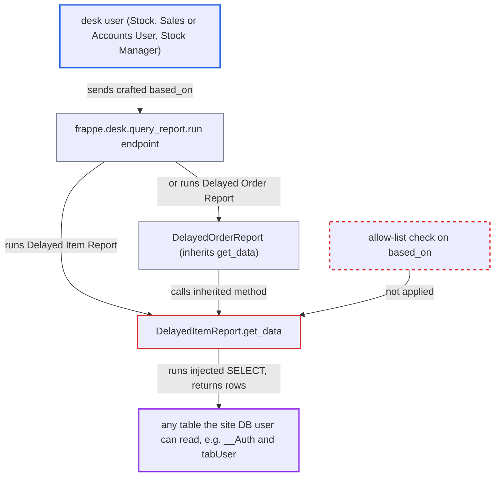

# SQL injection via based_on filter used as table name in Delayed Item/Order Reports

| Field | Value |
|---|---|
| ID | `find_01FM1MLdZp2dLrA2PmAb4N5E` |
| Severity | **High** |
| Status | open |
| CWE | CWE-89 — SQL injection |
| Created | 2026-10-27T21:14:54.739337Z |
| Claude Security | https://claude.ai/security/findings/find_01FM1MLdZp2dLrA2PmAb4N5E |

## Description

A logged-in desk user with the Stock User, Sales User, Accounts User or Stock Manager role can read any table the site's database user can read. That includes `__Auth` (password hashes and encrypted secrets), `tabUser` and other companies' financial data. The attack works by sending a crafted `based_on` filter to the Delayed Item Report or Delayed Order Report. `DelayedItemReport.get_data` never validates `based_on` and uses it as a table name. Only reads are shown, not writes.

1. **the attacker (a desk user)** calls `/api/method/frappe.desk.query_report.run` for `Delayed Item Report` with a crafted `based_on`. The value contains a backtick, a chosen SELECT list, a far-future `posting_date` and a trailing `-- `, although the client JS only offers `Delivery Note` and `Sales Invoice`.
2. **the report method `get_data`** takes `based_on` from the filters and passes it unchecked to `frappe.qb.DocType(doctype)` and `frappe.qb.DocType(f"{doctype} Item")`. Frappe only adds the `tab` prefix, and the server never compares the value with the two supported doctypes. ([`erpnext/stock/report/delayed_item_report/delayed_item_report.py:24-29`](https://github.com/cx-benchmark/erpnext/blob/90e7aefca73da3c440d2e8da7472fcb67838e678/erpnext/stock/report/delayed_item_report/delayed_item_report.py#L24-L29))
3. **the query builder (pypika)** wraps the table name in backticks without escaping a backtick inside it. The backtick in `based_on` closes the identifier early, so the rest of the value becomes part of the SELECT list and FROM clause. The `-- ` comments out the rest of the single-line statement, including the parameterised WHERE clause. ([`erpnext/stock/report/delayed_item_report/delayed_item_report.py:31-78`](https://github.com/cx-benchmark/erpnext/blob/90e7aefca73da3c440d2e8da7472fcb67838e678/erpnext/stock/report/delayed_item_report/delayed_item_report.py#L31-L78))
4. **the report method `get_data`** runs the attacker's SELECT with `query.run(as_dict=True)`. The query runs as the application's database user, so it can read any table that user can read, such as `__Auth` or `tabUser`. ([`erpnext/stock/report/delayed_item_report/delayed_item_report.py:31-78`](https://github.com/cx-benchmark/erpnext/blob/90e7aefca73da3c440d2e8da7472fcb67838e678/erpnext/stock/report/delayed_item_report/delayed_item_report.py#L31-L78))
5. **the post-processing in `get_data`** keeps the injected rows and returns them in the JSON result. Only rows with `delayed_days > 0` survive. A missing Sales Order date counts as today, so a far-future `posting_date` keeps every row, and the leaked values come back under aliases such as `item_name` or `po_no`. ([`erpnext/stock/report/delayed_item_report/delayed_item_report.py:80-113`](https://github.com/cx-benchmark/erpnext/blob/90e7aefca73da3c440d2e8da7472fcb67838e678/erpnext/stock/report/delayed_item_report/delayed_item_report.py#L80-L113))

## Assessment

The attacker is an authenticated desk user with the Stock User, Sales User, Accounts User or Stock Manager role. These roles can run the report through `frappe.desk.query_report.run`. No victim action is needed and no defence has to be bypassed. The Delayed Order Report is a second way in, because `DelayedOrderReport` inherits `get_data` and calls `super().get_data(consolidated)`. There, injected rows survive if they carry `qty > 0` and a distinct `sales_order` alias. If the payload leaves the Link columns `name`, `customer`, `item_code` and `sales_order` empty, Frappe's user-permission filter on Link columns does not drop the rows. The report assumes Frappe `>=17.0.0-dev,<18.0.0` and the pinned PyPika behave as described, since the framework is not in the checkout.

Impact: The attacker can run any SELECT on the site database as the application's database user. This exposes every company's transactions, `tabUser`, and `__Auth` (password hashes and encrypted integration secrets), across company and user-permission boundaries. The injection sits inside a single SELECT and the client does not enable multi-statements, so the report shows no writes. Costly injected queries can tie up the database.

## Recommendation

`DelayedItemReport.get_data` passes the caller's `based_on` filter straight to `frappe.qb.DocType()`, so the caller controls SQL table identifiers, which the query builder does not escape. `DelayedOrderReport` inherits the same method.

Fix criteria: Both the Delayed Item Report and the Delayed Order Report only ever query the supported doctypes. Any `based_on` other than `Delivery Note` or `Sales Invoice` is rejected on the server before a table object is built. To verify, run either report with a `based_on` that contains a backtick or `-- `. A validation error must be raised, and no query containing the injected text may reach the database.

## Evidence

**https://github.com/cx-benchmark/erpnext**

- [`erpnext/stock/report/delayed_item_report/delayed_item_report.py:24-29`](https://github.com/cx-benchmark/erpnext/blob/90e7aefca73da3c440d2e8da7472fcb67838e678/erpnext/stock/report/delayed_item_report/delayed_item_report.py#L24-L29)
- [`erpnext/stock/report/delayed_item_report/delayed_item_report.py:31-78`](https://github.com/cx-benchmark/erpnext/blob/90e7aefca73da3c440d2e8da7472fcb67838e678/erpnext/stock/report/delayed_item_report/delayed_item_report.py#L31-L78)
- [`erpnext/stock/report/delayed_item_report/delayed_item_report.py:80-113`](https://github.com/cx-benchmark/erpnext/blob/90e7aefca73da3c440d2e8da7472fcb67838e678/erpnext/stock/report/delayed_item_report/delayed_item_report.py#L80-L113)
- [`erpnext/stock/report/delayed_order_report/delayed_order_report.py:20-47`](https://github.com/cx-benchmark/erpnext/blob/90e7aefca73da3c440d2e8da7472fcb67838e678/erpnext/stock/report/delayed_order_report/delayed_order_report.py#L20-L47)
- [`erpnext/stock/report/delayed_item_report/delayed_item_report.json:18-36`](https://github.com/cx-benchmark/erpnext/blob/90e7aefca73da3c440d2e8da7472fcb67838e678/erpnext/stock/report/delayed_item_report/delayed_item_report.json#L18-L36)
- [`erpnext/accounts/report/inactive_sales_items/inactive_sales_items.py:107-110`](https://github.com/cx-benchmark/erpnext/blob/90e7aefca73da3c440d2e8da7472fcb67838e678/erpnext/accounts/report/inactive_sales_items/inactive_sales_items.py#L107-L110)

