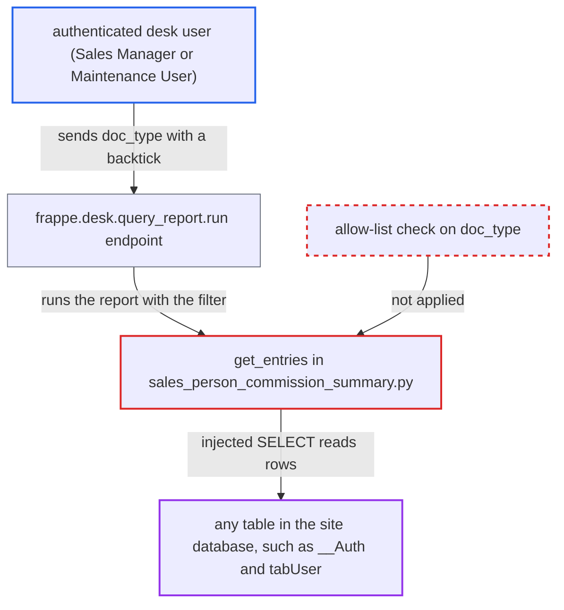

# SQL injection via doc_type filter used as table name in Sales Person Commission Summary

| Field | Value |
|---|---|
| ID | `find_01S7inTQw9hEVyQKFV6VUZ9i` |
| Severity | **High** |
| Status | open |
| CWE | CWE-89 — SQL injection |
| Created | 2026-10-27T21:24:26.497324Z |
| Claude Security | https://claude.ai/security/findings/find_01S7inTQw9hEVyQKFV6VUZ9i |

## Description

A logged-in desk user with the Sales Manager or Maintenance User role can run any SELECT on the site database through the Sales Person Commission Summary report. That includes password hashes, encrypted integration secrets, users and every company's transactions, and it bypasses role and user permissions. The attack works because `get_entries` uses the caller's `doc_type` filter as a table name, and the query builder does not escape a backtick in it. The only server check is that the value is not empty. No write is shown.

1. **the attacker (desk user)** posts a crafted `doc_type` to `frappe.desk.query_report.run`. The request names `report_name=Sales Person Commission Summary`. The roles Sales Manager and Maintenance User both have `report` on Sales Order, so they pass the report's role check. ([`erpnext/selling/report/sales_person_commission_summary/sales_person_commission_summary.json:14-25`](https://github.com/cx-benchmark/erpnext/blob/90e7aefca73da3c440d2e8da7472fcb67838e678/erpnext/selling/report/sales_person_commission_summary/sales_person_commission_summary.json#L14-L25))
2. **the function `execute`** passes the filters on to `get_entries` and accepts any non-empty `doc_type`. The only server-side check on `doc_type` is that it is not empty. The `.js` Select that limits the choice runs only in the browser. ([`erpnext/selling/report/sales_person_commission_summary/sales_person_commission_summary.py:42-53`](https://github.com/cx-benchmark/erpnext/blob/90e7aefca73da3c440d2e8da7472fcb67838e678/erpnext/selling/report/sales_person_commission_summary/sales_person_commission_summary.py#L42-L53))
3. **the function `get_entries`** builds `dt = qb.DocType(filters["doc_type"])` and uses it as the FROM table and as the prefix of every column. Frappe only adds the `tab` prefix to the name. The SQL therefore starts with the quoted name in the SELECT list, which is the first place the attacker's text appears. ([`erpnext/selling/report/sales_person_commission_summary/sales_person_commission_summary.py:101-128`](https://github.com/cx-benchmark/erpnext/blob/90e7aefca73da3c440d2e8da7472fcb67838e678/erpnext/selling/report/sales_person_commission_summary/sales_person_commission_summary.py#L101-L128))
4. **the query builder PyPika** wraps the name in backticks without escaping backticks inside it. A backtick in `doc_type` closes the identifier early. A trailing `-- ` then comments out the rest of the single-line statement, so the attacker writes the whole SELECT list and FROM clause. ([`erpnext/selling/report/sales_person_commission_summary/sales_person_commission_summary.py:101-128`](https://github.com/cx-benchmark/erpnext/blob/90e7aefca73da3c440d2e8da7472fcb67838e678/erpnext/selling/report/sales_person_commission_summary/sales_person_commission_summary.py#L101-L128))
5. **the call `.run(as_dict=True)`** executes the injected SELECT on the site database. Frappe parameterises only values, not identifiers, so the injected text reaches the database as SQL. ([`erpnext/selling/report/sales_person_commission_summary/sales_person_commission_summary.py:101-128`](https://github.com/cx-benchmark/erpnext/blob/90e7aefca73da3c440d2e8da7472fcb67838e678/erpnext/selling/report/sales_person_commission_summary/sales_person_commission_summary.py#L101-L128))
6. **the function `execute`** returns the injected rows to the attacker as report data. The first column is a Link to the raw `doc_type`, and Frappe's post-filter fails on a nonexistent doctype if that column holds a value. So the payload returns `NULL AS name` and puts the stolen values in `customer`, `commission_rate` or `allocated_percentage`. Injected strings survive the post-filter. ([`erpnext/selling/report/sales_person_commission_summary/sales_person_commission_summary.py:11-39`](https://github.com/cx-benchmark/erpnext/blob/90e7aefca73da3c440d2e8da7472fcb67838e678/erpnext/selling/report/sales_person_commission_summary/sales_person_commission_summary.py#L11-L39))

## Assessment

The attacker is an authenticated desk user with the Sales Manager or Maintenance User role, the roles of the report. Both roles have `report` on Sales Order. They send a POST to `/api/method/frappe.desk.query_report.run` with `report_name=Sales Person Commission Summary` and a `doc_type` that closes the backtick, selects `NULL AS name` plus the target columns from any table, and ends in `-- `. No victim action and no special configuration are needed. The sibling report `Sales Person-wise Transaction Summary` rejects values outside an allow-list, but this report does not.

Impact: The attacker can run any SELECT on the site database as the application DB user. That reaches `__Auth` (password hashes and encrypted integration secrets), `tabUser` and every company's transactions, past all role and user-permission limits. The report shows no write, because the injection sits inside one SELECT and stacked statements are not shown. Expensive injected queries or `SLEEP()` can tie up a worker and the database, a limited availability impact.

## Recommendation

`get_entries` passes the client-supplied `doc_type` filter to `qb.DocType()`, so the caller controls a SQL table name that the query builder renders without escaping. The query's structure then depends on untrusted input.

Fix criteria: `doc_type` is checked on the server against the fixed set `Sales Order`, `Delivery Note` and `Sales Invoice` before any query object or column definition is built from it, as the sibling transaction summary does. To verify, run the report through `frappe.desk.query_report.run` with a `doc_type` containing a backtick or `-- `, or any value outside that set. A validation error must be raised. No query containing the injected text may reach the database.

## Evidence

**https://github.com/cx-benchmark/erpnext**

- [`erpnext/selling/report/sales_person_commission_summary/sales_person_commission_summary.py:101-128`](https://github.com/cx-benchmark/erpnext/blob/90e7aefca73da3c440d2e8da7472fcb67838e678/erpnext/selling/report/sales_person_commission_summary/sales_person_commission_summary.py#L101-L128)
- [`erpnext/selling/report/sales_person_commission_summary/sales_person_commission_summary.py:11-39`](https://github.com/cx-benchmark/erpnext/blob/90e7aefca73da3c440d2e8da7472fcb67838e678/erpnext/selling/report/sales_person_commission_summary/sales_person_commission_summary.py#L11-L39)
- [`erpnext/selling/report/sales_person_commission_summary/sales_person_commission_summary.py:42-53`](https://github.com/cx-benchmark/erpnext/blob/90e7aefca73da3c440d2e8da7472fcb67838e678/erpnext/selling/report/sales_person_commission_summary/sales_person_commission_summary.py#L42-L53)
- [`erpnext/selling/report/sales_person_commission_summary/sales_person_commission_summary.py:131-149`](https://github.com/cx-benchmark/erpnext/blob/90e7aefca73da3c440d2e8da7472fcb67838e678/erpnext/selling/report/sales_person_commission_summary/sales_person_commission_summary.py#L131-L149)
- [`erpnext/stock/doctype/company_restriction/company_restriction.py:62-74`](https://github.com/cx-benchmark/erpnext/blob/90e7aefca73da3c440d2e8da7472fcb67838e678/erpnext/stock/doctype/company_restriction/company_restriction.py#L62-L74)
- [`erpnext/selling/report/sales_person_commission_summary/sales_person_commission_summary.js:12-18`](https://github.com/cx-benchmark/erpnext/blob/90e7aefca73da3c440d2e8da7472fcb67838e678/erpnext/selling/report/sales_person_commission_summary/sales_person_commission_summary.js#L12-L18)
- [`erpnext/selling/report/sales_person_wise_transaction_summary/sales_person_wise_transaction_summary.py:55-62`](https://github.com/cx-benchmark/erpnext/blob/90e7aefca73da3c440d2e8da7472fcb67838e678/erpnext/selling/report/sales_person_wise_transaction_summary/sales_person_wise_transaction_summary.py#L55-L62)
- [`erpnext/selling/report/sales_person_commission_summary/sales_person_commission_summary.json:14-25`](https://github.com/cx-benchmark/erpnext/blob/90e7aefca73da3c440d2e8da7472fcb67838e678/erpnext/selling/report/sales_person_commission_summary/sales_person_commission_summary.json#L14-L25)

