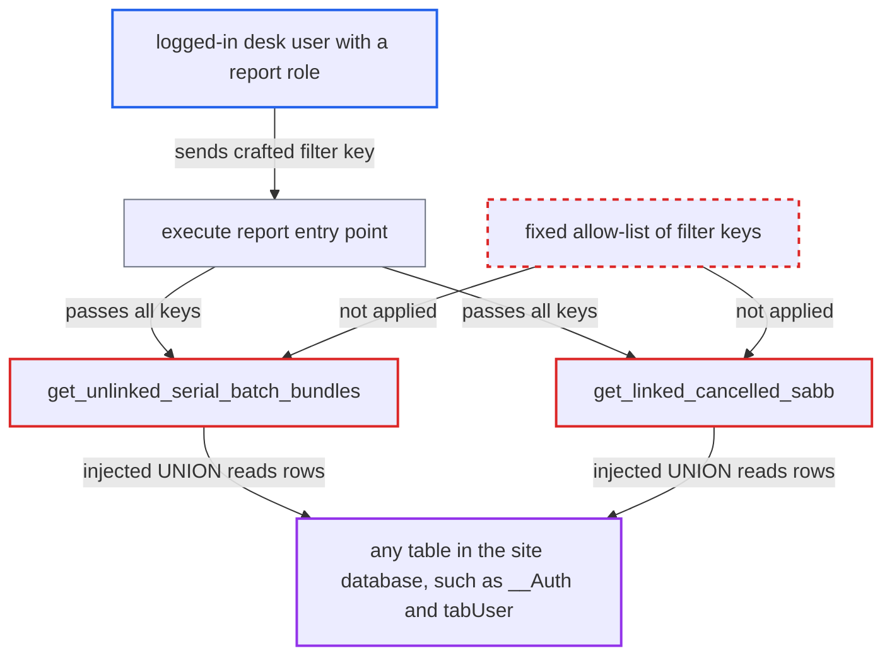

# SQL injection via filter keys used as column names in Incorrect Serial and Batch Bundle report

| Field | Value |
|---|---|
| ID | `find_018vRujVxH6LkjN5UpEHVuzn` |
| Severity | **High** |
| Status | open |
| CWE | CWE-89 — SQL injection |
| Created | 2026-10-27T21:15:28.889752Z |
| Claude Security | https://claude.ai/security/findings/find_018vRujVxH6LkjN5UpEHVuzn |

## Description

Any logged-in desk user with the Stock User, Purchase User, Delivery User or Manufacturing User role can read any table in the site database. That includes password hashes, encrypted secrets, user records and every company's ledgers. The functions `get_unlinked_serial_batch_bundles` and `get_linked_cancelled_sabb` use each key of the filters dict as a column name through `SABB[field]`, and pypika does not escape it. No write was demonstrated.

1. **the attacker** posts a crafted filters JSON to `/api/method/frappe.desk.query_report.run`. The request uses `report_name=Incorrect Serial and Batch Bundle`, and one filter key contains a backtick followed by a UNION SELECT. ([`erpnext/stock/report/incorrect_serial_and_batch_bundle/incorrect_serial_and_batch_bundle.json:19-53`](https://github.com/cx-benchmark/erpnext/blob/90e7aefca73da3c440d2e8da7472fcb67838e678/erpnext/stock/report/incorrect_serial_and_batch_bundle/incorrect_serial_and_batch_bundle.json#L19-L53))
2. **the function `execute`** passes the whole filters dict to both query functions. It never limits the keys to the two filters the client script defines, `item_code` and `warehouse`, and the report JSON has `"filters": []`, so nothing on the server checks them. ([`erpnext/stock/report/incorrect_serial_and_batch_bundle/incorrect_serial_and_batch_bundle.py:10-23`](https://github.com/cx-benchmark/erpnext/blob/90e7aefca73da3c440d2e8da7472fcb67838e678/erpnext/stock/report/incorrect_serial_and_batch_bundle/incorrect_serial_and_batch_bundle.py#L10-L23))
3. **the function `get_unlinked_serial_batch_bundles`** turns each filters key into a column with `SABB[field]`. pypika wraps the name in backticks without escaping, so a backtick in the key closes the identifier and the rest of the key becomes SQL in the flat `AND` chain of the WHERE clause. Only the value is parameterised. ([`erpnext/stock/report/incorrect_serial_and_batch_bundle/incorrect_serial_and_batch_bundle.py:103-104`](https://github.com/cx-benchmark/erpnext/blob/90e7aefca73da3c440d2e8da7472fcb67838e678/erpnext/stock/report/incorrect_serial_and_batch_bundle/incorrect_serial_and_batch_bundle.py#L103-L104))
4. **the function `get_linked_cancelled_sabb`** repeats the same loop over the filters keys. The injected key is therefore rendered into a second query as well. ([`erpnext/stock/report/incorrect_serial_and_batch_bundle/incorrect_serial_and_batch_bundle.py:136-137`](https://github.com/cx-benchmark/erpnext/blob/90e7aefca73da3c440d2e8da7472fcb67838e678/erpnext/stock/report/incorrect_serial_and_batch_bundle/incorrect_serial_and_batch_bundle.py#L136-L137))
5. **the database** runs the injected UNION SELECT through `query.run(as_dict=1)`. The rows come back in the five selected columns `name`, `voucher_type`, `voucher_no`, `voucher_detail_no` and `is_cancelled`, and `execute` returns them to the caller in the report grid. ([`erpnext/stock/report/incorrect_serial_and_batch_bundle/incorrect_serial_and_batch_bundle.py:10-23`](https://github.com/cx-benchmark/erpnext/blob/90e7aefca73da3c440d2e8da7472fcb67838e678/erpnext/stock/report/incorrect_serial_and_batch_bundle/incorrect_serial_and_batch_bundle.py#L10-L23))

## Assessment

The attacker is any authenticated desk user with the Stock User, Purchase User, Delivery User or Manufacturing User role. These roles are on the report and have `report` permission on Serial and Batch Bundle. The attacker only needs to call `frappe.desk.query_report.run` with a filters JSON whose key holds the injection. No victim action or special configuration is needed. The finding assumes the pinned Frappe version (`>=17.0.0-dev,<18`) uses PyPika \~0.48, which renders identifiers without escaping, and that `frappe.qb.DocType(...)[name]` does not validate field names. Neither source is in the checkout.

Impact: The attacker can run an arbitrary SELECT over the whole site database. That exposes all companies' financial and HR-adjacent data, user records, and `__Auth` password hashes and encrypted credentials. The injection sits inside one SELECT and is not shown to allow stacked statements, so no write is demonstrated. Expensive injected subqueries or `SLEEP()` can degrade the database, which is a limited availability impact.

## Recommendation

`get_unlinked_serial_batch_bundles` and `get_linked_cancelled_sabb` loop over the caller's filters dict and use its keys as SQL column names via `SABB[field]`, which pypika does not escape. Query structure is therefore controlled by user data.

Fix criteria: Both functions apply only a fixed, code-defined set of filter fields (`item_code`, `warehouse`), taken by name from the filters dict. Any other key is ignored or rejected before a `Field` is built from it. To verify, run the report with a filters key containing a backtick or `UNION SELECT`. The report must either ignore the key or reject the request, and no query containing that text may reach the database.

## Evidence

**https://github.com/cx-benchmark/erpnext**

- [`erpnext/stock/report/incorrect_serial_and_batch_bundle/incorrect_serial_and_batch_bundle.py:103-104`](https://github.com/cx-benchmark/erpnext/blob/90e7aefca73da3c440d2e8da7472fcb67838e678/erpnext/stock/report/incorrect_serial_and_batch_bundle/incorrect_serial_and_batch_bundle.py#L103-L104)
- [`erpnext/stock/report/incorrect_serial_and_batch_bundle/incorrect_serial_and_batch_bundle.py:136-137`](https://github.com/cx-benchmark/erpnext/blob/90e7aefca73da3c440d2e8da7472fcb67838e678/erpnext/stock/report/incorrect_serial_and_batch_bundle/incorrect_serial_and_batch_bundle.py#L136-L137)
- [`erpnext/stock/report/incorrect_serial_and_batch_bundle/incorrect_serial_and_batch_bundle.py:10-23`](https://github.com/cx-benchmark/erpnext/blob/90e7aefca73da3c440d2e8da7472fcb67838e678/erpnext/stock/report/incorrect_serial_and_batch_bundle/incorrect_serial_and_batch_bundle.py#L10-L23)
- [`erpnext/stock/report/incorrect_serial_and_batch_bundle/incorrect_serial_and_batch_bundle.js:5-18`](https://github.com/cx-benchmark/erpnext/blob/90e7aefca73da3c440d2e8da7472fcb67838e678/erpnext/stock/report/incorrect_serial_and_batch_bundle/incorrect_serial_and_batch_bundle.js#L5-L18)
- [`erpnext/stock/report/incorrect_serial_and_batch_bundle/incorrect_serial_and_batch_bundle.json:19-53`](https://github.com/cx-benchmark/erpnext/blob/90e7aefca73da3c440d2e8da7472fcb67838e678/erpnext/stock/report/incorrect_serial_and_batch_bundle/incorrect_serial_and_batch_bundle.json#L19-L53)

