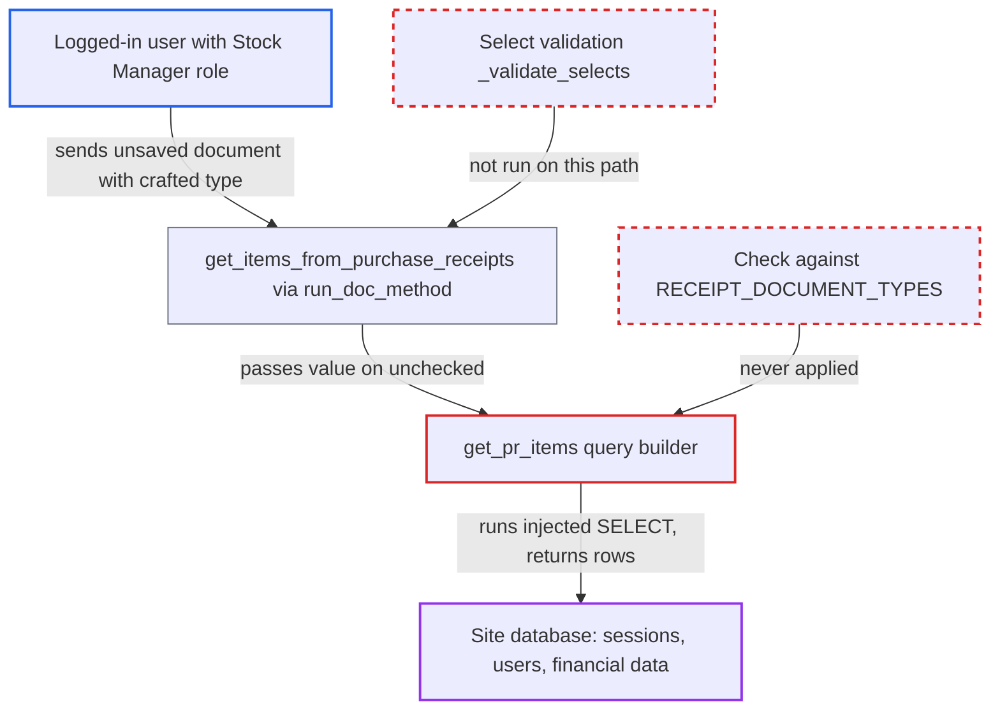

# SQL injection via receipt_document_type table identifier in Landed Cost Voucher get_pr_items

| Field | Value |
|---|---|
| ID | `find_016gVLg3XhhL39ht5BeEQopF` |
| Severity | **High** |
| Status | open |
| CWE | CWE-89 — SQL injection |
| Created | 2026-10-27T21:44:13.227124Z |
| Claude Security | https://claude.ai/security/findings/find_016gVLg3XhhL39ht5BeEQopF |

## Description

A logged-in user with the `Stock Manager` role can run any single SELECT query against the whole site database and read the result. That includes live session identifiers, which would let them take over an Administrator session. The cause is `get_pr_items`, which puts the caller-supplied `receipt_document_type` straight into the SQL table name without checking it against `RECEIPT_DOCUMENT_TYPES`.

1. **Attacker with the `Stock Manager` role** posts an unsaved Landed Cost Voucher to `/api/method/run_doc_method` with `method=get_items_from_purchase_receipts`. The document is built by the client, as the desk script does. Its `purchase_receipts[0].receipt_document_type` holds the injection text and `receipt_document` is any non-empty string. ([`erpnext/stock/doctype/landed_cost_voucher/landed_cost_voucher.js:47-58`](https://github.com/cx-benchmark/erpnext/blob/90e7aefca73da3c440d2e8da7472fcb67838e678/erpnext/stock/doctype/landed_cost_voucher/landed_cost_voucher.js#L47-L58))
2. **Frappe `run_doc_method`** loads the document and runs the method without validating the fields. It only calls `frappe.get_doc(json)`, `check_if_latest()` and `has_permission("read")`. The Select-option and link checks run only inside `insert()` or `save()`, so the declared options of `receipt_document_type` are never enforced. ([`erpnext/stock/doctype/landed_cost_voucher/landed_cost_voucher.js:47-58`](https://github.com/cx-benchmark/erpnext/blob/90e7aefca73da3c440d2e8da7472fcb67838e678/erpnext/stock/doctype/landed_cost_voucher/landed_cost_voucher.js#L47-L58))
3. **the method `get_items_from_purchase_receipts`** passes each receipt row to `get_pr_items`. It only checks that the two fields are truthy and never consults `RECEIPT_DOCUMENT_TYPES`. ([`erpnext/stock/doctype/landed_cost_voucher/landed_cost_voucher.py:63-85`](https://github.com/cx-benchmark/erpnext/blob/90e7aefca73da3c440d2e8da7472fcb67838e678/erpnext/stock/doctype/landed_cost_voucher/landed_cost_voucher.py#L63-L85))
4. **the function `get_pr_items`** builds the child-table name from `receipt_document_type`. It calls `frappe.qb.DocType(purchase_receipt.receipt_document_type + " Item")`, and the query builder wraps the name in backticks without escaping any backtick inside it. ([`erpnext/stock/doctype/landed_cost_voucher/landed_cost_voucher.py:630-636`](https://github.com/cx-benchmark/erpnext/blob/90e7aefca73da3c440d2e8da7472fcb67838e678/erpnext/stock/doctype/landed_cost_voucher/landed_cost_voucher.py#L630-L636))
5. **Attacker's payload** closes the quoted name, selects other columns from another table and comments out the rest of the query. The controlled name is the first token after `SELECT`, so a SQL line comment hides the later uses of the name, the join, the parameterized WHERE and the ORDER BY. The report's example reads `tabSessions`.`sid` and `tabSessions`.`user`. ([`erpnext/stock/doctype/landed_cost_voucher/landed_cost_voucher.py:638-656`](https://github.com/cx-benchmark/erpnext/blob/90e7aefca73da3c440d2e8da7472fcb67838e678/erpnext/stock/doctype/landed_cost_voucher/landed_cost_voucher.py#L638-L656))
6. **the method `get_items_from_purchase_receipts`** copies the returned rows into `self.items` and sends the document back. The query result appears in `items[*].item_code` and `description` inside `frappe.response.docs`, so the attacker reads it directly. ([`erpnext/stock/doctype/landed_cost_voucher/landed_cost_voucher.py:63-85`](https://github.com/cx-benchmark/erpnext/blob/90e7aefca73da3c440d2e8da7472fcb67838e678/erpnext/stock/doctype/landed_cost_voucher/landed_cost_voucher.py#L63-L85))

## Assessment

The attacker is any logged-in user with the `Stock Manager` role. That role gives the `read` permission on Landed Cost Voucher, which is all `run_doc_method` needs. No victim action is needed. Whitelisted methods are reachable by any logged-in user over `/api/method`. A second injection point exists in the same query. `receipt_document` is written as an unescaped quoted literal by `ConstantColumn(...)` (lines 648-649), so it can be abused once `receipt_document_type` is valid. The save path is not affected, because `_validate_links` and `validate_receipt_documents()` reject an unknown doctype first. `make_lcv` in `purchase_receipt.py` allow-lists the doctype. Only the `run_doc_method` route reaches the flaw.

Impact: The attacker can run an arbitrary single SELECT against the site database and read the result in the response. That exposes all company financial, customer and supplier data, `tabUser` (API keys, hashed reset keys), `__Auth` and `tabSessions.sid`. Replaying an Administrator's `sid` cookie gives full control of the site. The injection itself is limited to one SELECT, because stacked statements are not assumed, so it gives no direct write.

## Recommendation

`get_pr_items` (line 636) and `ConstantColumn(...)` (lines 648-649) put the caller-supplied `receipt_document_type` and `receipt_document` into SQL identifier and literal positions without validating them. The Select declaration is not enforced on the `run_doc_method` path, so unescaped quoting is reached with attacker text.

Fix criteria: Before any query is built, both `get_items_from_purchase_receipts` and `get_pr_items` reject any `receipt_document_type` that is not exactly one of `RECEIPT_DOCUMENT_TYPES`. `receipt_document` is no longer emitted as an unescaped literal; it is a parameterized value, or the constant columns are dropped and the fields are set in Python. The `run_doc_method` request with the backtick and line-comment payload is refused with a validation error and no SQL is executed. The Postgres double-quote variant is refused the same way.

## Evidence

**https://github.com/cx-benchmark/erpnext**

- [`erpnext/stock/doctype/landed_cost_voucher/landed_cost_voucher.py:630-636`](https://github.com/cx-benchmark/erpnext/blob/90e7aefca73da3c440d2e8da7472fcb67838e678/erpnext/stock/doctype/landed_cost_voucher/landed_cost_voucher.py#L630-L636)
- [`erpnext/stock/doctype/landed_cost_voucher/landed_cost_voucher.py:638-656`](https://github.com/cx-benchmark/erpnext/blob/90e7aefca73da3c440d2e8da7472fcb67838e678/erpnext/stock/doctype/landed_cost_voucher/landed_cost_voucher.py#L638-L656)
- [`erpnext/stock/doctype/landed_cost_voucher/landed_cost_voucher.py:648-649`](https://github.com/cx-benchmark/erpnext/blob/90e7aefca73da3c440d2e8da7472fcb67838e678/erpnext/stock/doctype/landed_cost_voucher/landed_cost_voucher.py#L648-L649)
- [`erpnext/stock/doctype/landed_cost_voucher/landed_cost_voucher.py:63-85`](https://github.com/cx-benchmark/erpnext/blob/90e7aefca73da3c440d2e8da7472fcb67838e678/erpnext/stock/doctype/landed_cost_voucher/landed_cost_voucher.py#L63-L85)
- [`erpnext/stock/doctype/landed_cost_voucher/landed_cost_voucher.js:47-58`](https://github.com/cx-benchmark/erpnext/blob/90e7aefca73da3c440d2e8da7472fcb67838e678/erpnext/stock/doctype/landed_cost_voucher/landed_cost_voucher.js#L47-L58)
- [`erpnext/stock/doctype/landed_cost_purchase_receipt/landed_cost_purchase_receipt.json`](https://github.com/cx-benchmark/erpnext/blob/90e7aefca73da3c440d2e8da7472fcb67838e678/erpnext/stock/doctype/landed_cost_purchase_receipt/landed_cost_purchase_receipt.json)
- [`erpnext/stock/doctype/landed_cost_voucher/landed_cost_voucher.json`](https://github.com/cx-benchmark/erpnext/blob/90e7aefca73da3c440d2e8da7472fcb67838e678/erpnext/stock/doctype/landed_cost_voucher/landed_cost_voucher.json)

