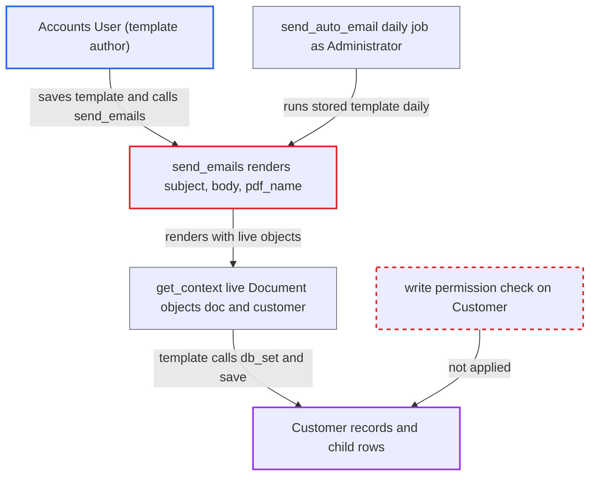

# Statement of Accounts templates get live Customer Document, letting Accounts User modify Customers

| Field | Value |
|---|---|
| ID | `find_01EEKpyptZUfE3YsRxS1rbJG` |
| Severity | **High** |
| Status | open |
| CWE | CWE-1336 — Server-side template injection |
| Created | 2026-10-27T21:51:42.744416Z |
| Claude Security | https://claude.ai/security/findings/find_01EEKpyptZUfE3YsRxS1rbJG |

## Description

A user with the `Accounts User` role can change Customer records they are only allowed to read, including permlevel-1 fields. They write a template into a Process Statement Of Accounts and trigger it. `get_context` gives the templates live `Document` objects, so a template can call `db_set` or `save` with no permission check.

1. **Accounts User** saves a Process Statement Of Accounts with a malicious template. The payload goes in `pdf_name`, `subject` or `body`, for example `{{ customer.db_set('is_frozen', 1) }}`, and `validate_template` only checks Jinja syntax, so it is accepted. ([`erpnext/accounts/doctype/process_statement_of_accounts/process_statement_of_accounts.py:93-105`](https://github.com/cx-benchmark/erpnext/blob/90e7aefca73da3c440d2e8da7472fcb67838e678/erpnext/accounts/doctype/process_statement_of_accounts/process_statement_of_accounts.py#L93-L105))
2. **Accounts User** calls the whitelisted `send_emails` with the document name. The only check is `check_permission()` for read access, which the author already has. ([`erpnext/accounts/doctype/process_statement_of_accounts/process_statement_of_accounts.py:527-531`](https://github.com/cx-benchmark/erpnext/blob/90e7aefca73da3c440d2e8da7472fcb67838e678/erpnext/accounts/doctype/process_statement_of_accounts/process_statement_of_accounts.py#L527-L531))
3. **`get_context`** builds the template context from live Document objects. `doc` is a deep copy of the PSOA and `customer` is loaded with `frappe.get_doc("Customer", customer)` with no permission check. ([`erpnext/accounts/doctype/process_statement_of_accounts/process_statement_of_accounts.py:418-426`](https://github.com/cx-benchmark/erpnext/blob/90e7aefca73da3c440d2e8da7472fcb67838e678/erpnext/accounts/doctype/process_statement_of_accounts/process_statement_of_accounts.py#L418-L426))
4. **`send_emails`** renders `pdf_name`, `subject` and `body` with `frappe.render_template`. `restrict_globals=True` removes the `frappe` globals but not the context objects, and `pdf_name` is rendered before the `if not recipients: continue` check, so no email needs to be sent. ([`erpnext/accounts/doctype/process_statement_of_accounts/process_statement_of_accounts.py:532-544`](https://github.com/cx-benchmark/erpnext/blob/90e7aefca73da3c440d2e8da7472fcb67838e678/erpnext/accounts/doctype/process_statement_of_accounts/process_statement_of_accounts.py#L532-L544))
5. **the template** calls mutating methods on `customer` and its child rows. Calls such as `db_set`, or `append` followed by `save(ignore_permissions=True)`, write to the database with no permission check and no validation. ([`erpnext/accounts/doctype/process_statement_of_accounts/process_statement_of_accounts.py:532-544`](https://github.com/cx-benchmark/erpnext/blob/90e7aefca73da3c440d2e8da7472fcb67838e678/erpnext/accounts/doctype/process_statement_of_accounts/process_statement_of_accounts.py#L532-L544))
6. **`send_auto_email`** runs the same stored template daily as Administrator. The daily scheduler event calls `send_emails` with `from_scheduler=True` for every enabled document whose date is today. ([`erpnext/accounts/doctype/process_statement_of_accounts/process_statement_of_accounts.py:585-595`](https://github.com/cx-benchmark/erpnext/blob/90e7aefca73da3c440d2e8da7472fcb67838e678/erpnext/accounts/doctype/process_statement_of_accounts/process_statement_of_accounts.py#L585-L595))

## Assessment

The attacker is a desk user with the `Accounts User` role. That role can create and edit Process Statement Of Accounts documents but has only read access to Customer. They need a PSOA for a company and a customer that has ledger entries in the chosen period, and they can post such an entry themselves. They put the payload in `pdf_name`, `subject` or `body`. They then POST to `send_emails` with `document_name`, and the template runs in their own session. Another way in is the daily `send_auto_email` job, which runs the same template as Administrator. No victim action is needed. The report assumes Frappe (pinned `>=17.0.0-dev,<18.0.0`, not in the checkout) uses jinja2's `SandboxedEnvironment`. That sandbox blocks only underscore and internal attributes and `unsafe_callable` or `alters_data` callables, and Frappe's `Document` methods carry neither marker.

Impact: The attacker can write any column of any Customer they can add to the PSOA, and of its child rows, with no validation. Examples are freezing or disabling customers, adding or raising credit limits, setting `bypass_credit_limit_check`, repointing the default receivable account, changing payment terms and price lists, and adding portal users. This undermines credit control and party accounting site-wide. Frozen or disabled customers also block new transactions. The report shows no data being read beyond what `Accounts User` can already read.

## Recommendation

`get_context` passes live `Document` objects (`doc`, `customer`) into Jinja templates written by an `Accounts User`. Rendering `subject`, `body` or `pdf_name` can therefore call mutating Document methods (`db_set`, `append`, `save`, `delete`) with no permission check.

Fix criteria: The template context holds only plain data, for example `as_dict()` copies or an explicit set of fields, so no Document method can be called from `subject`, `body` or `pdf_name`. To verify, render a PSOA whose `pdf_name` is `{{ customer.db_set('is_frozen', 1) }}` through `send_emails` and through `send_auto_email`. The Customer must be unchanged afterwards.

## Evidence

**https://github.com/cx-benchmark/erpnext**

- [`erpnext/accounts/doctype/process_statement_of_accounts/process_statement_of_accounts.py:418-426`](https://github.com/cx-benchmark/erpnext/blob/90e7aefca73da3c440d2e8da7472fcb67838e678/erpnext/accounts/doctype/process_statement_of_accounts/process_statement_of_accounts.py#L418-L426)
- [`erpnext/accounts/doctype/process_statement_of_accounts/process_statement_of_accounts.py:532-544`](https://github.com/cx-benchmark/erpnext/blob/90e7aefca73da3c440d2e8da7472fcb67838e678/erpnext/accounts/doctype/process_statement_of_accounts/process_statement_of_accounts.py#L532-L544)
- [`erpnext/accounts/doctype/process_statement_of_accounts/process_statement_of_accounts.py:93-105`](https://github.com/cx-benchmark/erpnext/blob/90e7aefca73da3c440d2e8da7472fcb67838e678/erpnext/accounts/doctype/process_statement_of_accounts/process_statement_of_accounts.py#L93-L105)
- [`erpnext/accounts/doctype/process_statement_of_accounts/process_statement_of_accounts.py:527-531`](https://github.com/cx-benchmark/erpnext/blob/90e7aefca73da3c440d2e8da7472fcb67838e678/erpnext/accounts/doctype/process_statement_of_accounts/process_statement_of_accounts.py#L527-L531)
- [`erpnext/accounts/doctype/process_statement_of_accounts/process_statement_of_accounts.py:585-595`](https://github.com/cx-benchmark/erpnext/blob/90e7aefca73da3c440d2e8da7472fcb67838e678/erpnext/accounts/doctype/process_statement_of_accounts/process_statement_of_accounts.py#L585-L595)
- [`erpnext/hooks.py:564`](https://github.com/cx-benchmark/erpnext/blob/90e7aefca73da3c440d2e8da7472fcb67838e678/erpnext/hooks.py#L564)
- [`erpnext/accounts/doctype/process_statement_of_accounts/process_statement_of_accounts.json:437-461`](https://github.com/cx-benchmark/erpnext/blob/90e7aefca73da3c440d2e8da7472fcb67838e678/erpnext/accounts/doctype/process_statement_of_accounts/process_statement_of_accounts.json#L437-L461)
- [`erpnext/selling/doctype/customer/customer.json:821-885`](https://github.com/cx-benchmark/erpnext/blob/90e7aefca73da3c440d2e8da7472fcb67838e678/erpnext/selling/doctype/customer/customer.json#L821-L885)
- [`erpnext/accounts/doctype/dunning/dunning.py:382-391`](https://github.com/cx-benchmark/erpnext/blob/90e7aefca73da3c440d2e8da7472fcb67838e678/erpnext/accounts/doctype/dunning/dunning.py#L382-L391)
- [`pyproject.toml:44-45`](https://github.com/cx-benchmark/erpnext/blob/90e7aefca73da3c440d2e8da7472fcb67838e678/pyproject.toml#L44-L45)

