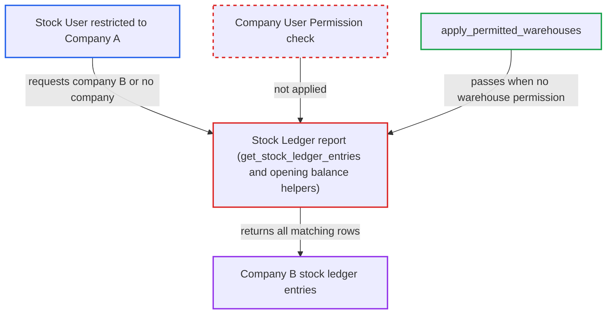

# Stock Ledger report does not apply Company user permissions

| Field | Value |
|---|---|
| ID | `find_01VHcbnx7eNHyVS4By3Q8tqh` |
| Severity | **High** |
| Status | open |
| CWE | CWE-862 — Missing authorization |
| Created | 2026-10-27T21:12:07.330127Z |
| Claude Security | https://claude.ai/security/findings/find_01VHcbnx7eNHyVS4By3Q8tqh |

## Description

A Stock User who is limited to Company A by a User Permission can read Company B's whole stock ledger. That includes quantities, valuation rates, stock values, voucher numbers, and batch and serial numbers. The attacker only needs a desk login with the Stock User role. The Stock Ledger report builds its company filter from the caller's request and never checks Company User Permissions.

1. **Attacker (Stock User restricted to Company A)** calls `frappe.desk.query_report.run` directly with `report_name=Stock Ledger`. The filters name `company:'B'` or leave `company` out. The desk UI marks `company` as required and defaults it, but only in the client, so a direct call can skip that. ([`erpnext/stock/report/stock_ledger/stock_ledger.js:8-14`](https://github.com/cx-benchmark/erpnext/blob/90e7aefca73da3c440d2e8da7472fcb67838e678/erpnext/stock/report/stock_ledger/stock_ledger.js#L8-L14))
2. **the report function `execute`** runs only the item and warehouse checks before querying. It calls `get_items`, which returns `None` when no item filters are sent, and `apply_permitted_warehouses`. No company permission step comes before `get_stock_ledger_entries`. ([`erpnext/stock/report/stock_ledger/stock_ledger.py:25-33`](https://github.com/cx-benchmark/erpnext/blob/90e7aefca73da3c440d2e8da7472fcb67838e678/erpnext/stock/report/stock_ledger/stock_ledger.py#L25-L33))
3. **the helper `apply_permitted_warehouses`** returns `True` without narrowing anything. It reads only the user's Warehouse User Permissions. This attacker has none, so the permitted list is empty and the helper lets everything through. ([`erpnext/stock/report/stock_ledger/stock_ledger.py:822-836`](https://github.com/cx-benchmark/erpnext/blob/90e7aefca73da3c440d2e8da7472fcb67838e678/erpnext/stock/report/stock_ledger/stock_ledger.py#L822-L836))
4. **the query builder `get_stock_ledger_entries`** adds a company condition only if the caller sent `company`. The condition is `sle[field] == filters.get(field)` for the field `company`. The caller's value is used as it is. The user's Company User Permissions are never read. ([`erpnext/stock/report/stock_ledger/stock_ledger.py:519-521`](https://github.com/cx-benchmark/erpnext/blob/90e7aefca73da3c440d2e8da7472fcb67838e678/erpnext/stock/report/stock_ledger/stock_ledger.py#L519-L521))
5. **the helpers `get_opening_balance` and `get_opening_balance_for_inv_dimension`** scope the opening balances the same way. They also take `company` only from the caller's filter, so opening balances for Company B are returned too. ([`erpnext/stock/report/stock_ledger/stock_ledger.py:789-791`](https://github.com/cx-benchmark/erpnext/blob/90e7aefca73da3c440d2e8da7472fcb67838e678/erpnext/stock/report/stock_ledger/stock_ledger.py#L789-L791))
6. **the report** returns Company B's ledger rows to the attacker. Each row holds company, warehouse, quantities, incoming and valuation rates, stock values, voucher type and number, batch and serial numbers, and project. ([`erpnext/stock/report/stock_ledger/stock_ledger.py:476-535`](https://github.com/cx-benchmark/erpnext/blob/90e7aefca73da3c440d2e8da7472fcb67838e678/erpnext/stock/report/stock_ledger/stock_ledger.py#L476-L535))

## Assessment

The attacker is an authenticated desk user with the Stock User role. A User Permission restricts them to Company A, and they have no Warehouse User Permission. They call `/api/method/frappe.desk.query_report.run` with `report_name=Stock Ledger` and filters such as `from_date`, `to_date` and `company:'B'`. Omitting `company` also works. The report's roles are Stock User and Accounts Manager. The report assumes Frappe (`>=17.0.0-dev,<18`, not in the checkout) gates only on roles and `report` permission and does not filter Script Report rows by User Permissions.

Impact: The attacker can read another company's full stock ledger. That includes valuation rates, stock values and transaction references. The report describes read access only, with no write or availability impact.

## Recommendation

`get_stock_ledger_entries` and the opening-balance helpers take the company scope from the caller's filter. They do not intersect it with the companies the running user is allowed by Company User Permissions.

Fix criteria: Every Stock Ledger Entry row returned by the main query and the opening-balance queries has a `company` the user is allowed by their Company User Permissions for Stock Ledger Entry, intersected with any caller filter. A request naming a non-permitted company returns nothing or raises PermissionError. Verify that a Stock User restricted to Company A requesting `company=B`, or omitting company, receives no Company-B rows.

## Evidence

**https://github.com/cx-benchmark/erpnext**

- [`erpnext/stock/report/stock_ledger/stock_ledger.py:519-521`](https://github.com/cx-benchmark/erpnext/blob/90e7aefca73da3c440d2e8da7472fcb67838e678/erpnext/stock/report/stock_ledger/stock_ledger.py#L519-L521)
- [`erpnext/stock/report/stock_ledger/stock_ledger.py:25-33`](https://github.com/cx-benchmark/erpnext/blob/90e7aefca73da3c440d2e8da7472fcb67838e678/erpnext/stock/report/stock_ledger/stock_ledger.py#L25-L33)
- [`erpnext/stock/report/stock_ledger/stock_ledger.py:822-836`](https://github.com/cx-benchmark/erpnext/blob/90e7aefca73da3c440d2e8da7472fcb67838e678/erpnext/stock/report/stock_ledger/stock_ledger.py#L822-L836)
- [`erpnext/stock/report/stock_ledger/stock_ledger.py:476-535`](https://github.com/cx-benchmark/erpnext/blob/90e7aefca73da3c440d2e8da7472fcb67838e678/erpnext/stock/report/stock_ledger/stock_ledger.py#L476-L535)
- [`erpnext/stock/report/stock_ledger/stock_ledger.py:789-791`](https://github.com/cx-benchmark/erpnext/blob/90e7aefca73da3c440d2e8da7472fcb67838e678/erpnext/stock/report/stock_ledger/stock_ledger.py#L789-L791)
- [`erpnext/stock/report/stock_ledger/stock_ledger.js:8-14`](https://github.com/cx-benchmark/erpnext/blob/90e7aefca73da3c440d2e8da7472fcb67838e678/erpnext/stock/report/stock_ledger/stock_ledger.js#L8-L14)
- [`erpnext/stock/report/stock_ledger_entries_of_cancelled_vouchers/stock_ledger_entries_of_cancelled_vouchers.py:20-55`](https://github.com/cx-benchmark/erpnext/blob/90e7aefca73da3c440d2e8da7472fcb67838e678/erpnext/stock/report/stock_ledger_entries_of_cancelled_vouchers/stock_ledger_entries_of_cancelled_vouchers.py#L20-L55)

