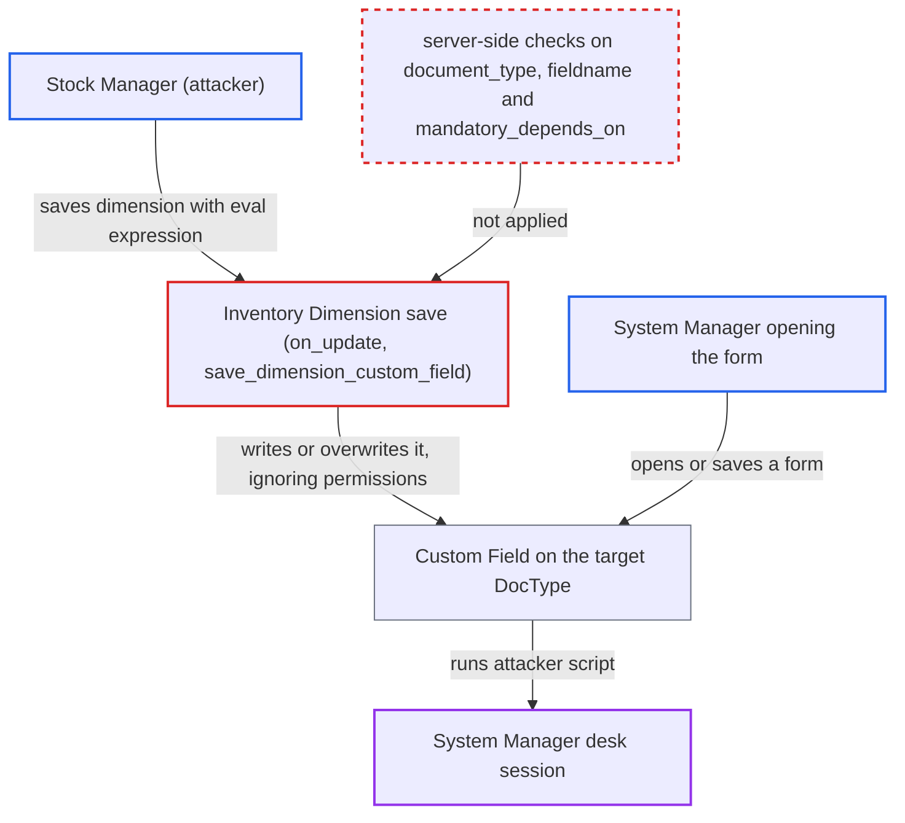

# Stock Manager plants JavaScript depends_on expressions in Custom Fields of any DocType via Inventory Dimension

| Field | Value |
|---|---|
| ID | `find_016b9iyTx89xj1otYMh3S9wD` |
| Severity | **High** |
| Status | open |
| CWE | CWE-95 — Eval injection |
| Created | 2026-10-27T21:31:09.535772Z |
| Claude Security | https://claude.ai/security/findings/find_016b9iyTx89xj1otYMh3S9wD |

## Description

A user who holds only the Stock Manager role can store JavaScript in the form settings of any DocType, and it runs in the browser session of any desk user who opens or saves that form. Against a System Manager it can grant the attacker System Manager rights, read or change any data, and delete records. The cause is `Inventory Dimension`: it copies `mandatory_depends_on` unchecked into a Custom Field that `save_dimension_custom_field` writes with `ignore_permissions`.

1. **Stock Manager** saves an `Inventory Dimension` with a chosen `document_type` and an `eval:` value in `mandatory_depends_on`. The role has create, write and delete rights on `Inventory Dimension`, and `mandatory_depends_on` is an ordinary free-text field that any user with write access to the doctype can fill in. ([`erpnext/stock/doctype/inventory_dimension/inventory_dimension.json:207-218`](https://github.com/cx-benchmark/erpnext/blob/90e7aefca73da3c440d2e8da7472fcb67838e678/erpnext/stock/doctype/inventory_dimension/inventory_dimension.json#L207-L218))
2. **the `validate()` method** checks only `reference_document`. `document_type`, `source_fieldname` and `mandatory_depends_on` are never checked on the server, and the limit to inventory documents exists only in the client-side `set_query` in `inventory_dimension.js`. ([`erpnext/stock/doctype/inventory_dimension/inventory_dimension.py:61-66`](https://github.com/cx-benchmark/erpnext/blob/90e7aefca73da3c440d2e8da7472fcb67838e678/erpnext/stock/doctype/inventory_dimension/inventory_dimension.py#L61-L66))
3. **the method `get_dimension_fields`** builds the Custom Field definition from the submitted values. It copies `mandatory_depends_on` verbatim, uses `source_fieldname` as the fieldname and `document_type` as the target DocType. ([`erpnext/stock/doctype/inventory_dimension/inventory_dimension.py:173-220`](https://github.com/cx-benchmark/erpnext/blob/90e7aefca73da3c440d2e8da7472fcb67838e678/erpnext/stock/doctype/inventory_dimension/inventory_dimension.py#L173-L220))
4. **the method `add_custom_fields`** filters the fields with `field_exists` and lets a match with an existing Custom Field through. `field_exists` looks only at standard `DocField` rows, so a fieldname that already belongs to a Custom Field is later updated in place. ([`erpnext/stock/doctype/inventory_dimension/inventory_dimension.py:237-284`](https://github.com/cx-benchmark/erpnext/blob/90e7aefca73da3c440d2e8da7472fcb67838e678/erpnext/stock/doctype/inventory_dimension/inventory_dimension.py#L237-L284))
5. **the function `save_dimension_custom_field`** updates or inserts the Custom Field on the target DocType with `ignore_permissions` set. The Custom Field is matched by `(dt, fieldname)`, and the permission check that would normally stop a Stock Manager from editing Custom Fields is skipped. ([`erpnext/stock/doctype/inventory_dimension/inventory_dimension.py:477-499`](https://github.com/cx-benchmark/erpnext/blob/90e7aefca73da3c440d2e8da7472fcb67838e678/erpnext/stock/doctype/inventory_dimension/inventory_dimension.py#L477-L499))
6. **a System Manager in the desk** opens or saves a form of the targeted DocType, and the desk runs the stored expression as JavaScript. The report assumes Frappe 17.x desk behaviour, where `eval:` strings are compiled with `new Function`, and the expression can call the client API such as `frappe.xcall`. ([`erpnext/buying/doctype/buying_settings/buying_settings.json:170`](https://github.com/cx-benchmark/erpnext/blob/90e7aefca73da3c440d2e8da7472fcb67838e678/erpnext/buying/doctype/buying_settings/buying_settings.json#L170))

## Assessment

The attacker needs a login with the Stock Manager role and nothing more. The report names System Manager as the trusted tier. The attacker sends an `Inventory Dimension` to `/api/resource` with `apply_to_all_doctypes=0`. They choose any `document_type` (for example `Sales Invoice`, or `Sales Invoice Item`), any non-table `reference_document`, and a `mandatory_depends_on` such as `eval:frappe.xcall(...)` that contains no `<`. When `apply_to_all_doctypes` is set, `mandatory_depends_on` is cleared, so it must stay unset. The attack then waits for a desk user, such as a System Manager, to open or save a form of that DocType. A second route needs no victim. Deleting an `Inventory Dimension` runs `on_trash`, which calls `delete_custom_fields` and removes, with `ignore_permissions`, any Custom Field on the chosen `document_type` named `source_fieldname` or its `to_`, `from_` or `rejected_` variant. A Stock Manager can also add, re-point or make mandatory Custom Fields on non-inventory DocTypes, including existing ones with the same fieldname.

Impact: The attacker's code runs with the victim's session. Against a System Manager that means granting the attacker System Manager, reading or changing any data and deleting records. The attacker can also add, change, make mandatory or delete Custom Fields on DocTypes outside inventory, which can break saving those DocTypes.

## Recommendation

(1) The free-text `mandatory_depends_on` of an `Inventory Dimension` is copied unchanged into a Custom Field, and the desk evaluates it as unsandboxed JavaScript. `save_dimension_custom_field` writes it with `ignore_permissions`, so a Stock Manager can plant code that runs for every user of the target form.

Fix criteria: A user without the right to write Custom Fields or Client Scripts cannot place an executable `eval:` expression into any generated Custom Field. The server refuses such a value or reduces it to a non-executable form. Check: a Stock Manager-only user saves an Inventory Dimension with `mandatory_depends_on="eval:frappe.xcall('frappe.client.get_list',{doctype:'User'})"`. The save is refused, and no Custom Field stores that expression.

(2) `document_type` and `source_fieldname` are trusted as submitted, and `field_exists` checks only `DocField`. The create, update and delete paths that use `ignore_permissions` can therefore reach any DocType and any existing Custom Field with a matching fieldname.

Fix criteria: The server refuses a `document_type` outside the inventory documents returned by `get_inventory_documents()`. It refuses a source or target fieldname that collides with a Custom Field the dimension did not create. On deletion it removes only fields it created. Check: an Inventory Dimension with `document_type="Company"`, or with `source_fieldname` set to an existing Accounting Dimension field, is refused. Deleting a dimension leaves other Custom Fields intact.

## Evidence

**https://github.com/cx-benchmark/erpnext**

- [`erpnext/stock/doctype/inventory_dimension/inventory_dimension.py:477-499`](https://github.com/cx-benchmark/erpnext/blob/90e7aefca73da3c440d2e8da7472fcb67838e678/erpnext/stock/doctype/inventory_dimension/inventory_dimension.py#L477-L499)
- [`erpnext/stock/doctype/inventory_dimension/inventory_dimension.py:173-220`](https://github.com/cx-benchmark/erpnext/blob/90e7aefca73da3c440d2e8da7472fcb67838e678/erpnext/stock/doctype/inventory_dimension/inventory_dimension.py#L173-L220)
- [`erpnext/stock/doctype/inventory_dimension/inventory_dimension.py:61-66`](https://github.com/cx-benchmark/erpnext/blob/90e7aefca73da3c440d2e8da7472fcb67838e678/erpnext/stock/doctype/inventory_dimension/inventory_dimension.py#L61-L66)
- [`erpnext/stock/doctype/inventory_dimension/inventory_dimension.py:237-284`](https://github.com/cx-benchmark/erpnext/blob/90e7aefca73da3c440d2e8da7472fcb67838e678/erpnext/stock/doctype/inventory_dimension/inventory_dimension.py#L237-L284)
- [`erpnext/stock/doctype/inventory_dimension/inventory_dimension.py:95-128`](https://github.com/cx-benchmark/erpnext/blob/90e7aefca73da3c440d2e8da7472fcb67838e678/erpnext/stock/doctype/inventory_dimension/inventory_dimension.py#L95-L128)
- [`erpnext/stock/doctype/inventory_dimension/inventory_dimension.json:207-218`](https://github.com/cx-benchmark/erpnext/blob/90e7aefca73da3c440d2e8da7472fcb67838e678/erpnext/stock/doctype/inventory_dimension/inventory_dimension.json#L207-L218)
- [`erpnext/stock/doctype/inventory_dimension/test_inventory_dimension.py:110-135`](https://github.com/cx-benchmark/erpnext/blob/90e7aefca73da3c440d2e8da7472fcb67838e678/erpnext/stock/doctype/inventory_dimension/test_inventory_dimension.py#L110-L135)
- [`erpnext/buying/doctype/buying_settings/buying_settings.json:170`](https://github.com/cx-benchmark/erpnext/blob/90e7aefca73da3c440d2e8da7472fcb67838e678/erpnext/buying/doctype/buying_settings/buying_settings.json#L170)

