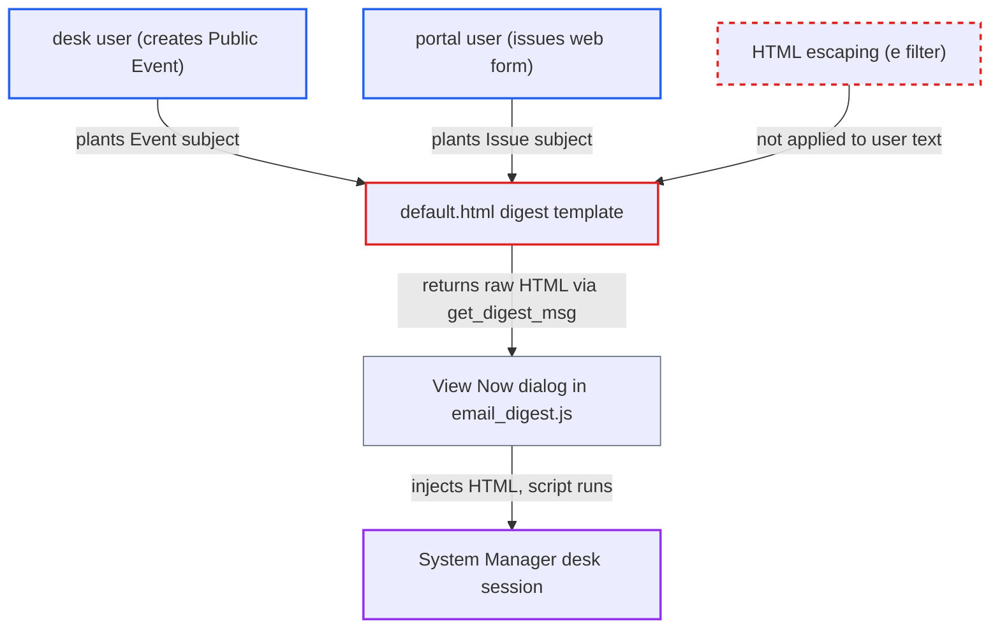

# Stored XSS in Email Digest preview via unescaped Event, Issue, ToDo and Project text

| Field | Value |
|---|---|
| ID | `find_01SExZLi9W8U4qn3fDMZSCoF` |
| Severity | **High** |
| Status | open |
| CWE | CWE-79 — Cross-site scripting |
| Created | 2026-10-27T22:05:31.598080Z |
| Claude Security | https://claude.ai/security/findings/find_01SExZLi9W8U4qn3fDMZSCoF |

## Description

A desk user can plant script in an Event subject, or a portal user can plant it in an Issue subject. It then runs in a System Manager's browser session when that person clicks View Now on an Email Digest. It only works if the digest has the relevant section enabled, which is off by default. The cause is the template `default.html`, which writes stored text into the page without escaping.

1. **attacker (desk user)** creates a Public Event whose subject is a JSON string holding an HTML payload. The subject looks like `""`, and the report assumes Frappe's save-time `sanitize_html` leaves a value unchanged when it parses as JSON.
2. **Frappe `get_events`** returns the Event for the digest window. `get_calendar_events` passes the Event to the template with `subject` untouched. ([`erpnext/setup/doctype/email_digest/email_digest.py:202-218`](https://github.com/cx-benchmark/erpnext/blob/90e7aefca73da3c440d2e8da7472fcb67838e678/erpnext/setup/doctype/email_digest/email_digest.py#L202-L218))
3. **System Manager** clicks View Now on the Email Digest. The button calls the whitelisted `get_digest_msg`, which only checks Email Digest permission, so the System Manager passes. ([`erpnext/setup/doctype/email_digest/email_digest.py:963-967`](https://github.com/cx-benchmark/erpnext/blob/90e7aefca73da3c440d2e8da7472fcb67838e678/erpnext/setup/doctype/email_digest/email_digest.py#L963-L967))
4. **`get_msg_html`** renders `default.html` with `frappe.render_template`. The Jinja environment does not autoescape, so the template's `{{ e.subject }}` writes the payload as raw HTML. ([`erpnext/setup/doctype/email_digest/email_digest.py:124-164`](https://github.com/cx-benchmark/erpnext/blob/90e7aefca73da3c440d2e8da7472fcb67838e678/erpnext/setup/doctype/email_digest/email_digest.py#L124-L164))
5. **the template line `{{ e.subject }}`** outputs the Event subject with no `| e` filter. Other lines in the same template do use `| e`, so escaping is applied only selectively. ([`erpnext/setup/doctype/email_digest/templates/default.html:108`](https://github.com/cx-benchmark/erpnext/blob/90e7aefca73da3c440d2e8da7472fcb67838e678/erpnext/setup/doctype/email_digest/templates/default.html#L108))
6. **the View Now handler in `email_digest.js`** injects the returned HTML into the desk dialog with `$(d.body).html(r.message)`. The browser runs the payload script inside the desk at `/app`, with the System Manager's session. ([`erpnext/setup/doctype/email_digest/email_digest.js:7-22`](https://github.com/cx-benchmark/erpnext/blob/90e7aefca73da3c440d2e8da7472fcb67838e678/erpnext/setup/doctype/email_digest/email_digest.js#L7-L22))

## Assessment

The attacker is any desk user who can create a Public Event. For the Issue subject, a portal user can do it through the `issues` web form, which requires login. The viewer must also have Issue read, and the digest lists the oldest ten open issues. An Email Digest must exist with the relevant section enabled, such as Upcoming Calendar Events or the Issue, ToDo or Project sections. All of these default to off. A System Manager must then press View Now. The Project name and ToDo description lines are also unescaped, and the report names Projects User for the Project name. The emailed copy, sent with Send Now, carries the same markup to recipients' mail clients as HTML injection.

Impact: The attacker's script runs as the System Manager. It can read the site's data and call any administrative API as that user, such as changing users, roles, settings or records. The report says the code puts no limit on the payload.

## Recommendation

`default.html` writes stored user text (Event and Issue subjects, ToDo description, Project name) into HTML without escaping. Jinja does not autoescape here, and the result is injected into the desk page.

Fix criteria: Every data-derived value in the digest template is HTML-escaped, with `| e`, or with `strip_html` then escape for the Text Editor description. Stored markup then shows as literal text in both the emailed copy and the View Now preview. To check, create a Public Event with the subject `""`. Preview a digest with calendar events enabled and confirm no script runs.

## Evidence

**https://github.com/cx-benchmark/erpnext**

- [`erpnext/setup/doctype/email_digest/templates/default.html:108`](https://github.com/cx-benchmark/erpnext/blob/90e7aefca73da3c440d2e8da7472fcb67838e678/erpnext/setup/doctype/email_digest/templates/default.html#L108)
- [`erpnext/setup/doctype/email_digest/templates/default.html:54`](https://github.com/cx-benchmark/erpnext/blob/90e7aefca73da3c440d2e8da7472fcb67838e678/erpnext/setup/doctype/email_digest/templates/default.html#L54)
- [`erpnext/setup/doctype/email_digest/templates/default.html:138`](https://github.com/cx-benchmark/erpnext/blob/90e7aefca73da3c440d2e8da7472fcb67838e678/erpnext/setup/doctype/email_digest/templates/default.html#L138)
- [`erpnext/setup/doctype/email_digest/templates/default.html:78`](https://github.com/cx-benchmark/erpnext/blob/90e7aefca73da3c440d2e8da7472fcb67838e678/erpnext/setup/doctype/email_digest/templates/default.html#L78)
- [`erpnext/setup/doctype/email_digest/templates/default.html:214`](https://github.com/cx-benchmark/erpnext/blob/90e7aefca73da3c440d2e8da7472fcb67838e678/erpnext/setup/doctype/email_digest/templates/default.html#L214)
- [`erpnext/setup/doctype/email_digest/email_digest.js:7-22`](https://github.com/cx-benchmark/erpnext/blob/90e7aefca73da3c440d2e8da7472fcb67838e678/erpnext/setup/doctype/email_digest/email_digest.js#L7-L22)
- [`erpnext/setup/doctype/email_digest/email_digest.py:963-967`](https://github.com/cx-benchmark/erpnext/blob/90e7aefca73da3c440d2e8da7472fcb67838e678/erpnext/setup/doctype/email_digest/email_digest.py#L963-L967)
- [`erpnext/setup/doctype/email_digest/email_digest.py:202-218`](https://github.com/cx-benchmark/erpnext/blob/90e7aefca73da3c440d2e8da7472fcb67838e678/erpnext/setup/doctype/email_digest/email_digest.py#L202-L218)
- [`erpnext/setup/doctype/email_digest/email_digest.py:124-164`](https://github.com/cx-benchmark/erpnext/blob/90e7aefca73da3c440d2e8da7472fcb67838e678/erpnext/setup/doctype/email_digest/email_digest.py#L124-L164)
- [`erpnext/setup/doctype/email_digest/email_digest.json:327-334`](https://github.com/cx-benchmark/erpnext/blob/90e7aefca73da3c440d2e8da7472fcb67838e678/erpnext/setup/doctype/email_digest/email_digest.json#L327-L334)
- [`erpnext/setup/doctype/email_digest/email_digest.json:273-277`](https://github.com/cx-benchmark/erpnext/blob/90e7aefca73da3c440d2e8da7472fcb67838e678/erpnext/setup/doctype/email_digest/email_digest.json#L273-L277)

