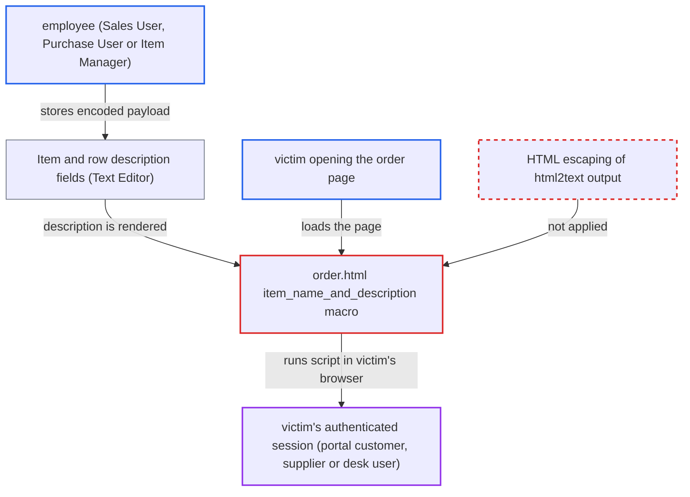

# Stored XSS in portal order page via html2text-decoded item description

| Field | Value |
|---|---|
| ID | `find_01Kj75Y4bGuX3dqj8XoSHfuo` |
| Severity | **High** |
| Status | open |
| CWE | CWE-79 — Cross-site scripting |
| Created | 2026-10-27T21:29:34.281855Z |
| Claude Security | https://claude.ai/security/findings/find_01Kj75Y4bGuX3dqj8XoSHfuo |

## Description

A low-privilege employee can run script in another user's browser, on the ERPNext origin and with that user's session. The victims are the document's portal customer or supplier, or a desk user who can read the document. They only need to open the portal order page. The line `{{ html2text(d.description or "") | truncate(140) }}` in `order.html` prints item descriptions without `| e`, and `html2text` turns stored `&lt;` and `&gt;` back into live markup.

1. **attacker (Sales User, Purchase User or Item Manager)** stores an entity-encoded payload in a description. The payload is `&lt;img src=x onerror=...&gt;`, written into an Item description or a transaction row description through the editor or the REST API. The editor stores typed angle brackets as `&lt;` and `&gt;`. ([`erpnext/stock/doctype/item/item.json:338-339`](https://github.com/cx-benchmark/erpnext/blob/90e7aefca73da3c440d2e8da7472fcb67838e678/erpnext/stock/doctype/item/item.json#L338-L339))
2. **Frappe save-time XSS filter** lets the value through unchanged. The filter skips values with no literal `<` or `>`, and it keeps entities in text nodes as they are, so the stored value stays encoded. ([`erpnext/selling/doctype/sales_order_item/sales_order_item.json:189-190`](https://github.com/cx-benchmark/erpnext/blob/90e7aefca73da3c440d2e8da7472fcb67838e678/erpnext/selling/doctype/sales_order_item/sales_order_item.json#L189-L190))
3. **`get_item_details.py`** copies the Item description into transaction rows. The description is copied as-is, only stripped, so a payload on the Item reaches every order that uses that Item. ([`erpnext/stock/get_item_details.py:640`](https://github.com/cx-benchmark/erpnext/blob/90e7aefca73da3c440d2e8da7472fcb67838e678/erpnext/stock/get_item_details.py#L640))
4. **victim (portal customer, portal supplier or desk user)** opens a page such as `/orders/<name>`. The same page serves `/invoices/<name>`, `/quotations/<name>`, `/shipments/<name>`, `/purchase-orders/<name>`, `/purchase-invoices/<name>` and `/supplier-quotations/<name>`. Opening it is the only thing the victim does. ([`erpnext/hooks.py:168-236`](https://github.com/cx-benchmark/erpnext/blob/90e7aefca73da3c440d2e8da7472fcb67838e678/erpnext/hooks.py#L168-L236))
5. **the macro `item_name_and_description` in `order.html`** decodes the entities and prints the result unescaped. `html2text` converts `&lt;img src=x onerror=alert(1)&gt;` into the literal tag ``, and the output has no `| e` in a Jinja environment that does not autoescape. ([`erpnext/templates/pages/order.html:175`](https://github.com/cx-benchmark/erpnext/blob/90e7aefca73da3c440d2e8da7472fcb67838e678/erpnext/templates/pages/order.html#L175))
6. **victim's browser** runs the injected handler on the ERPNext origin. The script runs with the victim's authenticated session. No CSP blocks it, because the shipped templates already use inline scripts and `onclick` handlers without nonces.

## Assessment

The attacker is a low-privilege employee, such as a Sales User, Purchase User or Item Manager. They can write an Item description or a transaction row description, through the editor or the REST API. The victim is the document's portal customer or supplier, or a desk user with read permission on the document. The victim only has to open the page. The report does not name any setting that must be enabled. The report assumes Frappe behaves in a certain way: the Jinja environment does not autoescape, and the `html2text` global is `frappe.core.utils.html2text`. It could not confirm this because the framework is not in the checkout.

Impact: The attacker's script runs as the victim and can call `/api/method` and `/api/resource`. It can read whatever the victim can read and write whatever the victim can write. For a Sales or Accounts Manager victim, that includes submitting or cancelling financial documents. The script is limited only by the victim's own privileges, and the report shows no availability impact.

## Recommendation

`order.html` line 175 prints the result of `html2text()` on a user-editable Text Editor field without HTML-escaping. `html2text` decodes entities back into markup, which undoes the save-time sanitiser that left them encoded.

Fix criteria: The item description reaches the browser as text only. Every `<`, `>`, `&` and quote that comes out of the conversion is HTML-escaped, or the value is reduced to escaped plain text. To verify, store `&lt;img src=x onerror=alert(1)&gt;` and the editor form `
&lt;script&gt;...&lt;/script&gt;
` in an item description. Then load `/orders/<name>` and confirm the response holds only escaped text and no element or event handler.

## Evidence

**https://github.com/cx-benchmark/erpnext**

- [`erpnext/templates/pages/order.html:175`](https://github.com/cx-benchmark/erpnext/blob/90e7aefca73da3c440d2e8da7472fcb67838e678/erpnext/templates/pages/order.html#L175)
- [`erpnext/templates/pages/order.py:36-37`](https://github.com/cx-benchmark/erpnext/blob/90e7aefca73da3c440d2e8da7472fcb67838e678/erpnext/templates/pages/order.py#L36-L37)
- [`erpnext/hooks.py:168-236`](https://github.com/cx-benchmark/erpnext/blob/90e7aefca73da3c440d2e8da7472fcb67838e678/erpnext/hooks.py#L168-L236)
- [`erpnext/selling/doctype/sales_order_item/sales_order_item.json:189-190`](https://github.com/cx-benchmark/erpnext/blob/90e7aefca73da3c440d2e8da7472fcb67838e678/erpnext/selling/doctype/sales_order_item/sales_order_item.json#L189-L190)
- [`erpnext/stock/doctype/item/item.json:338-339`](https://github.com/cx-benchmark/erpnext/blob/90e7aefca73da3c440d2e8da7472fcb67838e678/erpnext/stock/doctype/item/item.json#L338-L339)
- [`erpnext/stock/get_item_details.py:640`](https://github.com/cx-benchmark/erpnext/blob/90e7aefca73da3c440d2e8da7472fcb67838e678/erpnext/stock/get_item_details.py#L640)
- [`erpnext/controllers/website_list_for_contact.py:296-311`](https://github.com/cx-benchmark/erpnext/blob/90e7aefca73da3c440d2e8da7472fcb67838e678/erpnext/controllers/website_list_for_contact.py#L296-L311)

