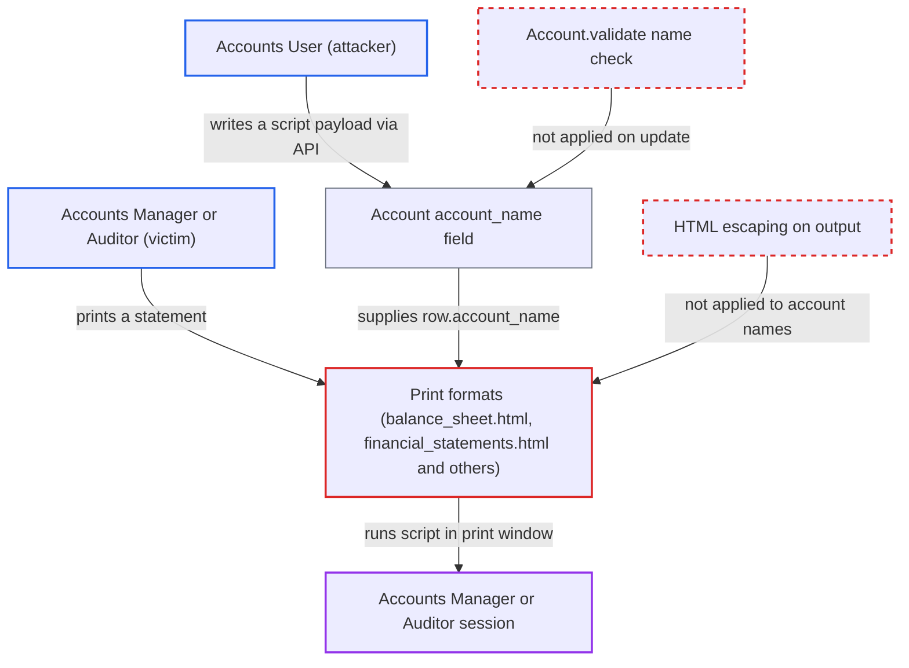

# Stored XSS via Account name in financial statement print formats

| Field | Value |
|---|---|
| ID | `find_01TfTy9t5Z3nW85rSmYL2ZJU` |
| Severity | **High** |
| Status | open |
| CWE | CWE-79 — Cross-site scripting |
| Created | 2026-10-27T22:14:34.701615Z |
| Claude Security | https://claude.ai/security/findings/find_01TfTy9t5Z3nW85rSmYL2ZJU |

## Description

An Accounts User can store a script in an account's name that runs in the browser of an Accounts Manager or Auditor who prints a financial statement. The script can read the financial data the victim can see and, for an Accounts Manager, act as them in the accounting API. The print formats write `row.account_name` without escaping, and `Account.validate` lets `account_name` be changed on an existing account.

1. **Accounts User** changes an existing account's `account_name` to a JSON-string payload such as `""`. The write goes through `frappe.client.set_value` or `PUT /api/resource/Account/<name>`, and `Account.validate` does not check that `account_name` still matches the document name. ([`erpnext/accounts/doctype/account/account.py:108-124`](https://github.com/cx-benchmark/erpnext/blob/90e7aefca73da3c440d2e8da7472fcb67838e678/erpnext/accounts/doctype/account/account.py#L108-L124))
2. **Frappe save-time `sanitize_html`** lets the value through unchanged. The report assumes it returns a value unchanged when the value parses as JSON or has no complete element, so the markup is stored as it was sent. ([`erpnext/accounts/doctype/account/account.json:46-55`](https://github.com/cx-benchmark/erpnext/blob/90e7aefca73da3c440d2e8da7472fcb67838e678/erpnext/accounts/doctype/account/account.json#L46-L55))
3. **report code in `financial_statements.py`** copies `Account.account_name` into the report rows. The value goes in verbatim, or translated, with no escaping. ([`erpnext/accounts/report/financial_statements.py:479-482`](https://github.com/cx-benchmark/erpnext/blob/90e7aefca73da3c440d2e8da7472fcb67838e678/erpnext/accounts/report/financial_statements.py#L479-L482))
4. **Accounts Manager or Auditor** opens a financial statement and chooses Print. This is a routine step, and the report is available to these roles as well as to Accounts User. ([`erpnext/accounts/report/balance_sheet/balance_sheet.json:30-40`](https://github.com/cx-benchmark/erpnext/blob/90e7aefca73da3c440d2e8da7472fcb67838e678/erpnext/accounts/report/balance_sheet/balance_sheet.json#L30-L40))
5. **the print format template** writes `row.account_name` into the print window without escaping. The microtemplate output `` only trims surrounding quotes, so the payload becomes live markup and its script runs in the victim's desk session. ([`erpnext/accounts/report/balance_sheet/balance_sheet.html:203-207`](https://github.com/cx-benchmark/erpnext/blob/90e7aefca73da3c440d2e8da7472fcb67838e678/erpnext/accounts/report/balance_sheet/balance_sheet.html#L203-L207))

## Assessment

The attacker is an Accounts User, a low-privilege employee with write access to Account. They need an existing account, since new names with `<` or `>` are rejected on creation. They change `account_name` through `frappe.client.set_value` or the REST API, because the desk form hides the field after creation. The attack fires when an Accounts Manager or Auditor prints the Balance Sheet, Profit and Loss Statement, Cash Flow or Trial Balance. It also fires for Consolidated Trial Balance, Gross and Net Profit and Profitability Analysis, which use the shared `financial_statements.html`. The report assumes Frappe's `sanitize_html` passes JSON strings and values with no complete element, that `validate_name` runs only on insert and rename, and that the print window is same origin.

Impact: The attacker runs JavaScript as the victim in the desk origin. That lets them read all financial data the victim can see. For an Accounts Manager they can also perform any accounting API action as that user through the session and CSRF token of `window.opener`. The report says the code imposes no limit.

## Recommendation

(1) The print formats write `Account.account_name` and section names with the unescaped `` microtemplate operator, and the save-time sanitizer lets some markup through.

Fix criteria: All data-derived text in these print formats, including account names and sections, is HTML-escaped at output so stored markup shows as literal text. Set an account's `account_name` to the JSON string `""` via the API, print the Balance Sheet, and confirm no script runs.

(2) `Account` lets `account_name` be changed on an existing document without the `validate_name` character restrictions that protect the derived document name.

Fix criteria: Updating `account_name` enforces the same character rules as account creation and rejects `<` and `>`, or goes through the rename path so the name and `account_name` stay consistent. A write of `account_name` containing `<` is refused.

## Evidence

**https://github.com/cx-benchmark/erpnext**

- [`erpnext/accounts/report/balance_sheet/balance_sheet.html:203-207`](https://github.com/cx-benchmark/erpnext/blob/90e7aefca73da3c440d2e8da7472fcb67838e678/erpnext/accounts/report/balance_sheet/balance_sheet.html#L203-L207)
- [`erpnext/accounts/report/profit_and_loss_statement/profit_and_loss_statement.html:205`](https://github.com/cx-benchmark/erpnext/blob/90e7aefca73da3c440d2e8da7472fcb67838e678/erpnext/accounts/report/profit_and_loss_statement/profit_and_loss_statement.html#L205)
- [`erpnext/accounts/report/cash_flow/cash_flow.html:205`](https://github.com/cx-benchmark/erpnext/blob/90e7aefca73da3c440d2e8da7472fcb67838e678/erpnext/accounts/report/cash_flow/cash_flow.html#L205)
- [`erpnext/accounts/report/trial_balance/trial_balance.html:196`](https://github.com/cx-benchmark/erpnext/blob/90e7aefca73da3c440d2e8da7472fcb67838e678/erpnext/accounts/report/trial_balance/trial_balance.html#L196)
- [`erpnext/accounts/report/financial_statements.html:68`](https://github.com/cx-benchmark/erpnext/blob/90e7aefca73da3c440d2e8da7472fcb67838e678/erpnext/accounts/report/financial_statements.html#L68)
- [`erpnext/accounts/report/financial_statements.py:479-482`](https://github.com/cx-benchmark/erpnext/blob/90e7aefca73da3c440d2e8da7472fcb67838e678/erpnext/accounts/report/financial_statements.py#L479-L482)
- [`erpnext/accounts/doctype/account/account.json:46-55`](https://github.com/cx-benchmark/erpnext/blob/90e7aefca73da3c440d2e8da7472fcb67838e678/erpnext/accounts/doctype/account/account.json#L46-L55)
- [`erpnext/accounts/doctype/account/account.json:219-231`](https://github.com/cx-benchmark/erpnext/blob/90e7aefca73da3c440d2e8da7472fcb67838e678/erpnext/accounts/doctype/account/account.json#L219-L231)
- [`erpnext/accounts/doctype/account/account.py:108-124`](https://github.com/cx-benchmark/erpnext/blob/90e7aefca73da3c440d2e8da7472fcb67838e678/erpnext/accounts/doctype/account/account.py#L108-L124)
- [`erpnext/accounts/doctype/account/account.js:30`](https://github.com/cx-benchmark/erpnext/blob/90e7aefca73da3c440d2e8da7472fcb67838e678/erpnext/accounts/doctype/account/account.js#L30)
- [`erpnext/accounts/report/balance_sheet/balance_sheet.json:30-40`](https://github.com/cx-benchmark/erpnext/blob/90e7aefca73da3c440d2e8da7472fcb67838e678/erpnext/accounts/report/balance_sheet/balance_sheet.json#L30-L40)

