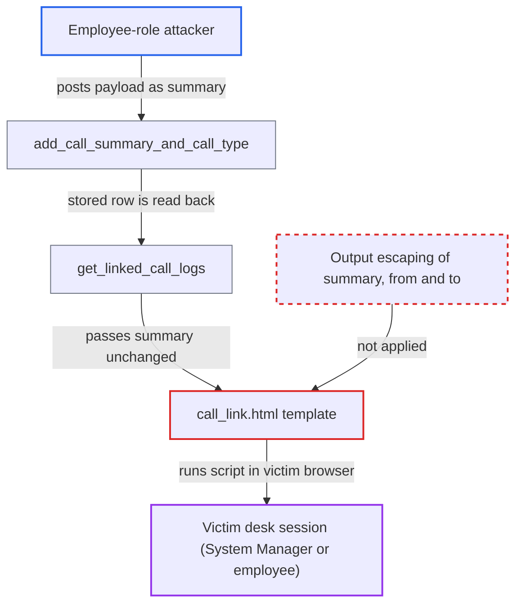

# Stored XSS via Call Log summary in linked-document timeline card

| Field | Value |
|---|---|
| ID | `find_01YcQWjCPJW1g5UkKu7DyXqK` |
| Severity | **High** |
| Status | open |
| CWE | CWE-79 — Cross-site scripting |
| Created | 2026-10-27T21:31:51.567397Z |
| Claude Security | https://claude.ai/security/findings/find_01YcQWjCPJW1g5UkKu7DyXqK |

## Description

A logged-in employee can plant a script in a Call Log summary. It runs in the browser of any System Manager or other employee who opens the linked Contact, Lead or Customer, with that victim's session. The template `call_link.html` writes `summary` into the page without escaping, and the save-time HTML filter does not catch every payload.

1. **Attacker (Employee-role user)** posts a crafted summary to `add_call_summary_and_call_type`. The attacker must be the `employee_user_id` of an answered Call Log linked to a Contact, Lead or Customer, and the method needs only Call Log read. ([`erpnext/telephony/doctype/call_log/call_log.py:156-169`](https://github.com/cx-benchmark/erpnext/blob/90e7aefca73da3c440d2e8da7472fcb67838e678/erpnext/telephony/doctype/call_log/call_log.py#L156-L169))
2. **Frappe save filter** lets the payload through unchanged. The report assumes, from upstream Frappe source, that `sanitize_html` keeps a JSON-quoted string like `""` and an unterminated tag like `` element. The microtemplate `{{ }}` does no escaping and the timeline inserts the result as HTML, so the `onerror` handler runs; for the unterminated tag, the browser closes it on the template's following `</i>`. ([`erpnext/public/js/templates/call_link.html:20-30`](https://github.com/cx-benchmark/erpnext/blob/90e7aefca73da3c440d2e8da7472fcb67838e678/erpnext/public/js/templates/call_link.html#L20-L30))

## Assessment

The attacker is a logged-in user with the Employee role. That role is added to every user linked to an Employee record. The attacker must be the `employee_user_id` of an answered Call Log linked to a Contact, Lead or Customer. The attack also relies on the assumed upstream behaviour of `sanitize_html`, which the report could not check because Frappe is not in this checkout. The victim only has to open the linked document. Victims are System Managers, or any employee, since Employee-only readers see logs that have `call_received_by` set. The fields `from` and `to` are also written unescaped, but only a System Manager or an outside telephony integration can write them, so the finding does not rely on them.

Impact: The script runs in the desk origin as the victim. It can call any whitelisted method or REST endpoint the victim can use, with the victim's session and CSRF token. The worst case is reading all business data and changing data, users and roles site-wide when the victim is a System Manager or Administrator. The victim's role sets the limit.

## Recommendation

The template `call_link.html` writes the Call Log `summary`, and the `from` and `to` values, into the timeline HTML without output encoding. It relies on a framework save filter that lets some HTML-bearing strings through.

Fix criteria: Every Call Log value the template interpolates as HTML is HTML-escaped at render time. A Call Log whose `summary` is `""` shows as literal text with no script run. The same holds for a `summary` of `<img src=x onerror=alert(1) //`. Both are checked in the Contact, Lead and Customer timeline.

## Evidence

**https://github.com/cx-benchmark/erpnext**

- [`erpnext/public/js/templates/call_link.html:20-30`](https://github.com/cx-benchmark/erpnext/blob/90e7aefca73da3c440d2e8da7472fcb67838e678/erpnext/public/js/templates/call_link.html#L20-L30)
- [`erpnext/telephony/doctype/call_log/call_log.py:156-169`](https://github.com/cx-benchmark/erpnext/blob/90e7aefca73da3c440d2e8da7472fcb67838e678/erpnext/telephony/doctype/call_log/call_log.py#L156-L169)
- [`erpnext/telephony/doctype/call_log/call_log.py:295-329`](https://github.com/cx-benchmark/erpnext/blob/90e7aefca73da3c440d2e8da7472fcb67838e678/erpnext/telephony/doctype/call_log/call_log.py#L295-L329)
- [`erpnext/hooks.py:758`](https://github.com/cx-benchmark/erpnext/blob/90e7aefca73da3c440d2e8da7472fcb67838e678/erpnext/hooks.py#L758)
- [`erpnext/telephony/doctype/call_log/call_log.py:172-187`](https://github.com/cx-benchmark/erpnext/blob/90e7aefca73da3c440d2e8da7472fcb67838e678/erpnext/telephony/doctype/call_log/call_log.py#L172-L187)
- [`erpnext/setup/doctype/employee/employee.py:235-241`](https://github.com/cx-benchmark/erpnext/blob/90e7aefca73da3c440d2e8da7472fcb67838e678/erpnext/setup/doctype/employee/employee.py#L235-L241)
- [`erpnext/public/js/call_popup/call_popup.js:164-183`](https://github.com/cx-benchmark/erpnext/blob/90e7aefca73da3c440d2e8da7472fcb67838e678/erpnext/public/js/call_popup/call_popup.js#L164-L183)

