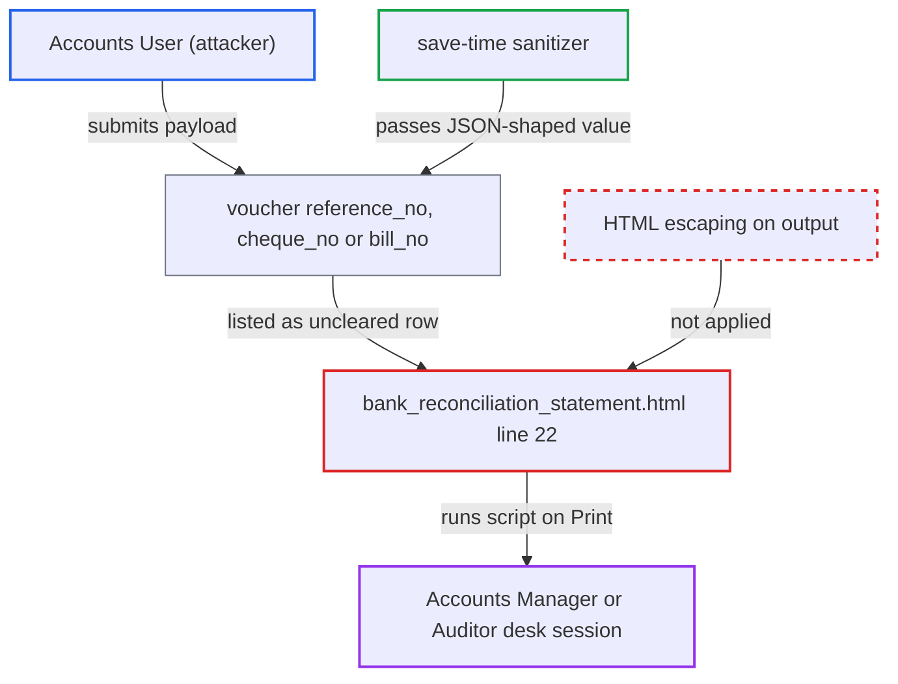

# Stored XSS via cheque/reference number in Bank Reconciliation Statement print format

| Field | Value |
|---|---|
| ID | `find_012K83WbzgPQxCKm4nTXbC2d` |
| Severity | **High** |
| Status | open |
| CWE | CWE-79 — Cross-site scripting |
| Created | 2026-10-27T22:03:40.129820Z |
| Claude Security | https://claude.ai/security/findings/find_012K83WbzgPQxCKm4nTXbC2d |

## Description

An Accounts User can run script in the browser of an Accounts Manager or Auditor who prints the Bank Reconciliation Statement. The script acts with that victim's permissions and can read what they can see. The print format `bank_reconciliation_statement.html` writes `reference_no` with the unescaped `` operator. The save-time sanitizer lets JSON-shaped values through.

1. **Accounts User** submits a voucher with a script payload as its reference number. The value is the JSON-string form `""`, which the save-time sanitizer leaves unchanged. ERPNext only checks that the field is present. ([`erpnext/accounts/doctype/payment_entry/payment_entry.json:436-445`](https://github.com/cx-benchmark/erpnext/blob/90e7aefca73da3c440d2e8da7472fcb67838e678/erpnext/accounts/doctype/payment_entry/payment_entry.json#L436-L445))
2. **the report query** returns the uncleared voucher with the payload as `reference_no`. The row is listed because it is submitted, matches the bank account and company, and has no clearance date. Journal Entry uses `cheque_no` and paid Purchase Invoice uses `bill_no` the same way. ([`erpnext/accounts/report/bank_reconciliation_statement/bank_reconciliation_statement.py:220`](https://github.com/cx-benchmark/erpnext/blob/90e7aefca73da3c440d2e8da7472fcb67838e678/erpnext/accounts/report/bank_reconciliation_statement/bank_reconciliation_statement.py#L220))
3. **Accounts Manager or Auditor** opens the statement for that bank account and chooses Print. This is a routine step that needs only the mandatory filters. The attacker's voucher passes the viewer's User Permission match because it sits in the victim's company and bank account. ([`erpnext/accounts/report/bank_reconciliation_statement/bank_reconciliation_statement.json:18-28`](https://github.com/cx-benchmark/erpnext/blob/90e7aefca73da3c440d2e8da7472fcb67838e678/erpnext/accounts/report/bank_reconciliation_statement/bank_reconciliation_statement.json#L18-L28))
4. **the print format `bank_reconciliation_statement.html`** writes `reference_no` into the print window without escaping. Line `22` uses the raw `` operator, and the result is written with `document.write` into a same-origin window. ([`erpnext/accounts/report/bank_reconciliation_statement/bank_reconciliation_statement.html:19-22`](https://github.com/cx-benchmark/erpnext/blob/90e7aefca73da3c440d2e8da7472fcb67838e678/erpnext/accounts/report/bank_reconciliation_statement/bank_reconciliation_statement.html#L19-L22))
5. **the victim's browser** runs the attacker's handler in the desk session. The script has the victim's cookies and, through `window.opener`, their CSRF token.

## Assessment

The attacker is an Accounts User who can create and submit a Payment Entry, a Bank Entry Journal Entry or a paid Purchase Invoice against the company bank account. The payload goes in `reference_no`, `cheque_no` or `bill_no`. The voucher must stay uncleared. The victim is an Accounts Manager or Auditor who opens the statement for that bank account and chooses Print. The report assumes certain behaviour of Frappe, which is not in the checkout: that `` does not escape, that `get_script` serves the HTML as the print format, that `sanitize_html` leaves JSON values unchanged, and that `get_filtered_data` never escapes values.

Impact: The attacker's script runs in the desk origin with the victim's session. It can do anything the victim can, and read all data they can see. For an Accounts Manager this includes writing Accounts Settings, which an Accounts User cannot do. No code limit applies.

## Recommendation

`bank_reconciliation_statement.html` writes user-typed reference numbers, and the other row values, with the unescaped `` operator. It relies on a save-time sanitizer that passes JSON-shaped and tag-incomplete values.

Fix criteria: Every data-derived value in the Bank Reconciliation Statement print format is HTML-escaped where it is output, so stored markup shows as literal text. To verify, submit a Payment Entry whose reference number is `""`. Print the statement for its bank account. Confirm that no script runs and the text shows literally.

## Evidence

**https://github.com/cx-benchmark/erpnext**

- [`erpnext/accounts/report/bank_reconciliation_statement/bank_reconciliation_statement.html:19-22`](https://github.com/cx-benchmark/erpnext/blob/90e7aefca73da3c440d2e8da7472fcb67838e678/erpnext/accounts/report/bank_reconciliation_statement/bank_reconciliation_statement.html#L19-L22)
- [`erpnext/accounts/report/bank_reconciliation_statement/bank_reconciliation_statement.py:156`](https://github.com/cx-benchmark/erpnext/blob/90e7aefca73da3c440d2e8da7472fcb67838e678/erpnext/accounts/report/bank_reconciliation_statement/bank_reconciliation_statement.py#L156)
- [`erpnext/accounts/report/bank_reconciliation_statement/bank_reconciliation_statement.py:182`](https://github.com/cx-benchmark/erpnext/blob/90e7aefca73da3c440d2e8da7472fcb67838e678/erpnext/accounts/report/bank_reconciliation_statement/bank_reconciliation_statement.py#L182)
- [`erpnext/accounts/report/bank_reconciliation_statement/bank_reconciliation_statement.py:220`](https://github.com/cx-benchmark/erpnext/blob/90e7aefca73da3c440d2e8da7472fcb67838e678/erpnext/accounts/report/bank_reconciliation_statement/bank_reconciliation_statement.py#L220)
- [`erpnext/accounts/doctype/payment_entry/payment_entry.json:436-445`](https://github.com/cx-benchmark/erpnext/blob/90e7aefca73da3c440d2e8da7472fcb67838e678/erpnext/accounts/doctype/payment_entry/payment_entry.json#L436-L445)
- [`erpnext/accounts/doctype/journal_entry/journal_entry.json:184-195`](https://github.com/cx-benchmark/erpnext/blob/90e7aefca73da3c440d2e8da7472fcb67838e678/erpnext/accounts/doctype/journal_entry/journal_entry.json#L184-L195)
- [`erpnext/accounts/doctype/purchase_invoice/purchase_invoice.json:403-415`](https://github.com/cx-benchmark/erpnext/blob/90e7aefca73da3c440d2e8da7472fcb67838e678/erpnext/accounts/doctype/purchase_invoice/purchase_invoice.json#L403-L415)
- [`erpnext/accounts/doctype/payment_entry/payment_entry.json:830-845`](https://github.com/cx-benchmark/erpnext/blob/90e7aefca73da3c440d2e8da7472fcb67838e678/erpnext/accounts/doctype/payment_entry/payment_entry.json#L830-L845)
- [`erpnext/accounts/doctype/journal_entry/journal_entry.json:689-702`](https://github.com/cx-benchmark/erpnext/blob/90e7aefca73da3c440d2e8da7472fcb67838e678/erpnext/accounts/doctype/journal_entry/journal_entry.json#L689-L702)
- [`erpnext/accounts/report/bank_reconciliation_statement/bank_reconciliation_statement.json:18-28`](https://github.com/cx-benchmark/erpnext/blob/90e7aefca73da3c440d2e8da7472fcb67838e678/erpnext/accounts/report/bank_reconciliation_statement/bank_reconciliation_statement.json#L18-L28)

