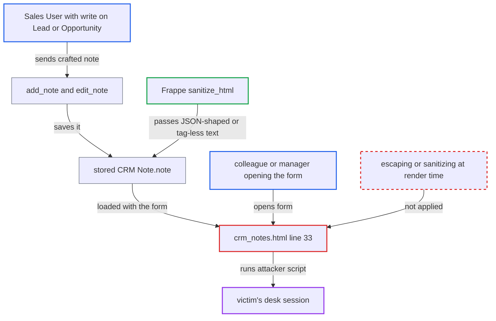

# Stored XSS via CRM Note content rendered raw in Lead, Opportunity and Prospect Notes panel

| Field | Value |
|---|---|
| ID | `find_01DAEbbAjSxFzGRckqqWtwp8` |
| Severity | **High** |
| Status | open |
| CWE | CWE-79 — Cross-site scripting |
| Created | 2026-10-27T22:02:41.234085Z |
| Claude Security | https://claude.ai/security/findings/find_01DAEbbAjSxFzGRckqqWtwp8 |

## Description

A Sales User can store script in a CRM note that then runs in the browser of any colleague, Sales Manager or System Manager who opens that Lead or Opportunity. The attacker needs only write permission on the parent, and the script acts with the victim's session. The cause is `crm_notes.html:33`, which prints `CRM Note.note` without escaping, so the panel depends on Frappe's save-time filter alone.

1. **Sales User** saves a crafted note through `add_note` or `edit_note`. The note is a JSON string literal such as `""` with its quotes, or an unterminated tag such as `"` and `` or `javascript:` URLs. This holds even when the submitted value parses as JSON or has an unterminated tag.

## Evidence

**https://github.com/cx-benchmark/erpnext**

- [`erpnext/public/js/templates/crm_notes.html:33`](https://github.com/cx-benchmark/erpnext/blob/90e7aefca73da3c440d2e8da7472fcb67838e678/erpnext/public/js/templates/crm_notes.html#L33)
- [`erpnext/public/js/utils/crm_activities.js:115-127`](https://github.com/cx-benchmark/erpnext/blob/90e7aefca73da3c440d2e8da7472fcb67838e678/erpnext/public/js/utils/crm_activities.js#L115-L127)
- [`erpnext/crm/utils.py:280-293`](https://github.com/cx-benchmark/erpnext/blob/90e7aefca73da3c440d2e8da7472fcb67838e678/erpnext/crm/utils.py#L280-L293)
- [`erpnext/crm/doctype/crm_note/crm_note.json:16-19`](https://github.com/cx-benchmark/erpnext/blob/90e7aefca73da3c440d2e8da7472fcb67838e678/erpnext/crm/doctype/crm_note/crm_note.json#L16-L19)
- [`erpnext/crm/doctype/lead/lead.json:564-620`](https://github.com/cx-benchmark/erpnext/blob/90e7aefca73da3c440d2e8da7472fcb67838e678/erpnext/crm/doctype/lead/lead.json#L564-L620)
- [`erpnext/crm/doctype/opportunity/opportunity.json:677-700`](https://github.com/cx-benchmark/erpnext/blob/90e7aefca73da3c440d2e8da7472fcb67838e678/erpnext/crm/doctype/opportunity/opportunity.json#L677-L700)
- [`erpnext/crm/doctype/lead/lead.js:220-228`](https://github.com/cx-benchmark/erpnext/blob/90e7aefca73da3c440d2e8da7472fcb67838e678/erpnext/crm/doctype/lead/lead.js#L220-L228)
- [`erpnext/crm/doctype/lead/test_lead.py:191-206`](https://github.com/cx-benchmark/erpnext/blob/90e7aefca73da3c440d2e8da7472fcb67838e678/erpnext/crm/doctype/lead/test_lead.py#L191-L206)
- [`erpnext/crm/doctype/lead/lead.py:317`](https://github.com/cx-benchmark/erpnext/blob/90e7aefca73da3c440d2e8da7472fcb67838e678/erpnext/crm/doctype/lead/lead.py#L317)

