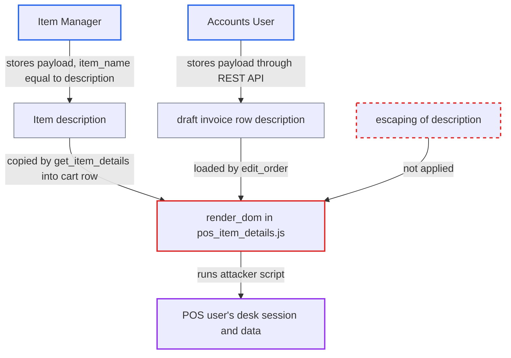

# Stored XSS via Item description rendered raw in Point of Sale item details

| Field | Value |
|---|---|
| ID | `find_01KZKvR7CQTGvqAXTavH9sBQ` |
| Severity | **High** |
| Status | open |
| CWE | CWE-79 — Cross-site scripting |
| Created | 2026-10-27T22:05:47.307786Z |
| Claude Security | https://claude.ai/security/findings/find_01KZKvR7CQTGvqAXTavH9sBQ |

## Description

A low-privilege user can make script run in the browser of a Point of Sale cashier, who may be an Accounts Manager or Sales Manager, and act with that cashier's session. The attacker needs the Item Manager role, or the Accounts User role for the draft-invoice route. The cause is `render_dom` in `pos_item_details.js`, which inserts the row `description` with `.html()` without escaping it.

1. **Item Manager** saves an Item whose `item_name` and `description` are the same JSON-quoted payload. `Item.validate_description` runs `clean_html` only when `description` differs from `item_name`, and Frappe's `sanitize_html` returns a value unchanged when it parses as JSON. ([`erpnext/stock/doctype/item/item.py:288-296`](https://github.com/cx-benchmark/erpnext/blob/90e7aefca73da3c440d2e8da7472fcb67838e678/erpnext/stock/doctype/item/item.py#L288-L296))
2. **Accounts User** alternatively stores the payload in a draft invoice row through the REST API. `description` is not in `force_item_fields`, and ERPNext does not clean transaction-row descriptions, so the caller's value is kept. ([`erpnext/controllers/accounts_controller.py:72-82`](https://github.com/cx-benchmark/erpnext/blob/90e7aefca73da3c440d2e8da7472fcb67838e678/erpnext/controllers/accounts_controller.py#L72-L82))
3. **`get_item_details`** copies the stored `description` into the cart row when a cashier adds the item. The value is only stripped of whitespace, so the payload arrives unchanged. ([`erpnext/stock/get_item_details.py:640`](https://github.com/cx-benchmark/erpnext/blob/90e7aefca73da3c440d2e8da7472fcb67838e678/erpnext/stock/get_item_details.py#L640))
4. **POS controller** loads the row into the details pane when the cashier clicks the cart line. The pane also opens by itself for serial or batch items, and `edit_order` loads a saved draft into the cart for the cashier who edits it. ([`erpnext/selling/page/point_of_sale/pos_controller.js:339-342`](https://github.com/cx-benchmark/erpnext/blob/90e7aefca73da3c440d2e8da7472fcb67838e678/erpnext/selling/page/point_of_sale/pos_controller.js#L339-L342))
5. **`render_dom`** truncates the `description` to 139 characters and inserts it with `.html()`. The value is not escaped, so the payload's event handler runs in the cashier's desk session. ([`erpnext/selling/page/point_of_sale/pos_item_details.js:130-145`](https://github.com/cx-benchmark/erpnext/blob/90e7aefca73da3c440d2e8da7472fcb67838e678/erpnext/selling/page/point_of_sale/pos_item_details.js#L130-L145))

## Assessment

The attacker is either an Item Manager or an Accounts User. As an Item Manager, they send a PUT to `/api/resource/Item/<code>` with `item_name` and `description` both set to the same JSON-quoted payload such as `""`. Setting `description` alone is not enough on a default install, because `clean_description_html` is on by default and `clean_html` strips the payload. As an Accounts User, they store the payload on a draft invoice row through the REST API, and another cashier then edits that draft through Recent Orders → Edit. The victim is a POS user (Accounts User, Accounts Manager, Sales User or Sales Manager). The victim must open the line's details, by clicking it or automatically for serial or batch items. The report assumes Frappe's `sanitize_html` and `clean_html` behave as described, because Frappe is not in the checkout.

Impact: The script runs in the desk origin with the victim's session and CSRF token. It can read the customer, pricing and invoice data the victim can see. It can also call any whitelisted method or REST endpoint the victim may use, such as creating, submitting or cancelling invoices. The victim's roles set the limit, and the 139-character truncation does not stop a short loader payload. There is no availability impact.

## Recommendation

`render_dom` in `pos_item_details.js` puts the stored description into the page with `.html()`, without escaping or sanitizing it. The save-time filters it relies on let JSON-shaped values through and are skipped when `description == item_name`.

Fix criteria: The POS details pane renders the description as text, or passes it through a client-side HTML sanitizer before insertion, and no script runs. To verify, set an Item's `item_name` and `description` both to `""`. Separately, save a draft POS Invoice row with that description. Add the item to a POS cart, or edit the draft, and open the line's details. No script runs and the value appears inert.

## Evidence

**https://github.com/cx-benchmark/erpnext**

- [`erpnext/selling/page/point_of_sale/pos_item_details.js:130-145`](https://github.com/cx-benchmark/erpnext/blob/90e7aefca73da3c440d2e8da7472fcb67838e678/erpnext/selling/page/point_of_sale/pos_item_details.js#L130-L145)
- [`erpnext/stock/doctype/item/item.py:288-296`](https://github.com/cx-benchmark/erpnext/blob/90e7aefca73da3c440d2e8da7472fcb67838e678/erpnext/stock/doctype/item/item.py#L288-L296)
- [`erpnext/stock/doctype/stock_settings/stock_settings.json:146-151`](https://github.com/cx-benchmark/erpnext/blob/90e7aefca73da3c440d2e8da7472fcb67838e678/erpnext/stock/doctype/stock_settings/stock_settings.json#L146-L151)
- [`erpnext/stock/get_item_details.py:640`](https://github.com/cx-benchmark/erpnext/blob/90e7aefca73da3c440d2e8da7472fcb67838e678/erpnext/stock/get_item_details.py#L640)
- [`erpnext/selling/page/point_of_sale/pos_controller.js:339-342`](https://github.com/cx-benchmark/erpnext/blob/90e7aefca73da3c440d2e8da7472fcb67838e678/erpnext/selling/page/point_of_sale/pos_controller.js#L339-L342)
- [`erpnext/selling/page/point_of_sale/pos_controller.js:498-507`](https://github.com/cx-benchmark/erpnext/blob/90e7aefca73da3c440d2e8da7472fcb67838e678/erpnext/selling/page/point_of_sale/pos_controller.js#L498-L507)
- [`erpnext/controllers/accounts_controller.py:72-82`](https://github.com/cx-benchmark/erpnext/blob/90e7aefca73da3c440d2e8da7472fcb67838e678/erpnext/controllers/accounts_controller.py#L72-L82)
- [`erpnext/stock/doctype/item/item.json:1146-1158`](https://github.com/cx-benchmark/erpnext/blob/90e7aefca73da3c440d2e8da7472fcb67838e678/erpnext/stock/doctype/item/item.json#L1146-L1158)
- [`erpnext/selling/page/point_of_sale/point_of_sale.json:14-27`](https://github.com/cx-benchmark/erpnext/blob/90e7aefca73da3c440d2e8da7472fcb67838e678/erpnext/selling/page/point_of_sale/point_of_sale.json#L14-L27)
- [`erpnext/selling/page/point_of_sale/pos_item_cart.js:660-673`](https://github.com/cx-benchmark/erpnext/blob/90e7aefca73da3c440d2e8da7472fcb67838e678/erpnext/selling/page/point_of_sale/pos_item_cart.js#L660-L673)

