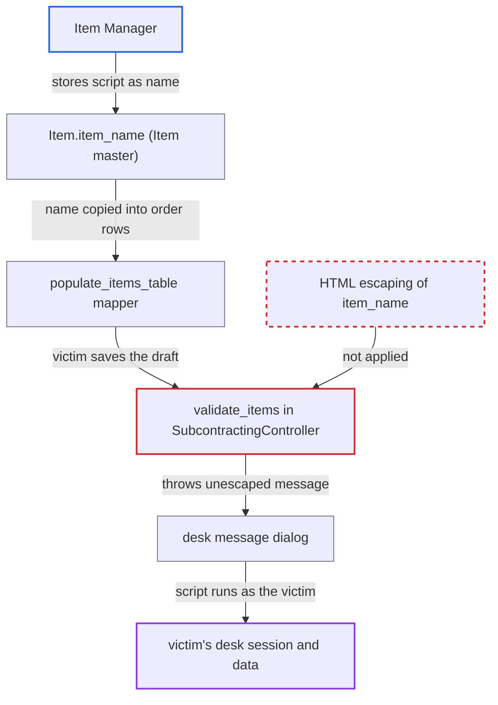

# Stored XSS via Item name in subcontracting validation error dialogs

| Field | Value |
|---|---|
| ID | `find_015QFthAxDEFTfvt6tyKRSyo` |
| Severity | **High** |
| Status | open |
| CWE | CWE-79 — Cross-site scripting |
| Created | 2026-10-27T22:33:48.869079Z |
| Claude Security | https://claude.ai/security/findings/find_015QFthAxDEFTfvt6tyKRSyo |

## Description

An Item Manager can run script in the browser of a Purchase, Stock or Sales user, or of a System Manager doing the task. The script acts with that user's session and can read their data and call actions as them. The attack needs the Item Manager role and a pending subcontracting order for the item. The cause is `validate_items`, which puts the Item's `item_name` into error messages that the desk renders as HTML, without escaping it.

1. **Item Manager** sets a finished-good Item's `item_name` to a JSON-quoted image tag with an `onerror` handler. The report assumes Frappe's save-time `sanitize_html` leaves JSON-shaped input unchanged, so the quoted string is stored intact. `item_name` is a plain Data field that only Item Manager can write. ([`erpnext/stock/doctype/item/item.json:1146-1158`](https://github.com/cx-benchmark/erpnext/blob/90e7aefca73da3c440d2e8da7472fcb67838e678/erpnext/stock/doctype/item/item.json#L1146-L1158))
2. **Item Manager** clears `is_sub_contracted_item` after the subcontracting Purchase Order has passed its check. `Item.cant_change` does not restrict this field, so the change is allowed. This makes later orders and receipts for the item fail validation. ([`erpnext/stock/doctype/item/item.py:1259-1290`](https://github.com/cx-benchmark/erpnext/blob/90e7aefca73da3c440d2e8da7472fcb67838e678/erpnext/stock/doctype/item/item.py#L1259-L1290))
3. **Purchase User** creates a Subcontracting Order from the Purchase Order and saves it. The mapper calls `populate_items_table`, which copies the Item master's `item_name` into each row. The victim does only this routine step. ([`erpnext/buying/doctype/purchase_order/mapper.py:272-276`](https://github.com/cx-benchmark/erpnext/blob/90e7aefca73da3c440d2e8da7472fcb67838e678/erpnext/buying/doctype/purchase_order/mapper.py#L272-L276))
4. **the method `validate_items`** throws an error that contains the stored `item_name` without escaping it. `validate()` runs on every save. The check fails at `:184` because the flag was cleared, and the message is built with `item.item_name` as is. ([`erpnext/controllers/subcontracting_controller.py:162-252`](https://github.com/cx-benchmark/erpnext/blob/90e7aefca73da3c440d2e8da7472fcb67838e678/erpnext/controllers/subcontracting_controller.py#L162-L252))
5. **the desk message dialog** renders the message as HTML and runs the `onerror` handler. The script runs on the desk origin with the victim's session and CSRF token.

## Assessment

The attacker is an authenticated Item Manager, the only role that can write `Item.item_name`. They store a JSON-quoted payload such as an image tag with `onerror`. After a subcontracting Purchase Order for the item is submitted, they clear `is_sub_contracted_item`. The next save of a Subcontracting Order or Receipt for that finished good then fails at `:184` with the stored name. The report also lists BOM-state and quantity errors in the same function, which carry the name too. The Subcontracting Receipt mapper copies the order rows, so a Stock User saving the receipt sees the same name. `validate_items` also runs for Subcontracting Inward Order, which copies the name the same way. The payload must be a complete tag, because an unterminated-tag payload would fail in this sink. The attack needs a pending subcontracting order for that item. It also depends on the report's assumption about Frappe `>=17.0.0-dev,<18`, which is not in the checkout.

Impact: The script can read the victim's purchasing and stock data and call any whitelisted method or REST endpoint as them, such as creating or submitting orders, receipts and stock entries. This lets an Item Manager act with transactional roles. The victim's own roles set the limit. Availability is not reduced by the dialog itself.

## Recommendation

`validate_items` puts the Item master's `item_name` into `frappe.throw` messages that render as HTML, with no encoding. It relies only on Frappe's save-time filter, which passes JSON-shaped values unchanged.

Fix criteria: Each message in `validate_items` shows the item as HTML-escaped text, or as a link built from the item code as `:178` already does. Test: give an Item the name `""` and clear its `is_sub_contracted_item` flag. Saving a Subcontracting Order or Receipt for it must show the name as literal text. No script may run.

## Evidence

**https://github.com/cx-benchmark/erpnext**

- [`erpnext/controllers/subcontracting_controller.py:162-252`](https://github.com/cx-benchmark/erpnext/blob/90e7aefca73da3c440d2e8da7472fcb67838e678/erpnext/controllers/subcontracting_controller.py#L162-L252)
- [`erpnext/controllers/subcontracting_controller.py:60-62`](https://github.com/cx-benchmark/erpnext/blob/90e7aefca73da3c440d2e8da7472fcb67838e678/erpnext/controllers/subcontracting_controller.py#L60-L62)
- [`erpnext/subcontracting/doctype/subcontracting_order/subcontracting_order.py:345-389`](https://github.com/cx-benchmark/erpnext/blob/90e7aefca73da3c440d2e8da7472fcb67838e678/erpnext/subcontracting/doctype/subcontracting_order/subcontracting_order.py#L345-L389)
- [`erpnext/buying/doctype/purchase_order/mapper.py:272-276`](https://github.com/cx-benchmark/erpnext/blob/90e7aefca73da3c440d2e8da7472fcb67838e678/erpnext/buying/doctype/purchase_order/mapper.py#L272-L276)
- [`erpnext/subcontracting/doctype/subcontracting_order/subcontracting_order.py:666-708`](https://github.com/cx-benchmark/erpnext/blob/90e7aefca73da3c440d2e8da7472fcb67838e678/erpnext/subcontracting/doctype/subcontracting_order/subcontracting_order.py#L666-L708)
- [`erpnext/subcontracting/doctype/subcontracting_order_item/subcontracting_order_item.json:75-84`](https://github.com/cx-benchmark/erpnext/blob/90e7aefca73da3c440d2e8da7472fcb67838e678/erpnext/subcontracting/doctype/subcontracting_order_item/subcontracting_order_item.json#L75-L84)
- [`erpnext/stock/doctype/item/item.py:1259-1290`](https://github.com/cx-benchmark/erpnext/blob/90e7aefca73da3c440d2e8da7472fcb67838e678/erpnext/stock/doctype/item/item.py#L1259-L1290)
- [`erpnext/stock/doctype/item/item.json:1146-1158`](https://github.com/cx-benchmark/erpnext/blob/90e7aefca73da3c440d2e8da7472fcb67838e678/erpnext/stock/doctype/item/item.json#L1146-L1158)
- [`erpnext/subcontracting/doctype/subcontracting_order/subcontracting_order.json:520-560`](https://github.com/cx-benchmark/erpnext/blob/90e7aefca73da3c440d2e8da7472fcb67838e678/erpnext/subcontracting/doctype/subcontracting_order/subcontracting_order.json#L520-L560)

