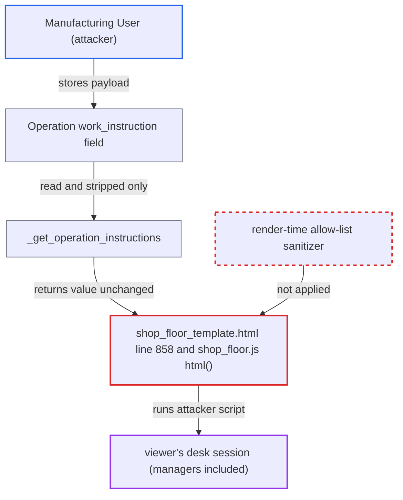

# Stored XSS via Operation Work Instructions rendered as raw HTML on Shop Floor

| Field | Value |
|---|---|
| ID | `find_01SsL2xKeoFeU8ZPkkCTb2DS` |
| Severity | **High** |
| Status | open |
| CWE | CWE-79 — Cross-site scripting |
| Created | 2026-10-27T21:42:48.605045Z |
| Claude Security | https://claude.ai/security/findings/find_01SsL2xKeoFeU8ZPkkCTb2DS |

## Description

A user with the `Manufacturing User` role can store HTML in an Operation's work instructions that runs as script in other users' Shop Floor sessions, including managers'. The viewer only has to open a Shop Floor view whose job card uses that Operation. The template at `shop_floor_template.html:858` prints `work_instruction` as raw HTML, and `_get_operation_instructions` returns it unchanged. Both rely only on Frappe's save-time filter, which the report assumes can be bypassed.

1. **attacker with the `Manufacturing User` role** sets `work_instruction` on an in-use Operation to a payload the save filter lets through. The role can create and write Operations, and the field can be set through `/api/resource/Operation/<name>`, `frappe.client.set_value` or `frappe.client.save`; the payload is either a JSON string literal such as `""` or an unterminated tag such as ``. ([`erpnext/public/js/templates/shop_floor_template.html:856-858`](https://github.com/cx-benchmark/erpnext/blob/90e7aefca73da3c440d2e8da7472fcb67838e678/erpnext/public/js/templates/shop_floor_template.html#L856-L858))
6. **`render_operator` in `shop_floor.js`** inserts the rendered template with `$container.html(html)`. The markup becomes live DOM and the handler runs in the viewer's session; hiding the instructions body with `display: none` does not stop an `` from firing. ([`erpnext/public/js/shop_floor/shop_floor.js:607-625`](https://github.com/cx-benchmark/erpnext/blob/90e7aefca73da3c440d2e8da7472fcb67838e678/erpnext/public/js/shop_floor/shop_floor.js#L607-L625))

## Assessment

The attacker needs a login with the `Manufacturing User` role, which can create and write Operations. They choose an Operation that is in use, because Operations are shared by Work Order routings and Job Cards. One poisoned Operation therefore reaches every Shop Floor view whose active or next-up job card uses it. The victim only has to open the Shop Floor page, which is open to `Manufacturing User`, `Manufacturing Manager`, `Shop Floor Manager`, `Shop Floor User` and Administrator. The report calls the filter bypass deterministic. It rests on an assumption about Frappe `>=17.0.0-dev,<18.0.0`, because Frappe is not in the checkout. The repository's own earlier Contact Us subject fixes (commits `cb239442` and `a48bf805`) support that assumption. This is a separate source and sink from the `item_name` finding at line 829 of the same template.

Impact: The script runs on the ERPNext desk origin with the viewer's session and CSRF token. It can read whatever the viewer can read and call any whitelisted method or REST resource as that viewer. For a Manufacturing Manager or Administrator viewer, that includes submitting or cancelling manufacturing and stock documents and creating users. The reach is limited by the viewer's roles and by who opens the Shop Floor page, and availability is not directly affected.

## Recommendation

`shop_floor_template.html:858` inserts the stored `Operation.work_instruction` into the page as raw HTML. It trusts a save-time framework filter that returns JSON-shaped or element-less input unchanged, so markup written by any `Manufacturing User` runs in other users' desk sessions.

Fix criteria: Rich work-instruction HTML goes through an allow-list sanitizer at render time, or `_get_operation_instructions` returns it already sanitized. The sanitizer does not skip JSON or element-less input, and it strips event-handler attributes, `script` and non-http(s) URLs. To verify, set `work_instruction` to `""` and then to `<img src=x onerror=alert(1)//`. Load the Shop Floor with a job card for that Operation in a slot. No handler runs, and no `onerror` attribute appears in the `get_data` response or in the DOM.

## Evidence

**https://github.com/cx-benchmark/erpnext**

- [`erpnext/public/js/templates/shop_floor_template.html:856-858`](https://github.com/cx-benchmark/erpnext/blob/90e7aefca73da3c440d2e8da7472fcb67838e678/erpnext/public/js/templates/shop_floor_template.html#L856-L858)
- [`erpnext/manufacturing/page/shop_floor/shop_floor.py:612-630`](https://github.com/cx-benchmark/erpnext/blob/90e7aefca73da3c440d2e8da7472fcb67838e678/erpnext/manufacturing/page/shop_floor/shop_floor.py#L612-L630)
- [`erpnext/manufacturing/page/shop_floor/shop_floor.py:512-528`](https://github.com/cx-benchmark/erpnext/blob/90e7aefca73da3c440d2e8da7472fcb67838e678/erpnext/manufacturing/page/shop_floor/shop_floor.py#L512-L528)
- [`erpnext/public/js/shop_floor/shop_floor.js:607-625`](https://github.com/cx-benchmark/erpnext/blob/90e7aefca73da3c440d2e8da7472fcb67838e678/erpnext/public/js/shop_floor/shop_floor.js#L607-L625)
- [`erpnext/manufacturing/doctype/operation/operation.json:51-56`](https://github.com/cx-benchmark/erpnext/blob/90e7aefca73da3c440d2e8da7472fcb67838e678/erpnext/manufacturing/doctype/operation/operation.json#L51-L56)
- [`erpnext/manufacturing/doctype/operation/operation.json:127-136`](https://github.com/cx-benchmark/erpnext/blob/90e7aefca73da3c440d2e8da7472fcb67838e678/erpnext/manufacturing/doctype/operation/operation.json#L127-L136)
- [`erpnext/manufacturing/page/shop_floor/shop_floor.json:15-28`](https://github.com/cx-benchmark/erpnext/blob/90e7aefca73da3c440d2e8da7472fcb67838e678/erpnext/manufacturing/page/shop_floor/shop_floor.json#L15-L28)

