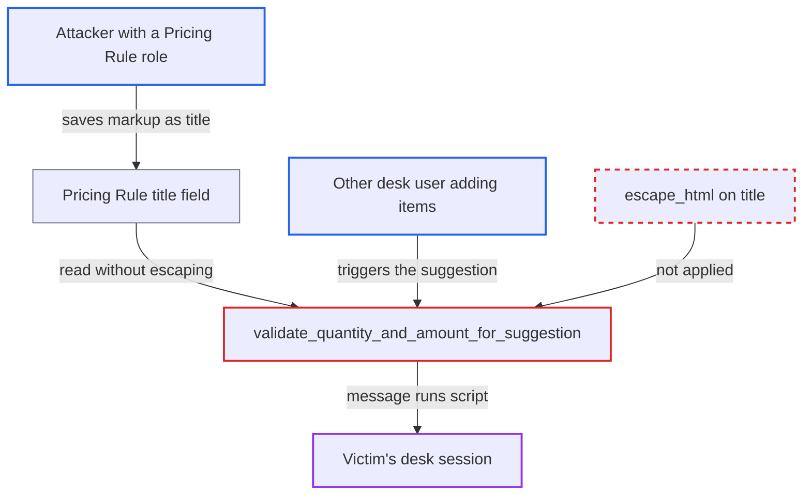

# Stored XSS via Pricing Rule title in pricing suggestion message

| Field | Value |
|---|---|
| ID | `find_01EYwhAzLEE6es4gYSF3Hibr` |
| Severity | **High** |
| Status | open |
| CWE | CWE-79 — Cross-site scripting |
| Created | 2026-10-27T22:32:06.482206Z |
| Claude Security | https://claude.ai/security/findings/find_01EYwhAzLEE6es4gYSF3Hibr |

## Description

A user who can create Pricing Rules can run script in the browser of other desk users, such as a System Manager or Accounts User. The script acts with the victim's session. The attacker needs a role that can write Pricing Rules, such as Sales Manager, Purchase Manager or Accounts Manager. The function `validate_quantity_and_amount_for_suggestion` puts the rule's free-text `title` into a `frappe.msgprint()` message without `escape_html`.

1. **attacker with a Pricing Rule role** saves a Pricing Rule whose `title` holds HTML. `title` is a free-text `Data` field, and the doctype uses a naming series, so Frappe's name check that forbids `<` and `>` never applies to it. ([`erpnext/accounts/doctype/pricing_rule/pricing_rule.json:107-112`](https://github.com/cx-benchmark/erpnext/blob/90e7aefca73da3c440d2e8da7472fcb67838e678/erpnext/accounts/doctype/pricing_rule/pricing_rule.json#L107-L112))
2. **attacker** sets the rule to match every transaction and to fail its quantity check. The rule leaves company and party blank, sets `apply_on` to the root Item Group, uses a very high `min_qty` and sets `threshold_percentage = 100`, so the suggestion message fires on every item fetch. ([`erpnext/accounts/doctype/pricing_rule/utils.py:312-381`](https://github.com/cx-benchmark/erpnext/blob/90e7aefca73da3c440d2e8da7472fcb67838e678/erpnext/accounts/doctype/pricing_rule/utils.py#L312-L381))
3. **another desk user** adds an item to a sales or purchase document, or saves one. The form calls `get_item_details`, which looks up pricing rules for each item. The same lookup runs again on save, and the rule's permissions play no part in it. ([`erpnext/stock/get_item_details.py:195-196`](https://github.com/cx-benchmark/erpnext/blob/90e7aefca73da3c440d2e8da7472fcb67838e678/erpnext/stock/get_item_details.py#L195-L196))
4. **the function `validate_quantity_and_amount_for_suggestion`** builds the suggestion message with `bold(args.title)` and sends it with `frappe.msgprint(msg)`. `args` is a raw Pricing Rule row and nothing escapes `title`. Frappe's `frappe.bold` only wraps the text in a tag. ([`erpnext/accounts/doctype/pricing_rule/utils.py:383-396`](https://github.com/cx-benchmark/erpnext/blob/90e7aefca73da3c440d2e8da7472fcb67838e678/erpnext/accounts/doctype/pricing_rule/utils.py#L383-L396))
5. **the victim's browser** renders the message as HTML and runs the script from the title. The form call has no `silent` flag, so the desk shows the server message to whoever is editing the document. The script runs on the ERPNext origin with the victim's session and CSRF token. ([`erpnext/public/js/controllers/transaction.js:823-835`](https://github.com/cx-benchmark/erpnext/blob/90e7aefca73da3c440d2e8da7472fcb67838e678/erpnext/public/js/controllers/transaction.js#L823-L835))

## Assessment

The attacker is a desk user with a role that can create or write Pricing Rules: Accounts Manager, Sales Manager, Purchase Manager, Website Manager or System Manager. The victim is any other user who adds an item to a Quotation, Sales Order, Delivery Note, Sales or POS Invoice, Purchase Order, Purchase Receipt or Purchase Invoice, or who saves one. The attacker needs no further action after saving the rule. The report assumes Frappe `>=17.0.0-dev,<18`, which is not in the checkout. It assumes desk `msgprint` inserts the message as HTML. It assumes the save-time `sanitize_html` returns a value unchanged if it parses as JSON, such as a double-quoted string like `""`. It also assumes `sanitize_html` leaves unchanged a value in which `html.parser` finds no complete element, such as an unterminated `"` (JSON-quoted) or `<img src=x onerror=alert(1) //`. Then have another user add an item that triggers the suggestion. The dialog must show the literal text and run no script.

## Evidence

**https://github.com/cx-benchmark/erpnext**

- [`erpnext/accounts/doctype/pricing_rule/utils.py:383-396`](https://github.com/cx-benchmark/erpnext/blob/90e7aefca73da3c440d2e8da7472fcb67838e678/erpnext/accounts/doctype/pricing_rule/utils.py#L383-L396)
- [`erpnext/accounts/doctype/pricing_rule/utils.py:312-381`](https://github.com/cx-benchmark/erpnext/blob/90e7aefca73da3c440d2e8da7472fcb67838e678/erpnext/accounts/doctype/pricing_rule/utils.py#L312-L381)
- [`erpnext/accounts/doctype/pricing_rule/pricing_rule.json:107-112`](https://github.com/cx-benchmark/erpnext/blob/90e7aefca73da3c440d2e8da7472fcb67838e678/erpnext/accounts/doctype/pricing_rule/pricing_rule.json#L107-L112)
- [`erpnext/accounts/doctype/pricing_rule/pricing_rule.json:668-722`](https://github.com/cx-benchmark/erpnext/blob/90e7aefca73da3c440d2e8da7472fcb67838e678/erpnext/accounts/doctype/pricing_rule/pricing_rule.json#L668-L722)
- [`erpnext/stock/get_item_details.py:195-196`](https://github.com/cx-benchmark/erpnext/blob/90e7aefca73da3c440d2e8da7472fcb67838e678/erpnext/stock/get_item_details.py#L195-L196)
- [`erpnext/public/js/controllers/transaction.js:823-835`](https://github.com/cx-benchmark/erpnext/blob/90e7aefca73da3c440d2e8da7472fcb67838e678/erpnext/public/js/controllers/transaction.js#L823-L835)
- [`erpnext/controllers/accounts_controller.py:929`](https://github.com/cx-benchmark/erpnext/blob/90e7aefca73da3c440d2e8da7472fcb67838e678/erpnext/controllers/accounts_controller.py#L929)
- [`erpnext/support/doctype/warranty_claim/warranty_claim.py:114-122`](https://github.com/cx-benchmark/erpnext/blob/90e7aefca73da3c440d2e8da7472fcb67838e678/erpnext/support/doctype/warranty_claim/warranty_claim.py#L114-L122)

