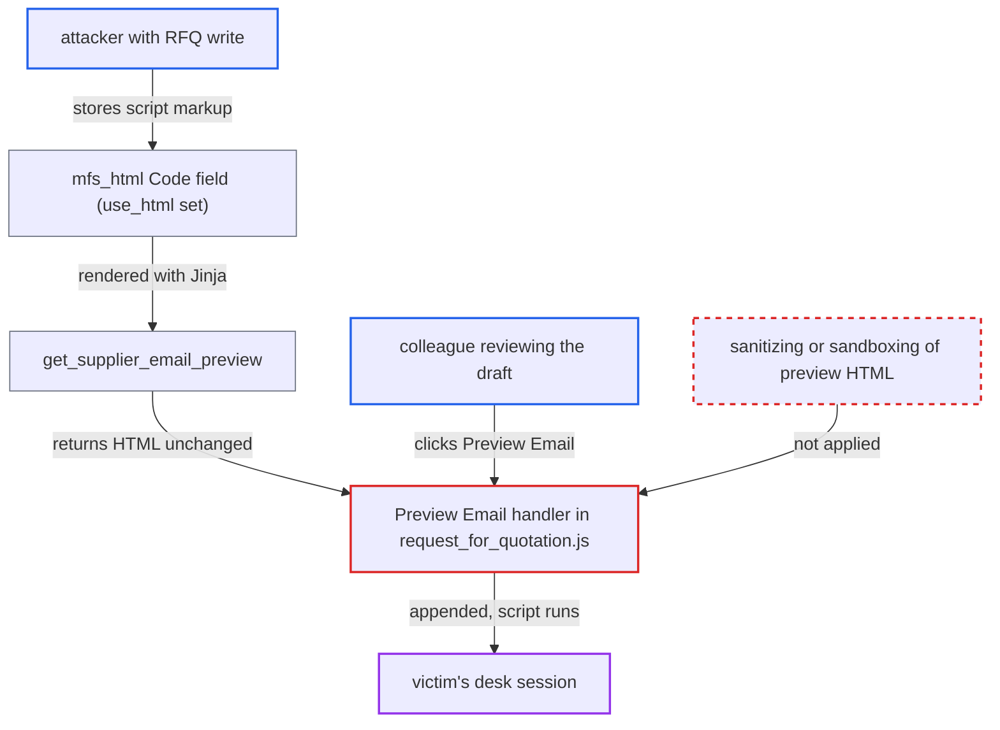

# Stored XSS via RFQ HTML message injected raw into Preview Email dialog

| Field | Value |
|---|---|
| ID | `find_01UBF8wjCSxChRfWke1YLyEP` |
| Severity | **High** |
| Status | open |
| CWE | CWE-79 — Cross-site scripting |
| Created | 2026-10-27T21:22:38.751875Z |
| Claude Security | https://claude.ai/security/findings/find_01UBF8wjCSxChRfWke1YLyEP |

## Description

A desk user with write access to Request for Quotation (Purchase User, Purchase Manager or Manufacturing Manager) can run script in a colleague's session when that colleague previews the RFQ e-mail. The script can do anything the victim's roles allow. The cause is that the Preview Email handler in `request_for_quotation.js` inserts HTML rendered from the unsanitized `Code` field `mfs_html` straight into the page with `$wrapper.append`.

1. **the attacker (desk user with RFQ write)** saves a draft RFQ with script markup in `mfs_html`. The attacker sets `use_html` to 1 and writes something like `` or `` in `mfs_html` with `use_html=1`, open Preview Email as another user, and confirm nothing executes. Ordinary formatting must still render.

## Evidence

**https://github.com/cx-benchmark/erpnext**

- [`erpnext/buying/doctype/request_for_quotation/request_for_quotation.js:308-314`](https://github.com/cx-benchmark/erpnext/blob/90e7aefca73da3c440d2e8da7472fcb67838e678/erpnext/buying/doctype/request_for_quotation/request_for_quotation.js#L308-L314)
- [`erpnext/buying/doctype/request_for_quotation/request_for_quotation.py:188-198`](https://github.com/cx-benchmark/erpnext/blob/90e7aefca73da3c440d2e8da7472fcb67838e678/erpnext/buying/doctype/request_for_quotation/request_for_quotation.py#L188-L198)
- [`erpnext/buying/doctype/request_for_quotation/request_for_quotation.py:337-351`](https://github.com/cx-benchmark/erpnext/blob/90e7aefca73da3c440d2e8da7472fcb67838e678/erpnext/buying/doctype/request_for_quotation/request_for_quotation.py#L337-L351)
- [`erpnext/buying/doctype/request_for_quotation/request_for_quotation.json:341-356`](https://github.com/cx-benchmark/erpnext/blob/90e7aefca73da3c440d2e8da7472fcb67838e678/erpnext/buying/doctype/request_for_quotation/request_for_quotation.json#L341-L356)
- [`erpnext/buying/doctype/request_for_quotation/request_for_quotation.json:262`](https://github.com/cx-benchmark/erpnext/blob/90e7aefca73da3c440d2e8da7472fcb67838e678/erpnext/buying/doctype/request_for_quotation/request_for_quotation.json#L262)

