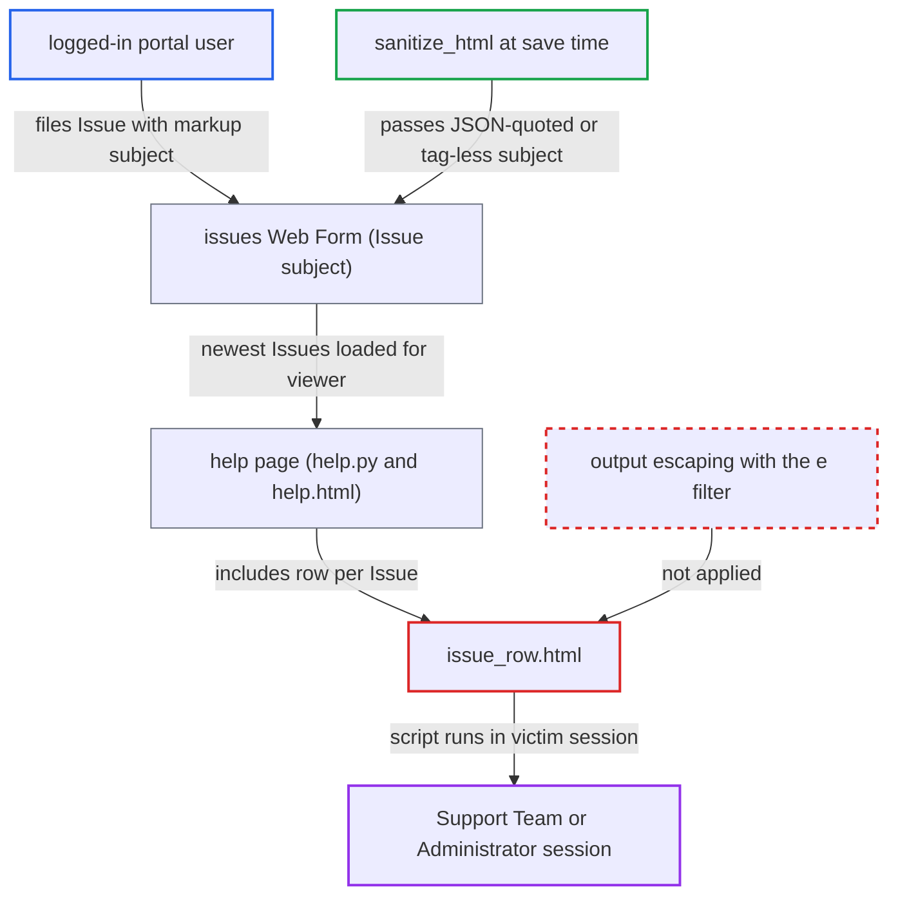

# Stored XSS via unescaped Issue subject in issue_row.html on the /help page

| Field | Value |
|---|---|
| ID | `find_01KJ2REczvtuPQFkBvENwBpN` |
| Severity | **High** |
| Status | open |
| CWE | CWE-79 — Cross-site Scripting |
| Created | 2026-10-27T21:31:24.239023Z |
| Claude Security | https://claude.ai/security/findings/find_01KJ2REczvtuPQFkBvENwBpN |

## Description

A logged-in portal user can store script in an Issue subject. It runs in the browser of a Support Team user or Administrator who opens the `/help` page, so the attacker can act with that person's session. The template `issue_row.html` prints `doc.subject` without HTML escaping.

1. **portal user** files an Issue through the `issues` Web Form with markup in the subject. The form requires login (`login_required: 1`) and `subject` is a plain Data field. The subject can be a JSON-quoted string such as `""` or an unclosed `=17.0.0-dev,<18`) that the filter returns a value as is when it parses as JSON or when no complete tag is found.
3. **Support Team user or Administrator** opens `/help`. `help.py` loads the first three Issues from `frappe.get_list("Issue", ...)`. Issues sort by `creation DESC` and Support Team can read all of them, so the attacker's new ticket is among them. ([`erpnext/templates/pages/help.py:26-30`](https://github.com/cx-benchmark/erpnext/blob/90e7aefca73da3c440d2e8da7472fcb67838e678/erpnext/templates/pages/help.py#L26-L30))
4. **`help.html`** includes `issue_row.html` once for each loaded Issue. Everything else on the page is escaped. Only the included row is not. ([`erpnext/templates/pages/help.html:50-56`](https://github.com/cx-benchmark/erpnext/blob/90e7aefca73da3c440d2e8da7472fcb67838e678/erpnext/templates/pages/help.html#L50-L56))
5. **`issue_row.html`** writes `{{ doc.subject }}` into the page without `| e`. Frappe's Jinja environment does not autoescape, so the stored markup becomes live HTML. ([`erpnext/templates/includes/issue_row.html:10-11`](https://github.com/cx-benchmark/erpnext/blob/90e7aefca73da3c440d2e8da7472fcb67838e678/erpnext/templates/includes/issue_row.html#L10-L11))
6. **attacker's script** runs in the victim's browser on the ERPNext origin. The script has the victim's session and CSRF token. Opening the page is the only action the victim takes.

## Assessment

The attacker is any logged-in website or portal user, since the `issues` Web Form is published and needs only a login. The victim is a Support Team user or Administrator who opens `/help`, because Support Team can read all Issues and `hooks.py` has no `permission_query_conditions` for Issue. Viewing the page is enough. A second route is the Issue list rendered on the server by `frappe.www.list.get`. It uses the same template as `row_template` in `get_list_context` and shows other portal users of the same Customer. The report does not confirm whether the `/issues` route uses that template, because that depends on Frappe routing outside the checkout. The report therefore relies on `/help`.

Impact: The attacker's script runs with the victim's session and can call anything that session can. A Support Team victim exposes every customer's tickets and communications and lets the attacker change them. An Administrator victim gives full control of the site, including users, roles and financial documents.

## Recommendation

`issue_row.html` outputs the user-controlled `Issue.subject` (and `doc.priority`) into HTML without escaping. It relies on Frappe's save-time sanitiser, which passes JSON-looking strings and tag-less fragments unchanged.

Fix criteria: Every user-supplied value rendered by `issue_row.html` is HTML-escaped at output. An Issue with subject `""` renders as inert text on `/help`. So does an Issue with subject `<img src=x onerror="alert(1)" `. Both also render as inert text on any server-rendered Issue list that uses this row template.

## Evidence

**https://github.com/cx-benchmark/erpnext**

- [`erpnext/templates/includes/issue_row.html:10-11`](https://github.com/cx-benchmark/erpnext/blob/90e7aefca73da3c440d2e8da7472fcb67838e678/erpnext/templates/includes/issue_row.html#L10-L11)
- [`erpnext/templates/pages/help.html:50-56`](https://github.com/cx-benchmark/erpnext/blob/90e7aefca73da3c440d2e8da7472fcb67838e678/erpnext/templates/pages/help.html#L50-L56)
- [`erpnext/templates/pages/help.py:26-30`](https://github.com/cx-benchmark/erpnext/blob/90e7aefca73da3c440d2e8da7472fcb67838e678/erpnext/templates/pages/help.py#L26-L30)
- [`erpnext/support/doctype/issue/issue.json:409-441`](https://github.com/cx-benchmark/erpnext/blob/90e7aefca73da3c440d2e8da7472fcb67838e678/erpnext/support/doctype/issue/issue.json#L409-L441)
- [`erpnext/support/web_form/issues/issues.json:20-45`](https://github.com/cx-benchmark/erpnext/blob/90e7aefca73da3c440d2e8da7472fcb67838e678/erpnext/support/web_form/issues/issues.json#L20-L45)
- [`erpnext/support/doctype/issue/issue.py:275-304`](https://github.com/cx-benchmark/erpnext/blob/90e7aefca73da3c440d2e8da7472fcb67838e678/erpnext/support/doctype/issue/issue.py#L275-L304)

