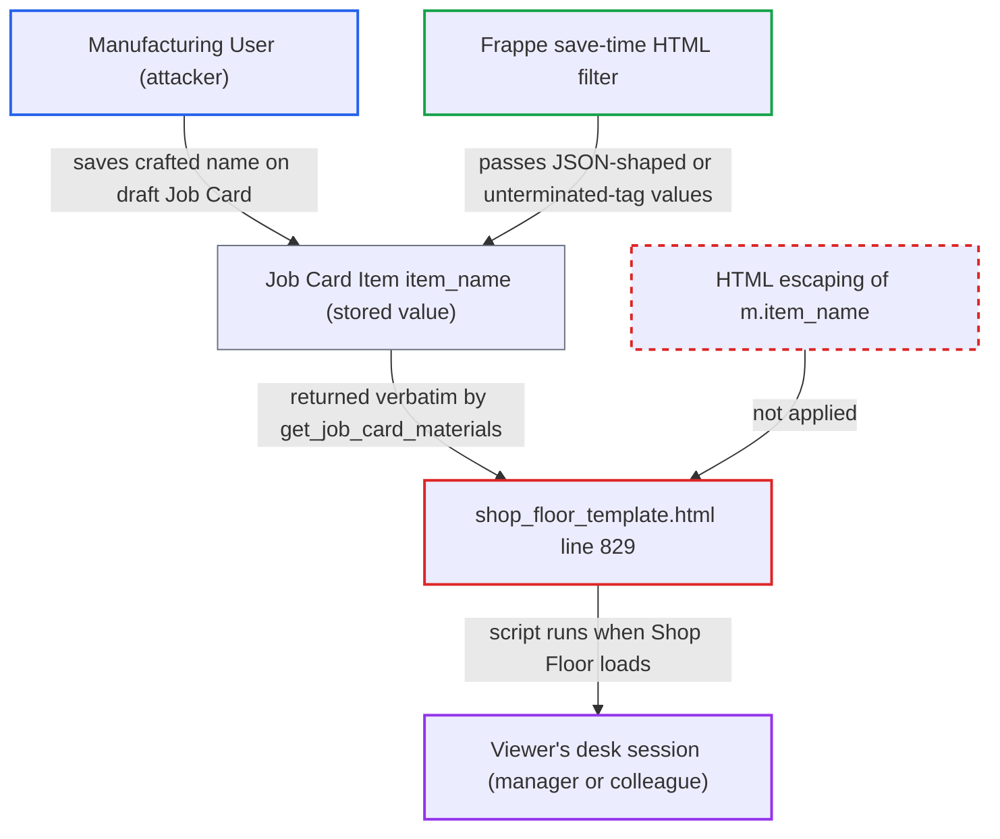

# Stored XSS via unescaped Job Card Item name in Shop Floor materials panel

| Field | Value |
|---|---|
| ID | `find_016NXx14ZhLXX9rDq9eM496m` |
| Severity | **High** |
| Status | open |
| CWE | CWE-79 — Cross-site scripting |
| Created | 2026-10-27T21:31:51.506625Z |
| Claude Security | https://claude.ai/security/findings/find_016NXx14ZhLXX9rDq9eM496m |

## Description

A user with the `Manufacturing User` role can run script in the browser of a colleague or manager who opens the Shop Floor page. The script acts with the viewer's session, so it can read and change whatever that viewer's roles allow. The cause is `{{ m.item_name }}` in `shop_floor_template.html`, which writes the stored Job Card Item name into the page without HTML escaping.

1. **attacker with the `Manufacturing User` role** saves a draft Job Card whose `items` row has a crafted `item_name`. The role can write Job Cards, and `item_name` is a plain `Data` field with no `fetch_from`. The save API stores whatever value is sent. The report names two payloads that pass Frappe's save-time filter: a JSON string literal such as `""`, and an unterminated tag such as `` handler fires as soon as it is inserted, even if the materials body is collapsed. The attacker's script then runs in the viewer's desk session. ([`erpnext/public/js/shop_floor/shop_floor.js:611-625`](https://github.com/cx-benchmark/erpnext/blob/90e7aefca73da3c440d2e8da7472fcb67838e678/erpnext/public/js/shop_floor/shop_floor.js#L611-L625))

## Assessment

The attacker is an authenticated user with the `Manufacturing User` role. That role can create and write Job Cards. The attacker saves a draft Job Card through `/api/resource` or `frappe.client.save`, with an `items` row carrying the payload. The Job Card must be the workstation's next-up card or an active one. A colleague or manager then opens the Shop Floor for that workstation or work order, which is a routine view that also reloads in realtime. A second way in is that the value can be inherited from `Item.item_name` through the Work Order's required items. The payloads are deterministic and fit the 140-character `Data` limit.

Impact: The attacker's script runs in the ERPNext desk origin with the viewer's session and CSRF token. It can read anything the viewer can and call any whitelisted method as them. For a Manufacturing Manager, or an account that also has stock, accounts or System Manager roles, that includes submitting Job Cards and Stock Entries, changing documents and creating users. The reach is limited by the viewer's roles and by who opens the Shop Floor page. There is no direct effect on availability.

## Recommendation

`shop_floor_template.html` line 829 writes the stored `Job Card Item.item_name` into element content without HTML encoding. It relies only on Frappe's save-time filter, which passes JSON-shaped and unterminated-tag values unchanged.

Fix criteria: Every free-text value the Shop Floor template writes into HTML, starting with `m.item_name`, is HTML-encoded on output. A Job Card Item with `item_name` set to `""`, or to `<img src=x onerror=alert(1)//`, appears as literal text in the Materials panel. No handler runs when the Shop Floor loads that workstation or work order.

## Evidence

**https://github.com/cx-benchmark/erpnext**

- [`erpnext/public/js/templates/shop_floor_template.html:829`](https://github.com/cx-benchmark/erpnext/blob/90e7aefca73da3c440d2e8da7472fcb67838e678/erpnext/public/js/templates/shop_floor_template.html#L829)
- [`erpnext/public/js/shop_floor/shop_floor.js:611-625`](https://github.com/cx-benchmark/erpnext/blob/90e7aefca73da3c440d2e8da7472fcb67838e678/erpnext/public/js/shop_floor/shop_floor.js#L611-L625)
- [`erpnext/manufacturing/page/shop_floor/shop_floor.py:669-721`](https://github.com/cx-benchmark/erpnext/blob/90e7aefca73da3c440d2e8da7472fcb67838e678/erpnext/manufacturing/page/shop_floor/shop_floor.py#L669-L721)
- [`erpnext/manufacturing/page/shop_floor/shop_floor.py:511-528`](https://github.com/cx-benchmark/erpnext/blob/90e7aefca73da3c440d2e8da7472fcb67838e678/erpnext/manufacturing/page/shop_floor/shop_floor.py#L511-L528)
- [`erpnext/manufacturing/doctype/job_card_item/job_card_item.json:52-57`](https://github.com/cx-benchmark/erpnext/blob/90e7aefca73da3c440d2e8da7472fcb67838e678/erpnext/manufacturing/doctype/job_card_item/job_card_item.json#L52-L57)
- [`erpnext/manufacturing/doctype/job_card/job_card.json:730-743`](https://github.com/cx-benchmark/erpnext/blob/90e7aefca73da3c440d2e8da7472fcb67838e678/erpnext/manufacturing/doctype/job_card/job_card.json#L730-L743)
- [`erpnext/public/js/templates/shop_floor_template.html:853-854`](https://github.com/cx-benchmark/erpnext/blob/90e7aefca73da3c440d2e8da7472fcb67838e678/erpnext/public/js/templates/shop_floor_template.html#L853-L854)

