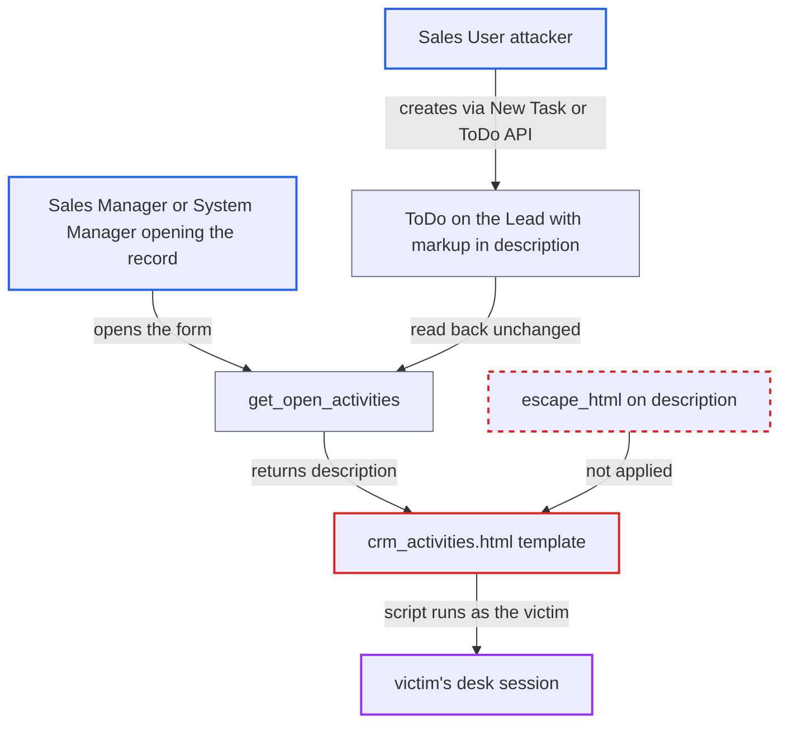

# Stored XSS via unescaped ToDo description in CRM Activities panel

| Field | Value |
|---|---|
| ID | `find_01FdtYWJSEDzGdotgxC9tE1J` |
| Severity | **High** |
| Status | open |
| CWE | CWE-79 — Cross-site scripting |
| Created | 2026-10-27T22:03:40.023309Z |
| Claude Security | https://claude.ai/security/findings/find_01FdtYWJSEDzGdotgxC9tE1J |

## Description

A user with Sales User access can store a script in a ToDo on a Lead, Opportunity or Prospect. It runs in the browser of any colleague who opens that record, including a Sales Manager or System Manager, and acts with that person's rights. The CRM Activities template prints each ToDo `description` raw with `` and ``, and Frappe's save-time filter is the only protection.

1. **attacker with Sales User access** creates a ToDo on a Lead they can open. The New Task button or `POST /api/resource/ToDo` with `reference_type=Lead` does this, and `description` is set to a JSON string literal such as `""` (quotes included) or an unterminated `"`, and another with `<img src=x onerror=alert(1) `, each show as inert text in the open and completed task lists. No handler runs when the Lead, or the Opportunity it converts to, is opened.

## Evidence

**https://github.com/cx-benchmark/erpnext**

- [`erpnext/public/js/templates/crm_activities.html:33-35`](https://github.com/cx-benchmark/erpnext/blob/90e7aefca73da3c440d2e8da7472fcb67838e678/erpnext/public/js/templates/crm_activities.html#L33-L35)
- [`erpnext/public/js/templates/crm_activities.html:92-94`](https://github.com/cx-benchmark/erpnext/blob/90e7aefca73da3c440d2e8da7472fcb67838e678/erpnext/public/js/templates/crm_activities.html#L92-L94)
- [`erpnext/public/js/utils/crm_activities.js:31-46`](https://github.com/cx-benchmark/erpnext/blob/90e7aefca73da3c440d2e8da7472fcb67838e678/erpnext/public/js/utils/crm_activities.js#L31-L46)
- [`erpnext/crm/utils.py:166-183`](https://github.com/cx-benchmark/erpnext/blob/90e7aefca73da3c440d2e8da7472fcb67838e678/erpnext/crm/utils.py#L166-L183)
- [`erpnext/crm/utils.py:207-218`](https://github.com/cx-benchmark/erpnext/blob/90e7aefca73da3c440d2e8da7472fcb67838e678/erpnext/crm/utils.py#L207-L218)
- [`erpnext/public/js/utils/crm_activities.js:67-83`](https://github.com/cx-benchmark/erpnext/blob/90e7aefca73da3c440d2e8da7472fcb67838e678/erpnext/public/js/utils/crm_activities.js#L67-L83)
- [`erpnext/crm/doctype/lead/lead.js:230-241`](https://github.com/cx-benchmark/erpnext/blob/90e7aefca73da3c440d2e8da7472fcb67838e678/erpnext/crm/doctype/lead/lead.js#L230-L241)
- [`erpnext/crm/doctype/lead/lead.json:564-614`](https://github.com/cx-benchmark/erpnext/blob/90e7aefca73da3c440d2e8da7472fcb67838e678/erpnext/crm/doctype/lead/lead.json#L564-L614)
- [`erpnext/crm/utils.py:142-152`](https://github.com/cx-benchmark/erpnext/blob/90e7aefca73da3c440d2e8da7472fcb67838e678/erpnext/crm/utils.py#L142-L152)
- [`erpnext/public/js/templates/crm_activities.html:117-119`](https://github.com/cx-benchmark/erpnext/blob/90e7aefca73da3c440d2e8da7472fcb67838e678/erpnext/public/js/templates/crm_activities.html#L117-L119)
- [`erpnext/public/js/erpnext.bundle.js:35-36`](https://github.com/cx-benchmark/erpnext/blob/90e7aefca73da3c440d2e8da7472fcb67838e678/erpnext/public/js/erpnext.bundle.js#L35-L36)

