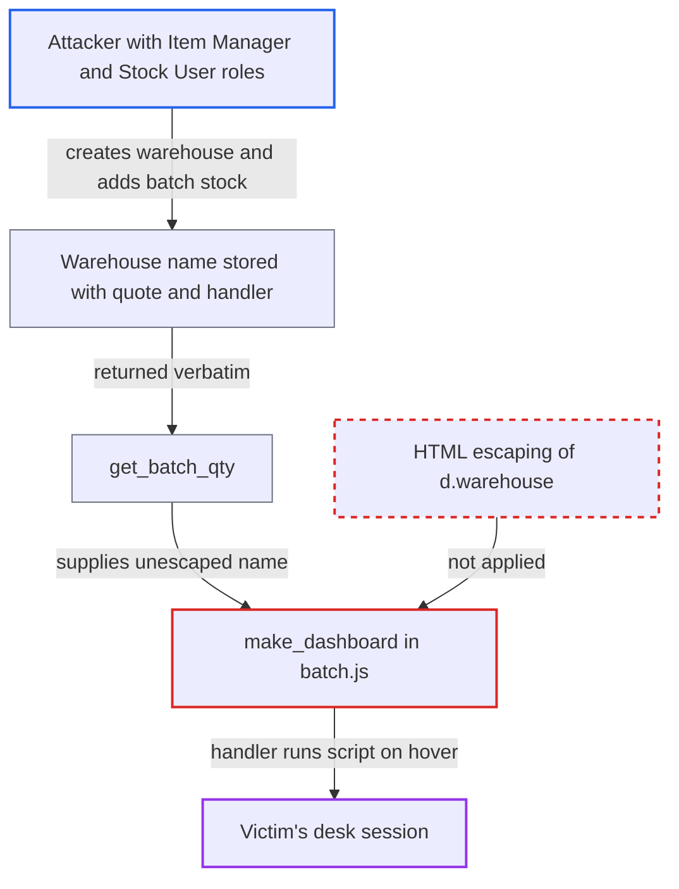

# Stored XSS via unescaped warehouse name in Batch form stock-levels buttons

| Field | Value |
|---|---|
| ID | `find_0129MFQJS7umDbKHtzqp2fGa` |
| Severity | **High** |
| Status | open |
| CWE | CWE-79 — Cross-site scripting |
| Created | 2026-10-27T21:23:41.239317Z |
| Claude Security | https://claude.ai/security/findings/find_0129MFQJS7umDbKHtzqp2fGa |

## Description

A user with the `Item Manager` and `Stock User` roles can run script in another user's desk session. That includes Administrator, and the script can call any API the victim is allowed to call. The attacker needs a Warehouse named with a double quote and an event handler, holding batch stock, and a victim who opens that Batch form and hovers over a button. The cause is `make_dashboard` in `batch.js`, which puts the warehouse name into HTML without escaping it.

1. **Attacker** creates a Warehouse whose name contains a double quote and an event handler. The `warehouse_name` is a plain Data field and `autoname` only appends the abbreviation, so ERPNext adds no character checks; the report assumes Frappe rejects only `<` and `>`, so a name with neither is accepted and its save-time sanitizer skips it. ([`erpnext/stock/doctype/warehouse/warehouse.py:55-62`](https://github.com/cx-benchmark/erpnext/blob/90e7aefca73da3c440d2e8da7472fcb67838e678/erpnext/stock/doctype/warehouse/warehouse.py#L55-L62))
2. **Attacker** moves some quantity of a batch into that warehouse with a Stock Entry. `Item Manager` can create the Warehouse, and `Stock User` can create and submit the Stock Entry, so the batch now has non-zero stock there. ([`erpnext/stock/doctype/warehouse/warehouse.json:301-313`](https://github.com/cx-benchmark/erpnext/blob/90e7aefca73da3c440d2e8da7472fcb67838e678/erpnext/stock/doctype/warehouse/warehouse.json#L301-L313))
3. **Victim** opens the Batch form for that batch. Any user who can read Batch can do this, which means `Item Manager`, `Stock User` and Administrator, and the dashboard asks `get_batch_qty` for the stock levels. ([`erpnext/stock/doctype/batch/batch.py:271-331`](https://github.com/cx-benchmark/erpnext/blob/90e7aefca73da3c440d2e8da7472fcb67838e678/erpnext/stock/doctype/batch/batch.py#L271-L331))
4. **the whitelisted function `get_batch_qty`** returns the stored warehouse name unchanged. The rows come from `get_auto_batch_nos` and `get_available_batches`, which carry `batch_ledger.warehouse` verbatim for every warehouse that holds the batch. ([`erpnext/stock/doctype/batch/batch.py:271-331`](https://github.com/cx-benchmark/erpnext/blob/90e7aefca73da3c440d2e8da7472fcb67838e678/erpnext/stock/doctype/batch/batch.py#L271-L331))
5. **the function `make_dashboard`** inserts `d.warehouse` into a template literal that jQuery parses as HTML. The name is used as text and inside the double-quoted `data-warehouse` attributes of the Move and Split buttons, so the quote closes the attribute and the rest of the name becomes new attributes such as `onmouseover`. ([`erpnext/stock/doctype/batch/batch.js:125-140`](https://github.com/cx-benchmark/erpnext/blob/90e7aefca73da3c440d2e8da7472fcb67838e678/erpnext/stock/doctype/batch/batch.js#L125-L140))
6. **Victim** points at a Move or Split button. The injected handler runs the attacker's script in the victim's authenticated desk session.

## Assessment

The attacker is a logged-in employee with `Item Manager`, to create the Warehouse, and a stock role such as `Stock User`, to submit a Stock Entry. Neither role is administrative. The attacker names the Warehouse `x" onmouseover="<js>" y="` and gets some batch quantity into it. The victim is any user who can read Batch, which means `Item Manager`, `Stock User` and Administrator, and System Manager accounts commonly hold these roles too. The victim opens that Batch form during normal work and points at a button. The report assumes Frappe's name check and sanitizer behave as described. Frappe is not in the checkout, so this was not confirmed there.

Impact: The attacker's script runs as the victim, with the victim's CSRF token, and can call any whitelisted API the victim may call. It can read confidential records across companies and create or submit stock and financial documents. If the victim is Administrator or a System Manager, it can grant roles to the attacker or change system settings. Deletions are limited to what the victim is allowed to delete.

## Recommendation

`make_dashboard` in `batch.js` puts the server-supplied warehouse name into HTML text and quoted attributes by string interpolation with no output encoding. Stored data can therefore break out of the attribute and add event handlers.

Fix criteria: Every data value in the Stock Levels markup (the warehouse, and `qty` for consistency) is HTML-escaped for its context, or set through DOM APIs such as `.text()` and `.attr()`/`.data()` instead of markup concatenation. The Move and Split handlers still receive the original warehouse name. To verify, use a warehouse named `x" onmouseover="alert(1)" y="` that holds batch stock. The Batch form must show the literal name, and the buttons must carry it as one `data-warehouse` value. Hovering must run nothing.

## Evidence

**https://github.com/cx-benchmark/erpnext**

- [`erpnext/stock/doctype/batch/batch.js:125-140`](https://github.com/cx-benchmark/erpnext/blob/90e7aefca73da3c440d2e8da7472fcb67838e678/erpnext/stock/doctype/batch/batch.js#L125-L140)
- [`erpnext/stock/doctype/batch/batch.py:271-331`](https://github.com/cx-benchmark/erpnext/blob/90e7aefca73da3c440d2e8da7472fcb67838e678/erpnext/stock/doctype/batch/batch.py#L271-L331)
- [`erpnext/stock/doctype/warehouse/warehouse.py:55-62`](https://github.com/cx-benchmark/erpnext/blob/90e7aefca73da3c440d2e8da7472fcb67838e678/erpnext/stock/doctype/warehouse/warehouse.py#L55-L62)
- [`erpnext/stock/doctype/warehouse/warehouse.json:301-313`](https://github.com/cx-benchmark/erpnext/blob/90e7aefca73da3c440d2e8da7472fcb67838e678/erpnext/stock/doctype/warehouse/warehouse.json#L301-L313)
- [`erpnext/stock/dashboard/item_dashboard.py:138-142`](https://github.com/cx-benchmark/erpnext/blob/90e7aefca73da3c440d2e8da7472fcb67838e678/erpnext/stock/dashboard/item_dashboard.py#L138-L142)

