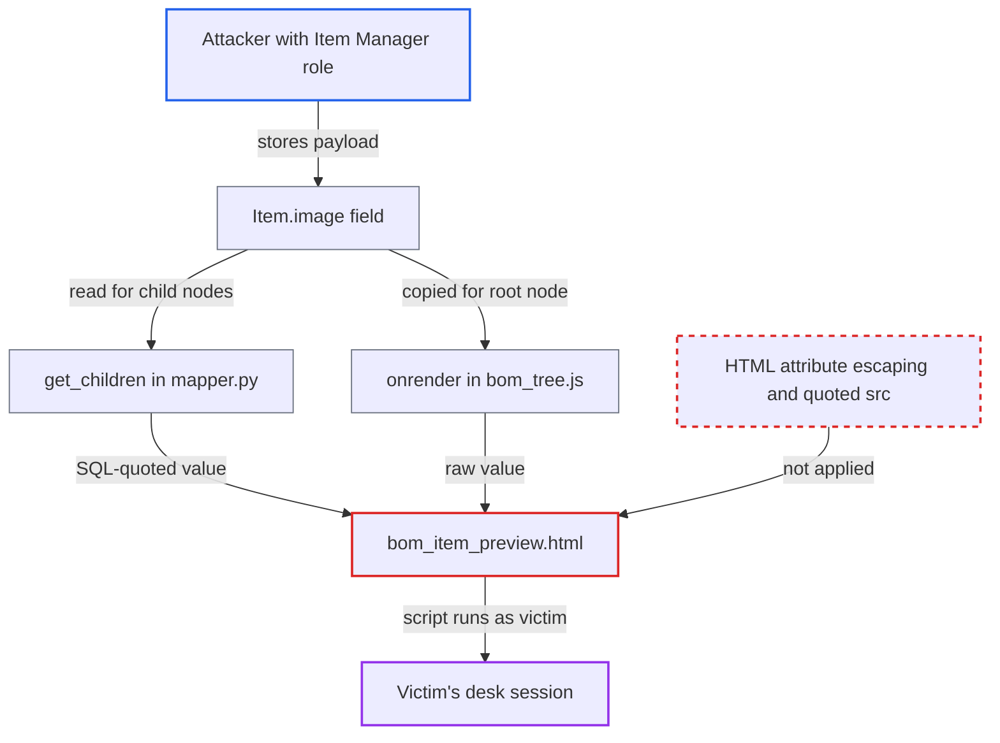

# Stored XSS via unquoted, unescaped image URL in BOM tree node preview

| Field | Value |
|---|---|
| ID | `find_01At3F1hYFBtoty3QgWS1yiU` |
| Severity | **High** |
| Status | open |
| CWE | CWE-79 — Cross-site scripting |
| Created | 2026-10-27T21:15:28.820972Z |
| Claude Security | https://claude.ai/security/findings/find_01At3F1hYFBtoty3QgWS1yiU |

## Description

A user with the `Item Manager` role can run script in the desk session of anyone who opens the BOM tree and clicks the node of an item they edited. Victims are Manufacturing, Stock and Purchase users and managers, and Administrator. The cause is `bom_item_preview.html`, which writes `data.image` into an unquoted `src` attribute without HTML escaping. `mapper.py` only applies SQL quoting to the value.

1. **attacker with `Item Manager` role** stores a crafted value in `Item.image`. The value is `x' onerror=eval(atob(this.title)) title=<base64> a='`. `Item.image` is an `Attach Image` field that `Item Manager` can write, and `item.py` does not validate it. ([`erpnext/stock/doctype/item/item.json:313-320`](https://github.com/cx-benchmark/erpnext/blob/90e7aefca73da3c440d2e8da7472fcb67838e678/erpnext/stock/doctype/item/item.json#L313-L320))
2. **victim with BOM read access** opens the BOM tree through the `Browse BOM` action. The action routes to the BOM tree view with the BOM preselected, so this is part of the normal UI. ([`erpnext/manufacturing/doctype/bom/bom.js:341-349`](https://github.com/cx-benchmark/erpnext/blob/90e7aefca73da3c440d2e8da7472fcb67838e678/erpnext/manufacturing/doctype/bom/bom.js#L341-L349))
3. **tree data code** passes the stored image value to the node data. For child nodes, `get_children` in `mapper.py` applies only `frappe.db.escape()`, which is SQL quoting and not HTML escaping. For the root node, `onrender` in `bom_tree.js` copies the raw `BOM.image`, which comes from `Item.image`. ([`erpnext/manufacturing/doctype/bom/mapper.py:63-74`](https://github.com/cx-benchmark/erpnext/blob/90e7aefca73da3c440d2e8da7472fcb67838e678/erpnext/manufacturing/doctype/bom/mapper.py#L63-L74))
4. **victim** clicks the node. The tree view then renders `bom_item_preview.html` with that node's data. ([`erpnext/manufacturing/doctype/bom/bom_tree.js:70-80`](https://github.com/cx-benchmark/erpnext/blob/90e7aefca73da3c440d2e8da7472fcb67838e678/erpnext/manufacturing/doctype/bom/bom_tree.js#L70-L80))
5. **template `bom_item_preview.html`** writes the image value into an unquoted `src` attribute. The `{{ }}` output is not escaped, so the quote and space in the value end the attribute and add an `onerror` handler. ([`erpnext/manufacturing/doctype/bom/bom_item_preview.html:4-7`](https://github.com/cx-benchmark/erpnext/blob/90e7aefca73da3c440d2e8da7472fcb67838e678/erpnext/manufacturing/doctype/bom/bom_item_preview.html#L4-L7))
6. **victim's browser** runs the handler when the image fails to load. The script runs with the victim's desk session and CSRF token.

## Assessment

The attacker is an authenticated desk user with the `Item Manager` role, which is not an administrator role. They set the `image` of a component item, for example through `frappe.client.set_value`. The victim needs BOM read access, which Manufacturing, Stock and Purchase users and managers and Administrator have. The victim opens `Browse BOM` for a BOM containing that item and clicks its node. The root node is also affected, because its value comes from `Item.image` through `BOM.image`, and a payload such as `x onerror=...` works there unchanged. The payload needs no `<` or `>`, so HTML sanitization does not touch it. SQL escaping mangles quotes, backslashes and backticks, so the script must be quote-free, which the `atob(this.title)` pattern allows. The report assumes, without having the code in the checkout, these things about Frappe (`>=17.0.0-dev,<18`). `frappe.render_template` does not escape `{{ }}`. `frappe.views.TreeView` renders `view_template` with `node.data` on node click. Frappe does not validate `Attach Image` values as URLs.

Impact: The attacker's script runs as the victim and can call any `/api/method` or `/api/resource` endpoint. It can read data the attacker's role cannot see, such as BOMs, costs, stock and purchasing. It can create, submit or cancel documents with the victim's roles. When the victim is Administrator, it can also grant roles. Availability impact is limited to destructive actions the victim could take.

## Recommendation

(1) `bom_item_preview.html` interpolates `data.image` into an unquoted `src` attribute without HTML escaping, so output encoding for an attribute is missing.

Fix criteria: The image value is HTML-attribute-escaped and placed in a quoted attribute, so no character in it can end the attribute or add new ones. Store `x onerror=alert(1)` and `x' onerror=alert(1) a='` in `Item.image`, then click the root and child nodes in the BOM tree. Only a broken image shows and no script runs.

(2) `mapper.py::_enrich_bom_items` applies `frappe.db.escape()`, which is SQL quoting, to the image value sent to the browser, as if it were HTML escaping.

Fix criteria: Tree node data sent to the client does not rely on SQL escaping for HTML safety. The plain URL is returned and escaped at render time, or it is HTML-escaped explicitly. A child node whose item image contains `'` renders with the whole value inside the `src` attribute.

## Evidence

**https://github.com/cx-benchmark/erpnext**

- [`erpnext/manufacturing/doctype/bom/bom_item_preview.html:4-7`](https://github.com/cx-benchmark/erpnext/blob/90e7aefca73da3c440d2e8da7472fcb67838e678/erpnext/manufacturing/doctype/bom/bom_item_preview.html#L4-L7)
- [`erpnext/manufacturing/doctype/bom/mapper.py:63-74`](https://github.com/cx-benchmark/erpnext/blob/90e7aefca73da3c440d2e8da7472fcb67838e678/erpnext/manufacturing/doctype/bom/mapper.py#L63-L74)
- [`erpnext/manufacturing/doctype/bom/bom_tree.js:70-80`](https://github.com/cx-benchmark/erpnext/blob/90e7aefca73da3c440d2e8da7472fcb67838e678/erpnext/manufacturing/doctype/bom/bom_tree.js#L70-L80)
- [`erpnext/stock/doctype/item/item.json:313-320`](https://github.com/cx-benchmark/erpnext/blob/90e7aefca73da3c440d2e8da7472fcb67838e678/erpnext/stock/doctype/item/item.json#L313-L320)
- [`erpnext/manufacturing/doctype/bom/bom.json:130-139`](https://github.com/cx-benchmark/erpnext/blob/90e7aefca73da3c440d2e8da7472fcb67838e678/erpnext/manufacturing/doctype/bom/bom.json#L130-L139)
- [`erpnext/manufacturing/doctype/bom/bom.js:341-349`](https://github.com/cx-benchmark/erpnext/blob/90e7aefca73da3c440d2e8da7472fcb67838e678/erpnext/manufacturing/doctype/bom/bom.js#L341-L349)

