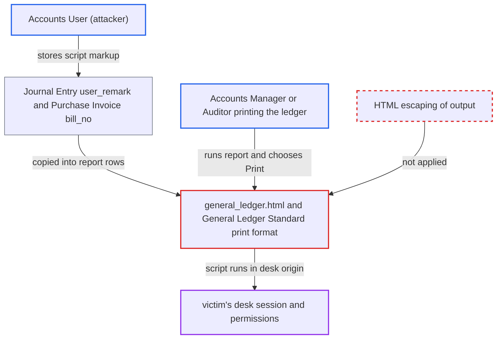

# Stored XSS via voucher remarks and supplier invoice number in General Ledger print formats

| Field | Value |
|---|---|
| ID | `find_011RfPNBWfGk7RYuXjkx5oNS` |
| Severity | **High** |
| Status | open |
| CWE | CWE-79 — Cross-site scripting |
| Created | 2026-10-27T22:04:09.871733Z |
| Claude Security | https://claude.ai/security/findings/find_011RfPNBWfGk7RYuXjkx5oNS |

## Description

An Accounts User can store script in voucher text, and it runs in the browser of an Accounts Manager or Auditor who prints the General Ledger. The script can then act with the victim's permissions. The remarks variant needs Show Remarks ticked. The cause is that `general_ledger.html` and the `General Ledger Standard` print format write `row.remarks` and `row.bill_no` with the unescaped `` operator.

1. **Accounts User** submits a Journal Entry or Purchase Invoice containing markup. The markup goes in the row `user_remark` of a Journal Entry or in the `bill_no` of a Purchase Invoice. A JSON string literal such as `""` passes Frappe's save-time sanitizer, which returns JSON-parsable values unchanged (the report assumes this, because Frappe is not in the checkout). ([`erpnext/accounts/doctype/journal_entry/journal_entry.json:688-701`](https://github.com/cx-benchmark/erpnext/blob/90e7aefca73da3c440d2e8da7472fcb67838e678/erpnext/accounts/doctype/journal_entry/journal_entry.json#L688-L701))
2. **GL Entry creation** stores the voucher text in `GL Entry.remarks`. The entries are created with `gle.submit()`, so they are already submitted when validated, and the sanitizer is assumed to skip such documents. ([`erpnext/accounts/general_ledger.py:377-388`](https://github.com/cx-benchmark/erpnext/blob/90e7aefca73da3c440d2e8da7472fcb67838e678/erpnext/accounts/general_ledger.py#L377-L388))
3. **the report code `general_ledger.py`** returns the stored values to the report unchanged. `remarks` is selected verbatim and passed only through `_()`. `set_bill_no` attaches `Purchase Invoice.bill_no` to the rows. ([`erpnext/accounts/report/general_ledger/general_ledger.py:586`](https://github.com/cx-benchmark/erpnext/blob/90e7aefca73da3c440d2e8da7472fcb67838e678/erpnext/accounts/report/general_ledger/general_ledger.py#L586))
4. **Accounts Manager or Auditor** runs the General Ledger for that company or account and chooses Print. The default print format is `General Ledger Standard`. The report's row filter only removes rows and never changes values, so any user allowed to see the rows gets the payload. ([`erpnext/accounts/report/general_ledger/general_ledger.json:6-40`](https://github.com/cx-benchmark/erpnext/blob/90e7aefca73da3c440d2e8da7472fcb67838e678/erpnext/accounts/report/general_ledger/general_ledger.json#L6-L40))
5. **the print template** writes `row.remarks` and `row.bill_no` into the page without escaping. `row.remarks` appears only when Show Remarks is ticked. `row.bill_no` appears on rows whose against-voucher is a submitted Purchase Invoice with a supplier invoice number. ([`erpnext/accounts/report/general_ledger/general_ledger.html:219-225`](https://github.com/cx-benchmark/erpnext/blob/90e7aefca73da3c440d2e8da7472fcb67838e678/erpnext/accounts/report/general_ledger/general_ledger.html#L219-L225))
6. **victim's browser** runs the attacker's script in the desk origin. The print window is same-origin, so the script can reach `window.opener.frappe` and the CSRF token. This depends on the assumption that the Print action compiles the template with `frappe.render_template` and `frappe.render_grid`.

## Assessment

The attacker is an Accounts User, who can create, write and submit Journal Entries and Purchase Invoices. There are two ways in. One is a Journal Entry row `user_remark`, or a voucher `remarks`, which is copied into `GL Entry.remarks`. The other is the Purchase Invoice `bill_no`. The victim is an Accounts Manager or Auditor who runs the General Ledger for that company or account and chooses Print, a routine step. The remarks variant also needs Show Remarks ticked. The `bill_no` variant needs no filter. It appears on rows whose against-voucher is a submitted Purchase Invoice with a supplier invoice number. Both variants rely on Frappe's sanitizer being bypassed, which the report assumes without having Frappe's code.

Impact: The attacker's script runs with the victim's session in the desk. It can read everything the victim can see. It can call any API the victim may, such as cancelling or amending vouchers or changing accounts and Accounts Settings. That rewrites financial records under the victim's name.

## Recommendation

Both General Ledger print templates, `general_ledger.html` and the `General Ledger Standard` print format, output the stored free-text fields `remarks` and `bill_no` with the unescaped `` operator. They depend on a save-time sanitizer that can be bypassed.

Fix criteria: Every data-derived string in both templates is HTML-escaped at output, so stored markup shows as literal text. To verify, submit a Journal Entry whose row user remark is `""` and a Purchase Invoice with that `bill_no`. Print the General Ledger with Show Remarks ticked, once with the report template and once with `General Ledger Standard`. The text must show literally and no script may run.

## Evidence

**https://github.com/cx-benchmark/erpnext**

- [`erpnext/accounts/report/general_ledger/general_ledger.html:219-225`](https://github.com/cx-benchmark/erpnext/blob/90e7aefca73da3c440d2e8da7472fcb67838e678/erpnext/accounts/report/general_ledger/general_ledger.html#L219-L225)
- [`erpnext/accounts/report/general_ledger/general_ledger.html:200-204`](https://github.com/cx-benchmark/erpnext/blob/90e7aefca73da3c440d2e8da7472fcb67838e678/erpnext/accounts/report/general_ledger/general_ledger.html#L200-L204)
- [`erpnext/accounts/print_format/general_ledger_standard/general_ledger_standard.json:11`](https://github.com/cx-benchmark/erpnext/blob/90e7aefca73da3c440d2e8da7472fcb67838e678/erpnext/accounts/print_format/general_ledger_standard/general_ledger_standard.json#L11)
- [`erpnext/accounts/report/general_ledger/general_ledger.json:6-40`](https://github.com/cx-benchmark/erpnext/blob/90e7aefca73da3c440d2e8da7472fcb67838e678/erpnext/accounts/report/general_ledger/general_ledger.json#L6-L40)
- [`erpnext/accounts/report/general_ledger/general_ledger.py:173-178`](https://github.com/cx-benchmark/erpnext/blob/90e7aefca73da3c440d2e8da7472fcb67838e678/erpnext/accounts/report/general_ledger/general_ledger.py#L173-L178)
- [`erpnext/accounts/report/general_ledger/general_ledger.py:401-404`](https://github.com/cx-benchmark/erpnext/blob/90e7aefca73da3c440d2e8da7472fcb67838e678/erpnext/accounts/report/general_ledger/general_ledger.py#L401-L404)
- [`erpnext/accounts/report/general_ledger/general_ledger.py:586`](https://github.com/cx-benchmark/erpnext/blob/90e7aefca73da3c440d2e8da7472fcb67838e678/erpnext/accounts/report/general_ledger/general_ledger.py#L586)
- [`erpnext/accounts/doctype/journal_entry/services/gl_composer.py:50`](https://github.com/cx-benchmark/erpnext/blob/90e7aefca73da3c440d2e8da7472fcb67838e678/erpnext/accounts/doctype/journal_entry/services/gl_composer.py#L50)
- [`erpnext/accounts/services/base_gl_composer.py:47`](https://github.com/cx-benchmark/erpnext/blob/90e7aefca73da3c440d2e8da7472fcb67838e678/erpnext/accounts/services/base_gl_composer.py#L47)
- [`erpnext/accounts/doctype/journal_entry_account/journal_entry_account.json:233-238`](https://github.com/cx-benchmark/erpnext/blob/90e7aefca73da3c440d2e8da7472fcb67838e678/erpnext/accounts/doctype/journal_entry_account/journal_entry_account.json#L233-L238)
- [`erpnext/accounts/doctype/purchase_invoice/purchase_invoice.json:404-412`](https://github.com/cx-benchmark/erpnext/blob/90e7aefca73da3c440d2e8da7472fcb67838e678/erpnext/accounts/doctype/purchase_invoice/purchase_invoice.json#L404-L412)
- [`erpnext/accounts/doctype/journal_entry/journal_entry.json:688-701`](https://github.com/cx-benchmark/erpnext/blob/90e7aefca73da3c440d2e8da7472fcb67838e678/erpnext/accounts/doctype/journal_entry/journal_entry.json#L688-L701)
- [`erpnext/accounts/general_ledger.py:377-388`](https://github.com/cx-benchmark/erpnext/blob/90e7aefca73da3c440d2e8da7472fcb67838e678/erpnext/accounts/general_ledger.py#L377-L388)

