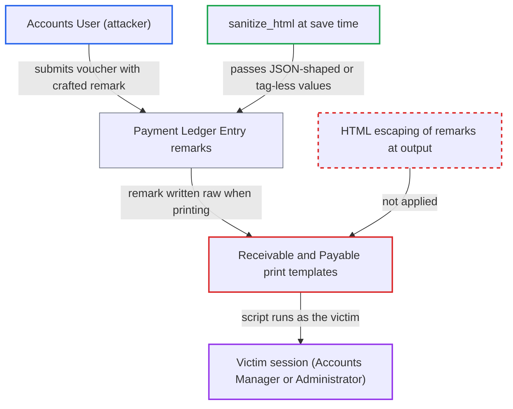

# Stored XSS via voucher remarks in Accounts Receivable/Payable print templates

| Field | Value |
|---|---|
| ID | `find_0153whBS32Mb92uQwHYaQUkV` |
| Severity | **High** |
| Status | open |
| CWE | CWE-79 — Cross-site scripting |
| Created | 2026-10-27T22:04:09.917385Z |
| Claude Security | https://claude.ai/security/findings/find_0153whBS32Mb92uQwHYaQUkV |

## Description

A low-privilege Accounts User can run script in the browser of an Accounts Manager or Administrator. The script runs with the victim's session and can do anything the victim's roles allow. It needs the victim to run Accounts Receivable or Accounts Payable with the non-default \*Show Remarks\* filter and choose Print. The print templates write the voucher remark raw with `` and never HTML-escape it.

1. **Accounts User** submits a voucher with a crafted remark. The voucher can be a Journal Entry (`user_remark` or `remark`), a Sales Invoice, a Purchase Invoice or a Payment Entry (`remarks`), and the remark is chosen to pass the save-time `sanitize_html` filter, e.g. `""` with its quotes. ([`erpnext/accounts/doctype/journal_entry/journal_entry.json:688-702`](https://github.com/cx-benchmark/erpnext/blob/90e7aefca73da3c440d2e8da7472fcb67838e678/erpnext/accounts/doctype/journal_entry/journal_entry.json#L688-L702))
2. **ERPNext ledger code** copies the remark into `GL Entry.remarks` and then into `Payment Ledger Entry.remarks`. The composers take the free-text remark as typed, and the ledger entry is saved with `ple.submit()`, so it is not sanitized again. ([`erpnext/accounts/utils.py:2121`](https://github.com/cx-benchmark/erpnext/blob/90e7aefca73da3c440d2e8da7472fcb67838e678/erpnext/accounts/utils.py#L2121))
3. **the report query in `accounts_receivable.py`** selects `ple.remarks` and puts it on the output row unchanged. This happens when `show_remarks` is set. The Accounts Payable report runs the same class. ([`erpnext/accounts/report/accounts_receivable/accounts_receivable.py:886-892`](https://github.com/cx-benchmark/erpnext/blob/90e7aefca73da3c440d2e8da7472fcb67838e678/erpnext/accounts/report/accounts_receivable/accounts_receivable.py#L886-L892))
4. **Accounts Manager or Administrator** runs the report for that party, ticks \*Show Remarks\* and chooses Print. `show_remarks` is an ordinary Check filter that is off by default, and the print template reads it from `filters`. ([`erpnext/accounts/report/accounts_receivable/accounts_receivable.js:174-178`](https://github.com/cx-benchmark/erpnext/blob/90e7aefca73da3c440d2e8da7472fcb67838e678/erpnext/accounts/report/accounts_receivable/accounts_receivable.js#L174-L178))
5. **the print template** writes `` into the print window without escaping. The `` operator does not encode its output, so the markup becomes live HTML in a same-origin window and the attacker's handler runs with the victim's cookies. ([`erpnext/accounts/report/accounts_receivable/accounts_receivable.html:156-162`](https://github.com/cx-benchmark/erpnext/blob/90e7aefca73da3c440d2e8da7472fcb67838e678/erpnext/accounts/report/accounts_receivable/accounts_receivable.html#L156-L162))

## Assessment

The attacker is an authenticated Accounts User, who can create and submit Journal Entries, Sales Invoices, Purchase Invoices and Payment Entries. They put a remark on a voucher against a party. The remark must pass the save-time `sanitize_html`, which returns a value unchanged when it parses as JSON (e.g. `""` with its quotes) or when BeautifulSoup finds no complete element in it. A victim without user-permission restrictions, such as an Accounts Manager or Administrator, must then run Accounts Receivable or Accounts Payable for that party, tick \*Show Remarks\* and choose Print. Both templates are affected: the report-folder `accounts_receivable.html` and `accounts_payable.html`, and the JS print formats `Accounts Receivable Standard` and `Accounts Payable Standard`, which the reports name as their `default_print_format`. So the flaw is hit whichever template the Print action uses. The report also depends on assumptions about Frappe, which is not in the checkout. It assumes the microtemplate output is unescaped. It assumes the Print action renders client-side through `frappe.render_grid` into a same-origin `window.open()` document. It assumes `_sanitize_content` skips fields that are not `allow_on_submit` while `docstatus` is 1. User Permission filtering of report rows only drops rows and does not encode values.

Impact: The attacker's script runs in the ERPNext desk origin with the victim's session. It can read every document the victim can read and call any whitelisted method or REST endpoint as the victim. With an Accounts Manager or Administrator as victim, this reaches settings, accounts and user or role changes. The victim's roles are the only limit. There is no direct availability impact.

## Recommendation

`accounts_receivable.html`, `accounts_payable.html` and the `html` of the `Accounts Receivable Standard` and `Accounts Payable Standard` JS print formats emit the stored voucher remark with the raw `` operator. They rely on the save-time sanitizer, which lets JSON-shaped and tag-less values through.

Fix criteria: Every data-derived free-text value these four templates emit, `remarks` first, is HTML-escaped at output. To verify, submit a voucher whose remark is `""`. Then print Accounts Receivable and Accounts Payable with \*Show Remarks\*, through both the report's default print format and the report-folder template. The remark must show as literal text and no script may run.

## Evidence

**https://github.com/cx-benchmark/erpnext**

- [`erpnext/accounts/report/accounts_receivable/accounts_receivable.html:156-162`](https://github.com/cx-benchmark/erpnext/blob/90e7aefca73da3c440d2e8da7472fcb67838e678/erpnext/accounts/report/accounts_receivable/accounts_receivable.html#L156-L162)
- [`erpnext/accounts/report/accounts_payable/accounts_payable.html:157-163`](https://github.com/cx-benchmark/erpnext/blob/90e7aefca73da3c440d2e8da7472fcb67838e678/erpnext/accounts/report/accounts_payable/accounts_payable.html#L157-L163)
- [`erpnext/accounts/print_format/accounts_receivable_standard/accounts_receivable_standard.json:11`](https://github.com/cx-benchmark/erpnext/blob/90e7aefca73da3c440d2e8da7472fcb67838e678/erpnext/accounts/print_format/accounts_receivable_standard/accounts_receivable_standard.json#L11)
- [`erpnext/accounts/print_format/accounts_payable_standard/accounts_payable_standard.json:11`](https://github.com/cx-benchmark/erpnext/blob/90e7aefca73da3c440d2e8da7472fcb67838e678/erpnext/accounts/print_format/accounts_payable_standard/accounts_payable_standard.json#L11)
- [`erpnext/accounts/report/accounts_receivable/accounts_receivable.json:6-37`](https://github.com/cx-benchmark/erpnext/blob/90e7aefca73da3c440d2e8da7472fcb67838e678/erpnext/accounts/report/accounts_receivable/accounts_receivable.json#L6-L37)
- [`erpnext/accounts/report/accounts_receivable/accounts_receivable.py:886-892`](https://github.com/cx-benchmark/erpnext/blob/90e7aefca73da3c440d2e8da7472fcb67838e678/erpnext/accounts/report/accounts_receivable/accounts_receivable.py#L886-L892)
- [`erpnext/accounts/report/accounts_receivable/accounts_receivable.py:166-175`](https://github.com/cx-benchmark/erpnext/blob/90e7aefca73da3c440d2e8da7472fcb67838e678/erpnext/accounts/report/accounts_receivable/accounts_receivable.py#L166-L175)
- [`erpnext/accounts/utils.py:2121`](https://github.com/cx-benchmark/erpnext/blob/90e7aefca73da3c440d2e8da7472fcb67838e678/erpnext/accounts/utils.py#L2121)
- [`erpnext/accounts/doctype/journal_entry/services/gl_composer.py:50`](https://github.com/cx-benchmark/erpnext/blob/90e7aefca73da3c440d2e8da7472fcb67838e678/erpnext/accounts/doctype/journal_entry/services/gl_composer.py#L50)
- [`erpnext/accounts/services/base_gl_composer.py:47`](https://github.com/cx-benchmark/erpnext/blob/90e7aefca73da3c440d2e8da7472fcb67838e678/erpnext/accounts/services/base_gl_composer.py#L47)
- [`erpnext/accounts/doctype/journal_entry/journal_entry.json:688-702`](https://github.com/cx-benchmark/erpnext/blob/90e7aefca73da3c440d2e8da7472fcb67838e678/erpnext/accounts/doctype/journal_entry/journal_entry.json#L688-L702)
- [`erpnext/accounts/report/accounts_receivable/accounts_receivable.js:174-178`](https://github.com/cx-benchmark/erpnext/blob/90e7aefca73da3c440d2e8da7472fcb67838e678/erpnext/accounts/report/accounts_receivable/accounts_receivable.js#L174-L178)

