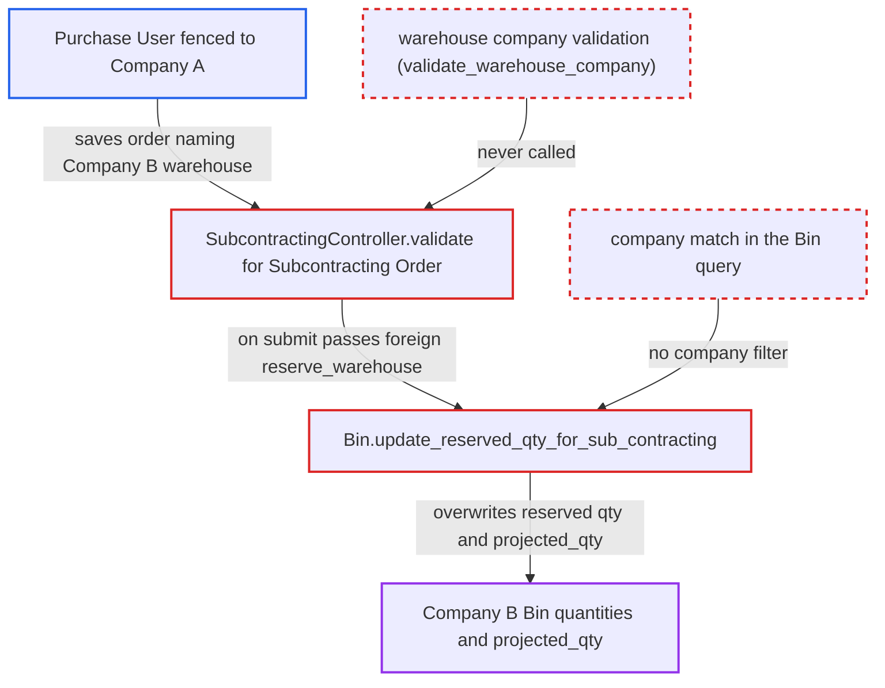

# Subcontracting Order reserve warehouse not checked against company; writes other company's Bins

| Field | Value |
|---|---|
| ID | `find_01NTi6bxzMouhSJRKWjPwWov` |
| Severity | **High** |
| Status | open |
| CWE | CWE-862 — Missing Authorization |
| Created | 2026-10-27T22:45:01.900241Z |
| Claude Security | https://claude.ai/security/findings/find_01NTi6bxzMouhSJRKWjPwWov |

## Description

A logged-in Purchase User limited to one company can corrupt another company's planning data. They can set the reserved and ordered quantities on the other company's stock records (Bins) and push projected stock far negative. No stock ledger or accounting entries are changed. The Subcontracting Order accepts any warehouse in `set_reserve_warehouse` and `items[].warehouse` without a company check, and `Bin.update_reserved_qty_for_sub_contracting` counts orders from every company.

1. **attacker (Purchase User in Company A)** creates a Subcontracting Order through the REST API naming a Company B warehouse. The order has `company` set to Company A, `set_reserve_warehouse` set to a Company B warehouse, `reserve_stock` left at 0, any active BOM and a large qty; the company filter on this field exists only in the browser form. ([`erpnext/subcontracting/doctype/subcontracting_order/subcontracting_order.js:112-118`](https://github.com/cx-benchmark/erpnext/blob/90e7aefca73da3c440d2e8da7472fcb67838e678/erpnext/subcontracting/doctype/subcontracting_order/subcontracting_order.js#L112-L118))
2. **the controller `SubcontractingController.validate`** accepts the order without checking any warehouse against the order's company. For a Subcontracting Order it runs only item, raw-material and valuation-rate logic and does not call `super().validate()`, so no warehouse-company validation runs. ([`erpnext/controllers/subcontracting_controller.py:60-68`](https://github.com/cx-benchmark/erpnext/blob/90e7aefca73da3c440d2e8da7472fcb67838e678/erpnext/controllers/subcontracting_controller.py#L60-L68))
3. **the controller `SubcontractingController`** clears and rebuilds `supplied_items` with the foreign warehouse in every row's `reserve_warehouse`. Each row gets `set_reserve_warehouse`, or the job card warehouse, or the item warehouse, so the unchecked header value is copied into every row. ([`erpnext/controllers/subcontracting_controller.py:651-660`](https://github.com/cx-benchmark/erpnext/blob/90e7aefca73da3c440d2e8da7472fcb67838e678/erpnext/controllers/subcontracting_controller.py#L651-L660))
4. **the order's own validation** checks only that `reserve_warehouse` differs from `supplier_warehouse`. That is the only server-side check on the field, and it says nothing about the company. ([`erpnext/subcontracting/doctype/subcontracting_order/subcontracting_order.py:262-270`](https://github.com/cx-benchmark/erpnext/blob/90e7aefca73da3c440d2e8da7472fcb67838e678/erpnext/subcontracting/doctype/subcontracting_order/subcontracting_order.py#L262-L270))
5. **the attacker** submits the order, which calls `update_reserved_qty_for_subcontracting`. For each supplied item this calls `get_bin` with the foreign `reserve_warehouse`, which creates the Bin if it is missing and ignores permissions. ([`erpnext/subcontracting/doctype/subcontracting_order/subcontracting_order.py:326-333`](https://github.com/cx-benchmark/erpnext/blob/90e7aefca73da3c440d2e8da7472fcb67838e678/erpnext/subcontracting/doctype/subcontracting_order/subcontracting_order.py#L326-L333))
6. **the method `Bin.update_reserved_qty_for_sub_contracting`** sums the required quantities of all submitted orders for that warehouse and writes the Company B Bin. The query has no company filter, so it writes `reserved_qty_for_sub_contract` and recomputes `projected_qty` on the other company's Bin. ([`erpnext/stock/doctype/bin/bin.py:164-194`](https://github.com/cx-benchmark/erpnext/blob/90e7aefca73da3c440d2e8da7472fcb67838e678/erpnext/stock/doctype/bin/bin.py#L164-L194))
7. **Company B's reorder job** creates and submits Material Requests in Company B for the inflated shortfall. This happens only when `auto_indent` is on; a negative `projected_qty` raises the quantity to reorder. ([`erpnext/stock/reorder_item.py:59-76`](https://github.com/cx-benchmark/erpnext/blob/90e7aefca73da3c440d2e8da7472fcb67838e678/erpnext/stock/reorder_item.py#L59-L76))

## Assessment

The attacker is an authenticated Purchase User fenced to Company A. They submit their own subcontracted Purchase Order in Company A. They then insert a Subcontracting Order through `/api/resource`, or edit the mapped document. The order has `company` set to Company A, `set_reserve_warehouse` set to a Company B warehouse, `reserve_stock` at 0 and any active BOM. BOMs are not filtered by company on the server. No victim action is needed. A second route uses the also unchecked `items[].warehouse`. It drives `update_ordered_qty_for_subcontracting` and inflates the other company's Bin `ordered_qty`. `reserve_stock` stays at its default of 0 because the Stock Reservation Entry path does call `validate_warehouse_company`. The report assumes a Company User Permission does not stop the user from naming another company's Warehouse. It also assumes `get_mapped_doc` copies `set_reserve_warehouse` from the Purchase Order, which does not validate it either. Frappe was not in the checkout, so both assumptions are unverified.

Impact: The attacker can set `reserved_qty_for_sub_contract` on any item and warehouse Bin of another company. They can push `projected_qty` arbitrarily negative, limited only by the quantity in their own Purchase Order and BOM. They can also inflate `ordered_qty`. Company B's planning data becomes false: auto-reorder can create Material Requests, Production Plan requests can over-request, reports mislead, and an Item UOM change is refused. No stock ledger or accounting entries are moved, so no data is exposed and availability is not affected.

## Recommendation

(1) The Subcontracting Order validate path does no warehouse-company validation. `set_reserve_warehouse`, the derived `supplied_items[].reserve_warehouse`, `items[].warehouse` and `supplier_warehouse` can name another company's Warehouse.

Fix criteria: A Subcontracting Order is rejected on the server at validate if `set_reserve_warehouse`, any `supplied_items[].reserve_warehouse`, any `items[].warehouse` or `supplier_warehouse` belongs to a company other than `doc.company`. This holds however the document is created: UI, REST insert or the Purchase Order mapper. Test: insert an order for Company A naming a Company B warehouse through the API. Save or submit must fail with `InvalidWarehouseCompany`. Company B's Bin `reserved_qty_for_sub_contract`, `ordered_qty` and `projected_qty` must stay unchanged.

(2) `Bin.update_reserved_qty_for_sub_contracting` adds up the supplied items of every submitted Subcontracting Order that matches only on `reserve_warehouse`. It does not match on company, so a mis-companied order still reaches the Bin even if it gets past document validation.

Fix criteria: The Bin recomputation counts only Subcontracting Orders whose `company` equals the warehouse's company or the Bin's `company`. A foreign-company order then never changes another company's `reserved_qty_for_sub_contract` or `projected_qty`. Test: recalculate a Company B Bin while a submitted Company A order names that warehouse. The reserved quantity must exclude that order.

## Evidence

**https://github.com/cx-benchmark/erpnext**

- [`erpnext/controllers/subcontracting_controller.py:60-68`](https://github.com/cx-benchmark/erpnext/blob/90e7aefca73da3c440d2e8da7472fcb67838e678/erpnext/controllers/subcontracting_controller.py#L60-L68)
- [`erpnext/controllers/subcontracting_controller.py:651-660`](https://github.com/cx-benchmark/erpnext/blob/90e7aefca73da3c440d2e8da7472fcb67838e678/erpnext/controllers/subcontracting_controller.py#L651-L660)
- [`erpnext/controllers/subcontracting_controller.py:265-275`](https://github.com/cx-benchmark/erpnext/blob/90e7aefca73da3c440d2e8da7472fcb67838e678/erpnext/controllers/subcontracting_controller.py#L265-L275)
- [`erpnext/subcontracting/doctype/subcontracting_order/subcontracting_order.py:326-333`](https://github.com/cx-benchmark/erpnext/blob/90e7aefca73da3c440d2e8da7472fcb67838e678/erpnext/subcontracting/doctype/subcontracting_order/subcontracting_order.py#L326-L333)
- [`erpnext/stock/doctype/bin/bin.py:164-194`](https://github.com/cx-benchmark/erpnext/blob/90e7aefca73da3c440d2e8da7472fcb67838e678/erpnext/stock/doctype/bin/bin.py#L164-L194)
- [`erpnext/subcontracting/doctype/subcontracting_order/subcontracting_order.py:262-270`](https://github.com/cx-benchmark/erpnext/blob/90e7aefca73da3c440d2e8da7472fcb67838e678/erpnext/subcontracting/doctype/subcontracting_order/subcontracting_order.py#L262-L270)
- [`erpnext/subcontracting/doctype/subcontracting_order/subcontracting_order.js:112-118`](https://github.com/cx-benchmark/erpnext/blob/90e7aefca73da3c440d2e8da7472fcb67838e678/erpnext/subcontracting/doctype/subcontracting_order/subcontracting_order.js#L112-L118)
- [`erpnext/stock/reorder_item.py:59-76`](https://github.com/cx-benchmark/erpnext/blob/90e7aefca73da3c440d2e8da7472fcb67838e678/erpnext/stock/reorder_item.py#L59-L76)
- [`erpnext/subcontracting/doctype/subcontracting_order/subcontracting_order.py:313-324`](https://github.com/cx-benchmark/erpnext/blob/90e7aefca73da3c440d2e8da7472fcb67838e678/erpnext/subcontracting/doctype/subcontracting_order/subcontracting_order.py#L313-L324)
- [`erpnext/stock/doctype/stock_reservation_entry/stock_reservation_entry.py:79-87`](https://github.com/cx-benchmark/erpnext/blob/90e7aefca73da3c440d2e8da7472fcb67838e678/erpnext/stock/doctype/stock_reservation_entry/stock_reservation_entry.py#L79-L87)

