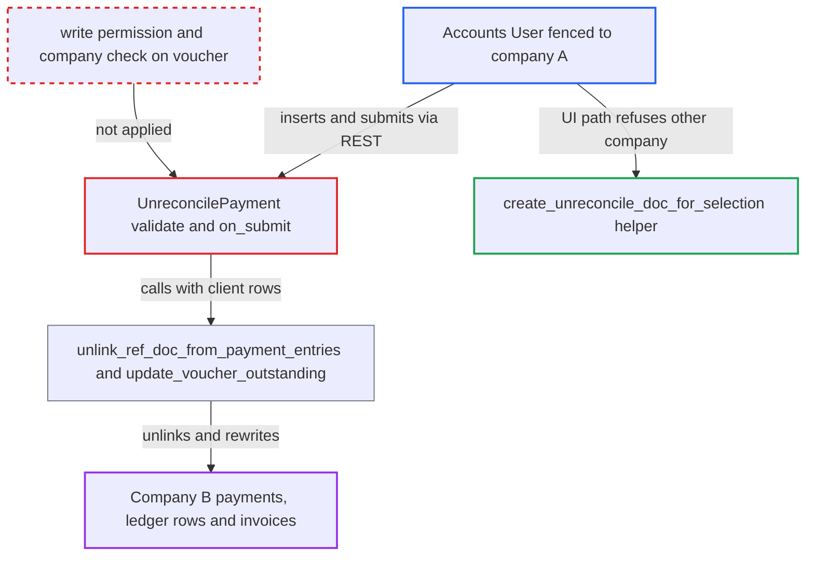

# Unreconcile Payment doctype unlinks other companies' payments without voucher permission check

| Field | Value |
|---|---|
| ID | `find_01VebsyypaQ3uKQnDLQP9ora` |
| Severity | **High** |
| Status | open |
| CWE | CWE-862 — Missing Authorization |
| Created | 2026-10-27T21:11:17.440729Z |
| Claude Security | https://claude.ai/security/findings/find_01VebsyypaQ3uKQnDLQP9ora |

## Description

A user with the Accounts User role who is restricted to one company can undo payment allocations in other companies. Payments become unallocated and invoices go back to unpaid. The attacker only needs to insert and submit an `Unreconcile Payment` document through the REST API. The controller never checks write permission on `voucher_no` or that the voucher belongs to `self.company`.

1. **Attacker (Accounts User fenced to company A)** posts an `Unreconcile Payment` through `/api/resource/Unreconcile Payment`. The document sets `company` to A, `voucher_type` to `Payment Entry`, `voucher_no` to a Payment Entry of company B and `allocations` to a Sales Invoice of company B, then it is submitted. ([`erpnext/accounts/doctype/unreconcile_payment/unreconcile_payment.json`](https://github.com/cx-benchmark/erpnext/blob/90e7aefca73da3c440d2e8da7472fcb67838e678/erpnext/accounts/doctype/unreconcile_payment/unreconcile_payment.json))
2. **the controller `UnreconcilePayment`** accepts the document after `validate()` checks only `voucher_type`. No check covers write permission on the voucher or whether the voucher and invoices belong to `self.company`. The `company` field is a Link the attacker set to their own permitted company, so Frappe user permissions do not stop it. ([`erpnext/accounts/doctype/unreconcile_payment/unreconcile_payment.py:45-81`](https://github.com/cx-benchmark/erpnext/blob/90e7aefca73da3c440d2e8da7472fcb67838e678/erpnext/accounts/doctype/unreconcile_payment/unreconcile_payment.py#L45-L81))
3. **the controller `on_submit()`** loads each client-supplied allocation row with `frappe.get_doc` and unlinks it from the voucher. The rows are trusted as sent and nothing confirms they are real references of the voucher. A row that is not actually linked fails silently. ([`erpnext/accounts/doctype/unreconcile_payment/unreconcile_payment.py:45-81`](https://github.com/cx-benchmark/erpnext/blob/90e7aefca73da3c440d2e8da7472fcb67838e678/erpnext/accounts/doctype/unreconcile_payment/unreconcile_payment.py#L45-L81))
4. **the helper `unlink_ref_doc_from_payment_entries`** rewrites the other company's ledger records with raw query-builder updates. It zeroes Payment Entry Reference allocations, recomputes the PE unallocated amount, resets GL `against_voucher` and PLE `against_voucher_no`, and delinks advance ledger rows. None of this is permission-checked. ([`erpnext/accounts/utils.py:1035-1039`](https://github.com/cx-benchmark/erpnext/blob/90e7aefca73da3c440d2e8da7472fcb67838e678/erpnext/accounts/utils.py#L1035-L1039))
5. **the function `update_voucher_outstanding`** recomputes the invoice outstanding and status and writes them back. It writes with `frappe.db.set_value` and `set_status(update=True)` without a permission check. The other company's invoice goes back to Unpaid or Overdue. ([`erpnext/accounts/utils.py:2206-2259`](https://github.com/cx-benchmark/erpnext/blob/90e7aefca73da3c440d2e8da7472fcb67838e678/erpnext/accounts/utils.py#L2206-L2259))

## Assessment

The attacker is a desk user with the Accounts User role who is fenced by a Company user permission to company A. Accounts Manager also has create and submit on the doctype. The attacker needs no victim action. Voucher and invoice names follow predictable naming series, so they can be guessed. The attacker can also set `party_type` and `party` on the request. The only route in is the standard REST or form insert and submit of `Unreconcile Payment`, because the permission check lives in `create_unreconcile_doc_for_selection`, outside the controller. The report assumes Frappe >=17.0.0-dev, \<18.

Impact: The attacker can modify the financial records of any company they are fenced out of. Payment allocations are zeroed, the Payment Entry becomes unallocated, GL and PLE against-links are rewritten, and invoice outstanding and status revert to unpaid. Advance GL entries are reversed where advances are booked separately. No amounts are created, and re-reconciling repairs the damage. One limit: a reconciliation that has an exchange gain/loss Journal Entry aborts and rolls back, because that cancel goes through `Document.cancel()`, which checks permissions. Same-currency reconciliations have none and go through. Disclosure is limited to un-link messages, and availability is unaffected.

## Recommendation

(1) `UnreconcilePayment.validate` and `on_submit` act on `voucher_no` and the client-supplied `allocations` without checking that the submitter may write the voucher or that it belongs to `self.company`. This breaks the company user-permission boundary.

Fix criteria: Before any state change, the controller itself refuses unless the submitter has write permission on `voucher_type` and `voucher_no`, user permissions included, and the voucher's company equals `self.company`. A Company-restricted Accounts User who inserts and submits an `Unreconcile Payment` naming another company's Payment Entry or Journal Entry through `/api/resource` gets a PermissionError. That PE, its GL and PLE rows and the invoice stay unchanged.

(2) `on_submit` trusts the `reference_doctype`, `reference_name`, `account`, `party_type` and `party` values sent by the client instead of the voucher's real ledger references.

Fix criteria: Each allocation row processed on submit matches an actual linked reference of the voucher, for example one returned by `get_linked_payments_for_doc` for that voucher and company. Account and party values come from the ledger, not the client. A row naming an unrelated or cross-company document is rejected.

## Evidence

**https://github.com/cx-benchmark/erpnext**

- [`erpnext/accounts/doctype/unreconcile_payment/unreconcile_payment.py:45-81`](https://github.com/cx-benchmark/erpnext/blob/90e7aefca73da3c440d2e8da7472fcb67838e678/erpnext/accounts/doctype/unreconcile_payment/unreconcile_payment.py#L45-L81)
- [`erpnext/accounts/doctype/unreconcile_payment/unreconcile_payment.py:354-383`](https://github.com/cx-benchmark/erpnext/blob/90e7aefca73da3c440d2e8da7472fcb67838e678/erpnext/accounts/doctype/unreconcile_payment/unreconcile_payment.py#L354-L383)
- [`erpnext/accounts/doctype/unreconcile_payment/unreconcile_payment.json`](https://github.com/cx-benchmark/erpnext/blob/90e7aefca73da3c440d2e8da7472fcb67838e678/erpnext/accounts/doctype/unreconcile_payment/unreconcile_payment.json)
- [`erpnext/accounts/utils.py:1035-1039`](https://github.com/cx-benchmark/erpnext/blob/90e7aefca73da3c440d2e8da7472fcb67838e678/erpnext/accounts/utils.py#L1035-L1039)
- [`erpnext/accounts/utils.py:2206-2259`](https://github.com/cx-benchmark/erpnext/blob/90e7aefca73da3c440d2e8da7472fcb67838e678/erpnext/accounts/utils.py#L2206-L2259)
- [`erpnext/accounts/doctype/unreconcile_payment/test_unreconcile_payment.py:628-666`](https://github.com/cx-benchmark/erpnext/blob/90e7aefca73da3c440d2e8da7472fcb67838e678/erpnext/accounts/doctype/unreconcile_payment/test_unreconcile_payment.py#L628-L666)

