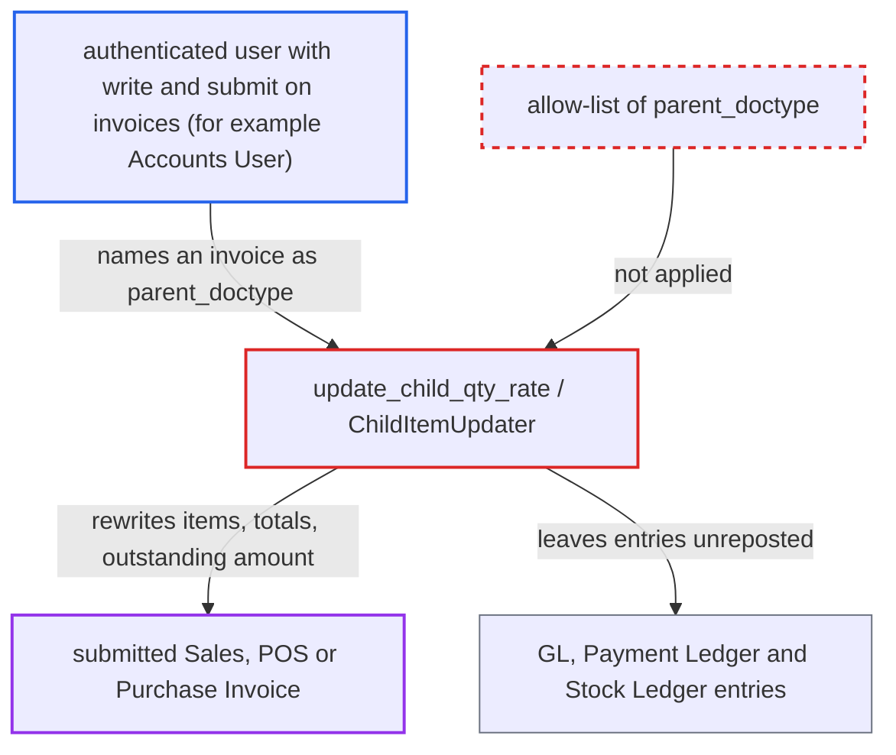

# Update Items API accepts invoice doctypes, rewriting posted invoices without ledger repost

| Field | Value |
|---|---|
| ID | `find_01UkmQUSHtrsSrX8JVv8iBQT` |
| Severity | **High** |
| Status | open |
| CWE | CWE-285 — Improper Authorization |
| Created | 2026-10-27T21:53:45.768841Z |
| Claude Security | https://claude.ai/security/findings/find_01UkmQUSHtrsSrX8JVv8iBQT |

## Description

A logged-in desk user who can write and submit Sales Invoice, POS Invoice or Purchase Invoice, such as the stock `Accounts User` role, can rewrite posted invoices. They can change items, quantities, rates, totals and `outstanding_amount` without a cancel or amend and without a ledger repost. The whitelisted `update_child_qty_rate` never limits `parent_doctype` to orders and quotations. Its only checks are write permission and Frappe's submit check.

1. **authenticated user** posts a request to the `update_child_qty_rate` API naming an invoice. The request sets `parent_doctype` to `Sales Invoice`, `POS Invoice` or `Purchase Invoice`. It lists each row's `docname` with a new `qty`, `rate`, `uom` or `description`. ([`erpnext/accounts/services/child_item_update.py:519-523`](https://github.com/cx-benchmark/erpnext/blob/90e7aefca73da3c440d2e8da7472fcb67838e678/erpnext/accounts/services/child_item_update.py#L519-L523))
2. **`ChildItemUpdater.__init__`** loads the named document with `frappe.get_doc`. No allow-list limits the doctype to Sales Order, Purchase Order, Quotation or Supplier Quotation, so a submitted invoice loads. The only authorization is write permission on that parent. ([`erpnext/accounts/services/child_item_update.py:33-38`](https://github.com/cx-benchmark/erpnext/blob/90e7aefca73da3c440d2e8da7472fcb67838e678/erpnext/accounts/services/child_item_update.py#L33-L38))
3. **`ChildItemUpdater`** writes the request's values into the invoice item rows. Rows are saved with `ignore_validate_update_after_submit` and `ignore_permissions=True`. No invoice-specific validation rejects the change. ([`erpnext/accounts/services/child_item_update.py:126-148`](https://github.com/cx-benchmark/erpnext/blob/90e7aefca73da3c440d2e8da7472fcb67838e678/erpnext/accounts/services/child_item_update.py#L126-L148))
4. **`_post_update`** recomputes totals, taxes, in-words text and payment schedule, then saves the submitted invoice. It saves with `flags.ignore_validate_update_after_submit` set, which turns off Frappe's guard on immutable submitted fields. The `outstanding_amount` is derived from the new grand total. ([`erpnext/accounts/services/child_item_update.py:182-223`](https://github.com/cx-benchmark/erpnext/blob/90e7aefca73da3c440d2e8da7472fcb67838e678/erpnext/accounts/services/child_item_update.py#L182-L223))
5. **invoice `on_update_after_submit` hooks** skip the ledger repost. They repost only when an account, cost centre, project or dimension changes. A change of quantity or rate leaves GL, Payment Ledger and Stock Ledger entries as they were posted. ([`erpnext/accounts/doctype/sales_invoice/sales_invoice.py:1261-1278`](https://github.com/cx-benchmark/erpnext/blob/90e7aefca73da3c440d2e8da7472fcb67838e678/erpnext/accounts/doctype/sales_invoice/sales_invoice.py#L1261-L1278))
6. **`validate_and_delete_children`** runs `update_prevdoc_status()` only before the rows are edited. Nothing runs it again afterwards. The linked order's `billed_amt` and the over-billing check never see the new amounts. ([`erpnext/accounts/services/child_item_update.py:738-741`](https://github.com/cx-benchmark/erpnext/blob/90e7aefca73da3c440d2e8da7472fcb67838e678/erpnext/accounts/services/child_item_update.py#L738-L741))

## Assessment

The attacker is an authenticated desk user with write and submit permission on Sales Invoice, POS Invoice or Purchase Invoice. The stock `Accounts User` role is one example. They call `/api/method/erpnext.controllers.accounts_controller.update_child_qty_rate` directly. The desk dialog only offers this on order and quotation forms. No victim interaction is needed. Only invoices the user can write are reachable. The report notes that rows can also be added, and on Purchase Invoice deleted. It relies on Frappe behaviour that is not in the checkout: `frappe.get_doc` checks no permission, and saving a submitted document needs only the `submit` permission.

Impact: Items, totals, `outstanding_amount`, payment schedule and in-words text of already-posted invoices are changed in place, with no cancel or amend trail. The invoice shown to the counterparty and the invoice-based reports, such as Sales Register, no longer match the books. The linked order's billed amount and over-billing check are skipped. The role that may not cancel an invoice can effectively rewrite it. Limits: the ledger entries themselves are unchanged, and Payment Entry allocation is still checked against the Payment Ledger.

## Recommendation

`update_child_qty_rate` and `ChildItemUpdater` accept any `parent_doctype`. The order-specific Update Items logic turns off update-after-submit validation and saves rows with `ignore_permissions`. That logic therefore runs on submitted accounting documents it was not designed for.

Fix criteria: The endpoint refuses any `parent_doctype` outside Sales Order, Purchase Order, Quotation and Supplier Quotation before it loads or changes anything. A call naming Sales Invoice, POS Invoice, Purchase Invoice or any other doctype returns an error and leaves parent and rows unchanged. To verify, call the API directly as Accounts User against a submitted Sales Invoice: items, totals and `outstanding_amount` must stay unchanged.

## Evidence

**https://github.com/cx-benchmark/erpnext**

- [`erpnext/accounts/services/child_item_update.py:519-523`](https://github.com/cx-benchmark/erpnext/blob/90e7aefca73da3c440d2e8da7472fcb67838e678/erpnext/accounts/services/child_item_update.py#L519-L523)
- [`erpnext/accounts/services/child_item_update.py:33-38`](https://github.com/cx-benchmark/erpnext/blob/90e7aefca73da3c440d2e8da7472fcb67838e678/erpnext/accounts/services/child_item_update.py#L33-L38)
- [`erpnext/accounts/services/child_item_update.py:126-148`](https://github.com/cx-benchmark/erpnext/blob/90e7aefca73da3c440d2e8da7472fcb67838e678/erpnext/accounts/services/child_item_update.py#L126-L148)
- [`erpnext/accounts/services/child_item_update.py:182-223`](https://github.com/cx-benchmark/erpnext/blob/90e7aefca73da3c440d2e8da7472fcb67838e678/erpnext/accounts/services/child_item_update.py#L182-L223)
- [`erpnext/accounts/services/child_item_update.py:738-741`](https://github.com/cx-benchmark/erpnext/blob/90e7aefca73da3c440d2e8da7472fcb67838e678/erpnext/accounts/services/child_item_update.py#L738-L741)
- [`erpnext/accounts/doctype/sales_invoice/sales_invoice.py:1261-1278`](https://github.com/cx-benchmark/erpnext/blob/90e7aefca73da3c440d2e8da7472fcb67838e678/erpnext/accounts/doctype/sales_invoice/sales_invoice.py#L1261-L1278)
- [`erpnext/accounts/doctype/purchase_invoice/purchase_invoice.py:770-781`](https://github.com/cx-benchmark/erpnext/blob/90e7aefca73da3c440d2e8da7472fcb67838e678/erpnext/accounts/doctype/purchase_invoice/purchase_invoice.py#L770-L781)
- [`erpnext/controllers/taxes_and_totals.py:1058-1165`](https://github.com/cx-benchmark/erpnext/blob/90e7aefca73da3c440d2e8da7472fcb67838e678/erpnext/controllers/taxes_and_totals.py#L1058-L1165)
- [`erpnext/accounts/doctype/sales_invoice/sales_invoice.json:2433-2444`](https://github.com/cx-benchmark/erpnext/blob/90e7aefca73da3c440d2e8da7472fcb67838e678/erpnext/accounts/doctype/sales_invoice/sales_invoice.json#L2433-L2444)
- [`erpnext/public/js/utils.js:1096-1105`](https://github.com/cx-benchmark/erpnext/blob/90e7aefca73da3c440d2e8da7472fcb67838e678/erpnext/public/js/utils.js#L1096-L1105)
- [`erpnext/selling/doctype/sales_order/test_sales_order.py:1456-1499`](https://github.com/cx-benchmark/erpnext/blob/90e7aefca73da3c440d2e8da7472fcb67838e678/erpnext/selling/doctype/sales_order/test_sales_order.py#L1456-L1499)

