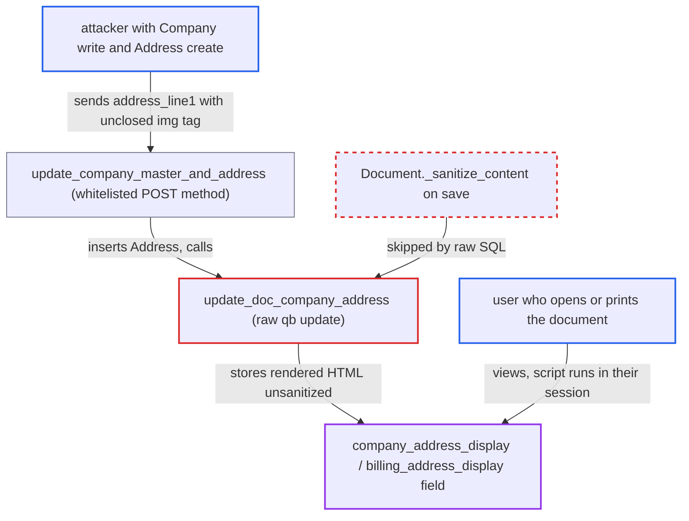

# update_doc_company_address writes rendered address HTML into transactions via raw query-builder update

| Field | Value |
|---|---|
| ID | `find_01RpHnFvjWBfDbdaxWfcU3gp` |
| Severity | **High** |
| Status | open |
| CWE | CWE-79 — Cross-site scripting |
| Created | 2026-10-27T21:55:46.142837Z |
| Claude Security | https://claude.ai/security/findings/find_01RpHnFvjWBfDbdaxWfcU3gp |

## Description

A user with high privileges can store a live script in a sales or purchase document's address display. Anyone who later opens or prints that document runs it in their desk session. The attacker needs write on the document, write on the Company (System Manager, Accounts Manager or HR Manager) and Address create. `update_doc_company_address` writes the rendered address with a raw query-builder update, which skips HTML sanitizing.

1. **attacker** posts to the whitelisted method `update_company_master_and_address`. The attacker needs write on the target document, write on the Company and Address create, and sends `details.address_line1` as `` without escaping, so the display becomes `...`, which is a live tag with a working `onerror`. ([`erpnext/regional/address_template/templates/united_states.html:1-4`](https://github.com/cx-benchmark/erpnext/blob/90e7aefca73da3c440d2e8da7472fcb67838e678/erpnext/regional/address_template/templates/united_states.html#L1-L4))
4. **`update_doc_company_address`** writes the rendered HTML into `company_address_display` or `billing_address_display` with `frappe.qb.update(...).run()`. A raw SQL update never runs `Document._sanitize_content`, so the markup is stored as it is. The guard at line 2136 is skipped when `details.address_line1` is set, so any writable document can be overwritten. ([`erpnext/controllers/accounts_controller.py:2114-2147`](https://github.com/cx-benchmark/erpnext/blob/90e7aefca73da3c440d2e8da7472fcb67838e678/erpnext/controllers/accounts_controller.py#L2114-L2147))
5. **victim user** opens or prints the document. The field is a visible read-only Text Editor on Quotation, Sales Order and Delivery Note, and it is rendered as HTML in the desk form and the shipped print formats. The script runs in the victim's desk session. ([`erpnext/selling/doctype/quotation/quotation.json:956-961`](https://github.com/cx-benchmark/erpnext/blob/90e7aefca73da3c440d2e8da7472fcb67838e678/erpnext/selling/doctype/quotation/quotation.json#L956-L961))

## Assessment

The attacker is a logged-in user who holds write on the target document (a Quotation, Sales Order, Delivery Note, Sales Invoice, Purchase Order, Purchase Invoice or RFQ) and write on the Company, which `company.json` grants to System Manager, Accounts Manager or HR Manager. They also need Address create. The payload is stored by the document's own display field. On Quotation, Sales Order and Delivery Note this is `company_address_display`, which is printed by the shipped formats. On Purchase Order, Purchase Invoice and RFQ it is `billing_address_display`, which is visible and printed. On Sales Invoice `company_address_display` is visible in the form but hidden in print. The attack runs when any user later opens or prints the document, which is routine work. The stored value stays until the next draft save re-renders and sanitizes it. On submitted documents it stays for good, if Frappe's `has_permission(..., 'write')` passes for them, which the report assumes without confirming. Two points rest on the report's assumptions: that `frappe.utils.sanitize_html` returns a value with no complete tag unchanged, and that the Text Editor formatter renders the field as HTML. A second way in exists through `details.company_address`, which accepts an Address not linked to the company. It only fires when the display is empty, and rendering by name checks Address read permission.

Impact: The attacker runs script in the desk origin with the victim's session and CSRF token. The script can read business and financial data and create, submit or change documents and settings within the victim's roles. For a System Manager that is full control of the site. The report says the code puts no limit on the script.

## Recommendation

(1) `update_doc_company_address` stores Address Template output in a Text Editor field with a raw query-builder update. This skips the framework's save-time HTML sanitizing and the checks on updating submitted documents.

Fix criteria: The display HTML is sanitized (for example with `frappe.utils.sanitize_html`), or the update goes through the Document API (`doc.save()` or `db_set` on a sanitized value). No unsanitized markup can then reach `*_address_display`. The method also refuses to alter submitted documents, or restricts itself to `allow_on_submit` fields. A call to `update_company_master_and_address` with `address_line1 = '<img src=x onerror=alert(1)//'` leaves a stored `company_address_display` that contains no `onerror` and no unclosed `<img`.

(2) `details.company_address` is accepted as any Address name without checking that it is linked to `company`. An attacker-controlled Address can therefore be rendered into the transaction.

Fix criteria: Only Addresses linked to the given Company (Dynamic Link `Company`/`company`) can be set as the transaction's company address. Passing an unrelated Address name is rejected, and this has been tested.

## Evidence

**https://github.com/cx-benchmark/erpnext**

- [`erpnext/controllers/accounts_controller.py:2114-2147`](https://github.com/cx-benchmark/erpnext/blob/90e7aefca73da3c440d2e8da7472fcb67838e678/erpnext/controllers/accounts_controller.py#L2114-L2147)
- [`erpnext/controllers/accounts_controller.py:2056-2111`](https://github.com/cx-benchmark/erpnext/blob/90e7aefca73da3c440d2e8da7472fcb67838e678/erpnext/controllers/accounts_controller.py#L2056-L2111)
- [`erpnext/selling/doctype/quotation/quotation.json:956-961`](https://github.com/cx-benchmark/erpnext/blob/90e7aefca73da3c440d2e8da7472fcb67838e678/erpnext/selling/doctype/quotation/quotation.json#L956-L961)
- [`erpnext/regional/address_template/templates/united_states.html:1-4`](https://github.com/cx-benchmark/erpnext/blob/90e7aefca73da3c440d2e8da7472fcb67838e678/erpnext/regional/address_template/templates/united_states.html#L1-L4)

