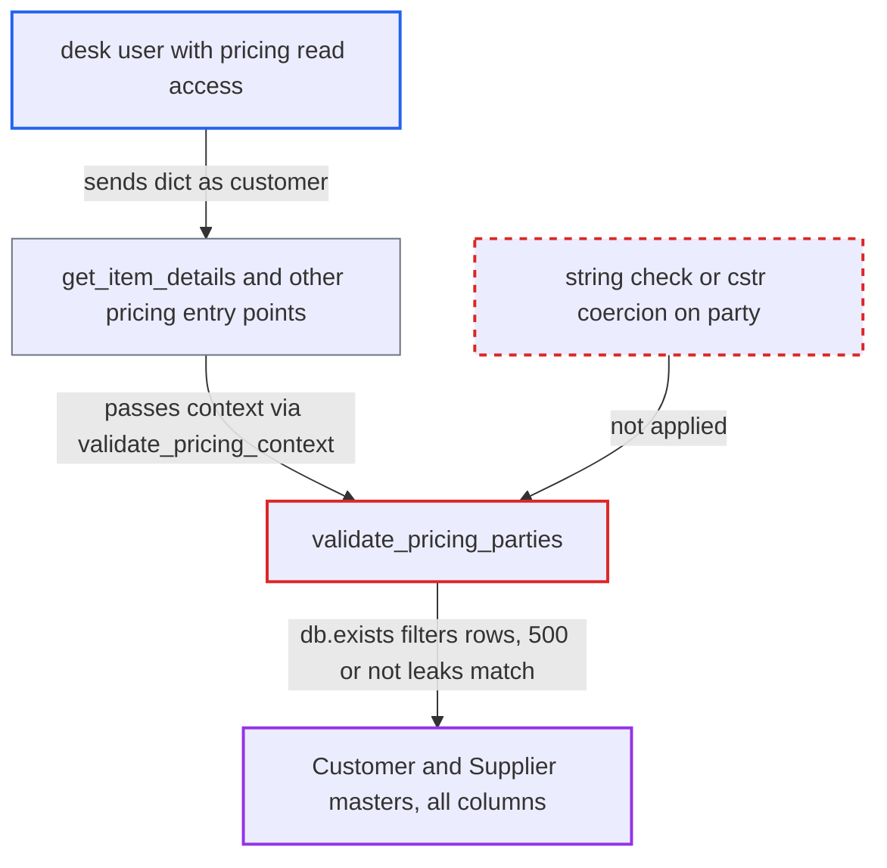

# validate_pricing_parties runs db.exists on dict customer/supplier before permission check, party oracle

| Field | Value |
|---|---|
| ID | `find_011w15sPRrj4oP8HF5eDpAFv` |
| Severity | **High** |
| Status | open |
| CWE | CWE-639 — Improper Authorization |
| Created | 2026-10-27T22:13:40.488201Z |
| Claude Security | https://claude.ai/security/findings/find_011w15sPRrj4oP8HF5eDpAFv |

## Description

A logged-in desk user can learn the contents of the Customer and Supplier masters one yes/no answer at a time. This includes records hidden from them by User Permissions and Company Restriction. The attacker needs a role that can price a transaction, meaning read access on one `PRICING_TRANSACTION_DOCTYPES` doctype. The cause is `validate_pricing_parties`, which passes a caller-supplied `customer` or `supplier` to `frappe.db.exists` before any permission check and without requiring a string.

1. **Attacker** posts a pricing request whose `customer` is an object. The `ctx` JSON carries a filter such as a `tax_id` `like` condition in place of a customer name, sent to the whitelisted `get_item_details`. ([`erpnext/stock/get_item_details.py:84-90`](https://github.com/cx-benchmark/erpnext/blob/90e7aefca73da3c440d2e8da7472fcb67838e678/erpnext/stock/get_item_details.py#L84-L90))
2. **the gate `validate_pricing_context`** accepts the context and calls `validate_pricing_parties`. It allow-lists the doctype but never requires `customer` or `supplier` to be a string, and every pricing entry point goes through it. ([`erpnext/accounts/doctype/pricing_rule/pricing_rule.py:766-795`](https://github.com/cx-benchmark/erpnext/blob/90e7aefca73da3c440d2e8da7472fcb67838e678/erpnext/accounts/doctype/pricing_rule/pricing_rule.py#L766-L795))
3. **`validate_pricing_parties`** runs `frappe.db.exists` on the dict before authorising the party. Frappe treats a dict in the name position as a set of filters, so the query runs over every column of the party master. ([`erpnext/accounts/doctype/pricing_rule/pricing_rule.py:797-801`](https://github.com/cx-benchmark/erpnext/blob/90e7aefca73da3c440d2e8da7472fcb67838e678/erpnext/accounts/doctype/pricing_rule/pricing_rule.py#L797-L801))
4. **`frappe.has_permission`** crashes when a row matched, and is skipped when none matched. A match passes a plain dict as `doc`, which raises inside Frappe and returns HTTP 500. With no match the request continues normally with HTTP 200 or an unrelated validation error. ([`erpnext/accounts/doctype/pricing_rule/pricing_rule.py:797-801`](https://github.com/cx-benchmark/erpnext/blob/90e7aefca73da3c440d2e8da7472fcb67838e678/erpnext/accounts/doctype/pricing_rule/pricing_rule.py#L797-L801))
5. **Attacker** repeats the request with narrower filters. HTTP 500 means a match and any other response means no match, so each request gives one bit and the column values can be found by binary search.

## Assessment

The attacker is any authenticated desk user with doctype-level read on one pricing transaction doctype (for example Sales User on Quotation) and read on one Item. They POST to `/api/method/erpnext.stock.get_item_details.get_item_details` with a `ctx` whose `customer` is an object of filters. The same flaw is reachable through `apply_price_list`, `get_batch_based_item_price`, `get_blanket_order_details` and `apply_pricing_rule`, and through `supplier` in the same way. No victim action is needed. The report relies on assumptions about Frappe that are not in the checkout: `frappe.db.exists` resolves a dict as filters, `has_permission` raises on a plain dict, and a JSON body delivers nested objects as dicts.

Impact: The attacker can read any column of the Customer and Supplier masters as a blind yes/no oracle. Examples are `customer_name`, `tax_id`, `mobile_no`, `email_id`, payment terms and status flags. This covers all companies and territories and bypasses User Permissions and Company Restriction. It gives one bit per request and can be automated. The report states no write or availability effect.

## Recommendation

`validate_pricing_parties` evaluates a caller-shaped party value with `frappe.db.exists` before authorising it and without requiring a plain string. A dict therefore acts as a filter, and the crash-or-continue behaviour reveals the result.

Fix criteria: Party values in the pricing context are required to be plain strings, or are coerced with `cstr()` as `erpnext.require_party_permission` does, before any lookup. The behaviour for a non-string value does not depend on database contents. Sending a dict as `customer` or `supplier` returns the same validation error whether or not any party matches the filter.

## Evidence

**https://github.com/cx-benchmark/erpnext**

- [`erpnext/accounts/doctype/pricing_rule/pricing_rule.py:797-801`](https://github.com/cx-benchmark/erpnext/blob/90e7aefca73da3c440d2e8da7472fcb67838e678/erpnext/accounts/doctype/pricing_rule/pricing_rule.py#L797-L801)
- [`erpnext/accounts/doctype/pricing_rule/pricing_rule.py:766-795`](https://github.com/cx-benchmark/erpnext/blob/90e7aefca73da3c440d2e8da7472fcb67838e678/erpnext/accounts/doctype/pricing_rule/pricing_rule.py#L766-L795)
- [`erpnext/stock/get_item_details.py:84-90`](https://github.com/cx-benchmark/erpnext/blob/90e7aefca73da3c440d2e8da7472fcb67838e678/erpnext/stock/get_item_details.py#L84-L90)
- [`erpnext/__init__.py:231-243`](https://github.com/cx-benchmark/erpnext/blob/90e7aefca73da3c440d2e8da7472fcb67838e678/erpnext/__init__.py#L231-L243)

