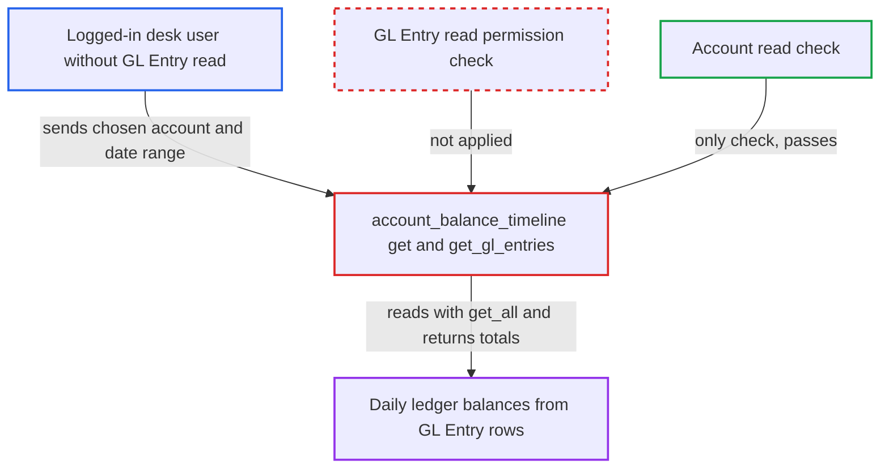

# Account Balance Timeline chart source reads GL Entry rows with only Account permission

| Field | Value |
|---|---|
| ID | `find_011GzBzGzp3W6Z5jp8huoFDb` |
| Severity | **Medium** |
| Status | open |
| CWE | CWE-862 — Missing Authorization |
| Created | 2026-10-27T22:03:58.505080Z |
| Claude Security | https://claude.ai/security/findings/find_011GzBzGzp3W6Z5jp8huoFDb |

## Description

A logged-in desk user who can read Accounts but not GL Entry, such as a Sales User or Purchase User, can get day-by-day ledger balances for any account they can read. This includes company-wide totals through root accounts. The whitelisted `get` method in `account_balance_timeline` checks only Account read, then reads GL Entry rows with `frappe.db.get_all`, which skips role and user permissions.

1. **Attacker (desk user with Account read)** posts a request to the `account_balance_timeline.get` method under `/api/method`. The request carries `filters` with the chosen `company` and `account`, and these override the chart's own `filters_json`, so the attacker picks the account. ([`erpnext/accounts/dashboard_chart_source/account_balance_timeline/account_balance_timeline.py:13-39`](https://github.com/cx-benchmark/erpnext/blob/90e7aefca73da3c440d2e8da7472fcb67838e678/erpnext/accounts/dashboard_chart_source/account_balance_timeline/account_balance_timeline.py#L13-L39))
2. **the method `get`** loads the chart definition. With `chart_name` the Dashboard Chart is loaded with a read check, but with a `chart` JSON object no Dashboard Chart permission is consulted at all. ([`erpnext/accounts/dashboard_chart_source/account_balance_timeline/account_balance_timeline.py:13-39`](https://github.com/cx-benchmark/erpnext/blob/90e7aefca73da3c440d2e8da7472fcb67838e678/erpnext/accounts/dashboard_chart_source/account_balance_timeline/account_balance_timeline.py#L13-L39))
3. **the method `get`** checks only that the caller can read the `Account`. This `frappe.has_permission("Account", doc=account, throw=True)` call is the only authorisation on the data, and Sales User and Purchase User pass it. ([`erpnext/accounts/dashboard_chart_source/account_balance_timeline/account_balance_timeline.py:52-77`](https://github.com/cx-benchmark/erpnext/blob/90e7aefca73da3c440d2e8da7472fcb67838e678/erpnext/accounts/dashboard_chart_source/account_balance_timeline/account_balance_timeline.py#L52-L77))
4. **the function `get_gl_entries`** collects the account's descendants and reads their GL Entry rows. It uses `get_descendants_of(..., ignore_permissions=True)` and then `frappe.db.get_all` to read `posting_date`, `debit` and `credit`, with no role or user permission applied. ([`erpnext/accounts/dashboard_chart_source/account_balance_timeline/account_balance_timeline.py:106-119`](https://github.com/cx-benchmark/erpnext/blob/90e7aefca73da3c440d2e8da7472fcb67838e678/erpnext/accounts/dashboard_chart_source/account_balance_timeline/account_balance_timeline.py#L106-L119))
5. **the method `get`** returns per-period balances to the caller. `build_result` folds the rows into net movements, or cumulative balances for balance-sheet accounts, returned as `datasets[0].values` with their dates. ([`erpnext/accounts/dashboard_chart_source/account_balance_timeline/account_balance_timeline.py:52-77`](https://github.com/cx-benchmark/erpnext/blob/90e7aefca73da3c440d2e8da7472fcb67838e678/erpnext/accounts/dashboard_chart_source/account_balance_timeline/account_balance_timeline.py#L52-L77))

## Assessment

The attacker is a logged-in desk user with Account read but no GL Entry read, such as a Sales User or Purchase User. The report names no setting needed and no victim action, and describes a default install. The attacker posts to `/api/method/erpnext.accounts.dashboard_chart_source.account_balance_timeline.account_balance_timeline.get` with `filters` naming the `company` and `account`, `no_cache=1`, and a date window with `time_interval` set to `Daily`. There are two ways to pass the chart. One is a `chart` JSON object, the path used for unsaved-chart previews, which has no Dashboard Chart read check. The other is `chart_name` naming a shipped chart such as `Bank Balance` (`is_public=1`, `roles=[]`) or the setup-wizard `Income` or `Expenses` charts, with `filters` pointing the query at any account. The report assumes the upstream Frappe `cache_source` wrapper forwards the `chart` dict and `no_cache`, and says that if it does not, the `chart_name` path still reaches the same query.

Impact: The attacker sees time-series ledger balances, down to daily net movement, for any account they can read. This includes company-wide totals through root or group accounts. Individual GL rows, vouchers and parties are not returned, only aggregates per period. Nothing is modified and service is not disrupted.

## Recommendation

(1) `account_balance_timeline.get` treats Account read as enough authorisation, then reads GL Entry rows with the permission-ignoring `frappe.db.get_all`. Ledger data therefore reaches users who hold no GL Entry permission.

Fix criteria: The endpoint requires GL Entry read permission for the caller and applies the caller's GL Entry user-permission conditions when collecting rows. For example, it uses `frappe.has_permission("GL Entry", "read", throw=True)` plus a permission-aware query such as `frappe.get_list` or `frappe.get_query(ignore_permissions=False)` instead of `frappe.db.get_all`. Calling the method as a Sales User with `filters` naming a readable account is refused. An Accounts User still receives the series.

(2) The `chart` dict branch accepts an unsaved chart definition without any Dashboard Chart permission check. The caller's `filters` also override the saved chart's filters. Saved-chart authorisation therefore never limits which account is queried.

Fix criteria: Data access does not depend on which chart document the caller names. Whichever branch is taken, the GL Entry permission check runs on the effective `account`. Supplying `chart` as a dict, or overriding `filters` on a saved chart, returns no GL data to a user who lacks GL Entry read.

## Evidence

**https://github.com/cx-benchmark/erpnext**

- [`erpnext/accounts/dashboard_chart_source/account_balance_timeline/account_balance_timeline.py:52-77`](https://github.com/cx-benchmark/erpnext/blob/90e7aefca73da3c440d2e8da7472fcb67838e678/erpnext/accounts/dashboard_chart_source/account_balance_timeline/account_balance_timeline.py#L52-L77)
- [`erpnext/accounts/dashboard_chart_source/account_balance_timeline/account_balance_timeline.py:106-119`](https://github.com/cx-benchmark/erpnext/blob/90e7aefca73da3c440d2e8da7472fcb67838e678/erpnext/accounts/dashboard_chart_source/account_balance_timeline/account_balance_timeline.py#L106-L119)
- [`erpnext/accounts/dashboard_chart_source/account_balance_timeline/account_balance_timeline.py:13-39`](https://github.com/cx-benchmark/erpnext/blob/90e7aefca73da3c440d2e8da7472fcb67838e678/erpnext/accounts/dashboard_chart_source/account_balance_timeline/account_balance_timeline.py#L13-L39)
- [`erpnext/accounts/doctype/account/account.json:218-254`](https://github.com/cx-benchmark/erpnext/blob/90e7aefca73da3c440d2e8da7472fcb67838e678/erpnext/accounts/doctype/account/account.json#L218-L254)
- [`erpnext/accounts/doctype/gl_entry/gl_entry.json:390-413`](https://github.com/cx-benchmark/erpnext/blob/90e7aefca73da3c440d2e8da7472fcb67838e678/erpnext/accounts/doctype/gl_entry/gl_entry.json#L390-L413)

